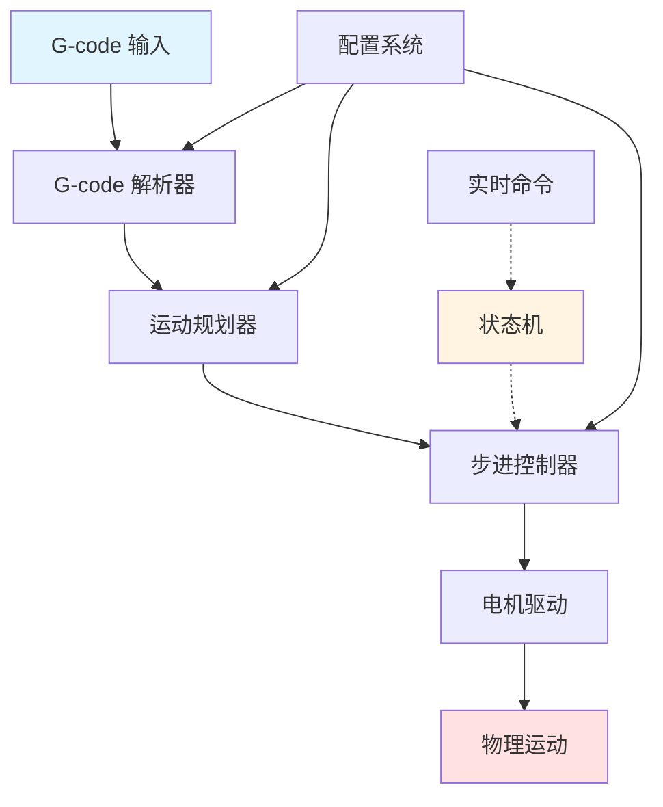
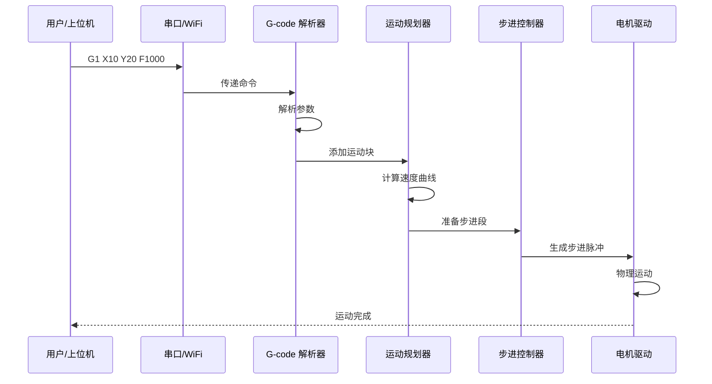
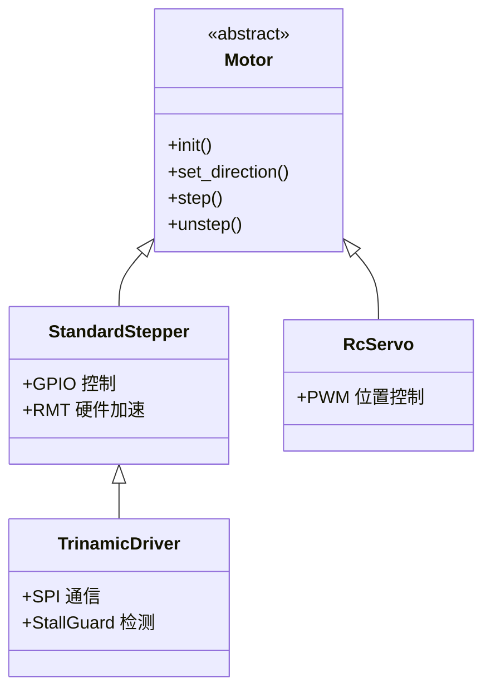
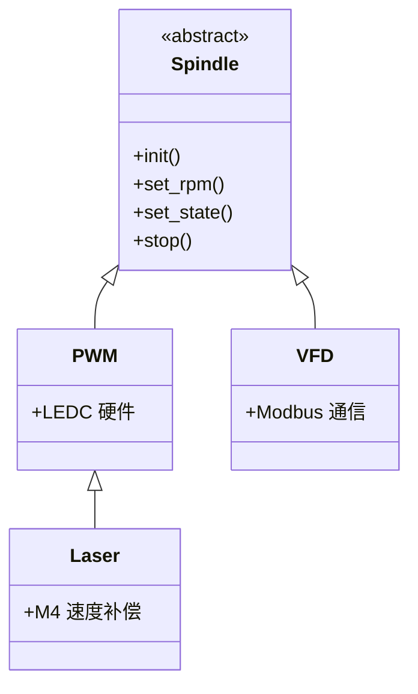
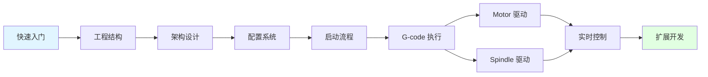

# Grbl_Esp32 快速入门

## 项目概述

Grbl_Esp32 是一个运行在 ESP32 微控制器上的开源 CNC（计算机数控）控制器固件，源自经典的 Grbl 项目。它将 Grbl 从 8 位 AVR 平台移植到 32 位 ESP32 平台，大幅提升了性能和功能。

### 核心特性

- **多轴支持**：最多支持 6 轴协调控制（XYZABC），每轴可配置 1-2 个电机（Ganged）
- **高速步进**：步进速率高达 120,000 步/秒
- **多种电机驱动**：标准步进、Trinamic（SPI/UART）、单极步进、RC 伺服、Dynamixel
- **多种主轴类型**：PWM、激光、RS485 Modbus VFD、DAC（0-10V）、继电器
- **丰富连接方式**：USB/Serial、Bluetooth、WiFi（AP/STA 模式）
- **Web 界面**：内置 Web 服务器和完整的 CNC 控制界面
- **扩展功能**：SD 卡支持、OTA 固件升级、推送通知

### 项目状态

- **维护模式**：现有功能保持维护，新功能开发已转向 [FluidNC](https://github.com/bdring/FluidNC)
- **硬件兼容**：所有 Grbl_ESP32 硬件与 FluidNC 兼容
- **稳定可靠**：经过多年实际应用验证

## 5 分钟了解核心概念

### 1. CNC 控制器的作用

CNC 控制器的核心任务是：
1. **接收 G-code 指令**（如 `G1 X10 Y20 F1000`）
2. **规划运动路径**（加速度、速度曲线）
3. **生成步进脉冲**（控制电机精确移动）
4. **监控限位开关**（防止超程、实现归零）
5. **控制主轴/激光**（开关、调速）

### 2. 系统架构概览



### 3. 关键模块

| 模块 | 文件 | 作用 |
|------|------|------|
| **G-code 解析器** | [GCode.cpp](../../Grbl_Esp32/src/GCode.cpp) | 解析 G-code 命令，提取运动参数 |
| **运动规划器** | [Planner.cpp](../../Grbl_Esp32/src/Planner.cpp) | 生成速度曲线，优化加速度 |
| **步进控制器** | [Stepper.cpp](../../Grbl_Esp32/src/Stepper.cpp) | 实时生成步进脉冲（ISR） |
| **Motor 驱动** | [Motors/](../../Grbl_Esp32/src/Motors/) | 硬件抽象层，支持多种电机 |
| **Spindle 驱动** | [Spindles/](../../Grbl_Esp32/src/Spindles/) | 主轴/激光控制 |
| **通信系统** | [Protocol.cpp](../../Grbl_Esp32/src/Protocol.cpp) | 处理串口/WiFi/蓝牙通信 |
| **配置系统** | [Settings.cpp](../../Grbl_Esp32/src/Settings.cpp) | 管理机器参数 |

### 4. 数据流概览



## 快速开始

### 1. 获取代码

```bash
git clone https://github.com/bdring/Grbl_Esp32.git
cd Grbl_Esp32
```

### 2. 选择机器配置

编辑 [Grbl_Esp32/src/Machine.h](../../Grbl_Esp32/src/Machine.h)：

```cpp
// 选择你的机器配置文件
#define MACHINE_FILENAME "Machines/3axis_v4.h"
```

可用的配置文件在 [Grbl_Esp32/src/Machines/](../../Grbl_Esp32/src/Machines/) 目录。

### 3. 编译上传

使用 PlatformIO：

```bash
pio run --target upload
```

### 4. 连接测试

使用串口工具（115200 波特率）连接 ESP32：

```
Grbl 1.3a [ESP32 v1.3a]
[MSG:Compiled with ESP32 SDK:v3.3.5-1-g85c43024c]
[MSG:Using machine:3axis_v4]
ok
```

发送 `$$` 查看设置：

```
$0=10    (Step pulse time, microseconds)
$1=255   (Step idle delay, milliseconds)
$2=0     (Step pulse invert, mask)
...
```

发送 `?` 查看状态：

```
<Idle|MPos:0.000,0.000,0.000|FS:0,0|WCO:0.000,0.000,0.000>
```

## 核心概念速查

### G-code 命令

| 命令 | 作用 | 示例 |
|------|------|------|
| `G0` | 快速定位 | `G0 X10 Y20` |
| `G1` | 直线插补 | `G1 X10 Y20 F1000` |
| `G2/G3` | 圆弧插补 | `G2 X10 Y10 I5 J0` |
| `M3` | 主轴正转 | `M3 S1000` |
| `M5` | 主轴停止 | `M5` |
| `$H` | 归零 | `$H` |
| `$$` | 查看设置 | `$$` |

### 实时命令

| 命令 | 作用 | 说明 |
|------|------|------|
| `?` | 状态报告 | 查询当前位置、状态 |
| `!` | 进给保持 | 暂停运动 |
| `~` | 循环启动 | 恢复运动 |
| `Ctrl+X` | 复位 | 软件复位 |

### 系统状态

| 状态 | 说明 |
|------|------|
| `Idle` | 空闲，等待命令 |
| `Run` | 运行中 |
| `Hold` | 保持（暂停） |
| `Alarm` | 报警（需要复位） |
| `Home` | 归零中 |
| `Jog` | 手动点动 |

## 配置系统概览

### 编译时配置

在机器定义文件中设置（如 `Machines/3axis_v4.h`）：

```cpp
// 定义轴引脚
#define X_STEP_PIN      GPIO_NUM_26
#define X_DIRECTION_PIN GPIO_NUM_16
#define X_LIMIT_PIN     GPIO_NUM_36

// 定义主轴类型
#define SPINDLE_TYPE        SpindleType::PWM
#define SPINDLE_OUTPUT_PIN  GPIO_NUM_2
```

### 运行时配置

通过 `$` 命令设置（存储在 NVS）：

```
$100=250.000  (X轴步进/mm)
$110=5000.000 (X轴最大速率, mm/min)
$120=500.000  (X轴加速度, mm/sec^2)
$130=200.000  (X轴最大行程, mm)
```

## 硬件抽象层

### Motor 驱动体系



### Spindle 驱动体系



## 扩展机制

### 弱函数覆盖

在机器配置文件中定义：

```cpp
// 自定义初始化
void machine_init() {
    // 初始化外部硬件
    pinMode(CUSTOM_PIN, OUTPUT);
}

// 自定义 M30（程序结束）行为
void user_m30() {
    // 关闭外部设备
    digitalWrite(CUSTOM_PIN, LOW);
}
```

### 条件编译

```cpp
#ifdef ENABLE_WIFI
    // WiFi 相关代码
#endif

#ifdef ENABLE_BLUETOOTH
    // 蓝牙相关代码
#endif
```

## 学习路线图



### 推荐学习顺序

1. **基础认知**（本文档）
   - 了解项目概况
   - 理解核心概念
   - 掌握基本操作

2. **工程结构**（下一篇）
   - 目录组织
   - 构建系统
   - 依赖关系

3. **架构设计**
   - 分层架构
   - 模块划分
   - 设计模式

4. **配置系统**
   - 编译时配置
   - 运行时设置
   - 机器定义文件

5. **核心流程**
   - 启动流程
   - G-code 执行路径
   - 实时命令处理

6. **硬件驱动**
   - Motor 驱动体系
   - Spindle 驱动体系
   - 辅助外设

7. **扩展开发**
   - 弱函数机制
   - 添加新驱动
   - 典型案例

## 常见问题

### Q: Grbl_Esp32 和 FluidNC 有什么区别？

**A**: Grbl_Esp32 是维护模式，FluidNC 是下一代项目。FluidNC 采用 YAML 配置文件，更易于配置，但 Grbl_Esp32 更稳定成熟。所有硬件兼容。

### Q: 如何选择机器配置文件？

**A**: 查看 `Machines/` 目录，选择与你硬件最接近的配置文件。如果没有完全匹配的，可以复制一个相似的进行修改。

### Q: 支持哪些 ESP32 开发板？

**A**: 理论上支持所有 ESP32 开发板，但需要注意 GPIO 引脚的可用性。推荐使用 ESP32-DevKitC 或类似开发板。

### Q: 如何调试？

**A**:
1. 使用串口监视器查看日志
2. 发送 `?` 命令查看实时状态
3. 发送 `$$` 命令查看设置
4. 检查 `$I` 查看构建信息

### Q: 步进电机不动怎么办？

**A**: 检查：
1. 引脚定义是否正确
2. 电机驱动是否上电
3. 使能引脚是否配置
4. 发送 `$X` 解除报警状态

## 下一步

阅读 [01_工程结构与构建系统.md](01_工程结构与构建系统.md) 了解项目的目录组织和构建配置。

## 参考资源

- **官方仓库**: https://github.com/bdring/Grbl_Esp32
- **Wiki**: https://github.com/bdring/Grbl_Esp32/wiki
- **FluidNC**: https://github.com/bdring/FluidNC
- **原始 Grbl**: https://github.com/gnea/grbl
- **G-code 参考**: http://linuxcnc.org/docs/html/gcode.html
