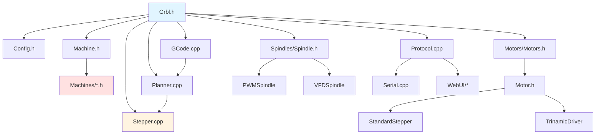

# 工程结构与构建系统

## 目录结构概览

```
Grbl_Esp32/
├── Grbl_Esp32/                    # 主源码目录
│   ├── src/                       # 核心源代码
│   │   ├── *.cpp, *.h            # 核心模块（约60个文件）
│   │   ├── Motors/               # 电机驱动（10个文件）
│   │   ├── Spindles/             # 主轴驱动（14个文件）
│   │   ├── Machines/             # 机器配置（39个文件）
│   │   └── WebUI/                # Web界面（16个文件）
│   ├── data/                      # Web界面资源文件
│   └── Grbl_Esp32.ino            # Arduino入口文件
├── libraries/                     # 第三方库（可选）
├── doc/                          # 文档目录
├── platformio.ini                # PlatformIO配置文件
└── README.md                     # 项目说明
```

## 核心源码目录详解

### 1. 根目录文件（src/）

| 文件 | 行数 | 作用 |
|------|------|------|
| [Grbl.h](../../Grbl_Esp32/src/Grbl.h) | 114 | 主头文件，包含所有模块 |
| [Grbl.cpp](../../Grbl_Esp32/src/Grbl.cpp) | ~200 | 系统初始化（grbl_init, run_once） |
| [Config.h](../../Grbl_Esp32/src/Config.h) | 609 | 编译时配置（功能开关、常量） |
| [Machine.h](../../Grbl_Esp32/src/Machine.h) | ~20 | 机器配置文件选择器 |
| [Defaults.h](../../Grbl_Esp32/src/Defaults.h) | ~100 | 默认设置值 |

**Grbl.h 的作用**：

```cpp
// Grbl_Esp32/src/Grbl.h (简化版)
#pragma once

#include <Arduino.h>
#include <EEPROM.h>
#include <driver/rmt.h>
#include <esp_task_wdt.h>
#include <freertos/task.h>

// 按依赖顺序包含所有模块
#include "Config.h"           // 编译时配置
#include "NutsBolts.h"        // 工具函数
#include "Defaults.h"         // 默认值
#include "Error.h"            // 错误定义
#include "System.h"           // 系统状态
#include "GCode.h"            // G-code解析器
#include "Planner.h"          // 运动规划器
#include "Stepper.h"          // 步进控制器
#include "Motors/Motors.h"    // 电机驱动
#include "Spindles/Spindle.h" // 主轴驱动
// ... 其他模块

// 全局初始化函数
void grbl_init();
void run_once();

// 弱函数声明（可在机器配置中覆盖）
void machine_init();
void display_init();
void user_m30();
void user_tool_change(uint8_t new_tool);
```

### 2. 运动控制模块

| 文件 | 行数 | 作用 |
|------|------|------|
| [GCode.cpp](../../Grbl_Esp32/src/GCode.cpp) | 2,800+ | G-code解析器（核心算法） |
| [Planner.cpp](../../Grbl_Esp32/src/Planner.cpp) | 800+ | 运动规划器（速度曲线） |
| [Stepper.cpp](../../Grbl_Esp32/src/Stepper.cpp) | 1,600+ | 步进控制器（ISR） |
| [MotionControl.cpp](../../Grbl_Esp32/src/MotionControl.cpp) | 400+ | 运动执行控制 |
| [Limits.cpp](../../Grbl_Esp32/src/Limits.cpp) | 600+ | 限位开关和归零 |

**关键点**：
- 这些文件包含经过严格测试的核心算法
- **不建议修改**，除非完全理解其工作原理
- 提供的接口函数可以安全调用

### 3. 硬件驱动模块

#### Motors/ 目录（10个文件）

| 文件 | 作用 |
|------|------|
| [Motor.h](../../Grbl_Esp32/src/Motors/Motor.h) | 基类定义（虚函数接口） |
| [Motors.h/cpp](../../Grbl_Esp32/src/Motors/Motors.cpp) | 电机管理（init_motors, 批量控制） |
| [StandardStepper.h/cpp](../../Grbl_Esp32/src/Motors/StandardStepper.cpp) | 标准步进电机（GPIO/RMT） |
| [TrinamicDriver.h/cpp](../../Grbl_Esp32/src/Motors/TrinamicDriver.cpp) | Trinamic驱动（SPI） |
| [TrinamicUartDriver.h](../../Grbl_Esp32/src/Motors/TrinamicUartDriver.h) | Trinamic驱动（UART） |
| [UnipolarMotor.h/cpp](../../Grbl_Esp32/src/Motors/UnipolarMotor.cpp) | 单极步进电机（4相） |
| [RcServo.h/cpp](../../Grbl_Esp32/src/Motors/RcServo.cpp) | RC伺服电机（PWM） |
| [Dynamixel2.h/cpp](../../Grbl_Esp32/src/Motors/Dynamixel2.cpp) | Dynamixel伺服（串口） |
| [NullMotor.h/cpp](../../Grbl_Esp32/src/Motors/NullMotor.cpp) | 空电机（占位符） |

#### Spindles/ 目录（14个文件）

| 文件 | 作用 |
|------|------|
| [Spindle.h/cpp](../../Grbl_Esp32/src/Spindles/Spindle.cpp) | 基类定义 + 选择机制 |
| [PWMSpindle.h/cpp](../../Grbl_Esp32/src/Spindles/PWMSpindle.cpp) | PWM主轴（LEDC） |
| [Laser.h/cpp](../../Grbl_Esp32/src/Spindles/Laser.cpp) | 激光主轴（M4支持） |
| [RelaySpindle.h/cpp](../../Grbl_Esp32/src/Spindles/RelaySpindle.cpp) | 继电器主轴（开/关） |
| [DacSpindle.h/cpp](../../Grbl_Esp32/src/Spindles/DacSpindle.cpp) | DAC主轴（0-3.3V） |
| [VFDSpindle.h/cpp](../../Grbl_Esp32/src/Spindles/VFDSpindle.cpp) | VFD基类（Modbus） |
| [HuanyangSpindle.h/cpp](../../Grbl_Esp32/src/Spindles/HuanyangSpindle.cpp) | 华阳VFD |
| [YL620Spindle.h/cpp](../../Grbl_Esp32/src/Spindles/YL620Spindle.cpp) | YL620 VFD |
| [H2ASpindle.h/cpp](../../Grbl_Esp32/src/Spindles/H2ASpindle.cpp) | H2A VFD |
| [其他VFD实现](../../Grbl_Esp32/src/Spindles/) | BESC, 10v, TecoL510 |
| [NullSpindle.h/cpp](../../Grbl_Esp32/src/Spindles/NullSpindle.cpp) | 空主轴（占位符） |

### 4. 机器配置目录（Machines/）

包含 **39 个机器配置文件**，每个文件定义一种硬件配置：

| 配置文件 | 描述 |
|----------|------|
| [3axis_v4.h](../../Grbl_Esp32/src/Machines/3axis_v4.h) | 3轴激光雕刻机 |
| [6_pack_stepstick_v1.h](../../Grbl_Esp32/src/Machines/6_pack_stepstick_v1.h) | 6轴CNC（StepStick驱动） |
| [6_pack_trinamic_stallguard.h](../../Grbl_Esp32/src/Machines/6_pack_trinamic_stallguard.h) | 6轴CNC（Trinamic + StallGuard） |
| [test_drive.h](../../Grbl_Esp32/src/Machines/test_drive.h) | 测试配置（无硬件） |
| [mpcnc_v1p2.h](../../Grbl_Esp32/src/Machines/mpcnc_v1p2.h) | MPCNC（Mostly Printed CNC） |
| [pen_laser.h](../../Grbl_Esp32/src/Machines/pen_laser.h) | 绘图机/激光 |
| ... | 其他配置 |

**机器配置文件结构**：

```cpp
// Machines/3axis_v4.h (简化版)
#pragma once
// clang-format off  // 禁用自动格式化

#define MACHINE_NAME "3axis_v4"
#define N_AXIS 3  // 轴数量

// X轴引脚定义
#define X_STEP_PIN      GPIO_NUM_26
#define X_DIRECTION_PIN GPIO_NUM_16
#define X_LIMIT_PIN     GPIO_NUM_36

// Y轴引脚定义
#define Y_STEP_PIN      GPIO_NUM_27
#define Y_DIRECTION_PIN GPIO_NUM_14
#define Y_LIMIT_PIN     GPIO_NUM_39

// Z轴引脚定义
#define Z_STEP_PIN      GPIO_NUM_33
#define Z_DIRECTION_PIN GPIO_NUM_32
#define Z_LIMIT_PIN     GPIO_NUM_34

// 主轴配置
#define SPINDLE_TYPE        SpindleType::LASER
#define SPINDLE_OUTPUT_PIN  GPIO_NUM_2

// 冷却液引脚
#define COOLANT_MIST_PIN  GPIO_NUM_21

// 探针引脚
#define PROBE_PIN GPIO_NUM_32
```

### 5. 通信与Web界面（WebUI/）

| 文件 | 作用 |
|------|------|
| [WebServer.cpp](../../Grbl_Esp32/src/WebUI/WebServer.cpp) | HTTP服务器（2,300行） |
| [WebSettings.cpp](../../Grbl_Esp32/src/WebUI/WebSettings.cpp) | Web设置界面（1,400行） |
| [WifiConfig.cpp](../../Grbl_Esp32/src/WebUI/WifiConfig.cpp) | WiFi配置 |
| [BTConfig.cpp](../../Grbl_Esp32/src/WebUI/BTConfig.cpp) | 蓝牙配置 |
| [TelnetServer.cpp](../../Grbl_Esp32/src/WebUI/TelnetServer.cpp) | Telnet服务器 |
| [Serial2Socket.cpp](../../Grbl_Esp32/src/WebUI/Serial2Socket.cpp) | 串口桥接 |
| [NotificationsService.cpp](../../Grbl_Esp32/src/WebUI/NotificationsService.cpp) | 推送通知 |
| [InputBuffer.cpp](../../Grbl_Esp32/src/WebUI/InputBuffer.cpp) | Web输入缓冲 |

### 6. 系统与协议

| 文件 | 作用 |
|------|------|
| [Protocol.cpp](../../Grbl_Esp32/src/Protocol.cpp) | 协议处理（1,200行） |
| [Serial.cpp](../../Grbl_Esp32/src/Serial.cpp) | 串口通信（400行） |
| [Settings.cpp](../../Grbl_Esp32/src/Settings.cpp) | 设置管理（700行） |
| [System.cpp](../../Grbl_Esp32/src/System.cpp) | 系统功能（400行） |
| [Report.cpp](../../Grbl_Esp32/src/Report.cpp) | 状态报告（600行） |
| [Error.cpp](../../Grbl_Esp32/src/Error.cpp) | 错误处理 |

### 7. 辅助模块

| 文件 | 作用 |
|------|------|
| [CoolantControl.cpp](../../Grbl_Esp32/src/CoolantControl.cpp) | 冷却液控制 |
| [Probe.cpp](../../Grbl_Esp32/src/Probe.cpp) | 探针功能 |
| [Jog.cpp](../../Grbl_Esp32/src/Jog.cpp) | 手动点动 |
| [SDCard.cpp](../../Grbl_Esp32/src/SDCard.cpp) | SD卡支持 |
| [I2SOut.cpp](../../Grbl_Esp32/src/I2SOut.cpp) | I2S步进输出 |
| [UserOutput.cpp](../../Grbl_Esp32/src/UserOutput.cpp) | 用户自定义输出 |

## 构建系统（PlatformIO）

### platformio.ini 配置详解

```ini
[platformio]
src_dir = Grbl_Esp32          # 源码目录
lib_dir = libraries           # 库目录
data_dir = Grbl_Esp32/data    # 数据目录（Web文件）
default_envs = release        # 默认环境

[env]
platform = espressif32@3.0.0  # ESP32平台版本（固定）
board = esp32dev              # 开发板类型
framework = arduino           # Arduino框架
upload_speed = 921600         # 上传速度
board_build.partitions = min_spiffs.csv  # 分区表
monitor_speed = 115200        # 串口监视器速度
board_build.f_cpu = 240000000L  # CPU频率：240MHz
board_build.f_flash = 80000000L # Flash频率：80MHz
board_build.flash_mode = qio    # Flash模式

[env:release]
lib_deps =
    TMCStepper@>=0.7.0,<1.0.0              # Trinamic驱动库
    ESP8266 and ESP32 OLED driver for SSD1306 displays@^4.2.0  # OLED显示

[env:debug]
build_type = debug            # 调试模式
lib_deps =
    TMCStepper@>=0.7.0,<1.0.0
    ESP8266 and ESP32 OLED driver for SSD1306 displays@^4.2.0
```

**关键配置说明**：

1. **平台版本固定**：`espressif32@3.0.0`
   - 原因：修复了UART接收字符丢失的问题
   - 不建议升级到更新版本

2. **分区表**：`min_spiffs.csv`
   - 最小化SPIFFS空间，最大化程序空间
   - 适合大型固件

3. **CPU频率**：240MHz
   - ESP32最高频率，确保实时性能

### 编译标志（build_flags）

```ini
[common]
build_flags =
    ;-DMACHINE_FILENAME=test_drive.h  # 可选：指定机器配置
    -DCORE_DEBUG_LEVEL=0              # 调试级别（0=无调试）
    -Wno-unused-variable              # 忽略未使用变量警告
    -Wno-unused-function              # 忽略未使用函数警告
```

**自定义机器配置**：

方法1：修改 `Machine.h`
```cpp
#define MACHINE_FILENAME "Machines/my_machine.h"
```

方法2：在 `platformio.ini` 中添加
```ini
build_flags =
    -DMACHINE_FILENAME=my_machine.h
```

## 依赖关系

### 内置库（Arduino ESP32）

```cpp
#include <Arduino.h>           // Arduino核心
#include <EEPROM.h>            // EEPROM模拟（NVS）
#include <WiFi.h>              // WiFi功能
#include <BluetoothSerial.h>   // 蓝牙串口
#include <WebServer.h>         // HTTP服务器
#include <SD.h>                // SD卡
#include <SPIFFS.h>            // 文件系统
#include <Preferences.h>       // NVS存储
#include <driver/rmt.h>        // RMT硬件
#include <driver/timer.h>      // 定时器
#include <freertos/task.h>     // FreeRTOS任务
```

### 外部库

1. **TMCStepper** (>=0.7.0, <1.0.0)
   - 用途：Trinamic步进驱动芯片通信
   - 支持：TMC2130, TMC5160, TMC2208, TMC2209
   - 仓库：https://github.com/teemuatlut/TMCStepper

2. **SSD1306 OLED Driver** (^4.2.0)
   - 用途：OLED显示屏支持
   - 可选：仅在使用OLED时需要

### 模块依赖图



## 编译流程

### 1. 预处理阶段

```
Machine.h → 选择机器配置文件
    ↓
Machines/xxx.h → 定义GPIO引脚、硬件类型
    ↓
Config.h → 应用功能开关
    ↓
条件编译宏展开
```

### 2. 编译阶段

```
所有 .cpp 文件 → 编译为 .o 目标文件
    ↓
链接所有 .o 文件 + Arduino库 + 外部库
    ↓
生成 firmware.bin
```

### 3. 上传阶段

```
esptool.py → 烧录固件到ESP32
    ├─ 0x1000: bootloader.bin
    ├─ 0x8000: partitions.bin
    └─ 0x10000: firmware.bin
```

## 常用构建命令

### PlatformIO CLI

```bash
# 编译
pio run

# 编译并上传
pio run --target upload

# 清理构建
pio run --target clean

# 串口监视器
pio device monitor

# 编译 + 上传 + 监视器
pio run --target upload && pio device monitor

# 指定环境
pio run -e debug

# 上传文件系统（Web界面）
pio run --target uploadfs
```

### 查看编译信息

```bash
# 查看详细编译输出
pio run -v

# 查看内存使用
pio run --target size

# 生成编译数据库（用于IDE）
pio run --target compiledb
```

## 文件大小统计

### 核心模块代码量

| 模块 | 文件数 | 总行数 | 说明 |
|------|--------|--------|------|
| 运动控制 | 5 | ~6,000 | GCode, Planner, Stepper等 |
| Motors | 10 | ~2,000 | 电机驱动 |
| Spindles | 14 | ~2,500 | 主轴驱动 |
| WebUI | 16 | ~6,000 | Web界面和通信 |
| 系统协议 | 10 | ~4,000 | Protocol, Settings等 |
| 机器配置 | 39 | ~8,000 | 各种硬件配置 |
| **总计** | **~100** | **~30,000** | 不含注释和空行 |

### 编译后大小

```
RAM:   [====      ]  40% (used 131KB, available 196KB)
Flash: [=======   ]  70% (used 1.1MB, available 1.9MB)
```

**说明**：
- RAM使用：主要是planner buffer和segment buffer
- Flash使用：包含Web界面资源文件

## 目录组织原则

### 1. 按功能模块划分

- **核心算法**：根目录（GCode, Planner, Stepper）
- **硬件抽象**：Motors/, Spindles/
- **配置管理**：Machines/, Config.h
- **通信接口**：WebUI/, Serial.cpp

### 2. 头文件与实现分离

```
Motor.h        # 接口定义
Motor.cpp      # 基类实现
StandardStepper.h   # 派生类接口
StandardStepper.cpp # 派生类实现
```

### 3. 机器配置独立

- 所有机器配置在 `Machines/` 目录
- 通过 `Machine.h` 选择
- 不影响核心代码

## 添加新文件的步骤

### 1. 添加新电机驱动

```bash
# 创建文件
touch Grbl_Esp32/src/Motors/MyMotor.h
touch Grbl_Esp32/src/Motors/MyMotor.cpp

# 在 Motors.cpp 中注册
# 在机器配置中使用
```

### 2. 添加新主轴驱动

```bash
# 创建文件
touch Grbl_Esp32/src/Spindles/MySpindle.h
touch Grbl_Esp32/src/Spindles/MySpindle.cpp

# 在 Spindle.h 中添加枚举
# 在 Spindle.cpp 中注册
```

### 3. 添加新机器配置

```bash
# 复制现有配置
cp Grbl_Esp32/src/Machines/3axis_v4.h \
   Grbl_Esp32/src/Machines/my_machine.h

# 修改引脚定义
# 在 Machine.h 中选择
```

## 技术约束

### 1. 文件命名规范

- **类名**：CamelCase（如 `StandardStepper`）
- **文件名**：与类名一致（如 `StandardStepper.h`）
- **头文件保护**：使用 `#pragma once`

### 2. 包含顺序

```cpp
// 1. 对应的头文件
#include "MyClass.h"

// 2. 系统/库头文件
#include <Arduino.h>
#include <driver/rmt.h>

// 3. 项目头文件
#include "Config.h"
#include "Motors/Motor.h"
```

### 3. 机器配置文件特殊规则

```cpp
#pragma once
// clang-format off  // 必须禁用格式化

// 所有定义使用 #define
// 不使用 const 或 constexpr
```

## 下一步

阅读 [02_架构设计与分层.md](02_架构设计与分层.md) 了解系统的分层架构和设计模式。

## 参考资源

- **PlatformIO文档**: https://docs.platformio.org/
- **ESP32 Arduino文档**: https://docs.espressif.com/projects/arduino-esp32/
- **TMCStepper库**: https://github.com/teemuatlut/TMCStepper
