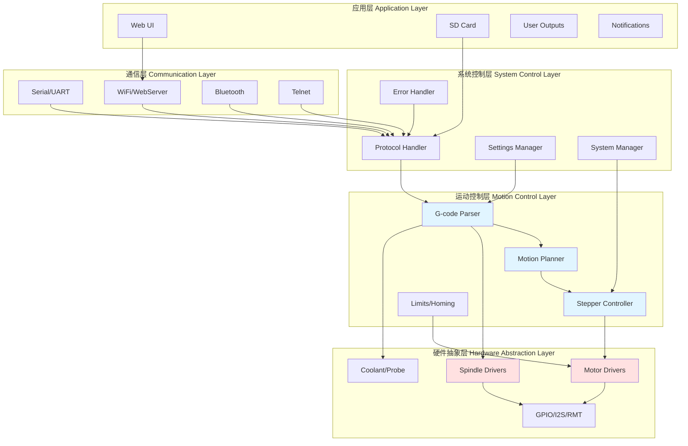
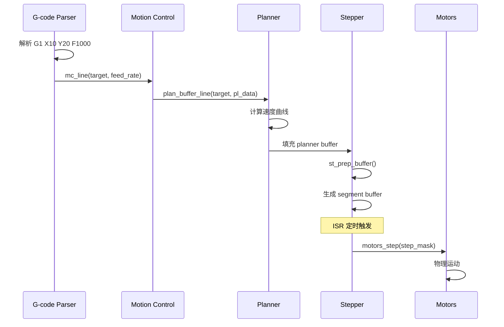
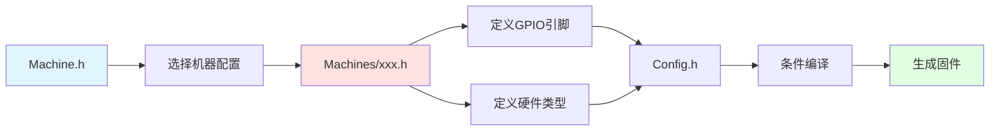
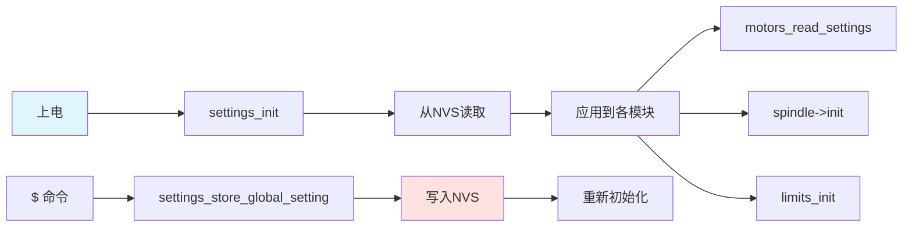

# 架构设计与分层

## 系统分层架构

Grbl_Esp32 采用经典的分层架构设计，从上到下分为5层：



## 各层详解

### 1. 应用层（Application Layer）

**职责**：提供用户交互界面和高级功能

**主要模块**：

| 模块 | 文件 | 作用 |
|------|------|------|
| Web UI | [WebServer.cpp](../../Grbl_Esp32/src/WebUI/WebServer.cpp) | HTTP服务器，Web控制界面 |
| SD Card | [SDCard.cpp](../../Grbl_Esp32/src/SDCard.cpp) | SD卡文件管理，G-code流式传输 |
| User Outputs | [UserOutput.cpp](../../Grbl_Esp32/src/UserOutput.cpp) | 用户自定义输出（M62-M65） |
| Notifications | [NotificationsService.cpp](../../Grbl_Esp32/src/WebUI/NotificationsService.cpp) | 推送通知服务 |

**特点**：
- 非实时性要求
- 可选功能（通过条件编译启用/禁用）
- 不直接影响运动控制

### 2. 通信层（Communication Layer）

**职责**：处理多种通信协议，接收G-code和实时命令

**主要模块**：

| 模块 | 文件 | 作用 |
|------|------|------|
| Serial | [Serial.cpp](../../Grbl_Esp32/src/Serial.cpp) | UART串口通信 |
| WiFi | [WifiConfig.cpp](../../Grbl_Esp32/src/WebUI/WifiConfig.cpp) | WiFi配置和管理 |
| Bluetooth | [BTConfig.cpp](../../Grbl_Esp32/src/WebUI/BTConfig.cpp) | 蓝牙串口 |
| Telnet | [TelnetServer.cpp](../../Grbl_Esp32/src/WebUI/TelnetServer.cpp) | Telnet服务器 |
| Serial2Socket | [Serial2Socket.cpp](../../Grbl_Esp32/src/WebUI/Serial2Socket.cpp) | 串口桥接 |

**关键设计**：

```cpp
// 多客户端支持（Serial.h）
enum {
    CLIENT_SERIAL = 0,  // UART
    CLIENT_BT,          // Bluetooth
    CLIENT_WIFI,        // WiFi
    CLIENT_INPUT,       // WebUI InputBuffer
    CLIENT_ALL = 0xFF   // 广播
};

// 客户端缓冲区
extern uint8_t client_buffer[CLIENT_COUNT][CLIENT_BUFFER_SIZE];
```

**双核架构**：

```cpp
// clientCheckTask 运行在 Core 1
void clientCheckTask(void* pvParameters) {
    while (true) {
        // 从所有客户端读取字符
        int c = getClientChar();
        if (c >= 0) {
            // 实时命令立即处理
            if (is_realtime_command(c)) {
                execute_realtime_command(c);
            } else {
                // 普通字符加入缓冲区
                client_buffer[client].write(c);
            }
        }
        vTaskDelay(1);
    }
}
```

### 3. 系统控制层（System Control Layer）

**职责**：协调各模块，管理系统状态和设置

**主要模块**：

| 模块 | 文件 | 作用 |
|------|------|------|
| Protocol | [Protocol.cpp](../../Grbl_Esp32/src/Protocol.cpp) | 主循环，命令分发 |
| Settings | [Settings.cpp](../../Grbl_Esp32/src/Settings.cpp) | 设置管理（NVS存储） |
| System | [System.cpp](../../Grbl_Esp32/src/System.cpp) | 系统功能（复位、睡眠等） |
| Report | [Report.cpp](../../Grbl_Esp32/src/Report.cpp) | 状态报告生成 |
| Error | [Error.cpp](../../Grbl_Esp32/src/Error.cpp) | 错误消息处理 |

**核心：protocol_main_loop()**

```cpp
// Protocol.cpp (简化版)
void protocol_main_loop() {
    while (!sys.abort) {
        // 1. 从所有客户端读取命令
        for (int client = 0; client < CLIENT_COUNT; client++) {
            int c;
            while ((c = client_read(client)) != -1) {
                if (add_char_to_line(c, client) == Error::Eol) {
                    // 执行完整命令行
                    execute_line(line, client);
                }
            }
        }

        // 2. 检查点：处理实时命令
        protocol_execute_realtime();

        // 3. 自动启动循环
        protocol_auto_cycle_start();

        // 4. 再次检查实时命令
        protocol_execute_realtime();
    }
}
```

**状态机**：

```cpp
// System.h
enum class State : uint8_t {
    Idle = 0,      // 空闲
    Alarm,         // 报警（锁定）
    CheckMode,     // 检查模式（不执行运动）
    Homing,        // 归零中
    Cycle,         // 运行中
    Hold,          // 保持（暂停）
    Jog,           // 手动点动
    SafetyDoor,    // 安全门
    Sleep,         // 睡眠
    ConfigAlarm    // 配置报警
};
```

### 4. 运动控制层（Motion Control Layer）

**职责**：G-code解析、运动规划、步进控制

**主要模块**：

| 模块 | 文件 | 行数 | 作用 |
|------|------|------|------|
| G-code Parser | [GCode.cpp](../../Grbl_Esp32/src/GCode.cpp) | 2,800+ | 解析G-code，提取参数 |
| Motion Planner | [Planner.cpp](../../Grbl_Esp32/src/Planner.cpp) | 800+ | 生成速度曲线，优化路径 |
| Stepper Controller | [Stepper.cpp](../../Grbl_Esp32/src/Stepper.cpp) | 1,600+ | 实时步进脉冲生成（ISR） |
| Motion Control | [MotionControl.cpp](../../Grbl_Esp32/src/MotionControl.cpp) | 400+ | 运动执行（直线、圆弧） |
| Limits | [Limits.cpp](../../Grbl_Esp32/src/Limits.cpp) | 600+ | 限位开关、归零逻辑 |

**数据流**：



**关键数据结构**：

```cpp
// Planner.h
typedef struct plan_block {
    uint32_t steps[MAX_N_AXIS];      // 各轴步数
    uint32_t step_event_count;       // 总步数
    float    entry_speed_sqr;        // 入口速度平方
    float    max_entry_speed_sqr;    // 最大入口速度平方
    float    acceleration;           // 加速度
    float    millimeters;            // 路径长度
    // ... 其他字段
} plan_block_t;

// Stepper.h
typedef struct st_segment {
    uint16_t n_step;                 // 段内步数
    uint8_t  dir_bits;               // 方向位
    uint32_t cycles_per_tick;        // 每步周期数
    // ... 其他字段
} segment_t;
```

### 5. 硬件抽象层（Hardware Abstraction Layer）

**职责**：屏蔽硬件差异，提供统一接口

**主要模块**：

| 模块 | 目录 | 作用 |
|------|------|------|
| Motor Drivers | [Motors/](../../Grbl_Esp32/src/Motors/) | 电机驱动抽象 |
| Spindle Drivers | [Spindles/](../../Grbl_Esp32/src/Spindles/) | 主轴驱动抽象 |
| Coolant | [CoolantControl.cpp](../../Grbl_Esp32/src/CoolantControl.cpp) | 冷却液控制 |
| Probe | [Probe.cpp](../../Grbl_Esp32/src/Probe.cpp) | 探针功能 |
| I2S/RMT | [I2SOut.cpp](../../Grbl_Esp32/src/I2SOut.cpp) | 硬件步进输出 |

**多态设计**：

```cpp
// Motor 基类（Motor.h）
class Motor {
public:
    virtual void init() = 0;
    virtual void set_direction(bool dir) = 0;
    virtual void step() = 0;
    virtual void unstep() = 0;
    // ...
};

// 派生类
class StandardStepper : public Motor { /* ... */ };
class TrinamicDriver : public StandardStepper { /* ... */ };
class RcServo : public Motor { /* ... */ };
```

## 关键设计模式

### 1. 多态扩展模式（Polymorphic Extension）

**用途**：支持多种硬件类型

**实现**：

```cpp
// 全局电机数组（Motors.cpp）
Motors::Motor* myMotor[MAX_AXES][MAX_GANGED];

// 编译时选择（init_motors()）
#ifdef X_TRINAMIC_DRIVER
    myMotor[X_AXIS][0] = new TrinamicDriver(...);
#elif defined(X_STEP_PIN)
    myMotor[X_AXIS][0] = new StandardStepper(...);
#else
    myMotor[X_AXIS][0] = new NullMotor();
#endif

// 统一调用
myMotor[X_AXIS][0]->step();
```

**优点**：
- 添加新驱动无需修改核心代码
- 编译时确定，无运行时开销
- 类型安全

### 2. 全局实例模式（Global Instance）

**用途**：主轴驱动的运行时切换

**实现**：

```cpp
// Spindle.cpp
namespace Spindles {
    // 所有类型预实例化
    Null     null;
    PWM      pwm;
    Laser    laser;
    Relay    relay;
    Dac      dac;
    Huanyang huanyang;
    // ...

    // 全局指针
    Spindle* spindle = &null;

    // 运行时切换
    void Spindle::select() {
        switch (spindle_type->get()) {
            case SpindleType::PWM:
                spindle = &pwm;
                break;
            case SpindleType::LASER:
                spindle = &laser;
                break;
            // ...
        }
        spindle->init();
    }
}
```

**优点**：
- 无动态内存分配
- 可运行时切换
- 内存占用可预测

### 3. 弱函数覆盖模式（Weak Function Override）

**用途**：机器特定定制

**实现**：

```cpp
// Grbl.cpp（弱定义）
void __attribute__((weak)) machine_init() {
    // 默认为空
}

void __attribute__((weak)) user_m30() {
    // 默认为空
}

// Machines/my_machine.h（强定义）
void machine_init() {
    // 自定义初始化
    pinMode(CUSTOM_PIN, OUTPUT);
}

void user_m30() {
    // 自定义M30行为
    digitalWrite(CUSTOM_PIN, LOW);
}
```

**优点**：
- 不修改核心代码
- 可选覆盖
- 编译时解析

### 4. 条件编译模式（Conditional Compilation）

**用途**：功能模块的启用/禁用

**实现**：

```cpp
// Config.h
#define ENABLE_WIFI
#define ENABLE_BLUETOOTH
#define ENABLE_SD_CARD

// Grbl.cpp
void grbl_init() {
    // ...
#ifdef ENABLE_WIFI
    WebUI::wifi_config.begin();
#endif

#ifdef ENABLE_BLUETOOTH
    WebUI::bt_config.begin();
#endif

#ifdef ENABLE_SD_CARD
    sd_init();
#endif
}
```

**优点**：
- 减少固件大小
- 降低内存占用
- 避免未使用功能的开销

### 5. 链表管理模式（Linked List）

**用途**：动态数量的同类对象管理

**实现**：

```cpp
// TrinamicDriver.h
class TrinamicDriver : public StandardStepper {
private:
    static TrinamicDriver* List;  // 链表头
    TrinamicDriver*        link;  // 下一个节点

public:
    TrinamicDriver(...) {
        // 添加到链表
        link = List;
        List = this;
    }

    static void readSgTask(void* pvParameters) {
        // 遍历链表
        for (TrinamicDriver* p = List; p; p = p->link) {
            p->read_sg_status();
        }
    }
};
```

**优点**：
- 无需预知对象数量
- 统一管理
- 适合后台任务

## 模块间通信机制

### 1. 全局变量（Global Variables）

**用途**：系统状态共享

```cpp
// System.h
extern system_t sys;                    // 系统状态
extern int32_t  sys_position[MAX_N_AXIS]; // 机器位置
extern volatile uint8_t sys_rt_exec_state; // 实时执行标志
```

**注意**：
- 使用 `volatile` 修饰ISR访问的变量
- 避免竞态条件

### 2. 函数调用（Function Calls）

**用途**：层间接口

```cpp
// 上层调用下层
gc_execute_line() → mc_line() → plan_buffer_line()

// 下层回调上层
limits_isr() → sys_rt_exec_alarm = ExecAlarm::HardLimit
```

### 3. 标志位通信（Flag-based Communication）

**用途**：ISR与主循环通信

```cpp
// 实时命令标志（System.h）
union ExecState {
    uint8_t value;
    struct {
        uint8_t statusReport : 1;
        uint8_t cycleStart : 1;
        uint8_t feedHold : 1;
        uint8_t reset : 1;
        uint8_t safetyDoor : 1;
        uint8_t motionCancel : 1;
        uint8_t sleep : 1;
    };
};

extern volatile ExecState sys_rt_exec_state;

// ISR设置标志
void isr_realtime_command(char c) {
    if (c == '?') {
        sys_rt_exec_state.statusReport = 1;
    }
}

// 主循环检查标志
void protocol_execute_realtime() {
    if (sys_rt_exec_state.statusReport) {
        report_realtime_status();
        sys_rt_exec_state.statusReport = 0;
    }
}
```

### 4. 缓冲区（Buffers）

**用途**：数据流传递

```cpp
// Planner buffer（环形缓冲区）
plan_block_t block_buffer[BLOCK_BUFFER_SIZE];
uint8_t block_buffer_head;
uint8_t block_buffer_tail;

// Segment buffer（环形缓冲区）
segment_t segment_buffer[SEGMENT_BUFFER_SIZE];
uint8_t segment_buffer_head;
uint8_t segment_buffer_tail;
```

## 实时性保证

### 1. 双核分工

```
Core 0 (Protocol Core):
    - protocol_main_loop()
    - G-code解析
    - 运动规划
    - 步进准备

Core 1 (Application Core):
    - clientCheckTask()
    - WiFi/Bluetooth
    - Web服务器
```

### 2. 中断优先级

```
最高优先级: Stepper ISR（定时器中断）
    ↓
高优先级: Limit Switch ISR
    ↓
中优先级: Serial RX ISR
    ↓
低优先级: FreeRTOS任务
```

### 3. 检查点机制

```cpp
// 在关键位置插入检查点
void protocol_main_loop() {
    while (!sys.abort) {
        // 读取命令
        read_commands();

        protocol_execute_realtime(); // 检查点1

        // 执行命令
        execute_commands();

        protocol_execute_realtime(); // 检查点2

        // 自动启动
        auto_cycle_start();

        protocol_execute_realtime(); // 检查点3
    }
}
```

## 配置驱动架构

### 编译时配置流程



### 运行时配置流程



## 扩展点总结

### 1. 添加新电机驱动

- 继承 `Motors::Motor`
- 实现虚函数
- 在 `init_motors()` 中注册

### 2. 添加新主轴驱动

- 继承 `Spindles::Spindle`
- 添加枚举值
- 在 `Spindle::select()` 中注册

### 3. 自定义机器行为

- 覆盖弱函数：`machine_init()`, `user_m30()` 等
- 在机器配置文件中定义

### 4. 添加新功能模块

- 使用条件编译开关
- 在 `grbl_init()` 中初始化
- 在 `protocol_main_loop()` 中集成

## 技术约束

### 1. 实时性约束

- **Stepper ISR**：执行时间 < 10μs
- **Limit ISR**：执行时间 < 5μs
- **主循环**：响应时间 < 100ms

### 2. 内存约束

- **RAM**：约130KB可用（ESP32总共320KB）
- **Flash**：约1.1MB可用（取决于分区表）
- **Planner buffer**：16个块（可配置）
- **Segment buffer**：6个段（可配置）

### 3. 核心模块不可修改

- GCode.cpp（G-code解析器）
- Planner.cpp（运动规划器）
- Stepper.cpp（步进控制器）

除非完全理解其算法，否则不要修改这些文件。

## 下一步

阅读 [03_配置系统详解.md](03_配置系统详解.md) 了解编译时和运行时配置的详细机制。

## 参考资源

- **设计模式**: https://refactoring.guru/design-patterns
- **FreeRTOS文档**: https://www.freertos.org/
- **ESP32技术参考**: https://www.espressif.com/sites/default/files/documentation/esp32_technical_reference_manual_en.pdf
