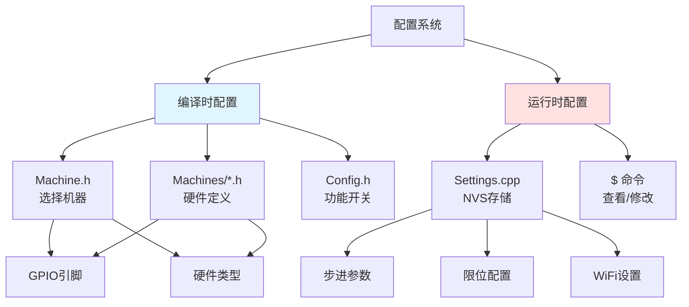
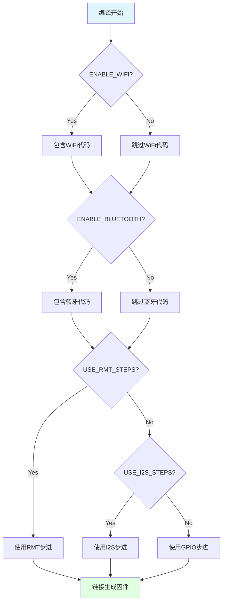
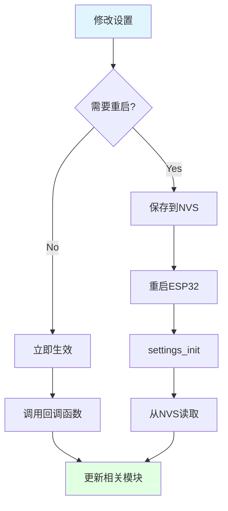

# 配置系统详解

## 配置系统概览

Grbl_Esp32 采用**双层配置系统**：



**核心区别**：

| 特性 | 编译时配置 | 运行时配置 |
|------|-----------|-----------|
| **修改方式** | 修改源码，重新编译 | 发送 `$` 命令 |
| **存储位置** | 固件代码 | NVS（非易失存储） |
| **生效时机** | 编译时 | 立即生效或重启后 |
| **典型内容** | GPIO引脚、硬件类型 | 步进参数、速度限制 |
| **修改频率** | 很少（硬件固定） | 经常（调试、优化） |

## 编译时配置

### 1. Machine.h - 机器选择器

**文件位置**：[Grbl_Esp32/src/Machine.h](../../Grbl_Esp32/src/Machine.h)

**作用**：选择要使用的机器配置文件

```cpp
// Machine.h
#pragma once

// 选择机器配置文件
#define MACHINE_FILENAME "Machines/3axis_v4.h"

// 包含选定的配置
#include MACHINE_FILENAME
```

**修改方法**：

方法1：直接修改 `Machine.h`
```cpp
#define MACHINE_FILENAME "Machines/my_machine.h"
```

方法2：在 `platformio.ini` 中覆盖
```ini
[common]
build_flags =
    -DMACHINE_FILENAME=my_machine.h
```

### 2. Machines/*.h - 机器配置文件

**文件位置**：[Grbl_Esp32/src/Machines/](../../Grbl_Esp32/src/Machines/)

**作用**：定义具体硬件的GPIO引脚和类型

#### 典型配置文件结构

以 [3axis_v4.h](../../Grbl_Esp32/src/Machines/3axis_v4.h) 为例：

```cpp
#pragma once
// clang-format off  // 必须禁用格式化

// 1. 机器名称
#define MACHINE_NAME "ESP32_V4"

// 2. 轴引脚定义
#define X_STEP_PIN              GPIO_NUM_12
#define X_DIRECTION_PIN         GPIO_NUM_14
#define Y_STEP_PIN              GPIO_NUM_26
#define Y_DIRECTION_PIN         GPIO_NUM_15
#define Z_STEP_PIN              GPIO_NUM_27
#define Z_DIRECTION_PIN         GPIO_NUM_33

// 3. 限位开关引脚
#define X_LIMIT_PIN             GPIO_NUM_17
#define Y_LIMIT_PIN             GPIO_NUM_4
#define Z_LIMIT_PIN             GPIO_NUM_16

// 4. 使能引脚（可选）
#define STEPPERS_DISABLE_PIN    GPIO_NUM_13

// 5. 主轴配置
#define SPINDLE_TYPE            SpindleType::PWM
#define SPINDLE_OUTPUT_PIN      GPIO_NUM_2
#define SPINDLE_ENABLE_PIN      GPIO_NUM_22

// 6. 辅助功能引脚
#define COOLANT_MIST_PIN        GPIO_NUM_21
#define COOLANT_FLOOD_PIN       GPIO_NUM_25
#define PROBE_PIN               GPIO_NUM_32

// 7. 控制引脚（可选）
// #define CONTROL_SAFETY_DOOR_PIN GPIO_NUM_35
// #define CONTROL_RESET_PIN       GPIO_NUM_34
// #define CONTROL_FEED_HOLD_PIN   GPIO_NUM_36
// #define CONTROL_CYCLE_START_PIN GPIO_NUM_39
```

#### 配置项详解

**轴引脚命名规则**：

```cpp
// 格式：<轴>_<功能>_PIN
X_STEP_PIN              // X轴步进脉冲
X_DIRECTION_PIN         // X轴方向
X_LIMIT_PIN             // X轴限位开关

// 支持的轴：X, Y, Z, A, B, C
// 支持Ganged电机（双电机）
X2_STEP_PIN             // X轴第二个电机
X2_DIRECTION_PIN
```

**主轴类型枚举**：

```cpp
// Spindles/Spindle.h
enum class SpindleType : int8_t {
    NONE = 0,    // 无主轴
    PWM,         // PWM调速
    RELAY,       // 继电器开关
    LASER,       // 激光（支持M4）
    DAC,         // DAC模拟输出
    HUANYANG,    // 华阳VFD
    BESC,        // 无刷电调
    _10V,        // 0-10V输出
    H2A,         // H2A VFD
    YL620,       // YL620 VFD
    L510         // Teco L510 VFD
};
```

**电机类型选择**：

```cpp
// 方法1：标准步进（默认）
#define X_STEP_PIN GPIO_NUM_12
#define X_DIRECTION_PIN GPIO_NUM_14

// 方法2：Trinamic SPI驱动
#define X_TRINAMIC_DRIVER 2130  // TMC2130
#define X_DRIVER_CS_PIN GPIO_NUM_17
#define X_RSENSE 0.11f

// 方法3：RC伺服
#define X_SERVO_PIN GPIO_NUM_12

// 方法4：单极步进
#define X_UNIPOLAR
#define X_PIN_PHASE_0 GPIO_NUM_12
#define X_PIN_PHASE_1 GPIO_NUM_14
#define X_PIN_PHASE_2 GPIO_NUM_26
#define X_PIN_PHASE_3 GPIO_NUM_27
```

#### 创建新机器配置

**步骤**：

1. 复制现有配置
```bash
cp Grbl_Esp32/src/Machines/3axis_v4.h \
   Grbl_Esp32/src/Machines/my_cnc.h
```

2. 修改机器名称
```cpp
#define MACHINE_NAME "My_CNC_Machine"
```

3. 修改引脚定义
```cpp
// 根据实际硬件连接修改
#define X_STEP_PIN GPIO_NUM_26
#define X_DIRECTION_PIN GPIO_NUM_16
// ...
```

4. 选择主轴类型
```cpp
#define SPINDLE_TYPE SpindleType::LASER
#define SPINDLE_OUTPUT_PIN GPIO_NUM_2
```

5. 在 `Machine.h` 中选择
```cpp
#define MACHINE_FILENAME "Machines/my_cnc.h"
```

### 3. Config.h - 功能开关

**文件位置**：[Grbl_Esp32/src/Config.h](../../Grbl_Esp32/src/Config.h)

**作用**：启用/禁用功能模块，定义系统常量

#### 主要配置项

**通信功能**：

```cpp
// Config.h (简化版)

// 蓝牙
#define ENABLE_BLUETOOTH

// WiFi
#define ENABLE_WIFI

// WiFi相关服务
#ifdef ENABLE_WIFI
    #define ENABLE_HTTP              // HTTP服务器
    #define ENABLE_OTA               // OTA升级
    #define ENABLE_TELNET            // Telnet服务器
    #define ENABLE_MDNS              // mDNS发现
    #define ENABLE_SSDP              // UPNP发现
    #define ENABLE_NOTIFICATIONS     // 推送通知
    #define ENABLE_CAPTIVE_PORTAL    // 强制门户
#endif

// SD卡
#define ENABLE_SD_CARD
```

**步进输出方式**：

```cpp
// RMT硬件加速（推荐）
#define USE_RMT_STEPS

// I2S输出（用于扩展GPIO）
// #define USE_I2S_STEPS

// 注意：RMT和I2S互斥
#ifdef USE_I2S_STEPS
    #ifdef USE_RMT_STEPS
        #undef USE_RMT_STEPS
    #endif
#endif
```

**系统常量**：

```cpp
// 轴数量（3-6）
#ifndef N_AXIS
    #define N_AXIS 3
#endif

// 串口波特率
#define BAUD_RATE 115200

// 实时命令字符
enum class Cmd : uint8_t {
    Reset          = 0x18,  // Ctrl-X
    StatusReport   = '?',
    CycleStart     = '~',
    FeedHold       = '!',
    SafetyDoor     = 0x84,
    // ...
};

// 归零初始化锁定
#define HOMING_INIT_LOCK

// 单轴归零命令
#define HOMING_SINGLE_AXIS_COMMANDS
```

**性能参数**：

```cpp
// 加速度时间分辨率（Hz）
const int ACCELERATION_TICKS_PER_SECOND = 100;

// 最小进给速率（mm/min）
const double MINIMUM_FEED_RATE = 1.0;

// 最小交点速度（mm/min）
const double MINIMUM_JUNCTION_SPEED = 0.0;

// 圆弧校正迭代次数
const int N_ARC_CORRECTION = 12;

// 停留时间步长（ms）
const int DWELL_TIME_STEP = 50;
```

**覆盖参数**：

```cpp
namespace FeedOverride {
    const int Default         = 100;  // 100%
    const int Max             = 200;  // 最大200%
    const int Min             = 10;   // 最小10%
    const int CoarseIncrement = 10;   // 粗调10%
    const int FineIncrement   = 1;    // 细调1%
};

namespace RapidOverride {
    const int Default  = 100;  // 100%
    const int Medium   = 50;   // 50%
    const int Low      = 25;   // 25%
};

namespace SpindleSpeedOverride {
    const int Default         = 100;
    const int Max             = 200;
    const int Min             = 10;
    const int CoarseIncrement = 10;
    const int FineIncrement   = 1;
};
```

### 4. 条件编译流程



## 运行时配置

### 1. Settings 系统架构

**核心文件**：
- [Settings.h](../../Grbl_Esp32/src/Settings.h) - 设置定义
- [Settings.cpp](../../Grbl_Esp32/src/Settings.cpp) - 设置管理
- [SettingsDefinitions.cpp](../../Grbl_Esp32/src/SettingsDefinitions.cpp) - 设置注册

**存储机制**：

```cpp
// Settings.cpp
#include <Preferences.h>

Preferences grbl_preferences;

void settings_init() {
    // 打开NVS命名空间
    grbl_preferences.begin("Grbl_ESP32", false);

    // 读取所有设置
    for (Setting* s = Setting::List; s; s = s->next()) {
        s->load();
    }
}

void settings_store_global_setting(uint8_t parameter, float value) {
    // 查找设置
    Setting* s = Setting::get(parameter);
    if (s) {
        // 设置值
        s->setDefault(value);
        // 保存到NVS
        s->save();
    }
}
```

### 2. 设置类型

**基类**：

```cpp
// Settings.h
class Setting {
protected:
    const char* _name;      // 设置名称
    Setting*    _next;      // 链表下一个
    static Setting* List;   // 链表头

public:
    virtual void load() = 0;
    virtual void save() = 0;
    virtual void setDefault(float val) = 0;
    // ...
};
```

**派生类**：

```cpp
class IntSetting : public Setting {
    int32_t _defaultValue;
    int32_t _currentValue;
    int32_t _minValue;
    int32_t _maxValue;
};

class FloatSetting : public Setting {
    float _defaultValue;
    float _currentValue;
    float _minValue;
    float _maxValue;
};

class AxisSetting : public Setting {
    float _defaultValue[MAX_N_AXIS];
    float _currentValue[MAX_N_AXIS];
};

class StringSetting : public Setting {
    const char* _defaultValue;
    char*       _currentValue;
    int         _maxLength;
};
```

### 3. 设置分类

#### 步进参数（$100-$132）

```cpp
// SettingsDefinitions.cpp
new AxisSetting("Steps/mm",
                AXIS_SETTINGS_BASE,  // $100-$105
                DEFAULT_AXIS_STEPS_PER_MM,
                &axis_settings->steps_per_mm);

new AxisSetting("Max Rate",
                AXIS_SETTINGS_BASE + AXIS_SETTINGS_INCREMENT,  // $110-$115
                DEFAULT_MAX_RATE,
                &axis_settings->max_rate);

new AxisSetting("Acceleration",
                AXIS_SETTINGS_BASE + 2*AXIS_SETTINGS_INCREMENT,  // $120-$125
                DEFAULT_ACCELERATION,
                &axis_settings->acceleration);

new AxisSetting("Max Travel",
                AXIS_SETTINGS_BASE + 3*AXIS_SETTINGS_INCREMENT,  // $130-$135
                DEFAULT_MAX_TRAVEL,
                &axis_settings->max_travel);
```

**示例**：

```
$100=250.000  (X轴 步进/mm)
$101=250.000  (Y轴 步进/mm)
$102=250.000  (Z轴 步进/mm)

$110=5000.000 (X轴 最大速率, mm/min)
$111=5000.000 (Y轴 最大速率, mm/min)
$112=5000.000 (Z轴 最大速率, mm/min)

$120=500.000  (X轴 加速度, mm/sec^2)
$121=500.000  (Y轴 加速度, mm/sec^2)
$122=500.000  (Z轴 加速度, mm/sec^2)

$130=200.000  (X轴 最大行程, mm)
$131=200.000  (Y轴 最大行程, mm)
$132=200.000  (Z轴 最大行程, mm)
```

#### 系统设置（$0-$32）

```
$0=10     (步进脉冲时间, 微秒)
$1=255    (步进空闲延迟, 毫秒)
$2=0      (步进脉冲反转, 掩码)
$3=0      (方向反转, 掩码)
$4=0      (步进使能反转, 布尔)
$5=0      (限位反转, 布尔)
$6=0      (探针反转, 布尔)

$10=1     (状态报告, 掩码)
$11=0.010 (交点偏差, mm)
$12=0.002 (圆弧公差, mm)
$13=0     (报告单位, 布尔)

$20=0     (软限位, 布尔)
$21=0     (硬限位, 布尔)
$22=1     (归零循环, 布尔)
$23=0     (归零方向反转, 掩码)
$24=25.000 (归零进给速率, mm/min)
$25=500.000 (归零快速速率, mm/min)
$26=250    (归零脱离距离, mm)
$27=1.000  (归零脱离速率, mm/min)

$30=1000   (主轴最大转速, RPM)
$31=0      (主轴最小转速, RPM)
$32=0      (激光模式, 布尔)
```

#### WiFi设置（$70-$79）

```
$70=My_SSID       (WiFi SSID)
$71=password      (WiFi密码)
$72=STA           (WiFi模式: STA/AP)
$73=192.168.1.100 (STA IP地址)
$74=192.168.4.1   (AP IP地址)
$75=80            (HTTP端口)
$76=23            (Telnet端口)
```

### 4. 设置命令

#### 查看设置

```
$$        # 查看所有设置
$#        # 查看坐标系统
$G        # 查看G-code解析器状态
$I        # 查看构建信息
$N        # 查看启动脚本
$x        # 查看报警代码
```

#### 修改设置

```
$100=250.5    # 设置X轴步进/mm
$110=8000     # 设置X轴最大速率
$32=1         # 启用激光模式
```

#### 恢复默认

```
$RST=$    # 恢复所有设置为默认值
$RST=#    # 清除坐标系统
$RST=*    # 恢复所有（设置+坐标）
```

### 5. 设置生效时机



**立即生效的设置**：
- 步进参数（$100-$132）
- 进给速率覆盖
- 主轴速度

**需要重启的设置**：
- WiFi配置（$70-$79）
- 串口波特率
- 功能模块启用/禁用

### 6. 设置回调机制

```cpp
// Settings.cpp
void Setting::afterSetCallback() {
    // 通知相关模块
    if (_name == "Steps/mm") {
        motors_read_settings();
    } else if (_name == "Max Rate") {
        plan_reset();
    } else if (_name == "WiFi/SSID") {
        wifi_config.reset();
    }
}
```

## 配置优先级

```
命令行参数（platformio.ini）
    ↓
Machine.h
    ↓
Machines/*.h
    ↓
Config.h
    ↓
Defaults.h
    ↓
NVS存储的设置
```

**规则**：
- 上层覆盖下层
- 编译时配置优先于运行时配置
- 用户设置优先于默认值

## GPIO引脚约束

### ESP32引脚特性

```cpp
// 输入专用（不能输出）
GPIO_NUM_34, GPIO_NUM_35, GPIO_NUM_36, GPIO_NUM_39

// 启动时必须为高电平
GPIO_NUM_0, GPIO_NUM_2, GPIO_NUM_15

// 启动时必须悬空或下拉
GPIO_NUM_12

// JTAG调试（避免使用）
GPIO_NUM_12, GPIO_NUM_13, GPIO_NUM_14, GPIO_NUM_15

// SPI Flash（禁止使用）
GPIO_NUM_6 - GPIO_NUM_11

// 推荐用于步进输出
GPIO_NUM_4, GPIO_NUM_13, GPIO_NUM_14, GPIO_NUM_16-19,
GPIO_NUM_21-23, GPIO_NUM_25-27, GPIO_NUM_32-33
```

### 引脚冲突检查

```cpp
// Pins.cpp
void pins_init() {
    // 检查引脚冲突
    if (X_STEP_PIN == Y_STEP_PIN) {
        grbl_msg_sendf(CLIENT_SERIAL, MsgLevel::Error,
                       "Pin conflict: X_STEP and Y_STEP");
    }

    // 检查输入专用引脚
    if (X_STEP_PIN == GPIO_NUM_34) {
        grbl_msg_sendf(CLIENT_SERIAL, MsgLevel::Error,
                       "GPIO34 is input-only");
    }
}
```

## 配置最佳实践

### 1. 创建新机器配置

```cpp
// 1. 复制模板
cp Machines/3axis_v4.h Machines/my_machine.h

// 2. 修改机器名称
#define MACHINE_NAME "My_Machine"

// 3. 定义引脚（按功能分组）
// 步进引脚
#define X_STEP_PIN GPIO_NUM_26
#define X_DIRECTION_PIN GPIO_NUM_16
// ...

// 限位引脚
#define X_LIMIT_PIN GPIO_NUM_36
// ...

// 主轴引脚
#define SPINDLE_TYPE SpindleType::PWM
#define SPINDLE_OUTPUT_PIN GPIO_NUM_2
// ...

// 4. 添加注释
// GPIO26: X轴步进脉冲（连接到驱动器STEP）
// GPIO16: X轴方向（连接到驱动器DIR）
```

### 2. 调试新配置

```cpp
// 在machine_init()中打印引脚信息
void machine_init() {
    grbl_msg_sendf(CLIENT_SERIAL, MsgLevel::Info,
                   "X_STEP_PIN: %d", X_STEP_PIN);
    grbl_msg_sendf(CLIENT_SERIAL, MsgLevel::Info,
                   "X_DIR_PIN: %d", X_DIRECTION_PIN);
    // ...
}
```

### 3. 设置备份与恢复

```bash
# 备份设置
echo "$$" > /dev/ttyUSB0
cat /dev/ttyUSB0 > settings_backup.txt

# 恢复设置
cat settings_backup.txt | grep "^\$" | while read line; do
    echo "$line" > /dev/ttyUSB0
    sleep 0.1
done
```

## 技术约束

### 1. 编译时配置约束

- 机器配置文件必须使用 `#define`
- 不能使用 `const` 或 `constexpr`
- 必须禁用 clang-format：`// clang-format off`

### 2. 运行时配置约束

- NVS存储空间有限（约15KB）
- 字符串设置最大长度：64字节
- 设置数量上限：约200个

### 3. GPIO约束

- 避免使用启动引脚（GPIO 0, 2, 12, 15）
- 避免使用输入专用引脚作为输出
- 避免使用SPI Flash引脚（GPIO 6-11）

## 兼容性注意事项

### 1. 硬件兼容性

- Trinamic驱动需要SPI总线
- I2S输出需要特定引脚
- RMT通道数量有限（8个）

### 2. 功能兼容性

- WiFi和Bluetooth不能同时全功率使用
- I2S和RMT步进输出互斥
- SD卡和某些GPIO功能可能冲突

## 下一步

阅读 [04_启动流程分析.md](04_启动流程分析.md) 了解系统从上电到运行的完整初始化过程。

## 参考资源

- **ESP32引脚参考**: https://randomnerdtutorials.com/esp32-pinout-reference-gpios/
- **NVS文档**: https://docs.espressif.com/projects/esp-idf/en/latest/esp32/api-reference/storage/nvs_flash.html
- **Grbl设置说明**: https://github.com/gnea/grbl/wiki/Grbl-v1.1-Configuration
