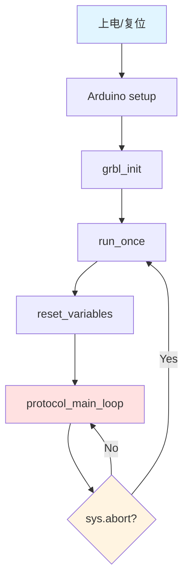
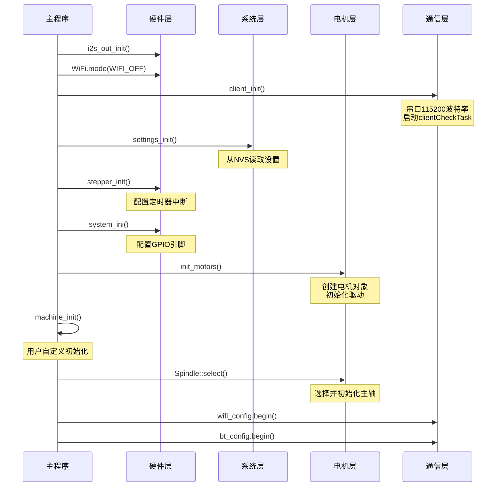
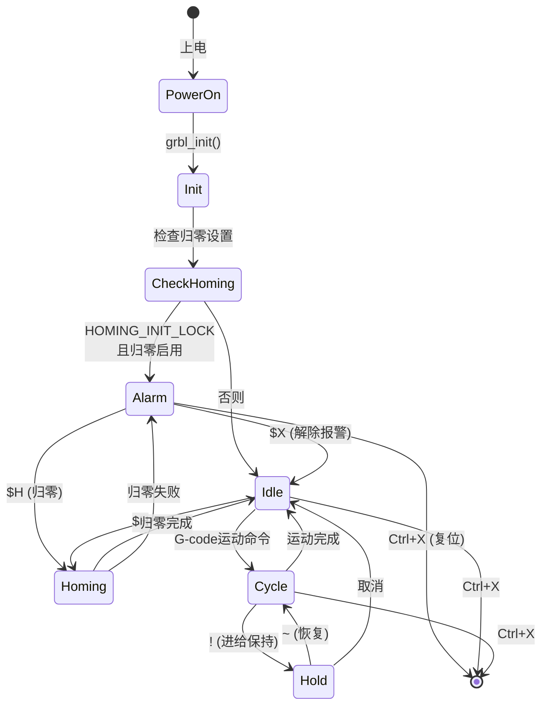

# 启动流程分析

## 启动流程概览

Grbl_Esp32 的启动流程从 Arduino 的 `setup()` 函数开始，经过一系列初始化步骤，最终进入主循环 `protocol_main_loop()`。



## Arduino 入口点

### Grbl_Esp32.ino

**文件位置**：[Grbl_Esp32/Grbl_Esp32.ino](../../Grbl_Esp32/Grbl_Esp32.ino)

```cpp
// Grbl_Esp32.ino
#include "src/Grbl.h"

void setup() {
    grbl_init();  // 系统初始化
}

void loop() {
    run_once();   // 主循环（可能因abort退出）
    // 如果run_once()退出，会重新执行
}
```

**等价的C代码**：

```cpp
// Grbl.cpp 注释中的说明
void main() {
    init();          // setup()
    while (1) {      // loop()
        run_once();
    }
}
```

## grbl_init() - 系统初始化

**文件位置**：[Grbl_Esp32/src/Grbl.cpp:24-74](../../Grbl_Esp32/src/Grbl.cpp)

### 完整初始化流程

```cpp
void grbl_init() {
    // 1. I2S输出初始化（如果启用）
#ifdef USE_I2S_OUT
    i2s_out_init();  // 必须在访问扩展GPIO之前初始化
#endif

    // 2. WiFi初始化为关闭状态
    WiFi.persistent(false);  // 不保存WiFi配置到Flash
    WiFi.disconnect(true);   // 断开连接
    WiFi.enableSTA(false);   // 禁用STA模式
    WiFi.enableAP(false);    // 禁用AP模式
    WiFi.mode(WIFI_OFF);     // 完全关闭WiFi

    // 3. 串口和客户端初始化
    client_init();  // 设置串口波特率和中断

    // 4. 显示器初始化（弱函数）
    display_init();

    // 5. 打印版本信息
    grbl_msg_sendf(CLIENT_SERIAL, MsgLevel::Info,
                   "Grbl_ESP32 Ver %s Date %s",
                   GRBL_VERSION, GRBL_VERSION_BUILD);
    grbl_msg_sendf(CLIENT_SERIAL, MsgLevel::Info,
                   "Compiled with ESP32 SDK:%s",
                   ESP.getSdkVersion());

    // 6. 打印机器类型
#ifdef MACHINE_NAME
    report_machine_type(CLIENT_SERIAL);
#endif

    // 7. 加载设置（从NVS）
    settings_init();

    // 8. 步进定时器初始化
    stepper_init();

    // 9. 系统GPIO初始化
    system_ini();

    // 10. 电机初始化
    init_motors();

    // 11. 清除机器位置
    memset(sys_position, 0, sizeof(sys_position));

    // 12. 机器特定初始化（弱函数）
    machine_init();

    // 13. 设置初始状态
#ifdef FORCE_INITIALIZATION_ALARM
    sys.state = State::Alarm;
#else
    sys.state = State::Idle;
#endif

    // 14. 归零锁定检查
#ifdef HOMING_INIT_LOCK
    if (homing_enable->get()) {
        sys.state = State::Alarm;
    }
#endif

    // 15. 主轴选择
    Spindles::Spindle::select();

    // 16. WiFi配置（如果启用）
#ifdef ENABLE_WIFI
    WebUI::wifi_config.begin();
#endif

    // 17. 蓝牙配置（如果启用）
#ifdef ENABLE_BLUETOOTH
    WebUI::bt_config.begin();
#endif

    // 18. Web输入缓冲初始化
    WebUI::inputBuffer.begin();
}
```

### 初始化时序图



## 关键初始化步骤详解

### 1. I2S输出初始化

**作用**：使用I2S外设扩展GPIO输出

```cpp
// I2SOut.cpp
void i2s_out_init() {
    // 配置I2S为并行输出模式
    i2s_config_t i2s_config = {
        .mode = (i2s_mode_t)(I2S_MODE_MASTER | I2S_MODE_TX),
        .sample_rate = 80000,  // 采样率
        .bits_per_sample = I2S_BITS_PER_SAMPLE_16BIT,
        .channel_format = I2S_CHANNEL_FMT_RIGHT_LEFT,
        // ...
    };

    i2s_driver_install(I2S_NUM_0, &i2s_config, 0, NULL);
    i2s_set_pin(I2S_NUM_0, &pin_config);
}
```

**注意**：
- 仅在定义 `USE_I2S_STEPS` 时启用
- 必须在访问扩展GPIO之前初始化
- 与 `USE_RMT_STEPS` 互斥

### 2. WiFi关闭

**作用**：确保WiFi初始状态为关闭，避免干扰

```cpp
WiFi.persistent(false);  // 不保存到Flash（避免Flash磨损）
WiFi.disconnect(true);   // 断开连接
WiFi.enableSTA(false);   // 禁用Station模式
WiFi.enableAP(false);    // 禁用AP模式
WiFi.mode(WIFI_OFF);     // 完全关闭WiFi射频
```

**原因**：
- WiFi会影响实时性能
- 后续根据配置选择性启用
- 避免启动时的WiFi干扰

### 3. 客户端初始化

**作用**：初始化串口和后台任务

```cpp
// Serial.cpp
void client_init() {
    // 初始化串口
    Serial.begin(BAUD_RATE);
    Serial.setRxBufferSize(256);

    // 创建客户端检查任务（Core 1）
    xTaskCreatePinnedToCore(
        clientCheckTask,        // 任务函数
        "clientCheckTask",      // 任务名称
        8192,                   // 栈大小
        NULL,                   // 参数
        1,                      // 优先级
        &clientCheckTaskHandle, // 任务句柄
        SUPPORT_TASK_CORE       // Core 1
    );
}
```

**clientCheckTask 任务**：

```cpp
void clientCheckTask(void* pvParameters) {
    while (true) {
        // 从所有客户端读取字符
        int c = getClientChar();
        if (c >= 0) {
            // 实时命令立即处理
            if (is_realtime_command(c)) {
                execute_realtime_command(c);
            } else {
                // 普通字符加入缓冲区
                client_buffer[current_client].write(c);
            }
        }
        vTaskDelay(1);  // 让出CPU
    }
}
```

### 4. 设置初始化

**作用**：从NVS加载所有设置

```cpp
// Settings.cpp
void settings_init() {
    // 打开NVS命名空间
    grbl_preferences.begin("Grbl_ESP32", false);

    // 遍历所有设置
    for (Setting* s = Setting::List; s; s = s->next()) {
        s->load();  // 从NVS读取
    }

    // 应用设置到各模块
    motors_read_settings();
    limits_init();
    // ...
}
```

**加载的设置**：
- 步进参数（$100-$132）
- 系统设置（$0-$32）
- WiFi配置（$70-$79）
- 用户自定义设置

### 5. 步进定时器初始化

**作用**：配置定时器中断用于步进脉冲生成

```cpp
// Stepper.cpp
void stepper_init() {
    // 配置定时器
    timer_config_t config = {
        .alarm_en = TIMER_ALARM_EN,
        .counter_en = TIMER_PAUSE,
        .intr_type = TIMER_INTR_LEVEL,
        .counter_dir = TIMER_COUNT_UP,
        .auto_reload = TIMER_AUTORELOAD_EN,
        .divider = STEPPER_TIMER_PRESCALER
    };

    timer_init(STEP_TIMER_GROUP, STEP_TIMER_INDEX, &config);
    timer_set_counter_value(STEP_TIMER_GROUP, STEP_TIMER_INDEX, 0);
    timer_set_alarm_value(STEP_TIMER_GROUP, STEP_TIMER_INDEX, 1000);

    // 注册中断处理函数
    timer_isr_register(STEP_TIMER_GROUP, STEP_TIMER_INDEX,
                       stepper_isr, NULL, ESP_INTR_FLAG_IRAM, NULL);

    // 启用中断
    timer_enable_intr(STEP_TIMER_GROUP, STEP_TIMER_INDEX);
}
```

**定时器参数**：
- 频率：可变（根据步进速率）
- 优先级：最高（实时性要求）
- 中断函数：`stepper_isr()`

### 6. 系统GPIO初始化

**作用**：配置控制引脚（复位、保持、启动等）

```cpp
// System.cpp
void system_ini() {
    // 配置控制引脚为输入（带上拉）
#ifdef CONTROL_RESET_PIN
    pinMode(CONTROL_RESET_PIN, INPUT_PULLUP);
#endif

#ifdef CONTROL_FEED_HOLD_PIN
    pinMode(CONTROL_FEED_HOLD_PIN, INPUT_PULLUP);
#endif

#ifdef CONTROL_CYCLE_START_PIN
    pinMode(CONTROL_CYCLE_START_PIN, INPUT_PULLUP);
#endif

#ifdef CONTROL_SAFETY_DOOR_PIN
    pinMode(CONTROL_SAFETY_DOOR_PIN, INPUT_PULLUP);
#endif

    // 配置中断
    attachInterrupt(digitalPinToInterrupt(CONTROL_RESET_PIN),
                    isr_control_pin, CHANGE);
}
```

### 7. 电机初始化

**作用**：根据机器配置创建电机对象

```cpp
// Motors/Motors.cpp
void init_motors() {
    uint8_t n_axis = number_axis->get();

    for (uint8_t axis = 0; axis < n_axis; axis++) {
        // 主电机
#ifdef X_TRINAMIC_DRIVER
        myMotor[axis][0] = new TrinamicDriver(axis, ...);
#elif defined(X_STEP_PIN)
        myMotor[axis][0] = new StandardStepper(axis, ...);
#else
        myMotor[axis][0] = new NullMotor(axis);
#endif

        // Ganged电机（如果定义）
#ifdef X2_STEP_PIN
        myMotor[axis][1] = new StandardStepper(axis, ...);
#endif
    }

    // 初始化所有电机
    for (uint8_t axis = 0; axis < n_axis; axis++) {
        for (uint8_t gang = 0; gang < MAX_GANGED; gang++) {
            if (myMotor[axis][gang]) {
                myMotor[axis][gang]->init();
            }
        }
    }
}
```

### 8. 机器特定初始化

**作用**：执行用户自定义初始化

```cpp
// Grbl.cpp（弱定义）
void __attribute__((weak)) machine_init() {
    // 默认为空
}

// 在机器配置文件中覆盖
void machine_init() {
    // 初始化自定义GPIO
    pinMode(CUSTOM_LED_PIN, OUTPUT);
    digitalWrite(CUSTOM_LED_PIN, HIGH);

    // 初始化外部设备
    Wire.begin();
    // ...
}
```

### 9. 主轴选择

**作用**：根据设置选择并初始化主轴

```cpp
// Spindles/Spindle.cpp
void Spindle::select() {
    // 读取主轴类型设置
    SpindleType type = static_cast<SpindleType>(spindle_type->get());

    // 选择对应的主轴实例
    switch (type) {
        case SpindleType::PWM:
            spindle = &pwm;
            break;
        case SpindleType::LASER:
            spindle = &laser;
            break;
        case SpindleType::HUANYANG:
            spindle = &huanyang;
            break;
        // ...
        default:
            spindle = &null;
            break;
    }

    // 初始化选定的主轴
    spindle->init();
}
```

### 10. WiFi/蓝牙配置

**作用**：根据配置启动WiFi或蓝牙

```cpp
// WebUI/WifiConfig.cpp
void WiFiConfig::begin() {
    // 读取WiFi模式设置
    int mode = radio_mode->get();

    if (mode == ESP_WIFI_STA) {
        // Station模式（连接到路由器）
        WiFi.mode(WIFI_STA);
        WiFi.begin(ssid, password);
    } else if (mode == ESP_WIFI_AP) {
        // AP模式（作为热点）
        WiFi.mode(WIFI_AP);
        WiFi.softAP(ap_ssid, ap_password);
    }

    // 启动Web服务器
    if (WiFi.status() == WL_CONNECTED || mode == ESP_WIFI_AP) {
        web_server.begin();
    }
}
```

## run_once() - 主循环入口

**文件位置**：[Grbl_Esp32/src/Grbl.cpp:114-120](../../Grbl_Esp32/src/Grbl.cpp)

```cpp
void run_once() {
    reset_variables();      // 重置系统变量
    protocol_main_loop();   // 进入主循环
}
```

### reset_variables() - 变量重置

**文件位置**：[Grbl_Esp32/src/Grbl.cpp:76-112](../../Grbl_Esp32/src/Grbl.cpp)

```cpp
static void reset_variables() {
    // 1. 保存当前状态
    State prior_state = sys.state;

    // 2. 清除系统结构体
    memset(&sys, 0, sizeof(system_t));
    sys.state = prior_state;

    // 3. 重置覆盖值为100%
    sys.f_override        = FeedOverride::Default;
    sys.r_override        = RapidOverride::Default;
    sys.spindle_speed_ovr = SpindleSpeedOverride::Default;

    // 4. 清除探针位置
    memset(sys_probe_position, 0, sizeof(sys_probe_position));

    // 5. 重置探针状态
    sys_probe_state = Probe::Off;

    // 6. 清除实时执行标志
    sys_rt_exec_state.value              = 0;
    sys_rt_exec_accessory_override.value = 0;
    sys_rt_exec_alarm                    = ExecAlarm::None;
    cycle_stop                           = false;

    // 7. 重置覆盖值
    sys_rt_f_override = FeedOverride::Default;
    sys_rt_r_override = RapidOverride::Default;
    sys_rt_s_override = SpindleSpeedOverride::Default;

    // 8. 重置各子系统
    client_reset_read_buffer(CLIENT_ALL);  // 清除输入缓冲
    gc_init();                             // G-code解析器
    spindle->stop();                       // 停止主轴
    coolant_init();                        // 冷却液
    limits_init();                         // 限位开关
    probe_init();                          // 探针
    plan_reset();                          // 清除planner buffer
    st_reset();                            // 清除stepper变量

    // 9. 同步位置
    plan_sync_position();   // 同步planner位置
    gc_sync_position();     // 同步G-code解析器位置

    // 10. 打印初始化消息
    report_init_message(CLIENT_ALL);

    // 11. 清除jog数据
    sys_pl_data_inflight = NULL;
}
```

## 启动状态机



## 启动时间分析

### 典型启动时间

```
上电 → grbl_init() 开始:        ~100ms  (ESP32启动)
grbl_init() 执行:                ~200ms
    ├─ I2S初始化:                ~10ms
    ├─ WiFi关闭:                 ~5ms
    ├─ client_init():            ~10ms
    ├─ settings_init():          ~50ms  (NVS读取)
    ├─ stepper_init():           ~5ms
    ├─ init_motors():            ~20ms
    ├─ machine_init():           ~10ms  (用户自定义)
    ├─ Spindle::select():        ~10ms
    ├─ WiFi启动:                 ~80ms  (如果启用)
    └─ 其他:                     ~10ms

总启动时间:                      ~300ms
```

### 优化启动时间

**延迟WiFi启动**：

```cpp
// 在machine_init()中延迟WiFi
void machine_init() {
    // 延迟WiFi启动到后台任务
    xTaskCreate(delayed_wifi_start, "wifi_start", 4096, NULL, 1, NULL);
}

void delayed_wifi_start(void* param) {
    vTaskDelay(pdMS_TO_TICKS(1000));  // 延迟1秒
    WebUI::wifi_config.begin();
    vTaskDelete(NULL);
}
```

**跳过不必要的初始化**：

```cpp
// 禁用不需要的功能
// #define ENABLE_BLUETOOTH  // 注释掉
// #define ENABLE_SD_CARD    // 注释掉
```

## 启动日志示例

```
Grbl_ESP32 Ver 1.3a Date 20211103
[MSG:Compiled with ESP32 SDK:v3.3.5-1-g85c43024c]
[MSG:Using machine:3axis_v4]
[MSG:Axis count 3]
[MSG:RMT Steps]
[MSG:Init Motors]
[MSG:TMCStepper Library Ver. 0x000701]
[MSG:X Axis Trinamic TMC2130 Step:12 Dir:14 CS:17 Disable:13 Index:0]
[MSG:Y Axis Trinamic TMC2130 Step:26 Dir:15 CS:21 Disable:13 Index:1]
[MSG:Z Axis Trinamic TMC2130 Step:27 Dir:33 CS:16 Disable:13 Index:2]
[MSG:Spindle type: PWM on Pin:2]
[MSG:WiFi AP SSID Grbl_ESP32 IP 192.168.0.1 mask 255.255.255.0 channel 1]
[MSG:HTTP Started on port 80]
[MSG:Telnet Started on port 23]

Grbl 1.3a ['$' for help]
[MSG:'$H'|'$X' to unlock]
```

## 启动失败排查

### 常见启动问题

**1. 串口无输出**
- 检查波特率（115200）
- 检查USB驱动
- 检查GPIO 1/3（TX/RX）

**2. 卡在WiFi初始化**
- 检查WiFi配置
- 尝试禁用WiFi
- 检查路由器连接

**3. 电机不响应**
- 检查引脚定义
- 检查使能引脚
- 发送 `$X` 解除报警

**4. 立即进入Alarm状态**
- 检查限位开关
- 检查 `HOMING_INIT_LOCK`
- 发送 `$X` 或 `$H`

### 调试启动过程

**添加调试输出**：

```cpp
void grbl_init() {
    Serial.println("DEBUG: grbl_init start");

    i2s_out_init();
    Serial.println("DEBUG: I2S init done");

    client_init();
    Serial.println("DEBUG: client init done");

    settings_init();
    Serial.println("DEBUG: settings init done");

    // ...
}
```

## 技术约束

### 1. 初始化顺序约束

- I2S必须在访问扩展GPIO之前初始化
- Settings必须在电机初始化之前加载
- 电机必须在主轴之前初始化

### 2. 时间约束

- 总启动时间应 < 500ms
- WiFi启动可延迟到后台

### 3. 内存约束

- 启动时内存峰值约150KB
- 需要预留足够栈空间给任务

## 下一步

阅读 [05_G-code执行路径.md](05_G-code执行路径.md) 了解从接收G-code到电机运动的完整数据流。

## 参考资源

- **ESP32启动流程**: https://docs.espressif.com/projects/esp-idf/en/latest/esp32/api-guides/startup.html
- **Arduino ESP32**: https://github.com/espressif/arduino-esp32
- **FreeRTOS任务**: https://www.freertos.org/taskandcr.html
