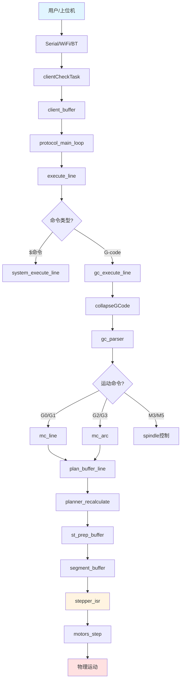
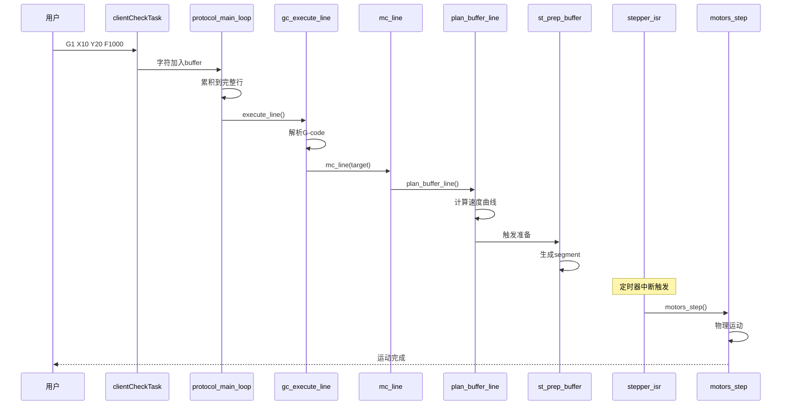

# G-code执行路径

## 数据流概览

从接收G-code到电机运动的完整路径：



## 1. 接收阶段

### clientCheckTask - 后台接收任务

**文件位置**：[Serial.cpp](../../Grbl_Esp32/src/Serial.cpp)

**运行核心**：Core 1（应用核心）

```cpp
void clientCheckTask(void* pvParameters) {
    while (true) {
        // 从所有客户端读取字符
        int c = getClientChar();

        if (c >= 0) {
            // 实时命令立即处理
            if (is_realtime_command(c)) {
                // 设置标志位
                if (c == '?') {
                    sys_rt_exec_state.statusReport = 1;
                } else if (c == '!') {
                    sys_rt_exec_state.feedHold = 1;
                } else if (c == '~') {
                    sys_rt_exec_state.cycleStart = 1;
                } else if (c == 0x18) {  // Ctrl+X
                    sys_rt_exec_state.reset = 1;
                }
            } else {
                // 普通字符加入缓冲区
                client_buffer[current_client].write(c);
            }
        }

        vTaskDelay(1);  // 让出CPU
    }
}
```

**关键点**：
- 运行在独立任务，不阻塞主循环
- 实时命令字符级拦截
- 多客户端支持（Serial, WiFi, BT）

### getClientChar - 多客户端轮询

```cpp
int getClientChar() {
    // 优先级：Serial > WebUI > Bluetooth > WiFi

    // 1. 检查串口
    if (Serial.available()) {
        current_client = CLIENT_SERIAL;
        return Serial.read();
    }

    // 2. 检查WebUI输入缓冲
    if (WebUI::inputBuffer.available()) {
        current_client = CLIENT_INPUT;
        return WebUI::inputBuffer.read();
    }

    // 3. 检查蓝牙
#ifdef ENABLE_BLUETOOTH
    if (SerialBT.available()) {
        current_client = CLIENT_BT;
        return SerialBT.read();
    }
#endif

    // 4. 检查WiFi
#ifdef ENABLE_WIFI
    if (telnet_server.available()) {
        current_client = CLIENT_WIFI;
        return telnet_server.read();
    }
#endif

    return -1;  // 无数据
}
```

## 2. 主循环处理

### protocol_main_loop - 主循环

**文件位置**：[Protocol.cpp](../../Grbl_Esp32/src/Protocol.cpp)

**运行核心**：Core 0（协议核心）

```cpp
void protocol_main_loop() {
    while (!sys.abort) {
        // 1. 从所有客户端读取命令
        for (int client = 0; client < CLIENT_COUNT; client++) {
            int c;
            while ((c = client_read(client)) != -1) {
                // 累积字符到行缓冲
                Error status = add_char_to_line(c, client);

                if (status == Error::Eol) {
                    // 收到完整行，执行
                    execute_line(line, client);
                    line[0] = '\0';  // 清空行缓冲
                } else if (status != Error::Ok) {
                    // 错误处理
                    report_status_message(status, client);
                }
            }
        }

        // 2. 检查点：处理实时命令
        protocol_execute_realtime();

        // 3. 自动启动循环
        protocol_auto_cycle_start();

        // 4. 再次检查实时命令
        protocol_execute_realtime();
    }
}
```

### add_char_to_line - 行缓冲累积

```cpp
Error add_char_to_line(char c, uint8_t client) {
    static uint8_t char_counter = 0;

    // 处理退格
    if (c == '\b') {
        if (char_counter > 0) {
            char_counter--;
        }
        return Error::Ok;
    }

    // 检查行结束
    if (c == '\n' || c == '\r') {
        line[char_counter] = '\0';
        char_counter = 0;
        return Error::Eol;  // End of Line
    }

    // 检查溢出
    if (char_counter >= LINE_BUFFER_SIZE - 1) {
        char_counter = 0;
        return Error::Overflow;
    }

    // 添加字符
    line[char_counter++] = c;
    return Error::Ok;
}
```

### execute_line - 命令分发

```cpp
Error execute_line(char* line, uint8_t client) {
    // 跳过空行
    if (line[0] == '\0') {
        return Error::Ok;
    }

    // 1. 系统命令（$开头）
    if (line[0] == '$') {
        return system_execute_line(line, client);
    }

    // 2. ESP命令（[ESP开头）
    if (line[0] == '[') {
        return WebUI::execute_esp_command(line, client);
    }

    // 3. 检查系统状态
    if (sys.state == State::Alarm || sys.state == State::Jog) {
        return Error::SystemGcLock;
    }

    // 4. G-code命令
    return gc_execute_line(line, client);
}
```

## 3. G-code解析

### gc_execute_line - G-code执行

**文件位置**：[GCode.cpp](../../Grbl_Esp32/src/GCode.cpp)

```cpp
Error gc_execute_line(char* line, uint8_t client) {
    // 1. 预处理：移除空格、注释、转大写
    collapseGCode(line);

    // 2. 解析G-code块
    parser_block_t gc_block;
    Error status = gc_parser(line, &gc_block);
    if (status != Error::Ok) {
        return status;
    }

    // 3. 执行非模态命令（立即执行）
    if (gc_block.non_modal_command != NonModal::None) {
        status = execute_non_modal(&gc_block);
        if (status != Error::Ok) {
            return status;
        }
    }

    // 4. 执行模态命令
    status = execute_modal(&gc_block);

    return status;
}
```

### collapseGCode - 预处理

```cpp
void collapseGCode(char* line) {
    char* dst = line;
    char* src = line;
    bool in_comment = false;

    while (*src) {
        if (*src == '(') {
            in_comment = true;
        } else if (*src == ')') {
            in_comment = false;
        } else if (!in_comment) {
            if (*src != ' ' && *src != '\t') {
                *dst++ = toupper(*src);
            }
        }
        src++;
    }
    *dst = '\0';
}

// 示例：
// 输入: "g1 x10.5 y20 (comment) f1000"
// 输出: "G1X10.5Y20F1000"
```

### gc_parser - 解析器

```cpp
Error gc_parser(char* line, parser_block_t* gc_block) {
    // 初始化块
    memset(gc_block, 0, sizeof(parser_block_t));

    char* p = line;

    while (*p) {
        char letter = *p++;
        float value = 0.0;

        // 读取数值
        if (!read_float(p, &value, &p)) {
            return Error::BadNumberFormat;
        }

        // 根据字母分类
        switch (letter) {
            case 'G':
                // G命令
                gc_block.modal.motion = (Motion)value;
                break;

            case 'M':
                // M命令
                gc_block.modal.spindle = (Spindle)value;
                break;

            case 'X':
                gc_block.values.xyz[X_AXIS] = value;
                gc_block.words.x = 1;
                break;

            case 'Y':
                gc_block.values.xyz[Y_AXIS] = value;
                gc_block.words.y = 1;
                break;

            case 'Z':
                gc_block.values.xyz[Z_AXIS] = value;
                gc_block.words.z = 1;
                break;

            case 'F':
                gc_block.values.f = value;
                gc_block.words.f = 1;
                break;

            case 'S':
                gc_block.values.s = value;
                gc_block.words.s = 1;
                break;

            // ... 其他字母
        }
    }

    return Error::Ok;
}
```

### execute_modal - 模态命令执行

```cpp
Error execute_modal(parser_block_t* gc_block) {
    // 1. 主轴控制（M3/M4/M5）
    if (gc_block->modal.spindle != gc_state.modal.spindle) {
        if (gc_block->modal.spindle == Spindle::CW) {
            spindle->set_state(SpindleState::Cw, gc_state.spindle_speed);
        } else if (gc_block->modal.spindle == Spindle::CCW) {
            spindle->set_state(SpindleState::Ccw, gc_state.spindle_speed);
        } else {
            spindle->stop();
        }
    }

    // 2. 冷却液控制（M7/M8/M9）
    if (gc_block->modal.coolant != gc_state.modal.coolant) {
        coolant_set_state(gc_block->modal.coolant);
    }

    // 3. 运动命令（G0/G1/G2/G3）
    if (gc_block->modal.motion != Motion::None) {
        switch (gc_block->modal.motion) {
            case Motion::Seek:      // G0
            case Motion::Linear:    // G1
                return mc_line(gc_block->values.xyz,
                              &pl_data,
                              gc_state.position);

            case Motion::CwArc:     // G2
            case Motion::CcwArc:    // G3
                return mc_arc(gc_block->values.xyz,
                             &pl_data,
                             gc_state.position,
                             gc_block->values.ijk,
                             gc_block->values.r,
                             gc_block->modal.motion == Motion::CwArc);
        }
    }

    return Error::Ok;
}
```

## 4. 运动控制

### mc_line - 直线运动

**文件位置**：[MotionControl.cpp](../../Grbl_Esp32/src/MotionControl.cpp)

```cpp
Error mc_line(float* target, plan_line_data_t* pl_data, float* position) {
    // 1. 检查软限位
    if (soft_limit->get()) {
        if (limitsCheckTravel(target)) {
            return Error::TravelExceeded;
        }
    }

    // 2. 添加到planner buffer
    if (!plan_buffer_line(target, pl_data)) {
        return Error::BufferOverflow;
    }

    // 3. 自动启动循环
    if (sys.state == State::Idle) {
        sys_rt_exec_state.cycleStart = 1;
    }

    return Error::Ok;
}
```

### mc_arc - 圆弧运动

```cpp
Error mc_arc(float* target, plan_line_data_t* pl_data, float* position,
             float* offset, float radius, bool is_clockwise) {
    // 1. 计算圆弧参数
    float center_axis0 = position[plane_axis_0] + offset[plane_axis_0];
    float center_axis1 = position[plane_axis_1] + offset[plane_axis_1];
    float r_axis0 = -offset[plane_axis_0];
    float r_axis1 = -offset[plane_axis_1];
    float rt_axis0 = target[plane_axis_0] - center_axis0;
    float rt_axis1 = target[plane_axis_1] - center_axis1;

    // 2. 计算角度
    float angular_travel = atan2(r_axis0 * rt_axis1 - r_axis1 * rt_axis0,
                                 r_axis0 * rt_axis0 + r_axis1 * rt_axis1);

    // 3. 分段为直线
    uint16_t segments = floor(fabs(angular_travel) /
                              (2 * M_PI / N_ARC_CORRECTION));

    float theta_per_segment = angular_travel / segments;

    // 4. 生成各段
    for (uint16_t i = 1; i <= segments; i++) {
        float cos_Ti = cos(i * theta_per_segment);
        float sin_Ti = sin(i * theta_per_segment);

        // 计算段终点
        float segment_target[MAX_N_AXIS];
        segment_target[plane_axis_0] = center_axis0 +
                                       r_axis0 * cos_Ti -
                                       r_axis1 * sin_Ti;
        segment_target[plane_axis_1] = center_axis1 +
                                       r_axis0 * sin_Ti +
                                       r_axis1 * cos_Ti;

        // 添加到planner
        plan_buffer_line(segment_target, pl_data);
    }

    return Error::Ok;
}
```

## 5. 运动规划

### plan_buffer_line - 添加到planner

**文件位置**：[Planner.cpp](../../Grbl_Esp32/src/Planner.cpp)

```cpp
bool plan_buffer_line(float* target, plan_line_data_t* pl_data) {
    // 1. 检查buffer是否满
    uint8_t next_buffer_head = next_block_index(block_buffer_head);
    if (next_buffer_head == block_buffer_tail) {
        return false;  // Buffer满
    }

    // 2. 获取新块
    plan_block_t* block = &block_buffer[block_buffer_head];

    // 3. 计算各轴步数
    for (int axis = 0; axis < N_AXIS; axis++) {
        block->steps[axis] = lround((target[axis] - position[axis]) *
                                    axis_settings->steps_per_mm[axis]);
    }

    // 4. 计算总步数
    block->step_event_count = max(block->steps);

    // 5. 计算速度和加速度
    block->millimeters = sqrt(dx*dx + dy*dy + dz*dz);
    block->acceleration = min(pl_data->acceleration,
                             axis_settings->acceleration);

    // 6. 计算最大入口速度
    block->max_entry_speed_sqr = min(pl_data->feed_rate * pl_data->feed_rate,
                                     max_allowable_speed_sqr);

    // 7. 更新buffer头
    block_buffer_head = next_buffer_head;

    // 8. 重新计算速度曲线
    planner_recalculate();

    return true;
}
```

### planner_recalculate - 速度曲线优化

```cpp
void planner_recalculate() {
    // 1. 反向遍历：计算减速
    uint8_t block_index = block_buffer_head;
    plan_block_t* current;
    plan_block_t* next = NULL;

    while (block_index != block_buffer_tail) {
        block_index = prev_block_index(block_index);
        current = &block_buffer[block_index];

        if (next) {
            // 计算当前块的最大出口速度
            current->max_exit_speed_sqr =
                min(current->max_entry_speed_sqr,
                    next->entry_speed_sqr +
                    2 * current->acceleration * current->millimeters);
        }

        next = current;
    }

    // 2. 正向遍历：计算加速
    plan_block_t* previous = NULL;
    block_index = block_buffer_tail;

    while (block_index != block_buffer_head) {
        current = &block_buffer[block_index];

        if (previous) {
            // 计算当前块的入口速度
            current->entry_speed_sqr =
                min(current->max_entry_speed_sqr,
                    previous->exit_speed_sqr +
                    2 * previous->acceleration * previous->millimeters);
        }

        previous = current;
        block_index = next_block_index(block_index);
    }
}
```

## 6. 步进准备

### st_prep_buffer - 准备步进段

**文件位置**：[Stepper.cpp](../../Grbl_Esp32/src/Stepper.cpp)

```cpp
void st_prep_buffer() {
    while (segment_buffer_tail != segment_next_head) {
        // 1. 检查planner buffer
        if (pl_block == NULL) {
            pl_block = plan_get_current_block();
            if (pl_block == NULL) {
                return;  // 无块可用
            }
        }

        // 2. 计算段参数
        float dt = (1.0 / ACCELERATION_TICKS_PER_SECOND);
        float mm_per_step = pl_block->millimeters / pl_block->step_event_count;

        // 3. 计算Bresenham参数
        prep.step_per_mm = pl_block->step_event_count / pl_block->millimeters;

        // 4. 填充segment
        segment_t* prep_segment = &segment_buffer[segment_buffer_head];
        prep_segment->n_step = steps_remaining;
        prep_segment->cycles_per_tick = cycles_per_tick;
        prep_segment->dir_bits = direction_bits;

        // 5. 更新buffer头
        segment_buffer_head = segment_next_head;
        segment_next_head = next_segment_index(segment_buffer_head);
    }
}
```

## 7. 步进执行

### stepper_isr - 步进中断

```cpp
void IRAM_ATTR stepper_isr() {
    // 1. 加载当前段
    if (step_count == 0) {
        current_segment = &segment_buffer[segment_buffer_tail];
        step_count = current_segment->n_step;
        direction_bits = current_segment->dir_bits;

        // 设置方向
        motors_set_direction(direction_bits);
    }

    // 2. Bresenham算法
    for (int axis = 0; axis < N_AXIS; axis++) {
        counter[axis] += steps[axis];
        if (counter[axis] >= step_event_count) {
            step_bits |= (1 << axis);
            counter[axis] -= step_event_count;
        }
    }

    // 3. 输出步进脉冲
    motors_step(step_bits);

    // 4. 延迟后清除脉冲
    delayMicroseconds(step_pulse_time);
    motors_unstep();

    // 5. 更新计数
    step_count--;
    if (step_count == 0) {
        segment_buffer_tail = next_segment_index(segment_buffer_tail);
    }

    // 6. 设置下次中断
    timer_set_alarm_value(STEP_TIMER_GROUP, STEP_TIMER_INDEX,
                         current_segment->cycles_per_tick);
}
```

### motors_step - 电机步进

**文件位置**：[Motors/Motors.cpp](../../Grbl_Esp32/src/Motors/Motors.cpp)

```cpp
void motors_step(uint8_t step_mask) {
    for (int axis = 0; axis < N_AXIS; axis++) {
        if (step_mask & (1 << axis)) {
            // 主电机
            if (myMotor[axis][0]) {
                myMotor[axis][0]->step();
            }

            // Ganged电机
            if (myMotor[axis][1]) {
                myMotor[axis][1]->step();
            }
        }
    }
}
```

## 执行时序



## 性能指标

### 延迟分析

```
接收字符 → 加入buffer:           ~1μs
buffer → 完整行:                  ~100μs (取决于行长度)
解析G-code:                       ~500μs
添加到planner:                    ~200μs
planner重计算:                    ~1ms (取决于buffer大小)
准备segment:                      ~100μs
ISR执行:                          ~5-10μs

总延迟（G-code → 第一个步进脉冲）: ~2-3ms
```

### 吞吐量

```
最大步进频率:                     120kHz
planner buffer大小:               16块
segment buffer大小:               6段
最大G-code处理速率:               ~1000行/秒
```

## 技术约束

### 1. Buffer大小限制

- Planner buffer: 16块（可配置）
- Segment buffer: 6段（可配置）
- Line buffer: 80字符（可配置）

### 2. 实时性要求

- ISR执行时间: < 10μs
- Planner重计算: < 5ms
- G-code解析: < 1ms

### 3. 精度限制

- 位置精度: 0.001mm
- 速度精度: 1mm/min
- 加速度精度: 1mm/sec²

## 下一步

阅读 [09_实时命令与状态机.md](09_实时命令与状态机.md) 了解实时命令的处理机制和系统状态转换。

## 参考资源

- **Grbl G-code**: https://github.com/gnea/grbl/wiki/Grbl-v1.1-Commands
- **运动规划算法**: https://github.com/gnea/grbl/wiki/Grbl's-Acceleration-Manager
- **Bresenham算法**: https://en.wikipedia.org/wiki/Bresenham%27s_line_algorithm
