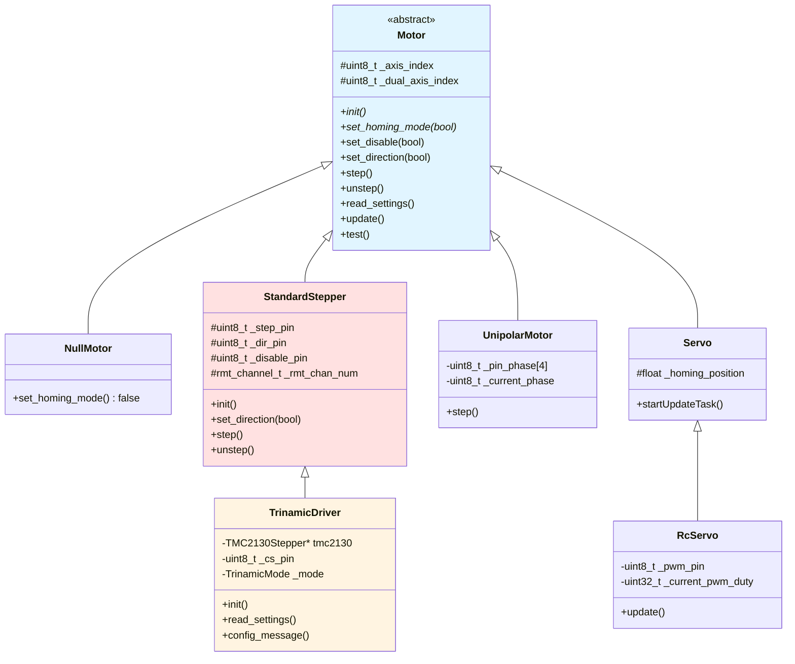

# Motor 驱动体系

## Motor 驱动概览

Grbl_Esp32 通过多态设计支持多种电机类型，所有电机驱动都继承自 `Motor` 基类。

### 继承关系



## Motor 基类

**文件位置**：[Motors/Motor.h](../../Grbl_Esp32/src/Motors/Motor.h)

### 关键虚函数

```cpp
class Motor {
protected:
    uint8_t _axis_index;       // X_AXIS, Y_AXIS, Z_AXIS, A_AXIS, B_AXIS, C_AXIS
    uint8_t _dual_axis_index;  // 0 = 主电机, 1 = Ganged电机

public:
    Motor(uint8_t axis_index, uint8_t dual_axis_index = 0)
        : _axis_index(axis_index), _dual_axis_index(dual_axis_index) {}

    virtual ~Motor() {}

    // 纯虚函数（必须实现）
    virtual bool set_homing_mode(bool isHoming) = 0;

    // 虚函数（可选实现）
    virtual void init() {}
    virtual void read_settings() {}
    virtual void set_disable(bool disable) {}
    virtual void set_direction(bool direction) {}
    virtual void step() {}
    virtual void unstep() {}
    virtual bool test() { return true; }
    virtual void update() {}
    virtual void debug_message() {}

protected:
    virtual void config_message() {}
};
```

**关键点**：
- `set_homing_mode()` 是纯虚函数，必须实现
- 其他函数有默认空实现
- 使用 `_axis_index` 区分不同轴
- 使用 `_dual_axis_index` 支持Ganged电机

## StandardStepper - 标准步进电机

**文件位置**：[Motors/StandardStepper.h](../../Grbl_Esp32/src/Motors/StandardStepper.h)

### 类定义

```cpp
class StandardStepper : public Motor {
protected:
    bool    _invert_step_pin;
    bool    _invert_dir_pin;
    uint8_t _step_pin;
    uint8_t _dir_pin;
    uint8_t _disable_pin;

#ifdef USE_RMT_STEPS
    rmt_channel_t _rmt_chan_num;  // RMT通道号
#endif

public:
    StandardStepper(uint8_t axis_index, uint8_t step_pin, uint8_t dir_pin,
                    uint8_t disable_pin, uint8_t dual_axis_index = 0);

    void init() override;
    bool set_homing_mode(bool isHoming) override { return true; }
    void set_disable(bool disable) override;
    void set_direction(bool direction) override;
    void step() override;
    void unstep() override;
    void read_settings() override;

protected:
    void config_message() override;
    void init_step_dir_pins();
};
```

### 初始化流程

**文件位置**：[Motors/StandardStepper.cpp](../../Grbl_Esp32/src/Motors/StandardStepper.cpp)

```cpp
void StandardStepper::init() {
    read_settings();
    config_message();
}

void StandardStepper::read_settings() {
    // 读取反转设置
    _invert_step_pin = bitnum_is_true(step_invert_mask->get(), _axis_index);
    _invert_dir_pin = bitnum_is_true(dir_invert_mask->get(), _axis_index);

    init_step_dir_pins();
}

void StandardStepper::init_step_dir_pins() {
    // 配置步进引脚
    pinMode(_step_pin, OUTPUT);
    digitalWrite(_step_pin, _invert_step_pin ? HIGH : LOW);

    // 配置方向引脚
    pinMode(_dir_pin, OUTPUT);
    digitalWrite(_dir_pin, _invert_dir_pin ? HIGH : LOW);

    // 配置使能引脚
    if (_disable_pin != UNDEFINED_PIN) {
        pinMode(_disable_pin, OUTPUT);
        digitalWrite(_disable_pin, HIGH);  // 默认禁用
    }

#ifdef USE_RMT_STEPS
    // 分配RMT通道
    static uint8_t next_RMT_chan_num = 0;
    _rmt_chan_num = (rmt_channel_t)next_RMT_chan_num++;

    // 配置RMT
    rmt_config_t rmt_tx = {
        .rmt_mode = RMT_MODE_TX,
        .channel = _rmt_chan_num,
        .gpio_num = (gpio_num_t)_step_pin,
        .clk_div = 20,  // 4MHz时钟
        .mem_block_num = 2,
        .tx_config = {
            .carrier_en = false,
            .loop_en = false,
            .idle_level = _invert_step_pin ? RMT_IDLE_LEVEL_HIGH : RMT_IDLE_LEVEL_LOW,
            .idle_output_en = true,
        }
    };

    rmt_config(&rmt_tx);
    rmt_driver_install(_rmt_chan_num, 0, 0);
#endif
}
```

### 步进脉冲生成

```cpp
void StandardStepper::step() {
#ifdef USE_RMT_STEPS
    // 使用RMT硬件生成脉冲
    rmt_item32_t rmtItem[1];

    // 脉冲宽度（微秒）
    uint32_t pulse_us = pulse_microseconds->get();

    // 高电平持续时间
    rmtItem[0].level0 = _invert_step_pin ? 0 : 1;
    rmtItem[0].duration0 = pulse_us * 4;  // 4MHz时钟

    // 低电平持续时间
    rmtItem[0].level1 = _invert_step_pin ? 1 : 0;
    rmtItem[0].duration1 = 0;  // 立即结束

    // 发送脉冲
    rmt_write_items(_rmt_chan_num, rmtItem, 1, false);
#else
    // 使用GPIO直接输出
    digitalWrite(_step_pin, _invert_step_pin ? LOW : HIGH);
#endif
}

void StandardStepper::unstep() {
#ifndef USE_RMT_STEPS
    // RMT模式下自动清除，无需手动unstep
    digitalWrite(_step_pin, _invert_step_pin ? HIGH : LOW);
#endif
}
```

### 方向控制

```cpp
void StandardStepper::set_direction(bool direction) {
    // 应用方向反转
    bool dir_output = direction ^ _invert_dir_pin;

    digitalWrite(_dir_pin, dir_output ? HIGH : LOW);

    // 方向延迟（确保驱动器识别）
    uint32_t delay_us = direction_delay_microseconds->get();
    if (delay_us > 0) {
        delayMicroseconds(delay_us);
    }
}
```

### 使能控制

```cpp
void StandardStepper::set_disable(bool disable) {
    if (_disable_pin != UNDEFINED_PIN) {
        // 使能引脚通常低电平有效
        bool disable_invert = bitnum_is_true(
            steppers_disable_invert_mask->get(), _axis_index);

        digitalWrite(_disable_pin,
                    (disable ^ disable_invert) ? HIGH : LOW);
    }
}
```

## TrinamicDriver - Trinamic智能驱动

**文件位置**：[Motors/TrinamicDriver.h](../../Grbl_Esp32/src/Motors/TrinamicDriver.h)

### 类定义

```cpp
class TrinamicDriver : public StandardStepper {
public:
    enum class TrinamicMode : uint8_t {
        None        = 0,
        StealthChop = 1,  // 静音模式
        CoolStep    = 2,  // 冷却模式
        StallGuard  = 3,  // 堵转检测
    };

private:
    TMC2130Stepper* tmc2130 = nullptr;
    TMC5160Stepper* tmc5160 = nullptr;

    TrinamicMode _homing_mode;
    uint8_t      _cs_pin;
    uint16_t     _driver_part_number;  // 2130, 5160
    float        _r_sense;              // 感应电阻值
    int8_t       _spi_index;            // SPI总线索引
    bool         _has_errors;
    bool         _disabled;
    TrinamicMode _mode;

    // 链表管理
    static TrinamicDriver* List;
    TrinamicDriver*        link;

public:
    TrinamicDriver(uint8_t axis_index, uint8_t step_pin, uint8_t dir_pin,
                   uint8_t cs_pin, uint16_t driver_part_number,
                   float r_sense, int8_t spi_index);

    void init() override;
    void read_settings() override;
    bool set_homing_mode(bool isHoming) override;
    bool test() override;
    void debug_message() override;

protected:
    void config_message() override;

private:
    void set_mode(TrinamicMode mode);
    void read_sg_status();
    bool report_open_load();
    bool report_short_to_ground();
    bool report_over_temp();
    bool report_short_to_ps();

    static void readSgTask(void* pvParameters);
};
```

### 初始化流程

```cpp
TrinamicDriver::TrinamicDriver(uint8_t axis_index, uint8_t step_pin,
                               uint8_t dir_pin, uint8_t cs_pin,
                               uint16_t driver_part_number, float r_sense,
                               int8_t spi_index)
    : StandardStepper(axis_index, step_pin, dir_pin, UNDEFINED_PIN),
      _cs_pin(cs_pin),
      _driver_part_number(driver_part_number),
      _r_sense(r_sense),
      _spi_index(spi_index) {

    // 添加到链表
    link = List;
    List = this;

    // 创建TMC对象
    if (_driver_part_number == 2130) {
        tmc2130 = new TMC2130Stepper(_cs_pin, _r_sense, _spi_index);
    } else if (_driver_part_number == 5160) {
        tmc5160 = new TMC5160Stepper(_cs_pin, _r_sense, _spi_index);
    }

    // 配置CS引脚
    pinMode(_cs_pin, OUTPUT);
    digitalWrite(_cs_pin, HIGH);
}

void TrinamicDriver::init() {
    config_message();

    // 初始化SPI
    if (_spi_index == -1) {
        SPI.begin();
    }

    // 测试通信
    if (!test()) {
        grbl_msg_sendf(CLIENT_SERIAL, MsgLevel::Error,
                      "Trinamic driver not responding");
        return;
    }

    // 读取设置
    read_settings();

    // 设置模式
    set_mode(_mode);

    // 创建StallGuard监控任务（仅一次）
    static bool task_created = false;
    if (!task_created && _mode == TrinamicMode::StallGuard) {
        xTaskCreate(readSgTask, "readSgTask", 4096, NULL, 1, NULL);
        task_created = true;
    }
}
```

### 模式设置

```cpp
void TrinamicDriver::set_mode(TrinamicMode mode) {
    _mode = mode;

    if (tmc2130) {
        switch (mode) {
            case TrinamicMode::StealthChop:
                tmc2130->en_pwm_mode(true);   // 启用PWM模式
                tmc2130->pwm_autoscale(true); // 自动缩放
                tmc2130->diag1_stall(false);  // 禁用堵转检测
                break;

            case TrinamicMode::CoolStep:
                tmc2130->en_pwm_mode(false);  // 禁用PWM模式
                tmc2130->TCOOLTHRS(0xFFFFF);  // CoolStep阈值
                tmc2130->diag1_stall(false);
                break;

            case TrinamicMode::StallGuard:
                tmc2130->en_pwm_mode(false);
                tmc2130->TCOOLTHRS(0xFFFFF);
                tmc2130->diag1_stall(true);   // 启用堵转检测
                tmc2130->diag1_pushpull(true);
                break;

            default:
                break;
        }
    }
}
```

### StallGuard监控

```cpp
void TrinamicDriver::readSgTask(void* pvParameters) {
    while (true) {
        // 遍历所有Trinamic驱动
        for (TrinamicDriver* p = List; p; p = p->link) {
            if (p->_mode == TrinamicMode::StallGuard) {
                p->read_sg_status();
            }
        }

        vTaskDelay(pdMS_TO_TICKS(100));  // 100ms检查一次
    }
}

void TrinamicDriver::read_sg_status() {
    if (tmc2130) {
        uint32_t drv_status = tmc2130->DRV_STATUS();

        // 检查堵转
        if (drv_status & TMC2130_STALLGUARD) {
            grbl_msg_sendf(CLIENT_SERIAL, MsgLevel::Warning,
                          "Axis %c StallGuard triggered", axis_letter());
        }

        // 检查其他错误
        report_open_load();
        report_short_to_ground();
        report_over_temp();
        report_short_to_ps();
    }
}
```

## UnipolarMotor - 单极步进电机

**文件位置**：[Motors/UnipolarMotor.h](../../Grbl_Esp32/src/Motors/UnipolarMotor.h)

### 类定义

```cpp
class UnipolarMotor : public Motor {
private:
    uint8_t _pin_phase0, _pin_phase1, _pin_phase2, _pin_phase3;
    uint8_t _current_phase;
    bool    _half_step;
    bool    _enabled;
    bool    _dir;

public:
    UnipolarMotor(uint8_t axis_index, uint8_t phase0, uint8_t phase1,
                  uint8_t phase2, uint8_t phase3);

    void init() override;
    bool set_homing_mode(bool isHoming) override { return true; }
    void set_disable(bool disable) override;
    void set_direction(bool direction) override;
    void step() override;
    void unstep() override {}  // 不需要unstep
};
```

### 步进序列

```cpp
// 全步序列
static const uint8_t full_step_sequence[4] = {
    0b1000,  // Phase 0
    0b0100,  // Phase 1
    0b0010,  // Phase 2
    0b0001,  // Phase 3
};

// 半步序列
static const uint8_t half_step_sequence[8] = {
    0b1000,  // Phase 0
    0b1100,  // Phase 0+1
    0b0100,  // Phase 1
    0b0110,  // Phase 1+2
    0b0010,  // Phase 2
    0b0011,  // Phase 2+3
    0b0001,  // Phase 3
    0b1001,  // Phase 3+0
};

void UnipolarMotor::step() {
    if (!_enabled) return;

    // 更新相位
    if (_dir) {
        _current_phase++;
    } else {
        _current_phase--;
    }

    // 获取相位模式
    uint8_t pattern;
    if (_half_step) {
        _current_phase %= 8;
        pattern = half_step_sequence[_current_phase];
    } else {
        _current_phase %= 4;
        pattern = full_step_sequence[_current_phase];
    }

    // 输出到引脚
    digitalWrite(_pin_phase0, (pattern & 0b1000) ? HIGH : LOW);
    digitalWrite(_pin_phase1, (pattern & 0b0100) ? HIGH : LOW);
    digitalWrite(_pin_phase2, (pattern & 0b0010) ? HIGH : LOW);
    digitalWrite(_pin_phase3, (pattern & 0b0001) ? HIGH : LOW);
}
```

## RcServo - RC伺服电机

**文件位置**：[Motors/RcServo.h](../../Grbl_Esp32/src/Motors/RcServo.h)

### 类定义

```cpp
class RcServo : public Servo {
private:
    uint8_t  _pwm_pin;
    uint8_t  _channel_num;
    uint32_t _current_pwm_duty;
    float    _homing_position;
    float    _pwm_pulse_min;
    float    _pwm_pulse_max;
    bool     _disabled;

    FloatSetting* rc_servo_cal_min;
    FloatSetting* rc_servo_cal_max;

public:
    RcServo(uint8_t axis_index, uint8_t pwm_pin);

    void init() override;
    bool set_homing_mode(bool isHoming) override;
    void set_disable(bool disable) override;
    void update() override;
    void read_settings() override;
};
```

### PWM控制

```cpp
void RcServo::init() {
    // 配置LEDC
    ledcSetup(_channel_num, 50, 16);  // 50Hz, 16位精度
    ledcAttachPin(_pwm_pin, _channel_num);

    read_settings();

    // 启动更新任务
    startUpdateTask();
}

void RcServo::update() {
    if (_disabled) return;

    // 计算目标位置（mm）
    float target_position = system_convert_axis_steps_to_mpos(
        sys_position[_axis_index], _axis_index);

    // 映射到PWM脉冲宽度（1-2ms）
    float pulse_ms = map_float(target_position,
                               0, axis_settings->max_travel[_axis_index],
                               _pwm_pulse_min, _pwm_pulse_max);

    // 转换为占空比（50Hz = 20ms周期）
    uint32_t duty = (uint32_t)(pulse_ms / 20.0 * 65535);

    // 输出PWM
    if (duty != _current_pwm_duty) {
        ledcWrite(_channel_num, duty);
        _current_pwm_duty = duty;
    }
}
```

## Motor 管理

### 全局电机数组

**文件位置**：[Motors/Motors.cpp](../../Grbl_Esp32/src/Motors/Motors.cpp)

```cpp
Motors::Motor* myMotor[MAX_AXES][MAX_GANGED];
// MAX_AXES = 6 (X, Y, Z, A, B, C)
// MAX_GANGED = 2 (主电机 + Ganged电机)
```

### init_motors - 电机初始化

```cpp
void init_motors() {
    uint8_t n_axis = number_axis->get();

    for (uint8_t axis = 0; axis < n_axis; axis++) {
        // 主电机
        myMotor[axis][0] = make_motor(axis, 0);

        // Ganged电机
        myMotor[axis][1] = make_motor(axis, 1);
    }

    // 初始化所有电机
    for (uint8_t axis = 0; axis < n_axis; axis++) {
        for (uint8_t gang = 0; gang < MAX_GANGED; gang++) {
            if (myMotor[axis][gang]) {
                myMotor[axis][gang]->init();
            }
        }
    }
}

Motor* make_motor(uint8_t axis, uint8_t gang_index) {
    // 根据机器配置创建电机
#ifdef X_TRINAMIC_DRIVER
    if (axis == X_AXIS && gang_index == 0) {
        return new TrinamicDriver(axis, X_STEP_PIN, X_DIRECTION_PIN,
                                 X_CS_PIN, X_TRINAMIC_DRIVER,
                                 X_RSENSE, X_SPI_INDEX);
    }
#elif defined(X_SERVO_PIN)
    if (axis == X_AXIS && gang_index == 0) {
        return new RcServo(axis, X_SERVO_PIN);
    }
#elif defined(X_UNIPOLAR)
    if (axis == X_AXIS && gang_index == 0) {
        return new UnipolarMotor(axis, X_PIN_PHASE_0, X_PIN_PHASE_1,
                                X_PIN_PHASE_2, X_PIN_PHASE_3);
    }
#elif defined(X_STEP_PIN)
    if (axis == X_AXIS && gang_index == 0) {
        return new StandardStepper(axis, X_STEP_PIN, X_DIRECTION_PIN,
                                  STEPPERS_DISABLE_PIN);
    }
#endif

    // ... 其他轴类似

    return new NullMotor(axis);
}
```

### 批量控制函数

```cpp
void motors_set_direction(uint8_t dir_mask) {
    for (int axis = 0; axis < N_AXIS; axis++) {
        bool dir = bitnum_is_true(dir_mask, axis);

        if (myMotor[axis][0]) {
            myMotor[axis][0]->set_direction(dir);
        }

        if (myMotor[axis][1]) {
            myMotor[axis][1]->set_direction(dir);
        }
    }
}

void motors_step(uint8_t step_mask) {
    for (int axis = 0; axis < N_AXIS; axis++) {
        if (bitnum_is_true(step_mask, axis)) {
            if (myMotor[axis][0]) {
                myMotor[axis][0]->step();
            }

            if (myMotor[axis][1]) {
                myMotor[axis][1]->step();
            }
        }
    }
}

void motors_unstep() {
    for (int axis = 0; axis < N_AXIS; axis++) {
        if (myMotor[axis][0]) {
            myMotor[axis][0]->unstep();
        }

        if (myMotor[axis][1]) {
            myMotor[axis][1]->unstep();
        }
    }
}

void motors_set_disable(bool disable, uint8_t mask) {
    for (int axis = 0; axis < N_AXIS; axis++) {
        if (bitnum_is_true(mask, axis)) {
            if (myMotor[axis][0]) {
                myMotor[axis][0]->set_disable(disable);
            }

            if (myMotor[axis][1]) {
                myMotor[axis][1]->set_disable(disable);
            }
        }
    }
}
```

## 技术约束

### 1. RMT通道限制

- ESP32只有8个RMT通道
- 每个StandardStepper占用1个通道
- 最多支持8个轴（包括Ganged）

### 2. GPIO限制

- 避免使用启动引脚
- 避免使用输入专用引脚作为输出
- 注意引脚冲突

### 3. SPI总线共享

- Trinamic驱动共享SPI总线
- 使用CS引脚区分不同驱动
- 注意SPI速度设置

### 4. 实时性要求

- `step()` 和 `unstep()` 在ISR中调用
- 执行时间必须 < 5μs
- 避免阻塞操作

## 兼容性注意事项

### 1. Ganged电机同步

- 两个电机必须同时step
- 方向可以独立设置（用于自动平方）
- 使能状态应该一致

### 2. Trinamic驱动配置

- 电流设置需要根据电机调整
- StallGuard阈值需要测试
- SPI通信速度不能太快

### 3. RcServo更新频率

- 更新任务50Hz
- 避免抖动
- 平滑运动

## 下一步

阅读 [07_Spindle驱动体系.md](07_Spindle驱动体系.md) 了解主轴驱动的实现。

## 参考资源

- **TMCStepper库**: https://github.com/teemuatlut/TMCStepper
- **RMT文档**: https://docs.espressif.com/projects/esp-idf/en/latest/esp32/api-reference/peripherals/rmt.html
- **步进电机原理**: https://en.wikipedia.org/wiki/Stepper_motor
