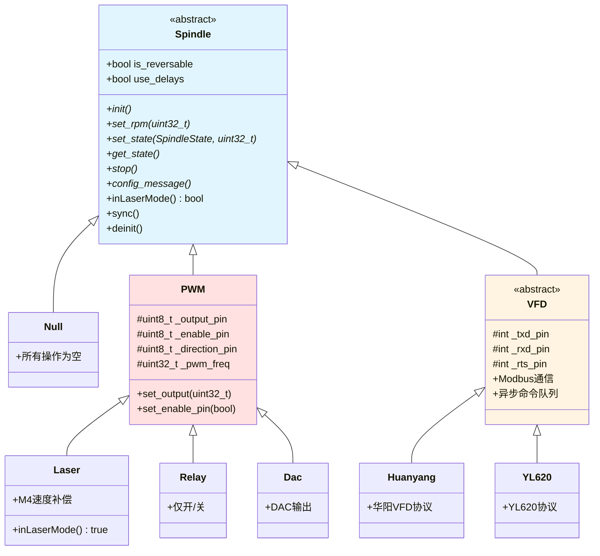

# Spindle 驱动体系

## Spindle 驱动概览

Grbl_Esp32 支持多种主轴类型，通过全局实例模式实现运行时切换。

### 继承关系



## Spindle 基类

**文件位置**：[Spindles/Spindle.h](../../Grbl_Esp32/src/Spindles/Spindle.h)

### 类定义

```cpp
class Spindle {
public:
    bool                  is_reversable;    // 是否可反转
    bool                  use_delays;       // 使用启动/停止延迟
    volatile SpindleState _current_state;   // 当前状态
    uint32_t              _spinup_delay;    // 启动延迟(ms)
    uint32_t              _spindown_delay;  // 停止延迟(ms)

    Spindle() : is_reversable(false), use_delays(false),
                _current_state(SpindleState::Disable),
                _spinup_delay(0), _spindown_delay(0) {}

    virtual ~Spindle() {}

    // 纯虚函数（必须实现）
    virtual void     init() = 0;
    virtual uint32_t set_rpm(uint32_t rpm) = 0;
    virtual void     set_state(SpindleState state, uint32_t rpm) = 0;
    virtual SpindleState get_state() = 0;
    virtual void     stop() = 0;
    virtual void     config_message() = 0;

    // 虚函数（可选实现）
    virtual bool inLaserMode() { return false; }
    virtual void sync(SpindleState state, uint32_t rpm) {}
    virtual void deinit() { stop(); }
};

// 主轴状态
enum class SpindleState : uint8_t {
    Disable = 0,  // M5
    Cw,           // M3 顺时针
    Ccw,          // M4 逆时针
};

// 主轴类型
enum class SpindleType : int8_t {
    NONE = 0,
    PWM,
    RELAY,
    LASER,
    DAC,
    HUANYANG,
    BESC,
    _10V,
    H2A,
    YL620,
    L510
};
```

### 全局实例与选择机制

**文件位置**：[Spindles/Spindle.cpp](../../Grbl_Esp32/src/Spindles/Spindle.cpp)

```cpp
namespace Spindles {
    // 所有主轴类型预实例化
    Null     null;
    PWM      pwm;
    Relay    relay;
    Laser    laser;
    Dac      dac;
    Huanyang huanyang;
    H2A      h2a;
    BESC     besc;
    _10v     _10v;
    YL620    yl620;
    L510     l510;

    // 全局主轴指针
    Spindle* spindle = &null;

    // 选择主轴
    void Spindle::select() {
        // 停止当前主轴
        spindle->deinit();

        // 读取主轴类型设置
        SpindleType type = static_cast<SpindleType>(spindle_type->get());

        // 选择对应实例
        switch (type) {
            case SpindleType::PWM:
                spindle = &pwm;
                break;
            case SpindleType::LASER:
                spindle = &laser;
                break;
            case SpindleType::RELAY:
                spindle = &relay;
                break;
            case SpindleType::DAC:
                spindle = &dac;
                break;
            case SpindleType::HUANYANG:
                spindle = &huanyang;
                break;
            case SpindleType::YL620:
                spindle = &yl620;
                break;
            case SpindleType::H2A:
                spindle = &h2a;
                break;
            case SpindleType::BESC:
                spindle = &besc;
                break;
            case SpindleType::_10V:
                spindle = &_10v;
                break;
            case SpindleType::L510:
                spindle = &l510;
                break;
            default:
                spindle = &null;
                break;
        }

        // 初始化选定的主轴
        spindle->init();
    }
}
```

## PWMSpindle - PWM主轴

**文件位置**：[Spindles/PWMSpindle.h](../../Grbl_Esp32/src/Spindles/PWMSpindle.h)

### 类定义

```cpp
class PWM : public Spindle {
protected:
    int32_t  _current_pwm_duty;
    uint32_t _min_rpm;
    uint32_t _max_rpm;
    uint32_t _pwm_off_value;
    uint32_t _pwm_min_value;
    uint32_t _pwm_max_value;
    uint8_t  _output_pin;
    uint8_t  _enable_pin;
    uint8_t  _direction_pin;
    uint8_t  _pwm_chan_num;
    uint32_t _pwm_freq;
    uint32_t _pwm_period;
    uint8_t  _pwm_precision;
    bool     _piecewide_linear;
    bool     _off_with_zero_speed;
    bool     _invert_pwm;

public:
    PWM() : Spindle() {}

    void     init() override;
    uint32_t set_rpm(uint32_t rpm) override;
    void     set_state(SpindleState state, uint32_t rpm) override;
    SpindleState get_state() override;
    void     stop() override;
    void     config_message() override;

protected:
    virtual void set_dir_pin(bool Clockwise);
    virtual void set_output(uint32_t duty);
    virtual void set_enable_pin(bool enable);
    virtual void deinit() override;
    virtual void get_pins_and_settings();
};
```

### 初始化

```cpp
void PWM::init() {
    get_pins_and_settings();

    // 检查输出引脚
    if (_output_pin == UNDEFINED_PIN) {
        grbl_msg_sendf(CLIENT_SERIAL, MsgLevel::Info,
                      "PWM spindle output pin not defined");
        return;
    }

    // 配置LEDC
    ledcSetup(_pwm_chan_num, _pwm_freq, _pwm_precision);
    ledcAttachPin(_output_pin, _pwm_chan_num);

    // 配置使能引脚
    if (_enable_pin != UNDEFINED_PIN) {
        pinMode(_enable_pin, OUTPUT);
        digitalWrite(_enable_pin, LOW);
    }

    // 配置方向引脚
    if (_direction_pin != UNDEFINED_PIN) {
        pinMode(_direction_pin, OUTPUT);
        is_reversable = true;
    }

    config_message();
}

void PWM::get_pins_and_settings() {
    // 从机器配置读取引脚
    _output_pin = SPINDLE_OUTPUT_PIN;
    _enable_pin = SPINDLE_ENABLE_PIN;
    _direction_pin = SPINDLE_DIR_PIN;

    // 读取设置
    _min_rpm = spindle_min_rpm->get();
    _max_rpm = spindle_max_rpm->get();
    _pwm_freq = spindle_pwm_freq->get();
    _pwm_precision = spindle_pwm_precision->get();

    // 计算PWM值范围
    _pwm_period = (1 << _pwm_precision) - 1;
    _pwm_off_value = spindle_pwm_off_value->get();
    _pwm_min_value = spindle_pwm_min_value->get();
    _pwm_max_value = spindle_pwm_max_value->get();

    // 分配LEDC通道
    static uint8_t next_pwm_chan = 0;
    _pwm_chan_num = next_pwm_chan++;
}
```

### RPM设置

```cpp
uint32_t PWM::set_rpm(uint32_t rpm) {
    // 限制RPM范围
    if (rpm == 0) {
        set_output(_pwm_off_value);
        return 0;
    }

    rpm = constrain(rpm, _min_rpm, _max_rpm);

    // 映射RPM到PWM占空比
    uint32_t pwm_value;
    if (_piecewide_linear) {
        // 分段线性映射
        pwm_value = piecewise_linear_fit(rpm);
    } else {
        // 线性映射
        pwm_value = map(rpm, _min_rpm, _max_rpm,
                       _pwm_min_value, _pwm_max_value);
    }

    set_output(pwm_value);

    return rpm;
}

void PWM::set_output(uint32_t duty) {
    // 应用PWM反转
    if (_invert_pwm) {
        duty = _pwm_period - duty;
    }

    // 输出到LEDC
    ledcWrite(_pwm_chan_num, duty);
    _current_pwm_duty = duty;
}
```

### 状态控制

```cpp
void PWM::set_state(SpindleState state, uint32_t rpm) {
    if (state == SpindleState::Disable) {
        stop();
        return;
    }

    // 设置方向
    set_dir_pin(state == SpindleState::Cw);

    // 设置使能
    set_enable_pin(true);

    // 设置转速
    set_rpm(rpm);

    // 启动延迟
    if (use_delays && _spinup_delay > 0) {
        delay(_spinup_delay);
    }

    _current_state = state;
}

void PWM::stop() {
    set_output(_pwm_off_value);
    set_enable_pin(false);

    // 停止延迟
    if (use_delays && _spindown_delay > 0) {
        delay(_spindown_delay);
    }

    _current_state = SpindleState::Disable;
}
```

## Laser - 激光主轴

**文件位置**：[Spindles/Laser.h](../../Grbl_Esp32/src/Spindles/Laser.h)

### 类定义

```cpp
class Laser : public PWM {
public:
    Laser() : PWM() {}

    bool inLaserMode() override { return true; }
    void config_message() override;
    void get_pins_and_settings() override;
    void deinit() override;
};
```

### 激光模式特性

```cpp
bool Laser::inLaserMode() {
    return true;  // 始终返回true
}

// 激光模式下的特殊处理：
// 1. M4命令支持速度补偿
// 2. 进给保持时自动关闭激光
// 3. 动态功率调整
```

### M4速度补偿

在G-code解析器中：

```cpp
// GCode.cpp
if (spindle->inLaserMode() && gc_block.modal.spindle == Spindle::Ccw) {
    // M4: 激光功率随速度变化
    pl_data->spindle_speed = gc_state.spindle_speed;
    pl_data->spindle_speed_ovr_counter = 0;
} else {
    // M3: 固定功率
    pl_data->spindle_speed = 0;
}
```

在步进控制器中：

```cpp
// Stepper.cpp
if (spindle->inLaserMode() && pl_block->spindle_speed > 0) {
    // 根据当前速度调整激光功率
    float speed_factor = current_speed / programmed_speed;
    uint32_t laser_power = pl_block->spindle_speed * speed_factor;
    spindle->set_rpm(laser_power);
}
```

## RelaySpindle - 继电器主轴

**文件位置**：[Spindles/RelaySpindle.h](../../Grbl_Esp32/src/Spindles/RelaySpindle.h)

### 类定义

```cpp
class Relay : public PWM {
public:
    Relay() : PWM() {}

    uint32_t set_rpm(uint32_t rpm) override;
    void     set_output(uint32_t duty) override;
};
```

### 开关控制

```cpp
uint32_t Relay::set_rpm(uint32_t rpm) {
    // 任何非零RPM都视为开启
    if (rpm > 0) {
        set_output(1);
        return _max_rpm;
    } else {
        set_output(0);
        return 0;
    }
}

void Relay::set_output(uint32_t duty) {
    // 仅输出高/低电平
    digitalWrite(_output_pin, duty > 0 ? HIGH : LOW);
}
```

## DacSpindle - DAC主轴

**文件位置**：[Spindles/DacSpindle.h](../../Grbl_Esp32/src/Spindles/DacSpindle.h)

### 类定义

```cpp
class Dac : public PWM {
private:
    bool _gpio_ok;  // DAC引脚有效性

public:
    Dac() : PWM(), _gpio_ok(false) {}

    void init() override;
    void set_output(uint32_t duty) override;
};
```

### DAC输出

```cpp
void Dac::init() {
    get_pins_and_settings();

    // 检查DAC引脚（仅GPIO25和GPIO26）
    if (_output_pin != GPIO_NUM_25 && _output_pin != GPIO_NUM_26) {
        grbl_msg_sendf(CLIENT_SERIAL, MsgLevel::Error,
                      "DAC spindle requires GPIO25 or GPIO26");
        _gpio_ok = false;
        return;
    }

    _gpio_ok = true;
    config_message();
}

void Dac::set_output(uint32_t duty) {
    if (!_gpio_ok) return;

    // 映射到8位DAC值（0-255）
    uint8_t dac_value = map(duty, 0, _pwm_period, 0, 255);

    // 输出到DAC
    if (_output_pin == GPIO_NUM_25) {
        dacWrite(25, dac_value);
    } else if (_output_pin == GPIO_NUM_26) {
        dacWrite(26, dac_value);
    }
}
```

## VFDSpindle - VFD基类

**文件位置**：[Spindles/VFDSpindle.h](../../Grbl_Esp32/src/Spindles/VFDSpindle.h)

### 类定义

```cpp
class VFD : public Spindle {
protected:
    int      _txd_pin, _rxd_pin, _rts_pin;
    uint32_t _current_rpm = 0;
    bool     _task_running = false;
    bool     vfd_ok = true;

    static QueueHandle_t vfd_cmd_queue;
    static TaskHandle_t  vfd_cmdTaskHandle;

    // Modbus命令结构
    struct ModbusCommand {
        bool    critical;
        uint8_t tx_length;
        uint8_t rx_length;
        uint8_t msg[VFD_RS485_MAX_MSG_SIZE];
    };

    using response_parser = bool (*)(const uint8_t* response, VFD* spindle);

public:
    VFD() : Spindle() {}

    void     init() override;
    uint32_t set_rpm(uint32_t rpm) override;
    void     set_state(SpindleState state, uint32_t rpm) override;
    SpindleState get_state() override;
    void     stop() override;
    void     config_message() override;

protected:
    // 纯虚函数（子类必须实现）
    virtual void direction_command(SpindleState mode, ModbusCommand& data) = 0;
    virtual void set_speed_command(uint32_t rpm, ModbusCommand& data) = 0;
    virtual response_parser get_status_ok(ModbusCommand& data) = 0;

    // 虚函数（可选实现）
    virtual response_parser initialization_sequence(int index, ModbusCommand& data);
    virtual response_parser get_current_rpm(ModbusCommand& data);
    virtual response_parser get_current_direction(ModbusCommand& data);
    virtual bool supports_actual_rpm() const { return false; }
    virtual bool safety_polling() const { return true; }

private:
    void vfd_cmd_send(ModbusCommand& cmd);
    static void vfd_cmd_task(void* pvParameters);
    uint16_t CRC16(uint8_t* buf, int len);
};
```

### Modbus通信

```cpp
void VFD::init() {
    // 读取引脚配置
    _txd_pin = VFD_TXD_PIN;
    _rxd_pin = VFD_RXD_PIN;
    _rts_pin = VFD_RTS_PIN;

    // 配置串口
    Serial2.begin(9600, SERIAL_8N1, _rxd_pin, _txd_pin);

    // 配置RTS引脚（RS485方向控制）
    if (_rts_pin != UNDEFINED_PIN) {
        pinMode(_rts_pin, OUTPUT);
        digitalWrite(_rts_pin, LOW);  // 接收模式
    }

    // 创建命令队列
    vfd_cmd_queue = xQueueCreate(10, sizeof(ModbusCommand));

    // 创建命令处理任务
    xTaskCreate(vfd_cmd_task, "vfd_cmd_task", 4096, this, 1, &vfd_cmdTaskHandle);

    // 初始化序列
    ModbusCommand cmd;
    for (int i = 0; ; i++) {
        response_parser parser = initialization_sequence(i, cmd);
        if (parser == nullptr) break;

        vfd_cmd_send(cmd);
        delay(100);
    }

    config_message();
}

void VFD::vfd_cmd_task(void* pvParameters) {
    VFD* vfd = static_cast<VFD*>(pvParameters);
    ModbusCommand cmd;

    while (true) {
        // 从队列获取命令
        if (xQueueReceive(vfd_cmd_queue, &cmd, pdMS_TO_TICKS(100)) == pdTRUE) {
            // 设置RTS为发送模式
            if (vfd->_rts_pin != UNDEFINED_PIN) {
                digitalWrite(vfd->_rts_pin, HIGH);
            }

            // 发送命令
            Serial2.write(cmd.msg, cmd.tx_length);
            Serial2.flush();

            // 设置RTS为接收模式
            if (vfd->_rts_pin != UNDEFINED_PIN) {
                digitalWrite(vfd->_rts_pin, LOW);
            }

            // 接收响应
            uint8_t response[VFD_RS485_MAX_MSG_SIZE];
            int rx_count = 0;
            unsigned long start_time = millis();

            while (rx_count < cmd.rx_length && millis() - start_time < 1000) {
                if (Serial2.available()) {
                    response[rx_count++] = Serial2.read();
                }
            }

            // 验证CRC
            if (rx_count == cmd.rx_length) {
                uint16_t crc = vfd->CRC16(response, rx_count - 2);
                uint16_t rx_crc = (response[rx_count - 1] << 8) | response[rx_count - 2];

                if (crc == rx_crc) {
                    // CRC正确，处理响应
                    // ...
                }
            }
        }
    }
}
```

### CRC16计算

```cpp
uint16_t VFD::CRC16(uint8_t* buf, int len) {
    uint16_t crc = 0xFFFF;

    for (int pos = 0; pos < len; pos++) {
        crc ^= (uint16_t)buf[pos];

        for (int i = 8; i != 0; i--) {
            if ((crc & 0x0001) != 0) {
                crc >>= 1;
                crc ^= 0xA001;
            } else {
                crc >>= 1;
            }
        }
    }

    return crc;
}
```

## HuanyangSpindle - 华阳VFD

**文件位置**：[Spindles/HuanyangSpindle.h](../../Grbl_Esp32/src/Spindles/HuanyangSpindle.h)

### 类定义

```cpp
class Huanyang : public VFD {
private:
    uint8_t _slaveAddress = 1;

public:
    Huanyang() : VFD() {}

protected:
    void direction_command(SpindleState mode, ModbusCommand& data) override;
    void set_speed_command(uint32_t rpm, ModbusCommand& data) override;
    response_parser get_status_ok(ModbusCommand& data) override;
    response_parser get_current_rpm(ModbusCommand& data) override;
    bool supports_actual_rpm() const override { return true; }
};
```

### Modbus命令实现

```cpp
void Huanyang::set_speed_command(uint32_t rpm, ModbusCommand& data) {
    // 华阳VFD: 写入频率寄存器
    // 功能码: 0x05 (写单个寄存器)
    // 寄存器: 0x02 (频率设置)

    // 转换RPM到频率（Hz）
    float freq = rpm * 50.0 / spindle_max_rpm->get();
    uint16_t freq_value = (uint16_t)(freq * 100);  // 频率*100

    data.msg[0] = _slaveAddress;  // 从机地址
    data.msg[1] = 0x05;           // 功能码
    data.msg[2] = 0x02;           // 寄存器高字节
    data.msg[3] = 0x00;           // 寄存器低字节
    data.msg[4] = freq_value >> 8;   // 数据高字节
    data.msg[5] = freq_value & 0xFF; // 数据低字节

    // 计算CRC
    uint16_t crc = CRC16(data.msg, 6);
    data.msg[6] = crc & 0xFF;
    data.msg[7] = crc >> 8;

    data.tx_length = 8;
    data.rx_length = 8;
    data.critical = false;
}

void Huanyang::direction_command(SpindleState mode, ModbusCommand& data) {
    // 华阳VFD: 写入控制寄存器
    // 寄存器: 0x01 (运行控制)
    // 值: 0x01=正转, 0x11=反转, 0x08=停止

    uint8_t control_value;
    if (mode == SpindleState::Cw) {
        control_value = 0x01;
    } else if (mode == SpindleState::Ccw) {
        control_value = 0x11;
    } else {
        control_value = 0x08;
    }

    data.msg[0] = _slaveAddress;
    data.msg[1] = 0x05;
    data.msg[2] = 0x01;
    data.msg[3] = 0x00;
    data.msg[4] = 0x00;
    data.msg[5] = control_value;

    uint16_t crc = CRC16(data.msg, 6);
    data.msg[6] = crc & 0xFF;
    data.msg[7] = crc >> 8;

    data.tx_length = 8;
    data.rx_length = 8;
    data.critical = true;
}
```

## 技术约束

### 1. PWM限制

- LEDC通道数量：16个
- PWM频率范围：1Hz - 40MHz
- PWM精度：1-16位

### 2. DAC限制

- 仅GPIO25和GPIO26支持DAC
- 输出电压：0-3.3V
- 分辨率：8位（0-255）

### 3. VFD通信

- 串口速度：通常9600或19200
- Modbus RTU协议
- 需要RS485转换器

### 4. 实时性

- PWM输出：硬件控制，无延迟
- VFD命令：异步队列，有延迟
- 激光模式：需要快速响应

## 兼容性注意事项

### 1. 激光安全

- 进给保持时自动关闭
- 使用 `DISABLE_LASER_DURING_HOLD`
- M4速度补偿

### 2. VFD配置

- 从机地址需匹配
- 波特率需匹配
- 寄存器地址因型号而异

### 3. PWM频率

- 某些主轴对频率敏感
- 需要测试最佳频率
- 避免共振频率

## 下一步

阅读 [08_辅助外设集成.md](08_辅助外设集成.md) 了解冷却液、限位开关、探针等辅助外设的实现。

## 参考资源

- **Modbus协议**: https://www.modbus.org/docs/Modbus_Application_Protocol_V1_1b3.pdf
- **LEDC文档**: https://docs.espressif.com/projects/esp-idf/en/latest/esp32/api-reference/peripherals/ledc.html
- **DAC文档**: https://docs.espressif.com/projects/esp-idf/en/latest/esp32/api-reference/peripherals/dac.html
