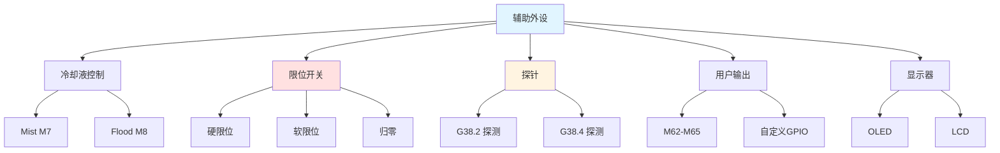

# 辅助外设集成

## 辅助外设概览

Grbl_Esp32 支持多种辅助外设，用于增强CNC控制功能。



## 冷却液控制

**文件位置**：[CoolantControl.h](../../Grbl_Esp32/src/CoolantControl.h)

### 冷却液状态

```cpp
// CoolantControl.h
enum class CoolantState : uint8_t {
    Disable = 0,  // M9 关闭
    Mist    = 1,  // M7 雾化冷却
    Flood   = 2,  // M8 液体冷却
    Both    = 3,  // M7 + M8
};
```

### 初始化

```cpp
// CoolantControl.cpp
void coolant_init() {
    // 配置雾化引脚
#ifdef COOLANT_MIST_PIN
    pinMode(COOLANT_MIST_PIN, OUTPUT);
    digitalWrite(COOLANT_MIST_PIN, LOW);
#endif

    // 配置液体引脚
#ifdef COOLANT_FLOOD_PIN
    pinMode(COOLANT_FLOOD_PIN, OUTPUT);
    digitalWrite(COOLANT_FLOOD_PIN, LOW);
#endif
}
```

### 状态控制

```cpp
void coolant_set_state(CoolantState mode) {
#ifdef COOLANT_MIST_PIN
    bool mist_on = (mode == CoolantState::Mist || mode == CoolantState::Both);
    digitalWrite(COOLANT_MIST_PIN, mist_on ? HIGH : LOW);
#endif

#ifdef COOLANT_FLOOD_PIN
    bool flood_on = (mode == CoolantState::Flood || mode == CoolantState::Both);
    digitalWrite(COOLANT_FLOOD_PIN, flood_on ? HIGH : LOW);
#endif
}

void coolant_stop() {
    coolant_set_state(CoolantState::Disable);
}

CoolantState coolant_get_state() {
    bool mist = false, flood = false;

#ifdef COOLANT_MIST_PIN
    mist = digitalRead(COOLANT_MIST_PIN);
#endif

#ifdef COOLANT_FLOOD_PIN
    flood = digitalRead(COOLANT_FLOOD_PIN);
#endif

    if (mist && flood) return CoolantState::Both;
    if (mist) return CoolantState::Mist;
    if (flood) return CoolantState::Flood;
    return CoolantState::Disable;
}
```

### 同步控制

```cpp
void coolant_sync(CoolantState mode) {
    // 等待planner buffer同步
    if (sys.state == State::CheckMode) {
        return;
    }

    protocol_buffer_synchronize();
    coolant_set_state(mode);
}
```

## 限位开关

**文件位置**：[Limits.h](../../Grbl_Esp32/src/Limits.h)

### 限位类型

```cpp
// 硬限位：物理开关触发
// 软限位：软件计算位置超出

// 限位掩码
typedef uint8_t AxisMask;
#define X_AXIS_BIT (1 << X_AXIS)
#define Y_AXIS_BIT (1 << Y_AXIS)
#define Z_AXIS_BIT (1 << Z_AXIS)
// ...
```

### 初始化

```cpp
// Limits.cpp
void limits_init() {
    // 配置限位引脚
#ifdef X_LIMIT_PIN
    pinMode(X_LIMIT_PIN, INPUT_PULLUP);
#endif

#ifdef Y_LIMIT_PIN
    pinMode(Y_LIMIT_PIN, INPUT_PULLUP);
#endif

#ifdef Z_LIMIT_PIN
    pinMode(Z_LIMIT_PIN, INPUT_PULLUP);
#endif

    // 如果启用硬限位，配置中断
    if (hard_limits->get()) {
        // 创建限位检查任务
        xTaskCreatePinnedToCore(
            limitCheckTask,
            "limitCheckTask",
            4096,
            NULL,
            1,
            &limitCheckTaskHandle,
            SUPPORT_TASK_CORE
        );
    }
}
```

### 限位状态读取

```cpp
AxisMask limits_get_state() {
    AxisMask limit_state = 0;
    bool invert = limits_invert->get();

#ifdef X_LIMIT_PIN
    if (digitalRead(X_LIMIT_PIN) ^ invert) {
        limit_state |= X_AXIS_BIT;
    }
#endif

#ifdef Y_LIMIT_PIN
    if (digitalRead(Y_LIMIT_PIN) ^ invert) {
        limit_state |= Y_AXIS_BIT;
    }
#endif

#ifdef Z_LIMIT_PIN
    if (digitalRead(Z_LIMIT_PIN) ^ invert) {
        limit_state |= Z_AXIS_BIT;
    }
#endif

    return limit_state;
}
```

### 硬限位中断

```cpp
void limitCheckTask(void* pvParameters) {
    AxisMask old_limit_state = 0;

    while (true) {
        if (sys.state != State::Homing) {
            AxisMask limit_state = limits_get_state();

            // 检测限位触发
            if (limit_state && limit_state != old_limit_state) {
                // 触发硬限位报警
                sys_rt_exec_alarm = ExecAlarm::HardLimit;

                grbl_msg_sendf(CLIENT_SERIAL, MsgLevel::Info,
                              "Hard limit triggered on axis: %s",
                              axis_mask_to_string(limit_state));
            }

            old_limit_state = limit_state;
        }

        vTaskDelay(pdMS_TO_TICKS(10));  // 10ms检查一次
    }
}
```

### 软限位检查

```cpp
bool limitsCheckTravel(float* target) {
    if (!soft_limits->get()) {
        return false;  // 软限位未启用
    }

    for (int axis = 0; axis < N_AXIS; axis++) {
        // 检查是否超出最大行程
        if (target[axis] < 0 || target[axis] > axis_settings->max_travel[axis]) {
            grbl_msg_sendf(CLIENT_SERIAL, MsgLevel::Info,
                          "Soft limit exceeded on %c axis: %.3f",
                          axis_letter(axis), target[axis]);
            return true;  // 超出限位
        }
    }

    return false;  // 在限位内
}
```

### 归零循环

```cpp
void limits_go_home(uint8_t cycle_mask) {
    // 设置归零状态
    sys.state = State::Homing;

    // 设置电机归零模式
    uint8_t homing_capable = motors_set_homing_mode(cycle_mask, true);

    if (homing_capable == 0) {
        grbl_msg_sendf(CLIENT_SERIAL, MsgLevel::Error,
                      "No motors capable of homing");
        sys.state = State::Idle;
        return;
    }

    // 执行归零序列
    for (int phase = 0; phase < N_HOMING_LOCATE_CYCLE; phase++) {
        // 1. 快速搜索限位
        homing_cycle_search(cycle_mask);

        // 2. 脱离限位
        homing_cycle_pulloff(cycle_mask);

        // 3. 慢速定位
        homing_cycle_locate(cycle_mask);
    }

    // 恢复正常模式
    motors_set_homing_mode(cycle_mask, false);

    // 设置机器位置为零
    for (int axis = 0; axis < N_AXIS; axis++) {
        if (bitnum_is_true(cycle_mask, axis)) {
            sys_position[axis] = 0;
        }
    }

    plan_sync_position();
    gc_sync_position();

    sys.state = State::Idle;
}
```

### 归零搜索

```cpp
void homing_cycle_search(uint8_t cycle_mask) {
    // 计算搜索距离
    float target[MAX_N_AXIS];
    for (int axis = 0; axis < N_AXIS; axis++) {
        if (bitnum_is_true(cycle_mask, axis)) {
            // 搜索距离 = 最大行程 * 搜索倍数
            float search_distance = axis_settings->max_travel[axis] *
                                   HOMING_AXIS_SEARCH_SCALAR;

            // 根据归零方向设置目标
            bool dir = bitnum_is_true(homing_dir_mask->get(), axis);
            target[axis] = dir ? search_distance : -search_distance;
        } else {
            target[axis] = 0;
        }
    }

    // 执行搜索运动
    plan_line_data_t plan_data;
    plan_data.feed_rate = homing_seek_rate->get();
    plan_data.condition = PlanLineFlag::IsHomingMotion;

    mc_line(target, &plan_data, sys_position);

    // 等待运动完成或限位触发
    do {
        protocol_execute_realtime();

        // 检查限位
        if (limits_get_state() & cycle_mask) {
            st_reset();  // 停止运动
            break;
        }
    } while (sys.state == State::Homing);
}
```

## 探针

**文件位置**：[Probe.h](../../Grbl_Esp32/src/Probe.h)

### 探针状态

```cpp
// Probe.h
enum class Probe : uint8_t {
    Off = 0,     // 探针禁用
    Active = 1,  // 探针激活
};

extern Probe sys_probe_state;
extern float sys_probe_position[MAX_N_AXIS];
```

### 初始化

```cpp
// Probe.cpp
void probe_init() {
#ifdef PROBE_PIN
    pinMode(PROBE_PIN, INPUT_PULLUP);
#endif

    sys_probe_state = Probe::Off;
    memset(sys_probe_position, 0, sizeof(sys_probe_position));
}
```

### 探针状态读取

```cpp
bool probe_get_state() {
#ifdef PROBE_PIN
    bool probe_invert = probe_invert_mask->get();
    return digitalRead(PROBE_PIN) ^ probe_invert;
#else
    return false;
#endif
}
```

### 探针监控

```cpp
void probe_state_monitor() {
    if (sys_probe_state == Probe::Active) {
        if (probe_get_state()) {
            // 探针触发
            sys_probe_state = Probe::Off;

            // 记录触发位置
            system_convert_array_steps_to_mpos(sys_probe_position, sys_position);

            // 停止运动
            sys_rt_exec_state.motionCancel = 1;

#ifdef MESSAGE_PROBE_COORDINATES
            // 报告探针坐标
            report_probe_parameters();
#endif
        }
    }
}
```

### G38探测命令

```cpp
// GCode.cpp
Error gc_execute_probe(parser_block_t* gc_block) {
    // G38.2: 探测向工件（触发=成功）
    // G38.4: 探测离开工件（未触发=成功）

    bool is_probe_away = (gc_block->non_modal_command == NonModal::ProbeAway);

    // 设置探针方向
    set_probe_direction(is_probe_away);

    // 激活探针
    sys_probe_state = Probe::Active;

    // 执行探测运动
    plan_line_data_t plan_data;
    plan_data.condition = PlanLineFlag::IsProbeCycle;
    plan_data.feed_rate = gc_state.feed_rate;

    Error status = mc_line(gc_block->values.xyz, &plan_data, gc_state.position);

    // 等待探测完成
    protocol_buffer_synchronize();

    // 检查探测结果
    if (sys_probe_state == Probe::Active) {
        // 探针未触发
        if (!is_probe_away) {
            return Error::ProbeFailContact;
        }
    } else {
        // 探针触发
        if (is_probe_away) {
            return Error::ProbeFailInitial;
        }
    }

    return Error::Ok;
}
```

## 用户输出

**文件位置**：[UserOutput.h](../../Grbl_Esp32/src/UserOutput.h)

### M62-M65命令

```cpp
// M62 P<n>: 立即打开数字输出
// M63 P<n>: 立即关闭数字输出
// M64 P<n>: 同步打开数字输出
// M65 P<n>: 同步关闭数字输出

#define MAX_USER_DIGITAL_PIN 4

static uint8_t user_digital_pins[MAX_USER_DIGITAL_PIN] = {
    USER_DIGITAL_PIN_0,
    USER_DIGITAL_PIN_1,
    USER_DIGITAL_PIN_2,
    USER_DIGITAL_PIN_3,
};
```

### 初始化

```cpp
void user_output_init() {
    for (int i = 0; i < MAX_USER_DIGITAL_PIN; i++) {
        if (user_digital_pins[i] != UNDEFINED_PIN) {
            pinMode(user_digital_pins[i], OUTPUT);
            digitalWrite(user_digital_pins[i], LOW);
        }
    }
}
```

### 输出控制

```cpp
void user_digital_output(uint8_t index, bool state) {
    if (index >= MAX_USER_DIGITAL_PIN) {
        return;
    }

    if (user_digital_pins[index] != UNDEFINED_PIN) {
        digitalWrite(user_digital_pins[index], state ? HIGH : LOW);
    }
}

// M62/M63: 立即执行
void user_m62(uint8_t index) {
    user_digital_output(index, true);
}

void user_m63(uint8_t index) {
    user_digital_output(index, false);
}

// M64/M65: 同步执行
void user_m64(uint8_t index) {
    protocol_buffer_synchronize();
    user_digital_output(index, true);
}

void user_m65(uint8_t index) {
    protocol_buffer_synchronize();
    user_digital_output(index, false);
}
```

## 显示器支持

### display_init - 弱函数

```cpp
// Grbl.cpp
void __attribute__((weak)) display_init() {
    // 默认为空
}

// 在机器配置中覆盖
void display_init() {
    // 初始化OLED
    Wire.begin(SDA_PIN, SCL_PIN);
    display.init();
    display.flipScreenVertically();
    display.setFont(ArialMT_Plain_10);

    // 显示启动信息
    display.clear();
    display.drawString(0, 0, "Grbl_ESP32");
    display.drawString(0, 16, GRBL_VERSION);
    display.display();
}
```

### OLED显示示例

```cpp
// 在机器配置文件中
#include <SSD1306Wire.h>

SSD1306Wire display(0x3c, SDA_PIN, SCL_PIN);

void display_init() {
    display.init();
    display.flipScreenVertically();
}

void display_update() {
    display.clear();

    // 显示状态
    display.drawString(0, 0, state_name[sys.state]);

    // 显示位置
    char pos_str[32];
    snprintf(pos_str, sizeof(pos_str), "X:%.2f Y:%.2f Z:%.2f",
             sys_position[X_AXIS] / axis_settings->steps_per_mm[X_AXIS],
             sys_position[Y_AXIS] / axis_settings->steps_per_mm[Y_AXIS],
             sys_position[Z_AXIS] / axis_settings->steps_per_mm[Z_AXIS]);
    display.drawString(0, 16, pos_str);

    // 显示进给速率
    snprintf(pos_str, sizeof(pos_str), "F:%d", st_get_realtime_rate());
    display.drawString(0, 32, pos_str);

    display.display();
}
```

## 宏按钮

### 宏按钮定义

```cpp
// 在机器配置中定义
#define MACRO_BUTTON_0_PIN GPIO_NUM_35
#define MACRO_BUTTON_1_PIN GPIO_NUM_34
#define MACRO_BUTTON_2_PIN GPIO_NUM_39

// 弱函数
void __attribute__((weak)) user_defined_macro(uint8_t index) {
    // 默认为空
}
```

### 宏按钮实现

```cpp
// 在机器配置中实现
void user_defined_macro(uint8_t index) {
    switch (index) {
        case 0:
            // 宏按钮0：归零
            execute_line("$H", CLIENT_SERIAL);
            break;

        case 1:
            // 宏按钮1：探测Z轴
            execute_line("G38.2 Z-10 F100", CLIENT_SERIAL);
            execute_line("G92 Z0", CLIENT_SERIAL);
            break;

        case 2:
            // 宏按钮2：回到原点
            execute_line("G0 X0 Y0 Z0", CLIENT_SERIAL);
            break;
    }
}

// 按钮检查任务
void macroButtonTask(void* pvParameters) {
    pinMode(MACRO_BUTTON_0_PIN, INPUT_PULLUP);
    pinMode(MACRO_BUTTON_1_PIN, INPUT_PULLUP);
    pinMode(MACRO_BUTTON_2_PIN, INPUT_PULLUP);

    bool last_state[3] = {true, true, true};

    while (true) {
        // 检查按钮0
        bool state0 = digitalRead(MACRO_BUTTON_0_PIN);
        if (state0 == LOW && last_state[0] == HIGH) {
            user_defined_macro(0);
        }
        last_state[0] = state0;

        // 检查按钮1
        bool state1 = digitalRead(MACRO_BUTTON_1_PIN);
        if (state1 == LOW && last_state[1] == HIGH) {
            user_defined_macro(1);
        }
        last_state[1] = state1;

        // 检查按钮2
        bool state2 = digitalRead(MACRO_BUTTON_2_PIN);
        if (state2 == LOW && last_state[2] == HIGH) {
            user_defined_macro(2);
        }
        last_state[2] = state2;

        vTaskDelay(pdMS_TO_TICKS(50));  // 50ms防抖
    }
}
```

## 技术约束

### 1. GPIO限制

- 输入专用引脚：GPIO 34, 35, 36, 39
- 避免启动引脚
- 注意引脚冲突

### 2. 中断限制

- 限位中断优先级高
- 避免在ISR中阻塞
- 使用任务处理复杂逻辑

### 3. 实时性

- 探针检测在ISR中
- 限位检测在任务中（10ms）
- 冷却液控制无实时要求

## 兼容性注意事项

### 1. 限位开关类型

- 常开（NO）vs 常闭（NC）
- 使用 `limits_invert` 设置
- 建议使用NC开关（安全）

### 2. 探针类型

- 接触式探针
- 电容式探针
- 光学探针
- 使用 `probe_invert` 设置

### 3. 显示器

- I2C地址冲突
- SDA/SCL引脚选择
- 刷新频率控制

## 下一步

阅读 [10_通信系统架构.md](10_通信系统架构.md) 了解Serial/WiFi/Bluetooth通信的实现。

## 参考资源

- **G38探测**: https://linuxcnc.org/docs/html/gcode/g-code.html#gcode:g38
- **M62-M65**: https://linuxcnc.org/docs/html/gcode/m-code.html#mcode:m62-m65
- **SSD1306库**: https://github.com/ThingPulse/esp8266-oled-ssd1306
