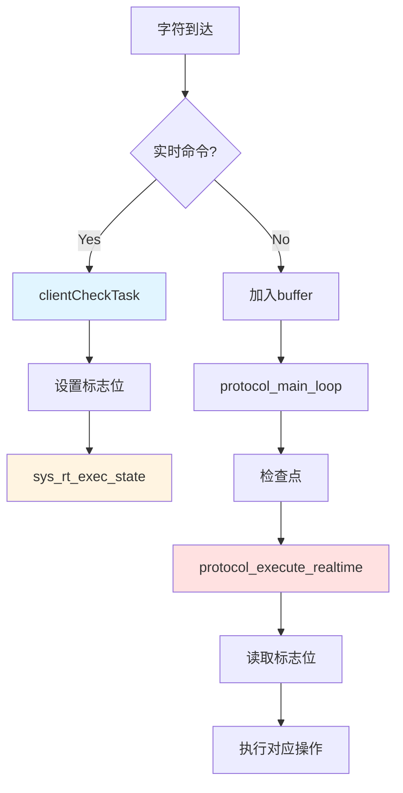
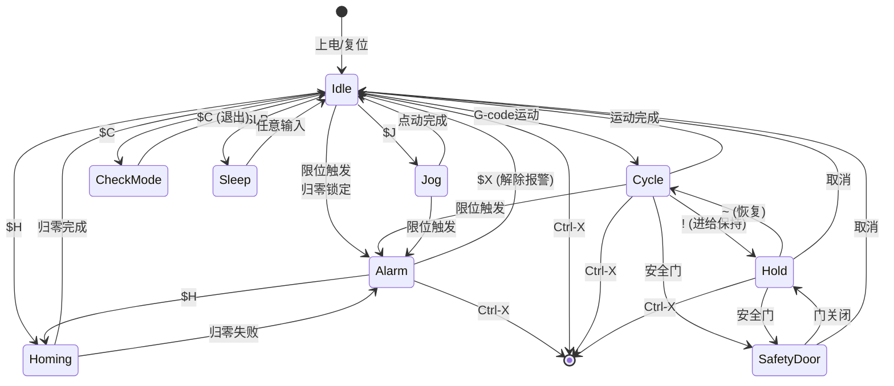

# 实时命令与状态机

## 实时命令概述

实时命令是可以在任何时候立即执行的单字符命令，无需等待当前G-code执行完成。

### 实时命令列表

```cpp
// Config.h
enum class Cmd : uint8_t {
    Reset                 = 0x18,  // Ctrl-X (24)
    StatusReport          = '?',   // 63
    CycleStart            = '~',   // 126
    FeedHold              = '!',   // 33
    SafetyDoor            = 0x84,  // 132
    JogCancel             = 0x85,  // 133
    DebugReport           = 0x86,  // 134
    FeedOvrReset          = 0x90,  // 144
    FeedOvrCoarsePlus     = 0x91,  // 145
    FeedOvrCoarseMinus    = 0x92,  // 146
    FeedOvrFinePlus       = 0x93,  // 147
    FeedOvrFineMinus      = 0x94,  // 148
    RapidOvrReset         = 0x95,  // 149
    RapidOvrMedium        = 0x96,  // 150
    RapidOvrLow           = 0x97,  // 151
    SpindleOvrReset       = 0x99,  // 153
    SpindleOvrCoarsePlus  = 0x9A,  // 154
    SpindleOvrCoarseMinus = 0x9B,  // 155
    SpindleOvrFinePlus    = 0x9C,  // 156
    SpindleOvrFineMinus   = 0x9D,  // 157
    SpindleOvrStop        = 0x9E,  // 158
    CoolantFloodOvrToggle = 0xA0,  // 160
    CoolantMistOvrToggle  = 0xA1,  // 161
};
```

## 实时命令处理流程



### 字符级拦截

**文件位置**：[Serial.cpp](../../Grbl_Esp32/src/Serial.cpp)

```cpp
void clientCheckTask(void* pvParameters) {
    while (true) {
        int c = getClientChar();

        if (c >= 0) {
            // 检查是否为实时命令
            if (is_realtime_command(c)) {
                // 立即处理，不加入buffer
                execute_realtime_command(c);
            } else {
                // 普通字符加入buffer
                client_buffer[current_client].write(c);
            }
        }

        vTaskDelay(1);
    }
}

bool is_realtime_command(uint8_t c) {
    return (c == '?' || c == '!' || c == '~' || c == 0x18 ||
            (c >= 0x84 && c <= 0xA1));
}
```

### 标志位设置

```cpp
void execute_realtime_command(uint8_t c) {
    switch (c) {
        case '?':  // 状态报告
            sys_rt_exec_state.statusReport = 1;
            break;

        case '!':  // 进给保持
            sys_rt_exec_state.feedHold = 1;
            break;

        case '~':  // 循环启动
            sys_rt_exec_state.cycleStart = 1;
            break;

        case 0x18:  // Ctrl-X 复位
            sys_rt_exec_state.reset = 1;
            break;

        case 0x84:  // 安全门
            sys_rt_exec_state.safetyDoor = 1;
            break;

        case 0x85:  // 取消点动
            sys_rt_exec_state.motionCancel = 1;
            break;

        // 覆盖命令
        case 0x90:  // 进给覆盖复位
            sys_rt_exec_accessory_override.feedOvrReset = 1;
            break;

        // ... 其他覆盖命令
    }
}
```

## 标志位通信机制

### 标志位定义

**文件位置**：[System.h](../../Grbl_Esp32/src/System.h)

```cpp
// 实时执行状态标志
union ExecState {
    uint8_t value;
    struct {
        uint8_t statusReport : 1;   // 状态报告请求
        uint8_t cycleStart : 1;     // 启动循环
        uint8_t feedHold : 1;       // 进给保持
        uint8_t reset : 1;          // 系统复位
        uint8_t safetyDoor : 1;     // 安全门
        uint8_t motionCancel : 1;   // 取消运动
        uint8_t sleep : 1;          // 睡眠模式
    };
};

extern volatile ExecState sys_rt_exec_state;

// 报警标志
enum class ExecAlarm : uint8_t {
    None = 0,
    HardLimit,      // 硬限位触发
    SoftLimit,      // 软限位超出
    AbortCycle,     // 中止循环
    ProbeFailInitial,
    ProbeFailContact,
    HomingFailReset,
    HomingFailDoor,
    HomingFailPulloff,
    HomingFailApproach,
};

extern volatile ExecAlarm sys_rt_exec_alarm;
```

### 检查点机制

**文件位置**：[Protocol.cpp](../../Grbl_Esp32/src/Protocol.cpp)

```cpp
void protocol_main_loop() {
    while (!sys.abort) {
        // 读取命令
        read_commands();

        // 检查点1：命令读取后
        protocol_execute_realtime();

        // 执行命令
        execute_commands();

        // 检查点2：命令执行后
        protocol_execute_realtime();

        // 自动启动
        auto_cycle_start();

        // 检查点3：启动后
        protocol_execute_realtime();
    }
}
```

### protocol_execute_realtime - 实时命令执行

```cpp
void protocol_execute_realtime() {
    // 1. 执行系统命令
    protocol_exec_rt_system();

    // 2. 如果有挂起状态，处理挂起
    if (sys.suspend.value) {
        protocol_exec_rt_suspend();
    }
}
```

### protocol_exec_rt_system - 系统命令处理

```cpp
void protocol_exec_rt_system() {
    // 1. 处理报警
    if (sys_rt_exec_alarm != ExecAlarm::None) {
        sys.state = State::Alarm;
        report_alarm_message(sys_rt_exec_alarm);

        // 硬限位或软限位：锁定系统
        if (sys_rt_exec_alarm == ExecAlarm::HardLimit ||
            sys_rt_exec_alarm == ExecAlarm::SoftLimit) {
            report_feedback_message(Message::CriticalEvent);
            system_clear_exec_state_flag(ExecState::Reset);
            // 等待复位
            while (sys_rt_exec_state.reset == 0) {
                // 阻塞直到复位
            }
        }

        sys_rt_exec_alarm = ExecAlarm::None;
    }

    // 2. 处理状态报告
    if (sys_rt_exec_state.statusReport) {
        report_realtime_status(CLIENT_ALL);
        sys_rt_exec_state.statusReport = 0;
    }

    // 3. 处理循环启动/进给保持
    if (sys_rt_exec_state.cycleStart ||
        sys_rt_exec_state.feedHold ||
        sys_rt_exec_state.motionCancel ||
        sys_rt_exec_state.safetyDoor ||
        sys_rt_exec_state.sleep) {

        // 进给保持
        if (sys_rt_exec_state.feedHold) {
            if (sys.state == State::Cycle) {
                sys.state = State::Hold;
                sys.step_control.executeHold = 1;
                st_update_plan_block_parameters();
            }
            sys_rt_exec_state.feedHold = 0;
        }

        // 循环启动
        if (sys_rt_exec_state.cycleStart) {
            if (sys.state == State::Hold) {
                if (sys.suspend.holdComplete) {
                    sys.state = State::Cycle;
                    sys.step_control = {};  // 清除控制标志
                    st_wake_up();
                }
            }
            sys_rt_exec_state.cycleStart = 0;
        }

        // 运动取消
        if (sys_rt_exec_state.motionCancel) {
            sys.step_control.motionCancel = 1;
            sys_rt_exec_state.motionCancel = 0;
        }

        // 安全门
        if (sys_rt_exec_state.safetyDoor) {
            sys.state = State::SafetyDoor;
            sys.step_control.executeHold = 1;
            sys_rt_exec_state.safetyDoor = 0;
        }

        // 睡眠
        if (sys_rt_exec_state.sleep) {
            sys.state = State::Sleep;
            sys_rt_exec_state.sleep = 0;
        }
    }

    // 4. 处理复位
    if (sys_rt_exec_state.reset) {
        sys.abort = true;  // 退出主循环
    }

    // 5. 处理覆盖
    if (sys_rt_exec_accessory_override.value) {
        protocol_exec_rt_override();
    }
}
```

## 系统状态机

### 状态定义

```cpp
// System.h
enum class State : uint8_t {
    Idle = 0,       // 空闲，等待命令
    Alarm,          // 报警，系统锁定
    CheckMode,      // 检查模式（不执行运动）
    Homing,         // 归零中
    Cycle,          // 运行中
    Hold,           // 保持（暂停）
    Jog,            // 手动点动
    SafetyDoor,     // 安全门打开
    Sleep,          // 睡眠模式
    ConfigAlarm     // 配置报警
};

extern system_t sys;  // 全局系统状态
```

### 状态转换图



### 状态转换实现

```cpp
// Protocol.cpp
void state_transition(State new_state) {
    State old_state = sys.state;

    // 状态转换逻辑
    switch (new_state) {
        case State::Idle:
            // 清除运动控制标志
            sys.step_control = {};
            break;

        case State::Alarm:
            // 停止所有运动
            st_reset();
            plan_reset();
            spindle->stop();
            coolant_stop();
            break;

        case State::Cycle:
            // 启动步进器
            st_wake_up();
            break;

        case State::Hold:
            // 执行保持
            sys.step_control.executeHold = 1;
            st_update_plan_block_parameters();
            break;

        case State::Homing:
            // 准备归零
            sys.step_control = {};
            break;

        // ... 其他状态
    }

    sys.state = new_state;

    // 报告状态变化
    if (old_state != new_state) {
        report_feedback_message(Message::StateChange);
    }
}
```

## 挂起状态处理

### 挂起标志

```cpp
// System.h
union Suspend {
    uint8_t value;
    struct {
        uint8_t holdComplete : 1;      // 保持完成
        uint8_t retractComplete : 1;   // 回退完成
        uint8_t initiateRestore : 1;   // 开始恢复
        uint8_t restoreComplete : 1;   // 恢复完成
        uint8_t safetyDoorAjar : 1;    // 安全门打开
        uint8_t motionCancel : 1;      // 取消运动
        uint8_t jogCancel : 1;         // 取消点动
    };
};

extern Suspend sys.suspend;
```

### protocol_exec_rt_suspend - 挂起处理

```cpp
void protocol_exec_rt_suspend() {
    // 1. 等待保持完成
    while (sys.suspend.holdComplete == 0) {
        // 检查步进器是否停止
        if (st_get_executing_block() == NULL) {
            sys.suspend.holdComplete = 1;
        }

        protocol_execute_realtime();
    }

    // 2. 安全门：执行回退
    if (sys.state == State::SafetyDoor) {
        if (sys.suspend.retractComplete == 0) {
            // 执行回退运动
            parking_motion();
            sys.suspend.retractComplete = 1;
        }

        // 等待门关闭
        while (sys.suspend.safetyDoorAjar) {
            // 检查门开关状态
            if (digitalRead(CONTROL_SAFETY_DOOR_PIN) == HIGH) {
                sys.suspend.safetyDoorAjar = 0;
                sys.suspend.initiateRestore = 1;
            }
        }
    }

    // 3. 恢复运动
    if (sys.suspend.initiateRestore) {
        if (sys.state == State::SafetyDoor) {
            // 恢复到原位置
            restore_motion();
        }

        sys.suspend.restoreComplete = 1;
        sys.suspend.initiateRestore = 0;
    }

    // 4. 清除挂起状态
    if (sys.suspend.restoreComplete) {
        sys.suspend.value = 0;
        sys.state = State::Idle;
    }
}
```

## 覆盖系统

### 覆盖类型

```cpp
// 进给速率覆盖（10%-200%）
namespace FeedOverride {
    const int Default         = 100;
    const int Max             = 200;
    const int Min             = 10;
    const int CoarseIncrement = 10;
    const int FineIncrement   = 1;
};

// 快速移动覆盖（25%-100%）
namespace RapidOverride {
    const int Default  = 100;
    const int Medium   = 50;
    const int Low      = 25;
};

// 主轴速度覆盖（10%-200%）
namespace SpindleSpeedOverride {
    const int Default         = 100;
    const int Max             = 200;
    const int Min             = 10;
    const int CoarseIncrement = 10;
    const int FineIncrement   = 1;
};
```

### protocol_exec_rt_override - 覆盖处理

```cpp
void protocol_exec_rt_override() {
    // 1. 进给速率覆盖
    if (sys_rt_exec_accessory_override.feedOvrReset) {
        sys.f_override = FeedOverride::Default;
        sys_rt_exec_accessory_override.feedOvrReset = 0;
    }

    if (sys_rt_exec_accessory_override.feedOvrCoarsePlus) {
        sys.f_override += FeedOverride::CoarseIncrement;
        sys.f_override = min(sys.f_override, FeedOverride::Max);
        sys_rt_exec_accessory_override.feedOvrCoarsePlus = 0;
    }

    if (sys_rt_exec_accessory_override.feedOvrCoarseMinus) {
        sys.f_override -= FeedOverride::CoarseIncrement;
        sys.f_override = max(sys.f_override, FeedOverride::Min);
        sys_rt_exec_accessory_override.feedOvrCoarseMinus = 0;
    }

    // 2. 快速移动覆盖
    if (sys_rt_exec_accessory_override.rapidOvrReset) {
        sys.r_override = RapidOverride::Default;
        sys_rt_exec_accessory_override.rapidOvrReset = 0;
    }

    if (sys_rt_exec_accessory_override.rapidOvrMedium) {
        sys.r_override = RapidOverride::Medium;
        sys_rt_exec_accessory_override.rapidOvrMedium = 0;
    }

    if (sys_rt_exec_accessory_override.rapidOvrLow) {
        sys.r_override = RapidOverride::Low;
        sys_rt_exec_accessory_override.rapidOvrLow = 0;
    }

    // 3. 主轴速度覆盖
    if (sys_rt_exec_accessory_override.spindleOvrReset) {
        sys.spindle_speed_ovr = SpindleSpeedOverride::Default;
        sys_rt_exec_accessory_override.spindleOvrReset = 0;
    }

    // ... 其他主轴覆盖命令

    // 4. 应用覆盖到运动
    if (sys.state == State::Cycle) {
        st_update_plan_block_parameters();
    }
}
```

## 状态报告

### 报告格式

```
<Idle|MPos:0.000,0.000,0.000|FS:0,0|WCO:0.000,0.000,0.000>
 ^^^^  ^^^^^^^^^^^^^^^^^^^^ ^^^^^^  ^^^^^^^^^^^^^^^^^^^^
  |              |             |              |
状态        机器位置      进给/主轴    工作坐标偏移
```

### report_realtime_status - 状态报告生成

**文件位置**：[Report.cpp](../../Grbl_Esp32/src/Report.cpp)

```cpp
void report_realtime_status(uint8_t client) {
    // 1. 状态
    grbl_sendf(client, "<%s", state_name[sys.state]);

    // 2. 机器位置
    float print_position[MAX_N_AXIS];
    system_convert_array_steps_to_mpos(print_position, sys_position);
    grbl_sendf(client, "|MPos:");
    for (int i = 0; i < N_AXIS; i++) {
        grbl_sendf(client, "%.3f", print_position[i]);
        if (i < N_AXIS - 1) {
            grbl_sendf(client, ",");
        }
    }

    // 3. 进给速率和主轴速度
    grbl_sendf(client, "|FS:%d,%d",
               st_get_realtime_rate(),
               spindle->get_current_rpm());

    // 4. 工作坐标偏移（定期刷新）
    if (report_wco_counter >= REPORT_WCO_REFRESH_BUSY_COUNT) {
        grbl_sendf(client, "|WCO:");
        for (int i = 0; i < N_AXIS; i++) {
            grbl_sendf(client, "%.3f", gc_state.coord_system[i]);
            if (i < N_AXIS - 1) {
                grbl_sendf(client, ",");
            }
        }
        report_wco_counter = 0;
    }
    report_wco_counter++;

    // 5. 覆盖值（定期刷新）
    if (report_ovr_counter >= REPORT_OVR_REFRESH_BUSY_COUNT) {
        grbl_sendf(client, "|Ov:%d,%d,%d",
                   sys.f_override,
                   sys.r_override,
                   sys.spindle_speed_ovr);
        report_ovr_counter = 0;
    }
    report_ovr_counter++;

    // 6. 结束
    grbl_sendf(client, ">\n");
}
```

## 实时性保证

### 优先级层次

```
最高优先级: Stepper ISR（定时器中断）
    ↓
高优先级: Limit Switch ISR
    ↓
中优先级: 实时命令标志位设置
    ↓
低优先级: 检查点处理
    ↓
最低优先级: G-code执行
```

### 响应时间

```
实时命令字符到达 → 标志位设置:     ~1μs
标志位设置 → 检查点检测:            ~100μs (最坏情况)
检查点检测 → 执行操作:              ~10μs
进给保持 → 运动停止:                ~100ms (取决于减速距离)
```

### 原子操作

```cpp
// 标志位操作是原子的（单字节写入）
sys_rt_exec_state.statusReport = 1;  // 原子操作

// 读取也是原子的
if (sys_rt_exec_state.statusReport) {
    // 处理
}

// 清除标志
sys_rt_exec_state.statusReport = 0;  // 原子操作
```

## 技术约束

### 1. 标志位限制

- 标志位总数：16位（2个字节）
- 每个标志1位
- 不能扩展太多

### 2. 检查点频率

- 检查点间隔：~100μs
- 不能太频繁（影响性能）
- 不能太稀疏（响应慢）

### 3. 状态转换约束

- 某些状态转换不允许
- 必须按顺序转换
- 需要满足前置条件

## 兼容性注意事项

### 1. 多客户端

- 实时命令可来自任何客户端
- 状态报告发送到请求客户端
- 报警消息广播到所有客户端

### 2. 并发安全

- 标志位操作原子
- 无需互斥锁
- 避免竞态条件

## 下一步

阅读 [11_步进控制与ISR.md](11_步进控制与ISR.md) 了解步进中断的详细实现和Bresenham算法应用。

## 参考资源

- **Grbl实时命令**: https://github.com/gnea/grbl/wiki/Grbl-v1.1-Interface
- **状态机设计**: https://en.wikipedia.org/wiki/Finite-state_machine
- **原子操作**: https://en.cppreference.com/w/cpp/atomic/atomic
