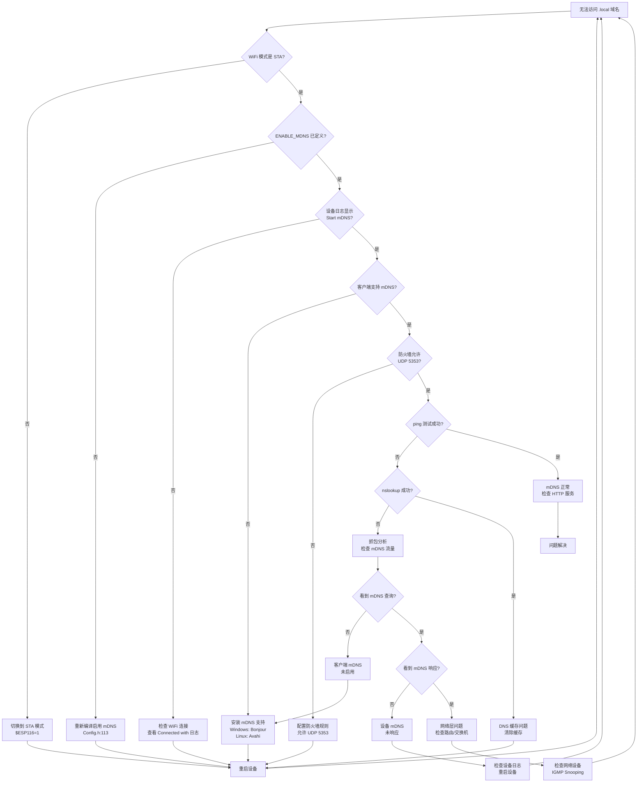

# Grbl_Esp32 mDNS 功能详解

> **文档版本**: 1.0
> **最后更新**: 2026-02-07
> **作者**: Grbl_Esp32 开发团队

---

## 文档说明

本文档深入解析 Grbl_Esp32 中 mDNS (Multicast DNS) 功能的技术实现，侧重于协议原理和源码分析。

**与《网络服务完全指南.md》的关系**:
- 《网络服务完全指南.md》第 9 章: 侧重用户使用和配置
- 本文档: 侧重协议规范、ESP32 库实现和源码分析
- 两者互为补充，建议结合阅读

**目标读者**:
- 需要理解 mDNS 协议原理的开发者
- 需要修改或扩展 mDNS 功能的维护者
- 需要深入调试网络问题的测试者
- 学习 ESP32 网络编程的学习者

---

## 目录

1. [概述](#1-概述)
2. [mDNS 协议详解](#2-mdns-协议详解)
3. [ESP32 mDNS 库实现](#3-esp32-mdns-库实现)
4. [Grbl_Esp32 源码实现分析](#4-grbl_esp32-源码实现分析)
5. [配置方法](#5-配置方法)
6. [使用方法](#6-使用方法)
7. [测试方法](#7-测试方法)
8. [平台兼容性](#8-平台兼容性)
9. [限制和约束](#9-限制和约束)
10. [与其他服务的集成](#10-与其他服务的集成)
11. [参考资源](#11-参考资源)

---

## 1. 概述

### 1.1 mDNS 简介

**mDNS (Multicast DNS)** 是一种零配置网络协议，允许设备在本地网络中通过主机名进行通信，无需传统的 DNS 服务器。

**核心特性**:
- **零配置**: 无需手动配置 DNS 服务器
- **本地解析**: 使用 `.local` 顶级域名
- **多播机制**: 通过 UDP 多播 (224.0.0.251:5353) 进行查询和响应
- **服务发现**: 结合 DNS-SD 实现服务自动发现

**典型应用场景**:
- 家庭网络设备发现 (打印机、NAS、智能家居)
- 开发环境中的设备访问 (无需记忆 IP 地址)
- IoT 设备的即插即用
- 跨平台服务发现 (Bonjour/Avahi)

### 1.2 在 Grbl_Esp32 中的作用

在 Grbl_Esp32 项目中，mDNS 提供以下功能：

#### 1.2.1 简化设备访问
```
传统方式: http://192.168.1.100
mDNS 方式: http://grblesp.local
```

用户无需记忆或查找设备的 IP 地址，只需使用易记的主机名即可访问 Web 界面。

#### 1.2.2 服务发现
mDNS 配合 DNS-SD 协议，允许客户端自动发现网络中的 Grbl_Esp32 设备：
- 服务类型: `_http._tcp.local`
- 服务实例: `grblesp._http._tcp.local`
- 端口: 80 (默认)

#### 1.2.3 动态 IP 适配
在 DHCP 环境中，设备 IP 地址可能变化，但主机名保持不变，确保访问的连续性。

### 1.3 与其他服务的关系

Grbl_Esp32 提供多种网络服务发现机制，mDNS 是其中之一：

| 服务 | 协议 | 端口 | 适用场景 | 跨子网 |
|------|------|------|----------|--------|
| **mDNS** | UDP 多播 | 5353 | 本地网络设备发现 | ❌ |
| **SSDP/UPnP** | UDP 多播 | 1900 | Windows 网络发现 | ❌ |
| **Captive Portal DNS** | UDP 单播 | 53 | AP 模式强制门户 | N/A |

**关系说明**:
- **mDNS vs SSDP**: 两者功能相似，mDNS 更通用，SSDP 更适合 Windows
- **mDNS + HTTP**: mDNS 负责域名解析，HTTP 提供 Web 服务
- **STA 模式专用**: mDNS 仅在 STA (Station) 模式下启用，AP 模式使用 Captive Portal DNS

**服务依赖关系**:
```
WiFi STA 模式
    ├── mDNS (域名解析)
    │   └── HTTP 服务注册
    ├── SSDP (UPnP 发现)
    └── HTTP Server (Web 界面)
```

### 1.4 文档结构说明

本文档按以下逻辑组织：

1. **第 2 章**: 深入 mDNS 协议规范 (RFC 6762/6763)，理解底层原理
2. **第 3 章**: 分析 ESP32 mDNS 库的实现机制
3. **第 4 章**: 解析 Grbl_Esp32 如何使用 ESP32 mDNS 库
4. **第 5-6 章**: 配置和使用方法 (简化，详见《网络服务完全指南.md》)
5. **第 7 章**: 完整的测试方法和故障排查流程
6. **第 8-10 章**: 兼容性、限制和集成关系
7. **第 11 章**: 参考资源和扩展阅读

---

## 2. mDNS 协议详解

本章深入解析 mDNS 协议的技术规范，基于 RFC 6762 (Multicast DNS) 和 RFC 6763 (DNS-Based Service Discovery)。

### 2.1 RFC 6762 规范解读

#### 2.1.1 协议目标和设计原则

**RFC 6762** 定义了 mDNS 协议，其核心目标是：

1. **零配置**: 无需 DNS 服务器或手动配置
2. **本地网络**: 仅在单个链路 (link-local) 范围内工作
3. **向后兼容**: 使用标准 DNS 消息格式
4. **高效**: 使用多播减少网络流量

**设计原则**:
- 使用 `.local` 作为特殊顶级域名 (TLD)
- 所有 `.local` 查询通过多播发送，不转发到传统 DNS 服务器
- 设备自己响应对其主机名的查询 (自我声明)
- 使用缓存减少重复查询

#### 2.1.2 多播 DNS 查询机制

**查询流程**:

```
客户端                                    网络                                    设备
   |                                        |                                        |
   |--- mDNS Query: grblesp.local A? ------>|                                        |
   |    (多播到 224.0.0.251:5353)           |                                        |
   |                                        |--- 多播转发 ------------------------->|
   |                                        |                                        |
   |                                        |<--- mDNS Response: A 192.168.1.100 ---|
   |<--- 多播响应 --------------------------|                                        |
   |    (从 224.0.0.251:5353)               |                                        |
   |                                        |                                        |
   |--- HTTP Request: GET / --------------->|--- 单播转发 ------------------------->|
   |    (单播到 192.168.1.100:80)           |                                        |
```

**关键参数**:
- **多播地址**:
  - IPv4: `224.0.0.251`
  - IPv6: `FF02::FB`
- **端口**: `5353` (UDP)
- **TTL**:
  - IP 层 TTL: `255` (仅本地链路)
  - DNS 记录 TTL: `120` 秒 (默认)

**查询类型**:
- **单播查询** (QU bit): 请求单播响应 (减少网络流量)
- **多播查询** (QM bit): 请求多播响应 (所有设备都能看到)

#### 2.1.3 资源记录格式

mDNS 使用标准 DNS 资源记录 (Resource Records, RR)，但有特殊语义：

**A 记录** (Address Record):
```
grblesp.local.  120  IN  A  192.168.1.100
```
- **名称**: `grblesp.local.` (注意末尾的点)
- **TTL**: `120` 秒
- **类型**: `A` (IPv4 地址)
- **数据**: `192.168.1.100`

**AAAA 记录** (IPv6 Address):
```
grblesp.local.  120  IN  AAAA  fe80::1234:5678:90ab:cdef
```

**PTR 记录** (Pointer Record, 用于反向查询):
```
100.1.168.192.in-addr.arpa.  120  IN  PTR  grblesp.local.
```

**SRV 记录** (Service Record, 详见 2.2 节):
```
_http._tcp.local.  120  IN  SRV  0 0 80 grblesp.local.
```

**TXT 记录** (Text Record, 用于服务元数据):
```
_http._tcp.local.  120  IN  TXT  "path=/"
```

#### 2.1.4 冲突检测和解决

**主机名冲突检测** (Probing):

当设备启动时，必须检测主机名是否已被占用：

1. **Probe 阶段** (探测):
   - 发送 3 个 mDNS 查询，询问 `grblesp.local` 是否存在
   - 查询间隔: 250ms
   - 如果收到响应，说明主机名冲突

2. **Announce 阶段** (宣告):
   - 如果没有冲突，发送 2 个 mDNS 响应，宣告自己的主机名
   - 响应间隔: 1 秒

**冲突解决策略**:
- **自动重命名**: 在主机名后添加数字后缀
  - `grblesp.local` → `grblesp-2.local` → `grblesp-3.local`
- **用户通知**: 通过日志或界面通知用户

**ESP32 mDNS 库的实现**:
- ESP32 的 `MDNS.begin()` 会自动执行 Probing 和 Announcing
- 如果检测到冲突，会自动添加数字后缀
- Grbl_Esp32 不会收到冲突通知 (库内部处理)

#### 2.1.5 缓存和 TTL 管理

**缓存机制**:
- 客户端缓存 mDNS 响应，避免重复查询
- 缓存时间由 TTL (Time To Live) 控制
- TTL 到期前，设备应发送 "goodbye" 消息 (TTL=0)

**TTL 语义**:
- **120 秒**: 默认 TTL，适合大多数场景
- **75 分钟**: 长期服务 (如打印机)
- **10 秒**: 临时服务 (如文件传输)
- **0 秒**: "goodbye" 消息，表示服务即将停止

**刷新机制**:
- 设备应在 TTL 到期前 (80% 时) 主动刷新记录
- 客户端可以发送查询请求刷新

### 2.2 DNS-SD 服务发现 (RFC 6763)

#### 2.2.1 服务类型命名规范

**RFC 6763** 定义了基于 DNS 的服务发现机制，使用 PTR/SRV/TXT 记录。

**服务类型格式**:
```
<服务名>.<传输协议>.local
```

**示例**:
- `_http._tcp.local`: HTTP 服务 (TCP)
- `_printer._tcp.local`: 打印机服务
- `_ssh._tcp.local`: SSH 服务
- `_ftp._tcp.local`: FTP 服务

**命名规则**:
- 服务名以下划线 `_` 开头
- 传输协议为 `_tcp` 或 `_udp`
- 必须在 IANA 注册 (或使用私有前缀 `_x-`)

**Grbl_Esp32 使用的服务类型**:
```cpp
MDNS.addService("http", "tcp", 80);
// 实际注册: _http._tcp.local
```

#### 2.2.2 PTR/SRV/TXT 记录

**服务发现的三层结构**:

1. **PTR 记录** (服务类型 → 服务实例):
   ```
   _http._tcp.local.  120  IN  PTR  grblesp._http._tcp.local.
   ```
   - 查询 `_http._tcp.local` 返回所有 HTTP 服务实例

2. **SRV 记录** (服务实例 → 主机名和端口):
   ```
   grblesp._http._tcp.local.  120  IN  SRV  0 0 80 grblesp.local.
   ```
   - **优先级**: `0` (数字越小优先级越高)
   - **权重**: `0` (负载均衡权重)
   - **端口**: `80`
   - **目标**: `grblesp.local.`

3. **TXT 记录** (服务实例 → 元数据):
   ```
   grblesp._http._tcp.local.  120  IN  TXT  "path=/" "version=1.0"
   ```
   - 键值对格式: `key=value`
   - 可包含多个键值对

**完整查询流程**:
```
1. 查询 PTR: _http._tcp.local → grblesp._http._tcp.local
2. 查询 SRV: grblesp._http._tcp.local → grblesp.local:80
3. 查询 A:   grblesp.local → 192.168.1.100
4. 查询 TXT: grblesp._http._tcp.local → path=/
5. 连接:     http://192.168.1.100:80/
```

#### 2.2.3 服务实例枚举

**枚举所有服务类型**:
```
查询: _services._dns-sd._udp.local PTR?
响应: _http._tcp.local
      _printer._tcp.local
      _ssh._tcp.local
```

**枚举特定服务的所有实例**:
```
查询: _http._tcp.local PTR?
响应: grblesp._http._tcp.local
      printer._http._tcp.local
      nas._http._tcp.local
```

#### 2.2.4 服务浏览机制

**浏览器实现** (如 Safari 的 Bonjour 浏览器):

1. 查询 `_services._dns-sd._udp.local` 获取所有服务类型
2. 对每个服务类型查询 PTR 记录获取实例列表
3. 对每个实例查询 SRV/TXT/A 记录获取详细信息
4. 显示服务列表供用户选择

**命令行工具**:
- **macOS**: `dns-sd -B _http._tcp`
- **Linux**: `avahi-browse -a`
- **Windows**: `dns-sd -B _http._tcp` (需安装 Bonjour)

### 2.3 多播机制

#### 2.3.1 UDP 5353 端口

**端口分配**:
- **标准 DNS**: UDP/TCP 53
- **mDNS**: UDP 5353
- **原因**: 避免与标准 DNS 冲突，允许非特权进程绑定

**套接字配置**:
```c
// 伪代码
socket = socket(AF_INET, SOCK_DGRAM, 0);
bind(socket, 0.0.0.0:5353);
setsockopt(socket, IP_ADD_MEMBERSHIP, 224.0.0.251);
```

**关键选项**:
- `SO_REUSEADDR`: 允许多个进程绑定同一端口
- `IP_ADD_MEMBERSHIP`: 加入多播组
- `IP_MULTICAST_TTL`: 设置多播 TTL (通常为 255)

#### 2.3.2 多播地址

**IPv4 多播地址**: `224.0.0.251`
- **范围**: 224.0.0.0/24 (本地网络控制块)
- **特性**: 不会被路由器转发 (TTL=1)

**IPv6 多播地址**: `FF02::FB`
- **范围**: FF02::/16 (链路本地多播)
- **特性**: 仅在本地链路有效

**多播组管理**:
- 设备加入多播组后，网卡会接收发往该地址的数据包
- 交换机可能需要配置 IGMP Snooping 以优化多播流量

#### 2.3.3 TTL 和缓存策略

**IP 层 TTL** (Time To Live):
- **值**: `255`
- **目的**: 确保数据包不会离开本地链路
- **检查**: 接收方应拒绝 TTL < 255 的 mDNS 数据包 (防止跨子网攻击)

**DNS 记录 TTL**:
- **默认**: `120` 秒
- **刷新**: 在 TTL 的 80% 时 (96 秒) 主动刷新
- **过期**: TTL 到期后，记录从缓存中删除

**缓存策略**:
- **Negative Caching**: 缓存 "不存在" 的响应 (NXDOMAIN)
- **Cache Flush**: 使用 "cache flush" 位强制客户端更新缓存
- **Goodbye Packets**: TTL=0 的响应，表示服务即将停止

#### 2.3.4 网络流量分析

**典型流量模式**:

1. **设备启动** (Probing + Announcing):
   ```
   0.000s: Query grblesp.local A? (Probe 1)
   0.250s: Query grblesp.local A? (Probe 2)
   0.500s: Query grblesp.local A? (Probe 3)
   0.750s: Response grblesp.local A 192.168.1.100 (Announce 1)
   1.750s: Response grblesp.local A 192.168.1.100 (Announce 2)
   ```

2. **客户端查询**:
   ```
   Client → 224.0.0.251:5353: Query grblesp.local A?
   Device → 224.0.0.251:5353: Response grblesp.local A 192.168.1.100
   ```

3. **服务发现**:
   ```
   Client → 224.0.0.251:5353: Query _http._tcp.local PTR?
   Device → 224.0.0.251:5353: Response PTR grblesp._http._tcp.local
                                       SRV 0 0 80 grblesp.local
                                       A   grblesp.local 192.168.1.100
   ```

**流量优化**:
- **Known-Answer Suppression**: 客户端在查询中包含已知答案，设备可以不响应
- **Passive Observation**: 监听其他设备的查询和响应，更新缓存
- **Query Aggregation**: 合并多个查询到一个数据包

**抓包分析** (使用 Wireshark):
```
过滤器: udp.port == 5353
显示: DNS 查询和响应
关注: 查询类型 (A/PTR/SRV/TXT)、TTL、多播地址
```

---

## 3. ESP32 mDNS 库实现

本章分析 ESP32 平台的 mDNS 库实现，理解其架构、API 和工作原理。

### 3.1 ESPmDNS.h 库介绍

#### 3.1.1 库的架构和功能

**ESP32 mDNS 库** 是 ESP-IDF 和 Arduino-ESP32 框架提供的官方 mDNS 实现。

**库的位置**:
- **ESP-IDF**: `components/mdns/`
- **Arduino-ESP32**: `libraries/ESPmDNS/`

**核心组件**:
```
ESPmDNS 库
├── mdns.h (C API, ESP-IDF)
├── ESPmDNS.h (C++ API, Arduino)
├── mdns.c (核心实现)
├── mdns_networking.c (网络层)
└── mdns_console.c (调试工具)
```

**功能特性**:
- 主机名注册和解析
- 服务注册和发现 (DNS-SD)
- IPv4/IPv6 双栈支持
- 自动冲突检测和解决
- 多个服务实例支持
- TXT 记录管理

#### 3.1.2 主要 API 接口

**Arduino API** (ESPmDNS.h):

```cpp
class MDNSResponder {
public:
    // 初始化 mDNS，注册主机名
    bool begin(const char* hostname);

    // 停止 mDNS 服务
    void end();

    // 添加服务
    void addService(const char* service, const char* proto, uint16_t port);

    // 添加 TXT 记录
    void addServiceTxt(const char* service, const char* proto,
                       const char* key, const char* value);

    // 查询主机名 (阻塞)
    IPAddress queryHost(const char* hostname, uint32_t timeout = 10000);

    // 查询服务 (阻塞)
    int queryService(const char* service, const char* proto);
};

extern MDNSResponder MDNS;  // 全局单例
```

**ESP-IDF API** (mdns.h):

```c
// 初始化 mDNS
esp_err_t mdns_init(void);

// 设置主机名
esp_err_t mdns_hostname_set(const char* hostname);

// 添加服务
esp_err_t mdns_service_add(const char* instance, const char* service,
                            const char* proto, uint16_t port,
                            mdns_txt_item_t txt[], size_t num_items);

// 移除服务
esp_err_t mdns_service_remove(const char* service, const char* proto);

// 查询主机名 (异步)
esp_err_t mdns_query_a(const char* hostname, uint32_t timeout,
                       ip4_addr_t* addr);

// 查询服务 (异步)
esp_err_t mdns_query_ptr(const char* service, const char* proto,
                         uint32_t timeout, size_t max_results,
                         mdns_result_t** results);
```

**Grbl_Esp32 使用的 API**:
```cpp
// WifiServices.cpp:108
MDNS.begin(hostname);

// WebServer.cpp:206
MDNS.addService("http", "tcp", 80);

// WifiServices.cpp:153
MDNS.end();

// WebServer.cpp:220
mdns_service_remove("_http", "_tcp");
```

#### 3.1.3 与 lwIP 的集成

**lwIP (Lightweight IP)** 是 ESP32 使用的 TCP/IP 协议栈。

**集成方式**:
```
应用层: ESPmDNS.h (Arduino API)
    ↓
中间层: mdns.c (ESP-IDF 实现)
    ↓
网络层: mdns_networking.c
    ↓
协议栈: lwIP (UDP 套接字)
    ↓
驱动层: WiFi 驱动
```

**关键集成点**:

1. **UDP 套接字**:
   ```c
   // mdns_networking.c
   pcb = udp_new();
   udp_bind(pcb, IP_ADDR_ANY, MDNS_SERVICE_PORT);  // 5353
   udp_recv(pcb, mdns_recv_callback, NULL);
   ```

2. **多播组加入**:
   ```c
   // 加入 IPv4 多播组
   ip4_addr_t multicast_addr;
   IP4_ADDR(&multicast_addr, 224, 0, 0, 251);
   igmp_joingroup_netif(netif, &multicast_addr);

   // 加入 IPv6 多播组
   ip6_addr_t multicast_addr6;
   ip6_addr_set(&multicast_addr6, 0xFF020000, 0, 0, 0xFB);
   mld6_joingroup_netif(netif, &multicast_addr6);
   ```

3. **网络接口监听**:
   ```c
   // 监听 STA 和 AP 接口
   netif_add_ext_callback(&mdns_netif_ext_callback, mdns_netif_callback);
   ```

#### 3.1.4 内存管理

**内存分配策略**:

1. **静态分配** (编译时):
   - 主机名缓冲区: 64 字节
   - 服务列表: 最多 10 个服务 (可配置)
   - 查询缓存: 最多 32 个条目

2. **动态分配** (运行时):
   - 服务实例名称
   - TXT 记录数据
   - 查询结果

**内存配置** (menuconfig):
```
Component config → mDNS
├── Max number of services: 10
├── Max number of TXT items: 10
├── Max number of query results: 32
└── Task stack size: 4096 bytes
```

**内存优化建议**:
- 限制服务数量 (Grbl_Esp32 只注册 1 个服务)
- 避免频繁查询 (使用缓存)
- 及时释放查询结果 (`mdns_query_results_free()`)

### 3.2 库的工作原理

#### 3.2.1 初始化流程

**`MDNS.begin(hostname)` 执行流程**:

```
1. 检查 WiFi 状态
   └─> 必须已连接 WiFi (STA 或 AP 模式)

2. 初始化 mDNS 服务
   ├─> 创建 UDP 套接字 (端口 5353)
   ├─> 加入多播组 (224.0.0.251 / FF02::FB)
   └─> 创建 mDNS 任务 (优先级 1, 栈 4KB)

3. 设置主机名
   ├─> 验证主机名格式 (1-63 字符, 字母数字和连字符)
   ├─> 转换为小写
   └─> 存储到内部缓冲区

4. 执行 Probing (冲突检测)
   ├─> 发送 3 个查询 (间隔 250ms)
   ├─> 等待响应 (750ms)
   └─> 如果冲突，添加数字后缀 (-2, -3, ...)

5. 执行 Announcing (宣告)
   ├─> 发送 2 个响应 (间隔 1s)
   └─> 宣告 A/AAAA 记录

6. 返回成功/失败
```

**代码示例** (简化):
```cpp
bool MDNSResponder::begin(const char* hostname) {
    if (!WiFi.isConnected()) {
        return false;  // WiFi 未连接
    }

    if (mdns_init() != ESP_OK) {
        return false;  // 初始化失败
    }

    if (mdns_hostname_set(hostname) != ESP_OK) {
        return false;  // 设置主机名失败
    }

    return true;  // 成功
}
```

**Grbl_Esp32 的调用** (WifiServices.cpp:108):
```cpp
if (!MDNS.begin(h.c_str())) {
    grbl_send(CLIENT_ALL, "[MSG:Cannot start mDNS]\r\n");
    no_error = false;
} else {
    grbl_sendf(CLIENT_ALL, "[MSG:Start mDNS with hostname:http://%s.local/]\r\n", h.c_str());
}
```

#### 3.2.2 查询响应机制

**mDNS 任务** (后台运行):

```c
void mdns_task(void* pvParameters) {
    while (1) {
        // 1. 接收 UDP 数据包
        udp_recv_callback();

        // 2. 解析 DNS 消息
        mdns_parse_packet();

        // 3. 处理查询
        if (is_query) {
            // 检查是否查询我的主机名或服务
            if (matches_my_hostname() || matches_my_service()) {
                // 发送响应
                mdns_send_response();
            }
        }

        // 4. 处理响应
        if (is_response) {
            // 更新缓存
            mdns_update_cache();

            // 通知等待的查询
            mdns_notify_query();
        }

        // 5. 定时任务
        mdns_check_timeouts();  // 检查 TTL 过期
        mdns_send_probes();     // 发送探测
        mdns_send_announces();  // 发送宣告

        vTaskDelay(10 / portTICK_PERIOD_MS);  // 10ms 延迟
    }
}
```

**查询处理逻辑**:

```c
void mdns_handle_query(mdns_packet_t* packet) {
    for (int i = 0; i < packet->num_questions; i++) {
        mdns_question_t* q = &packet->questions[i];

        // 检查查询类型
        if (q->type == MDNS_TYPE_A && strcmp(q->name, my_hostname) == 0) {
            // 响应 A 记录
            mdns_send_a_record(my_ipv4_addr);
        }
        else if (q->type == MDNS_TYPE_PTR && matches_service(q->name)) {
            // 响应 PTR/SRV/TXT 记录
            mdns_send_service_records();
        }
    }
}
```

**响应发送**:
- **多播响应**: 默认行为，所有设备都能看到
- **单播响应**: 如果查询设置了 QU 位，直接回复查询者
- **延迟响应**: 随机延迟 20-120ms，避免冲突

#### 3.2.3 服务注册机制

**`MDNS.addService(service, proto, port)` 执行流程**:

```
1. 验证参数
   ├─> 服务名: 1-15 字符, 字母数字和连字符
   ├─> 协议: "tcp" 或 "udp"
   └─> 端口: 1-65535

2. 构造服务名称
   ├─> 实例名: <hostname>
   ├─> 服务类型: _<service>._<proto>.local
   └─> 完整名称: <hostname>._<service>._<proto>.local

3. 创建服务记录
   ├─> PTR 记录: _http._tcp.local → grblesp._http._tcp.local
   ├─> SRV 记录: grblesp._http._tcp.local → grblesp.local:80
   ├─> TXT 记录: grblesp._http._tcp.local → (空)
   └─> A/AAAA 记录: grblesp.local → 192.168.1.100

4. 执行 Probing (服务冲突检测)
   └─> 检查服务实例名是否冲突

5. 执行 Announcing (服务宣告)
   └─> 发送 PTR/SRV/TXT/A 记录

6. 添加到服务列表
```

**代码示例** (简化):
```cpp
void MDNSResponder::addService(const char* service, const char* proto, uint16_t port) {
    mdns_service_add(
        NULL,           // 实例名 (NULL = 使用主机名)
        service,        // 服务类型 (如 "http")
        proto,          // 协议 (如 "tcp")
        port,           // 端口 (如 80)
        NULL,           // TXT 记录 (NULL = 无)
        0               // TXT 记录数量
    );
}
```

**Grbl_Esp32 的调用** (WebServer.cpp:206):
```cpp
#ifdef ENABLE_MDNS
    if (WiFi.getMode() == WIFI_STA) {
        MDNS.addService("http", "tcp", _port);  // _port = 80
    }
#endif
```

**服务移除** (WebServer.cpp:220):
```cpp
#ifdef ENABLE_MDNS
    mdns_service_remove("_http", "_tcp");  // 注意前缀 "_"
#endif
```

#### 3.2.4 后台任务处理

**mDNS 任务特性**:
- **任务名称**: `mdns`
- **优先级**: `1` (低优先级)
- **栈大小**: `4096` 字节 (可配置)
- **核心绑定**: 无 (可在任意核心运行)

**任务职责**:

1. **接收和处理数据包**:
   - 监听 UDP 5353 端口
   - 解析 DNS 消息
   - 响应查询

2. **定时维护**:
   - 刷新 TTL (每 80% TTL 时)
   - 清理过期缓存
   - 重新宣告服务 (每 2 分钟)

3. **冲突检测**:
   - 监听冲突响应
   - 自动重命名

4. **查询管理**:
   - 处理应用层查询请求
   - 超时管理
   - 结果通知

**与应用层的交互**:
```
应用层 (Grbl_Esp32)
    ↓ (调用 API)
ESPmDNS 库
    ↓ (队列/信号量)
mDNS 任务
    ↓ (UDP 套接字)
网络层 (lwIP)
```

**无需显式 `handle()` 调用**:
- mDNS 任务在后台自动运行
- 应用层无需调用 `MDNS.handle()` 或类似函数
- 这与某些库 (如 WebServer) 不同

**Grbl_Esp32 的实现** (WifiServices.cpp:157):
```cpp
void WiFiServices::handle() {
    COMMANDS::wait(0);
    // 注意: 没有 MDNS.handle() 调用
    // mDNS 任务在后台自动运行
}
```

---

## 4. Grbl_Esp32 源码实现分析

本章深入分析 Grbl_Esp32 如何使用 ESP32 mDNS 库，包括初始化、服务注册、生命周期管理等。

### 4.1 初始化流程

#### 4.1.1 WifiServices::begin() 详解

**文件位置**: `Grbl_Esp32/src/WebUI/WifiServices.cpp`
**代码位置**: 行 104-114

**完整代码**:
```cpp
#ifdef ENABLE_MDNS
    //no need in AP mode
    if (WiFi.getMode() == WIFI_STA) {
        //start mDns
        if (!MDNS.begin(h.c_str())) {
            grbl_send(CLIENT_ALL, "[MSG:Cannot start mDNS]\r\n");
            no_error = false;
        } else {
            grbl_sendf(CLIENT_ALL, "[MSG:Start mDNS with hostname:http://%s.local/]\r\n", h.c_str());
        }
    }
#endif
```

**执行流程分析**:

```
1. 条件编译检查
   └─> #ifdef ENABLE_MDNS (Config.h:113)
       └─> 如果未定义, 整个代码块被移除

2. WiFi 模式检查
   └─> WiFi.getMode() == WIFI_STA
       ├─> WIFI_STA: 继续执行
       ├─> WIFI_AP: 跳过 (AP 模式不需要 mDNS)
       └─> WIFI_AP_STA: 继续执行 (混合模式)

3. 获取主机名
   └─> h = wifi_hostname->get()
       └─> 从 EEPROM 读取用户配置的主机名
       └─> 默认值: "grblesp" (WifiConfig.h)

4. 调用 MDNS.begin()
   ├─> 成功: 输出 "[MSG:Start mDNS with hostname:http://grblesp.local/]"
   └─> 失败: 输出 "[MSG:Cannot start mDNS]", 设置 no_error = false

5. 返回状态
   └─> no_error 影响 WiFiServices::begin() 的返回值
```

**关键设计决策**:

1. **仅 STA 模式启用**:
   - **原因**: AP 模式使用 Captive Portal DNS，不需要 mDNS
   - **影响**: 设备作为 AP 时，客户端无法使用 `.local` 域名

2. **失败不阻塞**:
   - mDNS 启动失败不会阻止其他服务启动
   - 用户仍可通过 IP 地址访问设备

3. **用户友好的日志**:
   - 直接输出可访问的 URL: `http://grblesp.local/`
   - 方便用户复制粘贴到浏览器

#### 4.1.2 WiFi 模式检查

**WiFi 模式类型**:

| 模式 | 值 | 说明 | mDNS 启用? |
|------|---|------|-----------|
| `WIFI_OFF` | 0 | WiFi 关闭 | ❌ |
| `WIFI_STA` | 1 | Station 模式 (连接到路由器) | ✅ |
| `WIFI_AP` | 2 | Access Point 模式 (作为热点) | ❌ |
| `WIFI_AP_STA` | 3 | 混合模式 (同时 STA 和 AP) | ✅ |

**为什么 AP 模式不需要 mDNS?**

1. **Captive Portal DNS**:
   - AP 模式使用 Captive Portal DNS (端口 53)
   - 所有 DNS 查询都重定向到设备 IP (192.168.0.1)
   - 用户访问任何域名都会跳转到配置页面

2. **固定 IP 地址**:
   - AP 模式下设备 IP 固定 (通常 192.168.0.1)
   - 无需域名解析

3. **客户端限制**:
   - 连接到 AP 的客户端可能不支持 mDNS
   - 使用 IP 地址更可靠

**混合模式的行为**:
```cpp
// WIFI_AP_STA 模式
WiFi.getMode() == WIFI_STA  // false (不等于 WIFI_STA)
WiFi.getMode() == WIFI_AP_STA  // true

// 因此, 当前代码在混合模式下不会启用 mDNS
// 这可能是一个 bug, 应该使用:
if (WiFi.getMode() & WIFI_MODE_STA) {  // 位运算检查
    // 启用 mDNS
}
```

#### 4.1.3 主机名获取和设置

**主机名来源**:

1. **用户配置** (通过 `$ESP110` 命令):
   ```
   $ESP110=mycnc
   ```
   - 存储在 EEPROM (Preferences)
   - 通过 `wifi_hostname->get()` 读取

2. **默认值** (WifiConfig.h):
   ```cpp
   #define DEFAULT_HOSTNAME "grblesp"
   ```

3. **验证规则** (WifiConfig.cpp:118-136):
   ```cpp
   bool WiFiConfig::isHostnameValid(const char* hostname) {
       if (!hostname) {
           return true;  // NULL 视为有效 (使用默认值)
       }

       // 检查每个字符
       for (int i = 0; i < strlen(hostname); i++) {
           char c = hostname[i];
           // 只允许字母、数字和连字符
           if (!(isdigit(c) || isalpha(c) || c == '-')) {
               return false;
           }
           // 不允许空格
           if (c == ' ') {
               return false;
           }
       }
       return true;
   }
   ```

**主机名规则**:
- **长度**: 1-32 字符 (由 StringSetting 限制)
- **字符**: 字母 (a-z, A-Z)、数字 (0-9)、连字符 (-)
- **禁止**: 空格、特殊字符、下划线
- **大小写**: 不敏感 (mDNS 会转换为小写)

**设置时机** (关键!):

主机名必须在 **WiFi STA 启动后** 设置，详见 4.2 节。

#### 4.1.4 错误处理和日志输出

**错误处理策略**:

1. **mDNS 启动失败**:
   ```cpp
   if (!MDNS.begin(h.c_str())) {
       grbl_send(CLIENT_ALL, "[MSG:Cannot start mDNS]\r\n");
       no_error = false;  // 标记错误
   }
   ```
   - **可能原因**:
     - WiFi 未连接
     - 内存不足
     - 主机名冲突 (理论上不会，库会自动重命名)
   - **影响**: 其他服务继续启动，用户需使用 IP 地址访问

2. **WiFi 模式不匹配**:
   ```cpp
   if (WiFi.getMode() == WIFI_STA) {
       // 启用 mDNS
   }
   // 否则静默跳过, 无错误日志
   ```
   - **设计意图**: AP 模式不需要 mDNS，不是错误

**日志输出格式**:

1. **成功日志**:
   ```
   [MSG:Start mDNS with hostname:http://grblesp.local/]
   ```
   - 使用 `grbl_sendf()` 格式化输出
   - 包含完整 URL，方便用户使用

2. **失败日志**:
   ```
   [MSG:Cannot start mDNS]
   ```
   - 简洁明了，不包含技术细节

3. **日志接收者**:
   - `CLIENT_ALL`: 发送到所有客户端 (Serial, Telnet, WebSocket)
   - 用户可以通过任何连接方式看到日志

### 4.2 主机名设置时机

#### 4.2.1 WiFi 事件处理

**文件位置**: `Grbl_Esp32/src/WebUI/WifiConfig.cpp`
**代码位置**: 行 214-225

**完整代码**:
```cpp
void WiFiConfig::WiFiEvent(WiFiEvent_t event) {
    switch (event) {
        case SYSTEM_EVENT_STA_START:
            // 在 WiFi STA 启动后设置主机名 (关键时机!)
            // 此时 LwIP 网络接口已初始化, 可以安全设置主机名
            // https://cloud.tencent.com/developer/ask/sof/116024168
            {
                String h = wifi_hostname->get();
                if (WiFi.setHostname(h.c_str())) {
                    grbl_sendf(CLIENT_ALL, "[MSG:Start DHCP with hostname: %s]\r\n", h.c_str());
                } else {
                    grbl_sendf(CLIENT_ALL, "[MSG:Cannot start DHCP: %s]\r\n", h.c_str());
                }
            }
            break;
        // ... 其他事件处理
    }
}
```

**为什么在 SYSTEM_EVENT_STA_START 设置主机名?**

1. **lwIP 接口初始化**:
   - `SYSTEM_EVENT_STA_START` 事件在 WiFi STA 模式启动后触发
   - 此时 lwIP 网络接口 (netif) 已初始化
   - 可以安全调用 `WiFi.setHostname()`

2. **DHCP 请求时机**:
   - 主机名会包含在 DHCP DISCOVER/REQUEST 消息中
   - 路由器可以根据主机名分配 IP 地址
   - 某些路由器会在 DHCP 表中显示主机名

3. **错误的时机**:
   - **太早**: WiFi 未初始化，`setHostname()` 失败
   - **太晚**: DHCP 已完成，主机名不会发送到路由器

**事件顺序**:
```
1. WiFi.begin()
   └─> 启动 WiFi STA 模式

2. SYSTEM_EVENT_STA_START
   └─> WiFi.setHostname("grblesp")  ← 在这里设置主机名
   └─> 开始 DHCP 协商

3. SYSTEM_EVENT_STA_GOT_IP
   └─> 获得 IP 地址
   └─> WiFiServices::begin()
       └─> MDNS.begin("grblesp")  ← 在这里启动 mDNS
```

#### 4.2.2 与 lwIP 接口的同步

**lwIP 主机名设置**:

```c
// WiFi.setHostname() 内部实现 (简化)
bool WiFiSTAClass::setHostname(const char* hostname) {
    tcpip_adapter_set_hostname(TCPIP_ADAPTER_IF_STA, hostname);
    return true;
}

// lwIP 层
esp_err_t tcpip_adapter_set_hostname(tcpip_adapter_if_t tcpip_if, const char* hostname) {
    struct netif* netif = tcpip_adapter_get_netif(tcpip_if);
    if (netif) {
        netif_set_hostname(netif, hostname);  // lwIP API
        return ESP_OK;
    }
    return ESP_ERR_TCPIP_ADAPTER_IF_NOT_READY;
}
```

**同步关系**:
```
应用层: WiFi.setHostname("grblesp")
    ↓
ESP32 层: tcpip_adapter_set_hostname()
    ↓
lwIP 层: netif_set_hostname()
    ↓
DHCP 层: 在 DHCP 消息中包含主机名
    ↓
mDNS 层: MDNS.begin() 使用相同的主机名
```

**为什么需要同步?**

1. **DHCP 主机名**:
   - 路由器 DHCP 表中显示的名称
   - 某些路由器会注册到本地 DNS

2. **mDNS 主机名**:
   - `.local` 域名解析
   - 服务发现

3. **一致性**:
   - 两者必须使用相同的主机名
   - 否则用户会困惑 (DHCP 显示 "grblesp"，但 mDNS 是 "grblesp-2")

#### 4.2.3 主机名验证逻辑

**验证时机**:

1. **用户设置时** (通过 `$ESP110` 命令):
   ```cpp
   // Settings.cpp
   if (!wifi_config.isHostnameValid(value)) {
       return Error::InvalidValue;
   }
   wifi_hostname->set(value);
   ```

2. **启动时** (从 EEPROM 读取):
   ```cpp
   String h = wifi_hostname->get();
   // 假设存储的值已验证, 不再检查
   ```

**验证规则** (WifiConfig.cpp:118-136):

```cpp
bool WiFiConfig::isHostnameValid(const char* hostname) {
    if (!hostname) {
        return true;  // NULL 视为有效
    }

    for (int i = 0; i < strlen(hostname); i++) {
        char c = hostname[i];
        // 只允许字母、数字和连字符
        if (!(isdigit(c) || isalpha(c) || c == '-')) {
            return false;
        }
        // 不允许空格 (冗余检查)
        if (c == ' ') {
            return false;
        }
    }
    return true;
}
```

**验证限制**:

1. **未检查的规则**:
   - 首字符不能是连字符 (RFC 952)
   - 末字符不能是连字符
   - 不能全是数字 (可能与 IP 地址混淆)

2. **长度限制**:
   - 由 `StringSetting` 限制 (1-32 字符)
   - RFC 1123 允许最多 63 字符

3. **大小写处理**:
   - 不强制转换为小写
   - mDNS 库会自动转换

### 4.3 服务注册

#### 4.3.1 MDNS.addService() 调用

**文件位置**: `Grbl_Esp32/src/WebUI/WebServer.cpp`
**代码位置**: 行 203-208

**完整代码**:
```cpp
#ifdef ENABLE_MDNS
    //add mDNS
    if (WiFi.getMode() == WIFI_STA) {
        MDNS.addService("http", "tcp", _port);
    }
#endif
```

**执行时机**:
```
1. WiFiServices::begin()
   └─> MDNS.begin("grblesp")  // 注册主机名

2. Web_Server::begin()
   └─> _webserver->begin()  // 启动 HTTP 服务器
   └─> MDNS.addService("http", "tcp", 80)  // 注册 HTTP 服务
```

**参数说明**:
- **service**: `"http"` (不带下划线)
- **proto**: `"tcp"` (不带下划线)
- **port**: `_port` (默认 80，可通过 `$ESP121` 配置)

**注册的记录**:
```
PTR:  _http._tcp.local → grblesp._http._tcp.local
SRV:  grblesp._http._tcp.local → grblesp.local:80
TXT:  grblesp._http._tcp.local → (空)
A:    grblesp.local → 192.168.1.100
```

#### 4.3.2 服务类型和端口

**HTTP 服务类型**:
- **IANA 注册**: `_http._tcp`
- **用途**: Web 服务器
- **标准端口**: 80

**端口配置**:
```cpp
// WebServer.cpp
uint16_t _port = 80;  // 默认值

// 用户可通过 $ESP121 修改
$ESP121=8080  // 修改为 8080 端口
```

**非标准端口的影响**:
- mDNS 服务发现仍然有效
- 客户端会从 SRV 记录获取正确端口
- 浏览器访问需要指定端口: `http://grblesp.local:8080`

#### 4.3.3 服务发现格式

**完整的服务发现流程**:

1. **客户端查询所有 HTTP 服务**:
   ```
   查询: _http._tcp.local PTR?
   ```

2. **设备响应**:
   ```
   PTR: _http._tcp.local → grblesp._http._tcp.local
   SRV: grblesp._http._tcp.local → grblesp.local:80
   TXT: grblesp._http._tcp.local → (空)
   A:   grblesp.local → 192.168.1.100
   ```

3. **客户端解析**:
   - 服务实例: `grblesp`
   - 主机名: `grblesp.local`
   - IP 地址: `192.168.1.100`
   - 端口: `80`
   - URL: `http://192.168.1.100:80/`

**TXT 记录**:
- Grbl_Esp32 不添加 TXT 记录
- 可以添加元数据 (如版本号、设备类型):
  ```cpp
  MDNS.addServiceTxt("http", "tcp", "version", "1.0");
  MDNS.addServiceTxt("http", "tcp", "device", "Grbl_Esp32");
  ```

### 4.4 生命周期管理

#### 4.4.1 启动时机和依赖

**启动顺序**:

```
1. grbl_init()  // Grbl.cpp
   └─> 初始化核心系统

2. WiFi.begin()  // 用户配置或自动连接
   └─> SYSTEM_EVENT_STA_START
       └─> WiFi.setHostname("grblesp")

3. SYSTEM_EVENT_STA_GOT_IP
   └─> WiFiServices::begin()
       ├─> MDNS.begin("grblesp")  // 启动 mDNS
       ├─> Web_Server::begin()
       │   └─> MDNS.addService("http", "tcp", 80)  // 注册服务
       ├─> Telnet_Server::begin()
       └─> ...
```

**依赖关系**:
```
mDNS 启动依赖:
├─> WiFi 已连接 (STA 模式)
├─> 主机名已设置
└─> lwIP 网络接口已初始化

HTTP 服务注册依赖:
├─> mDNS 已启动
├─> HTTP 服务器已启动
└─> WiFi 模式为 STA
```

#### 4.4.2 运行时行为

**mDNS 任务运行**:
- 后台任务自动运行，无需显式调用
- 响应 mDNS 查询
- 定期刷新记录 (TTL 管理)
- 监听冲突

**无需 handle() 调用**:
```cpp
void WiFiServices::handle() {
    COMMANDS::wait(0);
    // 注意: 没有 MDNS.handle() 调用
    // mDNS 任务在后台自动运行
}
```

**与其他服务的交互**:
- **HTTP Server**: 注册 HTTP 服务
- **SSDP**: 并行运行，提供 UPnP 发现
- **Telnet**: 可以单独注册 Telnet 服务 (当前未实现)

#### 4.4.3 停止和清理

**停止时机**:

1. **WiFi 断开**:
   - mDNS 任务继续运行，但无法响应查询
   - 不会自动停止

2. **WiFiServices::end()**:
   ```cpp
   void WiFiServices::end() {
       #ifdef ENABLE_MDNS
           MDNS.end();  // 停止 mDNS
       #endif
   }
   ```

**MDNS.end() 执行流程**:
```
1. 发送 "goodbye" 消息
   └─> TTL=0 的响应，通知客户端服务停止

2. 移除所有服务
   └─> 清理服务列表

3. 停止 mDNS 任务
   └─> 删除任务

4. 关闭 UDP 套接字
   └─> 离开多播组

5. 释放内存
   └─> 清理缓存和缓冲区
```

**代码位置** (WifiServices.cpp:151-154):
```cpp
#ifdef ENABLE_MDNS
    //Stop mDNS
    MDNS.end();
#endif
```

#### 4.4.4 服务移除

**HTTP 服务移除**:

**文件位置**: `Grbl_Esp32/src/WebUI/WebServer.cpp`
**代码位置**: 行 218-221

**完整代码**:
```cpp
#ifdef ENABLE_MDNS
    //remove mDNS
    mdns_service_remove("_http", "_tcp");
#endif
```

**为什么使用 `mdns_service_remove()` 而非 `MDNS.removeService()`?**

1. **API 差异**:
   - `mdns_service_remove()`: ESP-IDF C API
   - `MDNS.removeService()`: Arduino C++ API (可能不存在)

2. **参数格式**:
   - C API 需要前缀 `_`: `"_http"`, `"_tcp"`
   - C++ API 不需要前缀: `"http"`, `"tcp"`

3. **兼容性**:
   - 直接使用 C API 更可靠
   - 避免 Arduino 库版本差异

**移除流程**:
```
1. 查找服务
   └─> 在服务列表中查找 "_http._tcp"

2. 发送 "goodbye" 消息
   └─> TTL=0 的 PTR/SRV/TXT 记录

3. 从列表中移除
   └─> 释放服务结构体

4. 不影响主机名
   └─> A/AAAA 记录仍然有效
```

### 4.5 关键代码路径

#### 4.5.1 条件编译

**ENABLE_MDNS 宏的影响范围**:

1. **Config.h:113**:
   ```cpp
   #define ENABLE_MDNS  // 启用 mDNS
   ```

2. **WifiServices.cpp**:
   ```cpp
   #ifdef ENABLE_MDNS
       // 初始化代码 (行 104-114)
       // 停止代码 (行 151-154)
   #endif
   ```

3. **WebServer.cpp**:
   ```cpp
   #ifdef ENABLE_MDNS
       // 服务注册 (行 203-208)
       // 服务移除 (行 218-221)
   #endif
   ```

**禁用 mDNS 的影响**:
- 编译时移除所有 mDNS 相关代码
- 减少固件大小 (~10KB)
- 减少内存使用 (~4KB)
- 用户必须使用 IP 地址访问设备

#### 4.5.2 WiFi 模式判断逻辑

**当前实现**:
```cpp
if (WiFi.getMode() == WIFI_STA) {
    // 启用 mDNS
}
```

**问题**:
- 混合模式 (`WIFI_AP_STA`) 不会启用 mDNS
- `WiFi.getMode()` 返回 `WIFI_AP_STA` (3)，不等于 `WIFI_STA` (1)

**改进方案**:
```cpp
if (WiFi.getMode() & WIFI_MODE_STA) {  // 位运算
    // 启用 mDNS
}
```

**或者**:
```cpp
wifi_mode_t mode = WiFi.getMode();
if (mode == WIFI_STA || mode == WIFI_AP_STA) {
    // 启用 mDNS
}
```

#### 4.5.3 错误处理机制

**错误类型和处理**:

1. **mDNS 启动失败**:
   ```cpp
   if (!MDNS.begin(h.c_str())) {
       grbl_send(CLIENT_ALL, "[MSG:Cannot start mDNS]\r\n");
       no_error = false;
   }
   ```
   - **处理**: 记录错误，继续启动其他服务
   - **用户影响**: 无法使用 `.local` 域名

2. **主机名设置失败**:
   ```cpp
   if (!WiFi.setHostname(h.c_str())) {
       grbl_sendf(CLIENT_ALL, "[MSG:Cannot start DHCP: %s]\r\n", h.c_str());
   }
   ```
   - **处理**: 记录错误，使用默认主机名
   - **用户影响**: DHCP 表中显示默认名称

3. **服务注册失败**:
   ```cpp
   MDNS.addService("http", "tcp", _port);
   // 无返回值检查
   ```
   - **处理**: 静默失败
   - **用户影响**: 服务发现不可用，但域名解析仍有效

**错误恢复**:
- 无自动重试机制
- 用户需要重启设备或重新连接 WiFi

#### 4.5.4 日志输出格式

**日志级别**:
- Grbl_Esp32 使用 `[MSG:...]` 格式
- 所有 mDNS 日志都是信息级别 (无错误/警告级别)

**日志示例**:

1. **成功启动**:
   ```
   [MSG:Start DHCP with hostname: grblesp]
   [MSG:Connected with 192.168.1.100]
   [MSG:Start mDNS with hostname:http://grblesp.local/]
   [MSG:HTTP Started]
   ```

2. **启动失败**:
   ```
   [MSG:Start DHCP with hostname: grblesp]
   [MSG:Connected with 192.168.1.100]
   [MSG:Cannot start mDNS]
   [MSG:HTTP Started]
   ```

3. **AP 模式** (无 mDNS 日志):
   ```
   [MSG:AP Started]
   [MSG:HTTP Started]
   ```

**日志接收者**:
- `CLIENT_ALL`: Serial, Telnet, WebSocket
- 用户可以通过任何连接方式查看日志

---

## 5. 配置方法

本章介绍如何配置 mDNS 功能，包括编译时配置和运行时配置。

### 5.1 编译时配置

#### 5.1.1 ENABLE_MDNS 宏

**文件位置**: `Grbl_Esp32/src/Config.h`
**代码位置**: 行 113

**配置代码**:
```cpp
#define ENABLE_MDNS  // enable mDNS discovery
```

**启用 mDNS** (默认):
```cpp
#define ENABLE_MDNS
```

**禁用 mDNS**:
```cpp
// #define ENABLE_MDNS  // 注释掉
```

**或者**:
```cpp
#undef ENABLE_MDNS  // 显式取消定义
```

#### 5.1.2 条件编译影响范围

**受影响的文件**:

1. **WifiServices.cpp**:
   - 行 104-114: mDNS 初始化
   - 行 151-154: mDNS 停止

2. **WebServer.cpp**:
   - 行 203-208: HTTP 服务注册
   - 行 218-221: HTTP 服务移除

**代码大小影响**:
- **启用**: 固件增加 ~10KB
- **禁用**: 固件减少 ~10KB

**内存使用影响**:
- **启用**: 运行时内存增加 ~4KB (mDNS 任务栈 + 缓存)
- **禁用**: 运行时内存减少 ~4KB

#### 5.1.3 禁用 mDNS 的影响

**功能影响**:
- ❌ 无法使用 `.local` 域名访问设备
- ❌ 无法通过服务发现找到设备
- ✅ 仍可通过 IP 地址访问
- ✅ SSDP/UPnP 发现仍然有效 (如果启用)

**适用场景**:
- 内存受限的设备
- 不需要 `.local` 域名的应用
- 仅使用 IP 地址或 SSDP 发现

**用户体验**:
- 用户需要手动查找设备 IP 地址
- 可以通过串口日志查看 IP: `[MSG:Connected with 192.168.1.100]`

### 5.2 运行时配置

#### 5.2.1 主机名设置

**配置命令**: `$ESP110`

**查看当前主机名**:
```
$ESP110
```

**输出**:
```
[ESP110:grblesp]
```

**设置新主机名**:
```
$ESP110=mycnc
```

**输出**:
```
ok
```

**验证**:
```
$ESP110
```

**输出**:
```
[ESP110:mycnc]
```

**生效时机**:
- 设置后立即保存到 EEPROM
- 需要重启设备才能生效
- 或者断开并重新连接 WiFi

**重启设备**:
```
$Restart
```

**或者通过 Web 界面**:
- 访问 `http://<IP>/` → Settings → WiFi → Hostname

#### 5.2.2 WiFi 模式配置

**配置命令**: `$ESP116`

**WiFi 模式值**:
- `0`: `WIFI_OFF` (WiFi 关闭)
- `1`: `WIFI_STA` (Station 模式，连接到路由器)
- `2`: `WIFI_AP` (Access Point 模式，作为热点)
- `3`: `WIFI_AP_STA` (混合模式)

**查看当前模式**:
```
$ESP116
```

**输出**:
```
[ESP116:1]  // STA 模式
```

**设置为 STA 模式** (启用 mDNS):
```
$ESP116=1
```

**设置为 AP 模式** (禁用 mDNS):
```
$ESP116=2
```

**注意**:
- mDNS 仅在 STA 模式下启用
- AP 模式使用 Captive Portal DNS
- 混合模式当前不启用 mDNS (可能是 bug)

#### 5.2.3 配置参数范围和限制

**主机名限制** (`$ESP110`):
- **长度**: 1-32 字符
- **字符**: 字母 (a-z, A-Z)、数字 (0-9)、连字符 (-)
- **禁止**: 空格、特殊字符、下划线
- **大小写**: 不敏感 (mDNS 会转换为小写)

**无效主机名示例**:
```
$ESP110=my cnc        // 包含空格
$ESP110=my_cnc        // 包含下划线
$ESP110=my.cnc        // 包含点
$ESP110=123           // 全是数字 (不推荐)
$ESP110=-mycnc        // 以连字符开头 (不推荐)
```

**有效主机名示例**:
```
$ESP110=mycnc         // ✅
$ESP110=my-cnc        // ✅
$ESP110=cnc123        // ✅
$ESP110=MyCNC         // ✅ (会转换为 mycnc)
```

**HTTP 端口配置** (`$ESP121`):
- **范围**: 1-65535
- **默认**: 80
- **推荐**: 80 (标准端口) 或 8080 (备用端口)

**示例**:
```
$ESP121=8080  // 修改 HTTP 端口为 8080
```

**影响**:
- mDNS SRV 记录会更新为新端口
- 浏览器访问需要指定端口: `http://grblesp.local:8080`

#### 5.2.4 配置持久化

**存储位置**:
- ESP32 Preferences (NVS, Non-Volatile Storage)
- 命名空间: `Grbl_ESP32`

**配置项**:
- `ESP110`: 主机名
- `ESP116`: WiFi 模式
- `ESP121`: HTTP 端口
- ... (其他 WiFi 配置)

**持久化时机**:
- 设置命令执行后立即保存
- 无需手动保存

**恢复默认值**:
```
$RST=$  // 恢复所有设置为默认值
```

**或者通过 Web 界面**:
- Settings → System → Reset Settings

**备份配置**:
```
$$  // 显示所有设置
```

**输出**:
```
[ESP110:grblesp]
[ESP116:1]
[ESP121:80]
...
```

**恢复配置**:
- 逐条执行设置命令
- 或者通过 Web 界面导入配置文件

---

## 6. 使用方法

本章简要介绍 mDNS 的使用方法。详细的使用说明请参考《网络服务完全指南.md》第 9 章。

### 6.1 客户端访问

#### 6.1.1 浏览器访问

**使用 `.local` 域名**:
```
http://grblesp.local
```

**自定义主机名**:
```
http://mycnc.local
```

**非标准端口**:
```
http://grblesp.local:8080
```

**平台支持**:
- ✅ **macOS**: 原生支持
- ✅ **iOS**: 原生支持
- ✅ **Android**: 原生支持 (Android 4.1+)
- ⚠️ **Windows**: 需要安装 Bonjour (详见 8.1 节)
- ⚠️ **Linux**: 需要安装 Avahi (详见 8.1 节)

#### 6.1.2 命令行工具

**ping 测试**:
```bash
ping grblesp.local
```

**nslookup 查询**:
```bash
nslookup grblesp.local
```

**dns-sd 服务发现** (macOS/Windows):
```bash
# 浏览所有 HTTP 服务
dns-sd -B _http._tcp

# 查询特定服务
dns-sd -L grblesp _http._tcp
```

**avahi-browse 服务发现** (Linux):
```bash
# 浏览所有服务
avahi-browse -a

# 浏览 HTTP 服务
avahi-browse _http._tcp
```

**详细说明**:
- 详见《网络服务完全指南.md》第 9.3 节

#### 6.1.3 引用: 详见《网络服务完全指南.md》第 9 章

本文档侧重于 mDNS 的技术实现和源码分析。关于用户使用方法的详细说明，请参考：

**《网络服务完全指南.md》第 9 章: mDNS (端口 5353)**
- 9.3 使用方法
- 9.4 测试方法
- 9.5 故障排查
- 9.6 平台兼容性

**文件位置**: `doc/md/功能解析/网络服务完全指南.md`

### 6.2 编程接口

#### 6.2.1 Python 示例

**基于 test_mdns.py**:

```python
from zeroconf import ServiceBrowser, Zeroconf

class MyListener:
    def add_service(self, zeroconf, type, name):
        info = zeroconf.get_service_info(type, name)
        print(f"Service {name} added")
        print(f"  Address: {info.parsed_addresses()[0]}")
        print(f"  Port: {info.port}")

zeroconf = Zeroconf()
listener = MyListener()
browser = ServiceBrowser(zeroconf, "_http._tcp.local.", listener)

try:
    input("Press enter to exit...\n\n")
finally:
    zeroconf.close()
```

**详细测试脚本**:
- 文件位置: `doc/md/wifi_test/test_mdns.py`
- 详见第 7.1 节

#### 6.2.2 其他语言简要说明

**JavaScript (Node.js)**:
```javascript
const mdns = require('mdns');

const browser = mdns.createBrowser(mdns.tcp('http'));
browser.on('serviceUp', function(service) {
    console.log('Service up:', service);
});
browser.start();
```

**C/C++ (Avahi)**:
```c
#include <avahi-client/client.h>
#include <avahi-client/lookup.h>

// 详见 Avahi 文档
```

**Java (JmDNS)**:
```java
import javax.jmdns.JmDNS;
import javax.jmdns.ServiceInfo;

JmDNS jmdns = JmDNS.create();
ServiceInfo[] infos = jmdns.list("_http._tcp.local.");
```

**更多示例**:
- 详见各语言的 mDNS 库文档
- 详见 `doc/md/wifi_test/` 目录

---

## 7. 测试方法

本章提供完整的 mDNS 测试方法，包括自动化测试脚本、手动测试步骤、调试方法和故障排查流程。

### 7.1 测试脚本详解

#### 7.1.1 test_mdns.py 源码分析

**文件位置**: `doc/md/wifi_test/test_mdns.py`

**脚本功能**:
- 测试 mDNS 域名解析
- 验证 IP 地址格式
- 测试 HTTP 端口连接
- 提供详细的错误诊断

**核心函数**:

```python
def test_mdns_service(hostname: str = "grblesp.local") -> bool:
    """测试 mDNS 域名解析"""
    try:
        # 1. 解析 .local 域名
        ip = socket.gethostbyname(hostname)
        print(f"✓ mDNS 解析成功: {hostname} -> {ip}")

        # 2. 验证 IP 地址格式
        parts = ip.split('.')
        if len(parts) == 4 and all(0 <= int(p) <= 255 for p in parts):
            print(f"✓ IP 地址格式正确: {ip}")

            # 3. 测试 HTTP 端口连接
            sock = socket.socket(socket.AF_INET, socket.SOCK_STREAM)
            sock.settimeout(2)
            sock.connect((ip, 80))
            sock.close()
            print(f"✓ 主机可访问 (HTTP 端口开放)")
            return True

    except socket.gaierror as e:
        print(f"✗ mDNS 解析失败: {e}")
        # 输出可能原因
        return False
```

**使用方法**:

```bash
# 测试默认主机名
python test_mdns.py

# 测试自定义主机名
python test_mdns.py --hostname mycnc.local

# 详细输出
python test_mdns.py --verbose
```

**预期输出** (成功):
```
============================================================
Grbl_ESP32 mDNS 服务测试
============================================================

解析 mDNS 主机名: grblesp.local...
✓ mDNS 解析成功: grblesp.local -> 192.168.1.100
✓ IP 地址格式正确: 192.168.1.100
✓ 主机可访问 (HTTP 端口开放)

============================================================
✓ mDNS 测试通过
============================================================
```

**预期输出** (失败):
```
============================================================
Grbl_ESP32 mDNS 服务测试
============================================================

解析 mDNS 主机名: grblesp.local...
✗ mDNS 解析失败: [Errno 8] nodename nor servname provided, or not known
可能原因:
  1. 设备未启动或未连接到网络
  2. 设备在 AP 模式 (mDNS 仅 STA 模式)
  3. 本地网络不支持 mDNS
  4. 主机名不正确

============================================================
✗ mDNS 测试失败
============================================================
```

#### 7.1.2 test_all_services.py 中的 mDNS 测试

**文件位置**: `doc/md/wifi_test/test_all_services.py`

**mDNS 测试部分**:
```python
def test_mdns(hostname: str) -> bool:
    """测试 mDNS 服务"""
    print("\n[测试 mDNS 服务]")
    try:
        ip = socket.gethostbyname(hostname)
        print(f"✓ mDNS 解析: {hostname} -> {ip}")
        return True
    except Exception as e:
        print(f"✗ mDNS 解析失败: {e}")
        return False
```

**集成测试**:
```bash
# 测试所有网络服务 (包括 mDNS)
python test_all_services.py --hostname grblesp.local
```

**输出示例**:
```
[测试 mDNS 服务]
✓ mDNS 解析: grblesp.local -> 192.168.1.100

[测试 HTTP 服务]
✓ HTTP 服务可访问: http://192.168.1.100

[测试 Telnet 服务]
✓ Telnet 服务可访问: 192.168.1.100:23

...
```

#### 7.1.3 测试流程和预期结果

**完整测试流程**:

```
1. 准备环境
   ├─> 确保设备已启动并连接到 WiFi (STA 模式)
   ├─> 确保测试机器与设备在同一网络
   └─> 安装 Python 3.6+ (测试脚本依赖)

2. 运行测试脚本
   └─> python test_mdns.py --hostname grblesp.local

3. 检查输出
   ├─> ✓ mDNS 解析成功 → 测试通过
   ├─> ✗ mDNS 解析失败 → 查看错误信息
   └─> ⚠ 解析成功但无法连接 → 检查防火墙/HTTP 服务

4. 验证结果
   ├─> 浏览器访问 http://grblesp.local
   └─> 应显示 Grbl_Esp32 Web 界面
```

**预期结果**:

| 测试项 | 预期结果 | 失败原因 |
|--------|----------|----------|
| mDNS 解析 | ✓ 成功 | 设备未启动/AP 模式/网络不支持 |
| IP 地址格式 | ✓ 正确 | 解析返回无效 IP |
| HTTP 连接 | ✓ 成功 | HTTP 服务未启动/防火墙阻止 |

### 7.2 手动测试

#### 7.2.1 域名解析测试

**ping 测试** (所有平台):
```bash
ping grblesp.local
```

**预期输出** (成功):
```
PING grblesp.local (192.168.1.100): 56 data bytes
64 bytes from 192.168.1.100: icmp_seq=0 ttl=255 time=5.123 ms
64 bytes from 192.168.1.100: icmp_seq=1 ttl=255 time=3.456 ms
...
```

**预期输出** (失败):
```
ping: cannot resolve grblesp.local: Unknown host
```

**nslookup 测试** (所有平台):
```bash
nslookup grblesp.local
```

**预期输出** (成功):
```
Server:  224.0.0.251
Address: 224.0.0.251#5353

Name:    grblesp.local
Address: 192.168.1.100
```

**预期输出** (失败):
```
** server can't find grblesp.local: NXDOMAIN
```

**dig 测试** (Linux/macOS):
```bash
dig @224.0.0.251 -p 5353 grblesp.local
```

**预期输出** (成功):
```
;; ANSWER SECTION:
grblesp.local.  120  IN  A  192.168.1.100
```

#### 7.2.2 服务发现测试

**dns-sd 测试** (macOS/Windows):

```bash
# 浏览所有 HTTP 服务
dns-sd -B _http._tcp

# 预期输出:
# Browsing for _http._tcp
# Timestamp     A/R Flags if Domain    Service Type         Instance Name
# 10:30:45.123  Add     2  4 local.    _http._tcp.          grblesp
```

```bash
# 查询特定服务详情
dns-sd -L grblesp _http._tcp

# 预期输出:
# Lookup grblesp._http._tcp.local
# grblesp._http._tcp.local. can be reached at grblesp.local.:80
```

```bash
# 解析主机名
dns-sd -G v4 grblesp.local

# 预期输出:
# Timestamp     A/R Flags if Hostname                Address                                      TTL
# 10:30:45.123  Add     2  4 grblesp.local.          192.168.1.100                                120
```

**avahi-browse 测试** (Linux):

```bash
# 浏览所有服务
avahi-browse -a

# 预期输出:
# + wlan0 IPv4 grblesp                                       Web Site             local
```

```bash
# 浏览 HTTP 服务
avahi-browse _http._tcp

# 预期输出:
# + wlan0 IPv4 grblesp                                       Web Site             local
```

```bash
# 解析服务详情
avahi-browse _http._tcp --resolve

# 预期输出:
# = wlan0 IPv4 grblesp                                       Web Site             local
#    hostname = [grblesp.local]
#    address = [192.168.1.100]
#    port = [80]
#    txt = []
```

#### 7.2.3 HTTP 访问测试

**curl 测试**:
```bash
curl -I http://grblesp.local
```

**预期输出** (成功):
```
HTTP/1.1 200 OK
Content-Type: text/html
Content-Length: 1234
...
```

**预期输出** (失败):
```
curl: (6) Could not resolve host: grblesp.local
```

**wget 测试**:
```bash
wget -O - http://grblesp.local
```

**浏览器测试**:
1. 打开浏览器
2. 输入 `http://grblesp.local`
3. 应显示 Grbl_Esp32 Web 界面

### 7.3 调试方法

#### 7.3.1 日志分析

**启动日志** (通过串口或 Telnet):

```
[MSG:Start DHCP with hostname: grblesp]
[MSG:Connected with 192.168.1.100]
[MSG:Start mDNS with hostname:http://grblesp.local/]
[MSG:HTTP Started]
```

**关键日志**:
- `Start DHCP with hostname`: 主机名已设置
- `Connected with`: 获得 IP 地址
- `Start mDNS with hostname`: mDNS 启动成功
- `Cannot start mDNS`: mDNS 启动失败

**错误日志**:
```
[MSG:Cannot start mDNS]
```

**可能原因**:
- WiFi 未连接
- 内存不足
- 主机名冲突 (理论上不会)

#### 7.3.2 抓包分析

**使用 tcpdump** (Linux/macOS):

```bash
# 捕获 mDNS 流量
sudo tcpdump -i wlan0 -n udp port 5353

# 预期输出:
# 10:30:45.123 IP 192.168.1.100.5353 > 224.0.0.251.5353: 0*- [0q] 1/0/0 grblesp.local. A 192.168.1.100 (120)
```

**使用 Wireshark**:

1. 启动 Wireshark
2. 选择网络接口 (如 wlan0)
3. 设置过滤器: `udp.port == 5353`
4. 开始捕获

**关键数据包**:

1. **Probe 查询** (设备启动时):
   ```
   Query: grblesp.local A?
   Source: 0.0.0.0
   Destination: 224.0.0.251
   ```

2. **Announce 响应** (设备启动时):
   ```
   Response: grblesp.local A 192.168.1.100
   Source: 192.168.1.100
   Destination: 224.0.0.251
   TTL: 120
   ```

3. **客户端查询**:
   ```
   Query: grblesp.local A?
   Source: 192.168.1.50
   Destination: 224.0.0.251
   ```

4. **设备响应**:
   ```
   Response: grblesp.local A 192.168.1.100
   Source: 192.168.1.100
   Destination: 224.0.0.251 (或单播到 192.168.1.50)
   ```

**分析要点**:
- 检查 TTL 是否为 255 (IP 层)
- 检查 DNS 记录 TTL 是否为 120 秒
- 检查多播地址是否正确 (224.0.0.251)
- 检查响应是否包含正确的 IP 地址

#### 7.3.3 多播流量监控

**检查多播组成员**:

```bash
# Linux
netstat -g

# 预期输出:
# IPv4 Multicast Group Memberships
# Interface       RefCnt Group
# wlan0           1      224.0.0.251
```

```bash
# macOS
netstat -g -f inet

# 预期输出:
# Group Memberships
# wlan0:
#   224.0.0.251
```

**检查多播路由**:

```bash
# Linux
ip mroute show

# macOS
netstat -g
```

**检查 IGMP 成员**:

```bash
# Linux
cat /proc/net/igmp

# 预期输出:
# Idx Device    : Count Querier       Group    Users Timer    Reporter
# 2   wlan0     : 1     V3
#                                     E00000FB     1 0:00000000           1
```

### 7.4 故障排查流程图

**mDNS 故障排查决策树**:



**故障排查步骤**:

1. **检查 WiFi 模式**:
   ```
   $ESP116
   ```
   - 必须是 `1` (STA) 或 `3` (AP_STA)
   - 如果是 `2` (AP)，切换到 STA 模式

2. **检查编译配置**:
   - 查看 `Config.h:113` 是否定义 `ENABLE_MDNS`
   - 如果未定义，重新编译固件

3. **检查设备日志**:
   ```
   [MSG:Start mDNS with hostname:http://grblesp.local/]
   ```
   - 如果看到此日志，mDNS 已启动
   - 如果看到 `Cannot start mDNS`，检查 WiFi 连接

4. **检查客户端支持**:
   - **Windows**: 安装 Bonjour (详见 8.1.1 节)
   - **Linux**: 安装 Avahi (详见 8.1.2 节)
   - **macOS/iOS/Android**: 原生支持

5. **检查防火墙**:
   - 允许 UDP 5353 (入站和出站)
   - 允许多播地址 224.0.0.251

6. **测试域名解析**:
   ```bash
   ping grblesp.local
   nslookup grblesp.local
   ```

7. **抓包分析**:
   ```bash
   sudo tcpdump -i wlan0 -n udp port 5353
   ```
   - 检查是否有 mDNS 查询和响应

8. **清除 DNS 缓存**:
   ```bash
   # Windows
   ipconfig /flushdns

   # macOS
   sudo dscacheutil -flushcache

   # Linux
   sudo systemd-resolve --flush-caches
   ```

9. **重启设备**:
   ```
   $Restart
   ```

10. **检查网络设备**:
    - 路由器是否支持多播
    - 交换机是否配置 IGMP Snooping

---

## 8. 平台兼容性

本章介绍不同操作系统和网络环境对 mDNS 的支持情况。

### 8.1 客户端支持

#### 8.1.1 Windows

**原生支持**: ❌ 不支持

**解决方案**: 安装 Bonjour

**Bonjour 安装方法**:

1. **方法 1: 安装 iTunes**
   - 下载并安装 iTunes (包含 Bonjour)
   - 下载地址: https://www.apple.com/itunes/

2. **方法 2: 单独安装 Bonjour**
   - 下载 Bonjour Print Services
   - 下载地址: https://support.apple.com/kb/DL999

3. **方法 3: 使用 Bonjour SDK**
   - 下载 Bonjour SDK for Windows
   - 下载地址: https://developer.apple.com/bonjour/

**验证安装**:
```cmd
# 检查 Bonjour 服务是否运行
sc query "Bonjour Service"

# 预期输出:
# STATE              : 4  RUNNING
```

**测试 mDNS**:
```cmd
ping grblesp.local
```

**常见问题**:
- **防火墙阻止**: 允许 UDP 5353
- **服务未启动**: 启动 "Bonjour Service"
- **网络配置**: 确保网络类型为 "专用网络"

#### 8.1.2 Linux

**原生支持**: ⚠️ 部分支持 (需要 Avahi)

**Avahi 安装方法**:

**Debian/Ubuntu**:
```bash
sudo apt-get update
sudo apt-get install avahi-daemon avahi-utils
```

**Fedora/RHEL/CentOS**:
```bash
sudo dnf install avahi avahi-tools
```

**Arch Linux**:
```bash
sudo pacman -S avahi nss-mdns
```

**启动 Avahi 服务**:
```bash
sudo systemctl start avahi-daemon
sudo systemctl enable avahi-daemon
```

**配置 NSS (Name Service Switch)**:

编辑 `/etc/nsswitch.conf`:
```bash
sudo nano /etc/nsswitch.conf
```

修改 `hosts` 行:
```
hosts: files mdns4_minimal [NOTFOUND=return] dns mdns4
```

**验证安装**:
```bash
# 检查 Avahi 服务状态
systemctl status avahi-daemon

# 测试 mDNS
ping grblesp.local
avahi-browse -a
```

**常见问题**:
- **NSS 未配置**: 修改 `/etc/nsswitch.conf`
- **防火墙阻止**: 允许 UDP 5353
- **服务未启动**: 启动 `avahi-daemon`

#### 8.1.3 macOS

**原生支持**: ✅ 完全支持 (Bonjour)

**无需安装**: macOS 内置 Bonjour 支持

**测试 mDNS**:
```bash
ping grblesp.local
dns-sd -B _http._tcp
```

**常见问题**:
- **防火墙阻止**: 系统偏好设置 → 安全性与隐私 → 防火墙 → 防火墙选项 → 允许 mDNS
- **网络配置**: 确保 WiFi 已连接

#### 8.1.4 iOS

**原生支持**: ✅ 完全支持

**无需安装**: iOS 内置 Bonjour 支持

**使用方法**:
- Safari 浏览器直接访问 `http://grblesp.local`
- 第三方 App 可以使用 `NSNetService` API

**常见问题**:
- **WiFi 未连接**: 确保 iOS 设备与 Grbl_Esp32 在同一网络
- **蜂窝数据**: mDNS 仅在 WiFi 网络有效

#### 8.1.5 Android

**原生支持**: ✅ 部分支持 (Android 4.1+)

**无需安装**: Android 4.1+ 内置 mDNS 支持

**使用方法**:
- Chrome 浏览器直接访问 `http://grblesp.local`
- 第三方 App 可以使用 `NsdManager` API

**常见问题**:
- **旧版本 Android**: Android 4.0 及以下不支持
- **某些厂商定制**: 部分厂商可能禁用 mDNS
- **WiFi 未连接**: 确保 Android 设备与 Grbl_Esp32 在同一网络

### 8.2 网络环境

#### 8.2.1 本地网络限制

**mDNS 仅在本地网络有效**:
- 不能跨子网 (不同网段)
- 不能跨 VLAN
- 不能通过 VPN 访问 (大多数情况)

**示例**:
```
设备 A: 192.168.1.100 (子网 192.168.1.0/24)
设备 B: 192.168.2.100 (子网 192.168.2.0/24)
→ 设备 B 无法通过 mDNS 访问设备 A
```

**解决方案**:
- 使用相同子网
- 配置路由器支持多播路由 (高级)
- 使用 IP 地址或传统 DNS

#### 8.2.2 路由器兼容性

**大多数家用路由器支持 mDNS**:
- TP-Link
- Netgear
- Asus
- Linksys
- Apple AirPort

**可能不支持的路由器**:
- 某些企业级路由器 (默认禁用多播)
- 某些 ISP 提供的路由器 (限制多播)

**检查方法**:
```bash
# 发送 mDNS 查询
ping grblesp.local

# 如果失败, 检查路由器设置:
# - 多播支持 (Multicast Support)
# - IGMP Snooping (应启用)
# - mDNS 转发 (mDNS Forwarding)
```

#### 8.2.3 企业网络注意事项

**企业网络可能禁用 mDNS**:
- 安全策略限制多播
- VLAN 隔离
- 防火墙阻止 UDP 5353

**解决方案**:
1. **联系网络管理员**: 请求启用 mDNS
2. **使用 IP 地址**: 绕过 mDNS
3. **配置传统 DNS**: 在 DNS 服务器中添加记录

**企业网络配置示例**:
```
# 允许 mDNS 流量
iptables -A INPUT -p udp --dport 5353 -j ACCEPT
iptables -A OUTPUT -p udp --dport 5353 -j ACCEPT

# 允许多播地址
iptables -A INPUT -d 224.0.0.251 -j ACCEPT
iptables -A OUTPUT -d 224.0.0.251 -j ACCEPT
```

#### 8.2.4 防火墙配置

**Windows 防火墙**:
```powershell
# 允许 UDP 5353 入站
New-NetFirewallRule -DisplayName "mDNS" -Direction Inbound -Protocol UDP -LocalPort 5353 -Action Allow

# 允许 UDP 5353 出站
New-NetFirewallRule -DisplayName "mDNS" -Direction Outbound -Protocol UDP -LocalPort 5353 -Action Allow
```

**Linux iptables**:
```bash
# 允许 UDP 5353
sudo iptables -A INPUT -p udp --dport 5353 -j ACCEPT
sudo iptables -A OUTPUT -p udp --dport 5353 -j ACCEPT

# 保存规则
sudo iptables-save > /etc/iptables/rules.v4
```

**macOS 防火墙**:
- 系统偏好设置 → 安全性与隐私 → 防火墙
- 防火墙选项 → 允许 mDNS

---

## 9. 限制和约束

本章总结 mDNS 在 Grbl_Esp32 中的限制和约束。

### 9.1 WiFi 模式限制

**仅 STA 模式启用**:
- ✅ `WIFI_STA` (1): 启用 mDNS
- ❌ `WIFI_AP` (2): 禁用 mDNS (使用 Captive Portal DNS)
- ⚠️ `WIFI_AP_STA` (3): 当前代码不启用 (可能是 bug)

**原因**:
- AP 模式使用固定 IP (192.168.0.1)
- AP 模式使用 Captive Portal DNS 重定向
- 客户端连接到 AP 时可能不支持 mDNS

**影响**:
- 设备作为 AP 时，客户端无法使用 `.local` 域名
- 客户端必须使用 IP 地址 (192.168.0.1)

### 9.2 主机名规则

**长度限制**:
- **最小**: 1 字符
- **最大**: 32 字符
- **RFC 1123**: 允许最多 63 字符 (Grbl_Esp32 限制为 32)

**字符限制**:
- ✅ 字母: a-z, A-Z
- ✅ 数字: 0-9
- ✅ 连字符: -
- ❌ 空格
- ❌ 特殊字符: @, #, $, %, 等
- ❌ 下划线: _ (虽然某些系统支持)

**命名建议**:
- 使用小写字母 (mDNS 会自动转换)
- 避免以连字符开头或结尾
- 避免全是数字 (可能与 IP 地址混淆)
- 使用描述性名称 (如 `cnc-laser`, `grbl-mill`)

**无效主机名示例**:
```
my cnc        // 包含空格
my_cnc        // 包含下划线
my.cnc        // 包含点
-mycnc        // 以连字符开头
mycnc-        // 以连字符结尾
```

### 9.3 网络边界

**不跨子网**:
- mDNS 使用 IP TTL=255，不会被路由器转发
- 仅在同一子网 (广播域) 内有效

**不跨 VLAN**:
- VLAN 隔离会阻止多播流量
- 需要配置 VLAN 间多播路由 (高级)

**不通过 VPN**:
- 大多数 VPN 不转发多播流量
- 某些 VPN 可以配置支持 (如 Tailscale)

**示例**:
```
子网 A: 192.168.1.0/24
    ├─> 设备: 192.168.1.100 (grblesp.local)
    └─> 客户端: 192.168.1.50 → ✅ 可以访问

子网 B: 192.168.2.0/24
    └─> 客户端: 192.168.2.50 → ❌ 无法访问
```

### 9.4 客户端要求

**操作系统支持**:
- ✅ macOS: 原生支持
- ✅ iOS: 原生支持
- ✅ Android 4.1+: 原生支持
- ⚠️ Windows: 需要安装 Bonjour
- ⚠️ Linux: 需要安装 Avahi

**网络要求**:
- 必须与设备在同一网络
- 必须连接到 WiFi (不能是蜂窝数据)
- 防火墙必须允许 UDP 5353

**浏览器支持**:
- ✅ Safari (macOS/iOS): 完全支持
- ✅ Chrome (所有平台): 支持 (需要系统支持)
- ✅ Firefox (所有平台): 支持 (需要系统支持)
- ✅ Edge (Windows): 支持 (需要 Bonjour)

---

## 10. 与其他服务的集成

本章介绍 mDNS 与 Grbl_Esp32 其他网络服务的集成关系。

### 10.1 HTTP Server

**集成关系**:
```
mDNS (域名解析)
    ↓
HTTP Server (Web 服务)
```

**服务注册**:
- mDNS 注册 HTTP 服务: `_http._tcp.local`
- 客户端通过服务发现找到 HTTP 服务
- 客户端通过 mDNS 解析主机名获得 IP 地址
- 客户端连接到 HTTP 服务器

**代码位置**:
- mDNS 初始化: `WifiServices.cpp:108`
- HTTP 服务注册: `WebServer.cpp:206`

**依赖关系**:
- HTTP Server 依赖 mDNS (可选)
- mDNS 不依赖 HTTP Server

### 10.2 SSDP/UPnP

**并行关系**:
```
mDNS (多播 DNS)
    ↓
设备发现

SSDP/UPnP (多播 SSDP)
    ↓
设备发现
```

**功能对比**:

| 特性 | mDNS | SSDP/UPnP |
|------|------|-----------|
| 协议 | DNS-SD | SSDP |
| 端口 | UDP 5353 | UDP 1900 |
| 多播地址 | 224.0.0.251 | 239.255.255.250 |
| 平台支持 | 跨平台 | 主要 Windows |
| 服务发现 | ✅ | ✅ |
| 域名解析 | ✅ | ❌ |

**使用场景**:
- **mDNS**: 跨平台设备发现，域名解析
- **SSDP**: Windows 网络发现，UPnP 设备

**代码位置**:
- mDNS: `WifiServices.cpp:104-114`
- SSDP: `WebServer.cpp:195-201`

### 10.3 Captive Portal DNS

**互斥关系**:
```
STA 模式
    └─> mDNS (端口 5353)

AP 模式
    └─> Captive Portal DNS (端口 53)
```

**Captive Portal DNS**:
- 拦截所有 DNS 查询
- 重定向到设备 IP (192.168.0.1)
- 用于强制门户 (配置页面)

**代码位置**:
- Captive Portal DNS: `CaptivePortal.cpp`

**切换逻辑**:
- WiFi 模式切换时，自动启用/禁用相应服务
- STA 模式: 启用 mDNS，禁用 Captive Portal DNS
- AP 模式: 禁用 mDNS，启用 Captive Portal DNS

### 10.4 服务发现层次结构

**Grbl_Esp32 网络服务层次**:

```
应用层
├─> Web UI (HTTP)
├─> Telnet
├─> File Transfer (TCP Socket)
└─> Notifications

服务发现层
├─> mDNS (STA 模式)
│   ├─> 域名解析 (grblesp.local)
│   └─> 服务发现 (_http._tcp.local)
├─> SSDP/UPnP (STA 模式)
│   └─> Windows 网络发现
└─> Captive Portal DNS (AP 模式)
    └─> 强制门户重定向

网络层
├─> WiFi STA (连接到路由器)
└─> WiFi AP (作为热点)
```

**服务启动顺序**:
```
1. WiFi 初始化
2. WiFi 连接 (STA) 或启动 (AP)
3. 设置主机名 (SYSTEM_EVENT_STA_START)
4. 获得 IP 地址 (SYSTEM_EVENT_STA_GOT_IP)
5. WiFiServices::begin()
   ├─> mDNS 启动 (STA 模式)
   ├─> HTTP Server 启动
   │   └─> mDNS 服务注册
   ├─> SSDP 启动 (STA 模式)
   ├─> Telnet 启动
   └─> File Transfer 启动
```

**服务依赖图**:
```
WiFi STA 模式
    ├── mDNS
    │   ├── 依赖: WiFi 已连接
    │   └── 被依赖: HTTP 服务注册
    ├── SSDP
    │   └── 依赖: WiFi 已连接
    ├── HTTP Server
    │   ├── 依赖: WiFi 已连接
    │   └── 可选依赖: mDNS (服务注册)
    ├── Telnet
    │   └── 依赖: WiFi 已连接
    └── File Transfer
        └── 依赖: WiFi 已连接

WiFi AP 模式
    ├── Captive Portal DNS
    │   └── 依赖: WiFi AP 已启动
    ├── HTTP Server
    │   └── 依赖: WiFi AP 已启动
    └── (mDNS 禁用)
```

---

## 11. 参考资源

### 11.1 RFC 规范

**mDNS 协议**:
- **RFC 6762**: Multicast DNS
  - URL: https://tools.ietf.org/html/rfc6762
  - 定义 mDNS 协议的核心机制

**DNS-SD 服务发现**:
- **RFC 6763**: DNS-Based Service Discovery
  - URL: https://tools.ietf.org/html/rfc6763
  - 定义基于 DNS 的服务发现机制

**相关 RFC**:
- **RFC 1035**: Domain Names - Implementation and Specification
- **RFC 1123**: Requirements for Internet Hosts
- **RFC 2782**: A DNS RR for specifying the location of services (DNS SRV)

### 11.2 ESP32 文档

**ESP-IDF mDNS 组件**:
- **文档**: https://docs.espressif.com/projects/esp-idf/en/latest/esp32/api-reference/protocols/mdns.html
- **源码**: https://github.com/espressif/esp-idf/tree/master/components/mdns

**Arduino-ESP32 mDNS 库**:
- **文档**: https://github.com/espressif/arduino-esp32/tree/master/libraries/ESPmDNS
- **示例**: https://github.com/espressif/arduino-esp32/tree/master/libraries/ESPmDNS/examples

### 11.3 Grbl_Esp32 文档

**项目文档**:
- **主 README**: `README.md`
- **网络服务完全指南**: `doc/md/功能解析/网络服务完全指南.md`
- **WiFi 测试脚本**: `doc/md/wifi_test/`

**相关源码**:
- **WifiServices.cpp**: mDNS 初始化和停止
- **WebServer.cpp**: HTTP 服务注册
- **WifiConfig.cpp**: 主机名设置和验证
- **Config.h**: 编译时配置

### 11.4 工具和库

**命令行工具**:
- **dns-sd** (macOS/Windows): Apple Bonjour 工具
  - 文档: `man dns-sd`
- **avahi-browse** (Linux): Avahi 浏览工具
  - 文档: `man avahi-browse`
- **Wireshark**: 网络抓包分析
  - URL: https://www.wireshark.org/

**编程库**:
- **Python**: zeroconf
  - URL: https://github.com/jstasiak/python-zeroconf
- **JavaScript**: mdns
  - URL: https://github.com/agnat/node_mdns
- **Java**: JmDNS
  - URL: https://github.com/jmdns/jmdns
- **C/C++**: Avahi
  - URL: https://www.avahi.org/

### 11.5 相关项目

**Bonjour** (Apple):
- **官网**: https://developer.apple.com/bonjour/
- **下载**: https://support.apple.com/kb/DL999

**Avahi** (Linux):
- **官网**: https://www.avahi.org/
- **文档**: https://www.avahi.org/documentation/

**FluidNC** (Grbl_Esp32 的下一代):
- **仓库**: https://github.com/bdring/FluidNC
- **文档**: https://github.com/bdring/FluidNC/wiki

### 11.6 扩展阅读

**mDNS 技术文章**:
- "Understanding mDNS" - Apple Developer
- "Multicast DNS and DNS-SD" - O'Reilly
- "Zero Configuration Networking" - Stuart Cheshire

**网络协议**:
- "TCP/IP Illustrated" - W. Richard Stevens
- "Computer Networks" - Andrew S. Tanenbaum

**ESP32 开发**:
- "ESP32 Technical Reference Manual" - Espressif
- "ESP-IDF Programming Guide" - Espressif

---

## 附录

### A. 术语表

| 术语 | 全称 | 说明 |
|------|------|------|
| mDNS | Multicast DNS | 多播 DNS，零配置网络协议 |
| DNS-SD | DNS-Based Service Discovery | 基于 DNS 的服务发现 |
| Bonjour | - | Apple 的 mDNS 实现 |
| Avahi | - | Linux 的 mDNS 实现 |
| STA | Station | WiFi 客户端模式 |
| AP | Access Point | WiFi 热点模式 |
| TTL | Time To Live | 生存时间 |
| PTR | Pointer Record | DNS 指针记录 |
| SRV | Service Record | DNS 服务记录 |
| TXT | Text Record | DNS 文本记录 |
| A | Address Record | DNS 地址记录 (IPv4) |
| AAAA | IPv6 Address Record | DNS 地址记录 (IPv6) |
| IGMP | Internet Group Management Protocol | 互联网组管理协议 |
| lwIP | Lightweight IP | 轻量级 TCP/IP 协议栈 |

### B. 常见问题 (FAQ)

**Q1: 为什么无法访问 `.local` 域名?**
- A: 检查 WiFi 模式 (必须是 STA)、客户端支持 (Windows 需要 Bonjour)、防火墙设置

**Q2: 主机名冲突怎么办?**
- A: ESP32 mDNS 库会自动添加数字后缀 (如 `grblesp-2.local`)

**Q3: 可以使用自定义端口吗?**
- A: 可以，通过 `$ESP121` 设置，mDNS SRV 记录会自动更新

**Q4: mDNS 会影响性能吗?**
- A: 影响很小，mDNS 任务优先级低，仅在查询时响应

**Q5: 可以禁用 mDNS 吗?**
- A: 可以，注释掉 `Config.h:113` 的 `ENABLE_MDNS` 宏

**Q6: 混合模式 (AP_STA) 支持 mDNS 吗?**
- A: 当前代码不支持，可能是 bug，需要修改 `WiFi.getMode()` 判断逻辑

**Q7: 可以跨子网访问吗?**
- A: 不可以，mDNS 仅在本地网络有效

**Q8: VPN 环境下可以使用吗?**
- A: 大多数 VPN 不支持，某些 VPN (如 Tailscale) 可以配置支持

### C. 更新日志

**版本 1.0** (2026-02-07):
- 初始版本
- 完整的协议解析 (RFC 6762/6763)
- ESP32 mDNS 库实现分析
- Grbl_Esp32 源码实现分析
- 配置和使用方法
- 测试方法和故障排查流程图
- 平台兼容性和限制说明
- 与其他服务的集成关系

---

**文档结束**

如有问题或建议，请访问:
- GitHub Issues: https://github.com/bdring/Grbl_Esp32/issues
- Discord: Grbl_Esp32 开发者社区

