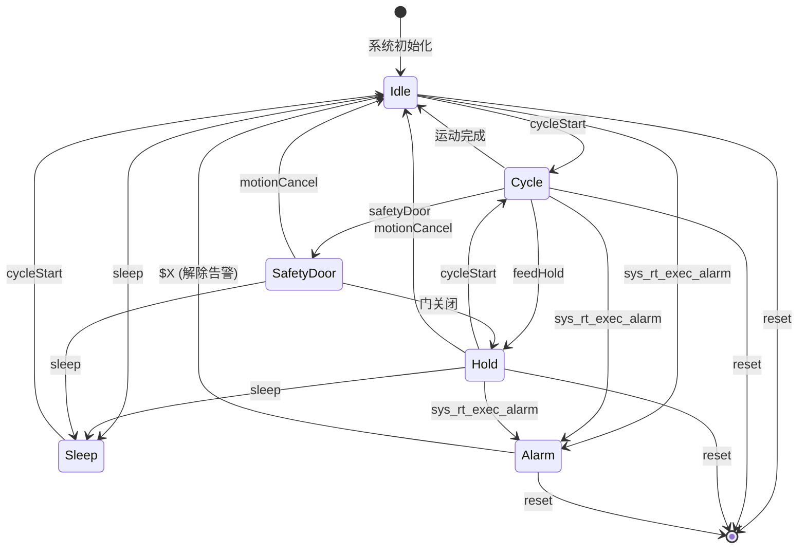
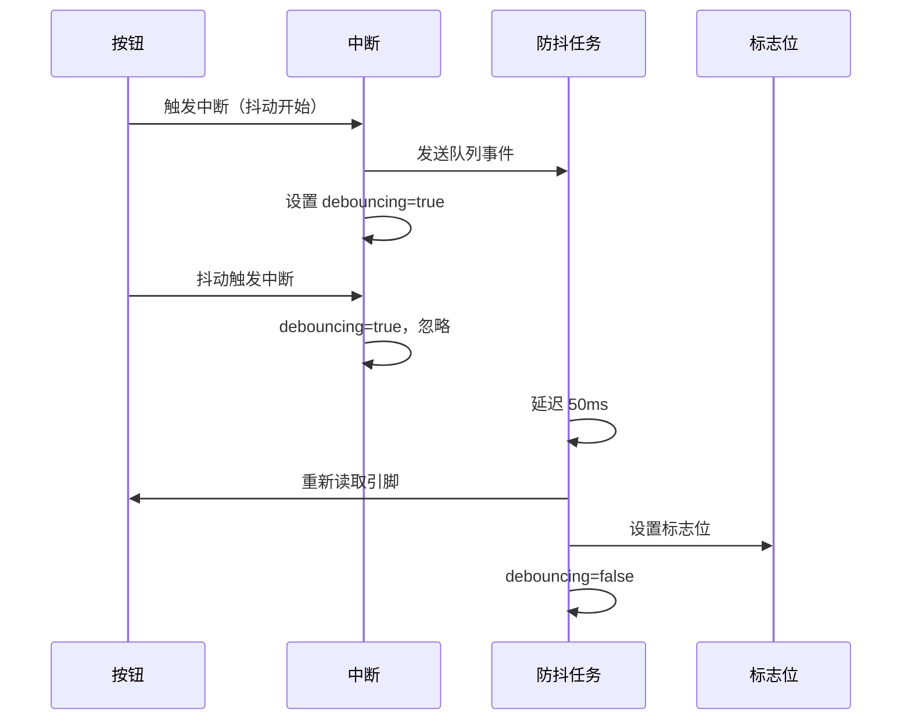
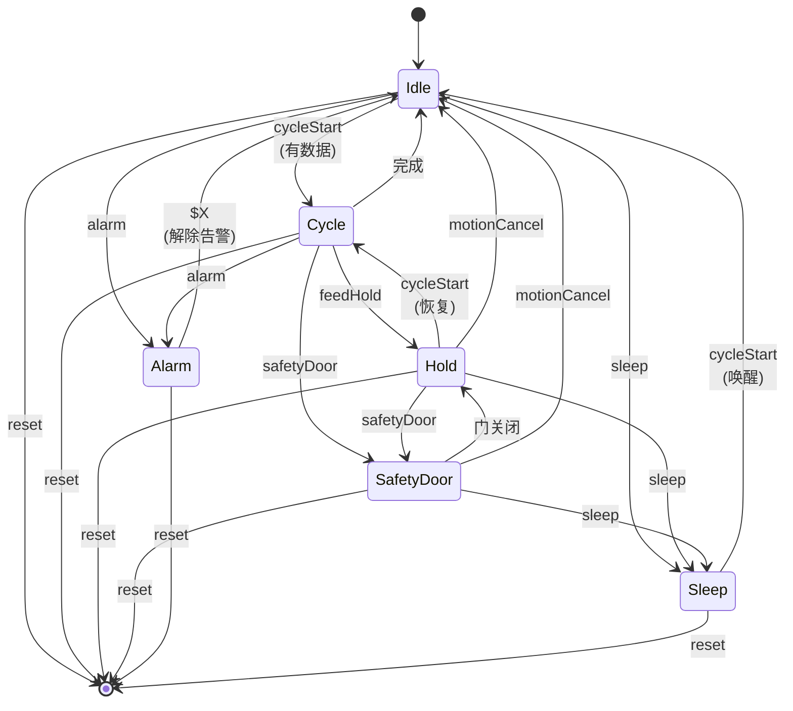

# Grbl_Esp32 实时标志位系统设计详解

> **核心主题**：嵌入式系统中的生产者-消费者模式与实时命令处理机制
>
> **适用场景**：CNC 控制器、实时控制系统、中断驱动的嵌入式应用
>
> **最后更新**：2026-01-21

---

## 目录

- [第一部分：设计概述](#第一部分设计概述)
- [第二部分：核心实现](#第二部分核心实现)
- [第三部分：防御性编程机制](#第三部分防御性编程机制)
- [第四部分：跨平台对比分析](#第四部分跨平台对比分析)
- [第五部分：实战应用指南](#第五部分实战应用指南)
- [第六部分：设计模式总结](#第六部分设计模式总结)

---

## 第一部分：设计概述

### 1.1 什么是实时标志位系统

**实时标志位系统** 是一种轻量级的进程间通信机制，用于在中断上下文和主程序之间传递控制命令。在 Grbl_Esp32 中，它通过 8 个布尔标志位（压缩到 1 个字节）实现实时命令的异步传递。

**核心组件**：
```
┌─────────────────────────────────────────────────────┐
│                实时标志位系统                         │
│                                                     │
│  ┌──────────────┐    ┌──────────────┐    ┌────────┐ │
│  │   生产者      │───>│  标志位缓冲区 │───>│ 消费者 │ │
│  │ (中断/命令)   │    │  (1 字节)    │    │(主循环)│ │
│  └──────────────┘    └──────────────┘    └────────┘ │
│                                                     │
│  特性：非阻塞、原子操作、低延迟 (<1ms)                │
└─────────────────────────────────────────────────────┘
```

### 1.2 为什么需要这种设计

#### 问题场景

在实时控制系统中，存在三个关键矛盾：

1. **实时性 vs 复杂性**
   - 中断需要快速响应（<10μs）
   - 但实际处理逻辑可能很复杂（停止电机、更新状态、发送报告）

2. **中断安全 vs 功能完整**
   - 中断上下文禁止调用大多数系统函数（malloc、printf、delay）
   - 但实时命令需要执行完整的控制逻辑

3. **内存效率 vs 功能丰富**
   - 嵌入式系统 RAM 有限（ESP32: 520KB，STM32F103: 20KB）
   - 需要支持多种实时命令（复位、暂停、急停、状态报告等）

#### 解决方案

**标志位系统**通过"延迟执行"模式解决上述矛盾：

```cpp
// 中断上下文：仅设置标志位（<1μs）
void IRAM_ATTR isr_emergency_stop() {
    sys_rt_exec_state.bit.reset = true;  // 快速标记
    // 不执行实际停止逻辑！
}

// 主循环：轮询并执行（1ms 周期）
void protocol_main_loop() {
    for (;;) {
        protocol_execute_realtime();  // 检查标志位并执行
        // ... 其他任务
    }
}
```

**优势**：
- ✅ 中断快速返回，保证实时性
- ✅ 主循环中安全执行复杂逻辑
- ✅ 仅占用 1 字节内存，支持 8 种命令

### 1.3 核心设计原则

#### 原则 1：位域压缩（Bit Field）

**目标**：用最少的内存表示多个布尔状态。

```cpp
// 方案 A：每个标志占 1 字节（浪费）
uint8_t flag_reset = 0;
uint8_t flag_feedHold = 0;
uint8_t flag_statusReport = 0;
// ... 8 个标志 = 8 字节

// 方案 B：位域结构体（推荐）
struct ExecStateBits {
    uint8_t statusReport : 1;   // 位 0
    uint8_t cycleStart : 1;     // 位 1
    uint8_t feedHold : 1;       // 位 3
    uint8_t reset : 1;          // 位 4
    uint8_t safetyDoor : 1;     // 位 5
    uint8_t motionCancel : 1;   // 位 6
    uint8_t sleep : 1;          // 位 7
};  // 总大小：1 字节
```

**内存布局**：
```
Byte:  [7] [6] [5] [4] [3] [2] [1] [0]
       slp  mc  sd  rst  fh   -  cs  sr
```

#### 原则 2：联合体原子操作（Union）

**目标**：既能逐位访问，又能原子读写整个字节。

```cpp
union ExecState {
    uint8_t       value;  // 整体访问（原子）
    ExecStateBits bit;    // 位访问（便捷）
};

ExecState state;

// 原子读取所有标志
uint8_t snapshot = state.value;

// 逐位访问
if (state.bit.reset) { ... }

// 原子清零
state.value = 0;
```

**为什么需要联合体？**
- ESP32 保证单字节读写的原子性
- 但不保证位域操作的原子性（可能被编译为多条指令）
- 联合体允许快速检查"是否有任何命令待处理"

```cpp
// 快速检查（单次比较）
if (sys_rt_exec_state.value != 0) {
    // 有实时命令需要处理
}

// vs 逐位检查（8 次比较）
if (sys_rt_exec_state.bit.reset ||
    sys_rt_exec_state.bit.feedHold || ...) { ... }
```

#### 原则 3：volatile 防止优化

**目标**：确保每次访问都从内存读取，而非使用寄存器缓存。

```cpp
// 错误：编译器可能优化掉循环
ExecState state;
while (state.bit.reset == false) {
    // 编译器认为 state 不会改变，可能优化为死循环
}

// 正确：强制每次从内存读取
volatile ExecState state;
while (state.bit.reset == false) {
    // 编译器每次都会读取内存中的 state
}
```

**volatile 的作用**：
- 告诉编译器：这个变量可能被"外部因素"修改（中断、硬件、其他线程）
- 禁止将其缓存到寄存器
- 禁止重排序优化

#### 原则 4：双缓冲消除竞态

**目标**：避免在处理过程中标志位被中断修改。

```cpp
// 问题场景：直接使用全局变量
void protocol_execute_realtime() {
    if (sys_rt_exec_state.bit.reset) {
        // 问题：中断可能在此期间修改 sys_rt_exec_state
        do_reset_logic();
        sys_rt_exec_state.bit.reset = false;
    }
}

// 解决方案：先复制到本地变量
void protocol_execute_realtime() {
    ExecState rt_exec;
    rt_exec.value = sys_rt_exec_state.value;  // 原子复制

    // 使用本地副本，不受中断干扰
    if (rt_exec.bit.reset) {
        do_reset_logic();
        sys_rt_exec_state.bit.reset = false;  // 清除原始标志
    }
}
```

### 1.4 工作流程

```mermaid
sequenceDiagram
    participant ISR as 中断/命令
    participant Flag as 标志位缓冲区<br/>(volatile)
    participant Loop as 主循环
    participant Logic as 业务逻辑

    ISR->>Flag: 1. 设置标志位 (bit=1)
    Note right of ISR: 快速返回 (<1μs)

    Loop->>Flag: 2. 轮询检查 (每 1ms)
    Flag-->>Loop: 3. 返回标志状态

    alt 有标志被设置
        Loop->>Flag: 4. 原子复制到本地
        Loop->>Logic: 5. 执行对应逻辑
        Note right of Logic: 安全上下文<br/>可调用任何函数
        Loop->>Flag: 6. 清除标志位 (bit=0)
    end

    Loop->>Loop: 7. 继续下一轮
```

**时序特征**：
- **设置延迟**：<1μs（中断响应时间）
- **处理延迟**：<1ms（主循环周期）
- **总响应时间**：<2ms（满足实时要求）

---

## 第二部分：核心实现

### 2.1 数据结构定义

#### 2.1.1 ExecStateBits 位域结构体

**文件路径**：[Grbl_Esp32/src/Exec.h:10-19](Grbl_Esp32/src/Exec.h#L10-L19)

```cpp
struct ExecStateBits {
    uint8_t statusReport : 1;   // 位0: 请求状态报告 (? 命令)
    uint8_t cycleStart : 1;     // 位1: 启动运动循环 (~ 命令)
    uint8_t cycleStop : 1;      // 位2: 停止循环 (已弃用)
    uint8_t feedHold : 1;       // 位3: 进给保持/暂停 (! 命令)
    uint8_t reset : 1;          // 位4: 系统复位 (Ctrl+X)
    uint8_t safetyDoor : 1;     // 位5: 安全门触发
    uint8_t motionCancel : 1;   // 位6: 取消运动 (Jog 取消)
    uint8_t sleep : 1;          // 位7: 睡眠模式 ($SLP 命令)
};
```

**设计细节**：
- 每个字段占 1 位（`:1` 语法）
- 总共 8 位 = 1 字节
- 未使用的 `cycleStop` 保留，避免破坏二进制兼容性

**静态断言**：
```cpp
static_assert(sizeof(ExecStateBits) == sizeof(uint8_t),
              "ExecStateBits is not an uint8");
```
编译时检查确保结构体确实只占 1 字节。

#### 2.1.2 ExecState 联合体

**文件路径**：[Grbl_Esp32/src/Exec.h:21-24](Grbl_Esp32/src/Exec.h#L21-L24)

```cpp
union ExecState {
    uint8_t       value;  // 整体访问（用于原子操作）
    ExecStateBits bit;    // 位字段访问（用于读取单个标志）
};
```

**使用示例**：
```cpp
ExecState state;

// 场景 1：快速检查是否有任何命令
if (state.value != 0) {
    // 至少有一个标志被设置
}

// 场景 2：检查特定标志
if (state.bit.reset) {
    // 复位标志被设置
}

// 场景 3：清零所有标志
state.value = 0;  // 比逐个清零快 8 倍
```

#### 2.1.3 全局变量声明

**文件路径**：[Grbl_Esp32/src/System.h:134-139](Grbl_Esp32/src/System.h#L134-L139)

```cpp
// 实时执行状态标志
extern volatile ExecState     sys_rt_exec_state;

// 实时执行告警标志
extern volatile ExecAlarm     sys_rt_exec_alarm;

// 配件覆盖标志（主轴、冷却液）
extern volatile ExecAccessory sys_rt_exec_accessory_override;

// 进给/快速/主轴速度覆盖百分比
extern volatile Percent       sys_rt_f_override;
extern volatile Percent       sys_rt_r_override;
extern volatile Percent       sys_rt_s_override;
```

**定义位置**：[Grbl_Esp32/src/System.cpp:29-39](Grbl_Esp32/src/System.cpp#L29-L39)

```cpp
volatile ExecState sys_rt_exec_state;
volatile ExecAlarm sys_rt_exec_alarm;
// ...
```

**关键点**：
- `volatile`：防止编译器优化
- `extern`：允许所有源文件访问
- 全局作用域：中断和主循环都能访问

### 2.2 标志位设置场景（生产者）

#### 2.2.1 场景分类

| 类别 | 触发源 | 上下文 | 延迟 | 示例 |
|------|-------|--------|------|------|
| **中断** | 硬件事件 | ISR | <1μs | 限位开关、安全门、控制按钮 |
| **串口命令** | 实时字符 | 任务 | <100μs | `?`、`!`、`~`、Ctrl+X |
| **内部触发** | 逻辑判断 | 主程序 | <1ms | M0 暂停、探针失败、归零失败 |

#### 2.2.2 串口实时命令处理

**文件路径**：[Grbl_Esp32/src/Serial.cpp:243-290](Grbl_Esp32/src/Serial.cpp#L243-L290)

```cpp
void execute_realtime_command(Cmd command, uint8_t client) {
    switch (command) {
        case Cmd::Reset:           // Ctrl+X (0x18)
            mc_reset();            // 直接调用复位
            break;

        case Cmd::StatusReport:    // ? (0x3F)
            report_realtime_status(client);  // 立即发送
            break;

        case Cmd::CycleStart:      // ~ (0x7E)
            sys_rt_exec_state.bit.cycleStart = true;
            break;

        case Cmd::FeedHold:        // ! (0x21)
            sys_rt_exec_state.bit.feedHold = true;
            break;

        case Cmd::SafetyDoor:      // 0x84
            sys_rt_exec_state.bit.safetyDoor = true;
            break;

        case Cmd::JogCancel:       // 0x85
            if (sys.state == State::Jog) {
                sys_rt_exec_state.bit.motionCancel = true;
            }
            break;
    }
}
```

**注意**：
- `Reset` 和 `StatusReport` **不设置标志位**，直接执行
- 其他命令设置标志位，由主循环处理

**命令识别**：[Grbl_Esp32/src/Serial.cpp:234-240](Grbl_Esp32/src/Serial.cpp#L234-L240)

```cpp
bool is_realtime_command(uint8_t data) {
    if (data >= 0x80) {
        return true;  // 高位字符 (0x80-0xFF) 都是实时命令
    }
    auto cmd = static_cast<Cmd>(data);
    return cmd == Cmd::Reset || cmd == Cmd::StatusReport ||
           cmd == Cmd::CycleStart || cmd == Cmd::FeedHold;
}
```

#### 2.2.3 控制引脚中断处理

**文件路径**：[Grbl_Esp32/src/System.cpp:140-152](Grbl_Esp32/src/System.cpp#L140-L152)

```cpp
void IRAM_ATTR isr_control_inputs() {
#ifdef ENABLE_CONTROL_SW_DEBOUNCE
    // 防抖模式：启动任务延迟检查
    int evt;
    if (!debouncing) {
        debouncing = true;
        xQueueSendFromISR(control_sw_queue, &evt, NULL);
    }
#else
    // 直接模式：立即处理
    ControlPins pins = system_control_get_state();
    system_exec_control_pin(pins);
#endif
}
```

**引脚处理逻辑**：[Grbl_Esp32/src/System.cpp:259-278](Grbl_Esp32/src/System.cpp#L259-L278)

```cpp
void system_exec_control_pin(ControlPins pins) {
    if (pins.bit.reset) {
        mc_reset();
    } else if (pins.bit.cycleStart) {
        sys_rt_exec_state.bit.cycleStart = true;
    } else if (pins.bit.feedHold) {
        sys_rt_exec_state.bit.feedHold = true;
    } else if (pins.bit.safetyDoor) {
        sys_rt_exec_state.bit.safetyDoor = true;
    }
}
```

**关键技术**：
- `IRAM_ATTR`：将中断函数放入 RAM，避免 Flash 缓存延迟
- 防抖处理：避免按钮抖动导致多次触发

#### 2.2.4 限位开关硬限位中断

**文件路径**：[Grbl_Esp32/src/Limits.cpp:42-70](Grbl_Esp32/src/Limits.cpp#L42-L70)

```cpp
void IRAM_ATTR isr_limit_switches() {
    // 仅在非告警/归零状态下触发
    if (sys.state != State::Alarm && sys.state != State::Homing) {
        if (sys_rt_exec_alarm == ExecAlarm::None) {
#ifdef ENABLE_SOFTWARE_DEBOUNCE
            int evt;
            xQueueSendFromISR(limit_sw_queue, &evt, NULL);
#else
            if (limits_get_state()) {
                mc_reset();  // 立即复位
                sys_rt_exec_alarm = ExecAlarm::HardLimit;  // 设置告警
            }
#endif
        }
    }
}
```

#### 2.2.5 程序暂停（M0/M1）

**文件路径**：[Grbl_Esp32/src/GCode.cpp:1563-1569](Grbl_Esp32/src/GCode.cpp#L1563-L1569)

```cpp
case ProgramFlow::Paused:  // M0 或 M1
    protocol_buffer_synchronize();  // 等待缓冲区清空
    if (sys.state != State::CheckMode) {
        sys_rt_exec_state.bit.feedHold = true;  // 复用进给保持
        protocol_execute_realtime();            // 立即执行
    }
    break;
```

#### 2.2.6 文件路径索引表

| 触发源 | 文件路径 | 关键函数 | 设置的标志位 |
|--------|---------|---------|------------|
| 串口命令 | `Serial.cpp:243` | `execute_realtime_command()` | cycleStart, feedHold, safetyDoor, motionCancel |
| 控制引脚 | `System.cpp:259` | `system_exec_control_pin()` | cycleStart, feedHold, safetyDoor |
| 限位开关 | `Limits.cpp:42` | `isr_limit_switches()` | 设置 sys_rt_exec_alarm |
| M0/M1 | `GCode.cpp:1566` | G-code 解析 | feedHold |
| 探针失败 | `MotionControl.cpp:410` | `mc_probe_cycle()` | 设置 sys_rt_exec_alarm |
| $SLP 命令 | `ProcessSettings.cpp:277` | 命令解析 | sleep |
| 系统复位 | `MotionControl.cpp:507` | `mc_reset()` | reset |

### 2.3 标志位处理机制（消费者）

#### 2.3.1 主循环调用点

**文件路径**：[Grbl_Esp32/src/Protocol.cpp:105-199](Grbl_Esp32/src/Protocol.cpp#L105-L199)

```cpp
void protocol_main_loop() {
    for (;;) {  // 主循环
        // 检查点 1：处理每个字符后
        while ((c = client_read(client)) != -1) {
            if (收到完整命令) {
                protocol_execute_realtime();  // ← 检查点
                execute_line(line);
            }
        }

        // 检查点 2：每轮循环末尾
        protocol_auto_cycle_start();
        protocol_execute_realtime();  // ← 检查点

        if (sys.abort) {
            return;  // 复位时退出
        }
    }
}
```

**调用频率**：
- 接收串口数据时：每条命令后 1 次
- 空闲时：每 1-2ms 一次
- 运动时：可能更频繁（取决于数据流）

#### 2.3.2 核心处理流程

**文件路径**：[Grbl_Esp32/src/Protocol.cpp:241-246](Grbl_Esp32/src/Protocol.cpp#L241-L246)

```cpp
void protocol_execute_realtime() {
    protocol_exec_rt_system();      // 系统级实时命令
    if (sys.suspend.value) {
        protocol_exec_rt_suspend(); // 暂停级实时命令
    }
}
```

**系统级处理（简化）**：[Protocol.cpp:251-524](Grbl_Esp32/src/Protocol.cpp#L251-L524)

```cpp
void protocol_exec_rt_system() {
    // 1. 处理告警（最高优先级）
    if (sys_rt_exec_alarm != ExecAlarm::None) {
        sys.state = State::Alarm;
        report_alarm_message(sys_rt_exec_alarm);
        // 硬限位/软限位进入阻塞等待
        if (alarm == ExecAlarm::HardLimit || alarm == ExecAlarm::SoftLimit) {
            do {
                // 只允许复位和状态报告
            } while (!sys_rt_exec_state.bit.reset);
        }
        sys_rt_exec_alarm = ExecAlarm::None;  // 清除告警
    }

    // 2. 原子复制标志位到本地变量
    ExecState rt_exec;
    rt_exec.value = sys_rt_exec_state.value;

    if (rt_exec.value == 0 && !cycle_stop) {
        return;  // 无命令，提前退出
    }

    // 3. 系统复位（第二优先级）
    if (rt_exec.bit.reset) {
        sys.abort = true;
        return;  // 立即退出，不清除标志位
    }

    // 4. 状态报告
    if (rt_exec.bit.statusReport) {
        report_realtime_status(CLIENT_ALL);
        sys_rt_exec_state.bit.statusReport = false;  // 清除
    }

    // 5. 运动保持类命令（feedHold, safetyDoor, motionCancel, sleep）
    if (rt_exec.bit.feedHold || rt_exec.bit.safetyDoor ||
        rt_exec.bit.motionCancel || rt_exec.bit.sleep) {

        // 状态检查
        if (!(sys.state == State::Alarm || sys.state == State::CheckMode)) {
            // 启动保持
            if (sys.state == State::Cycle || sys.state == State::Jog) {
                sys.step_control.executeHold = true;
            }

            // 分别处理各个标志
            if (rt_exec.bit.motionCancel) {
                sys.suspend.bit.motionCancel = true;
                sys_rt_exec_state.bit.motionCancel = false;  // 清除
            }

            if (rt_exec.bit.feedHold) {
                sys.state = State::Hold;
                sys_rt_exec_state.bit.feedHold = false;  // 清除
            }

            if (rt_exec.bit.safetyDoor) {
                sys.state = State::SafetyDoor;
                sys_rt_exec_state.bit.safetyDoor = false;  // 清除
            }

            if (rt_exec.bit.sleep) {
                sys.state = State::Sleep;
                sys_rt_exec_state.bit.sleep = false;  // 清除
            }
        }
    }

    // 6. 循环启动
    if (rt_exec.bit.cycleStart) {
        if (sys.state == State::Idle ||
            (sys.state == State::Hold && sys.suspend.bit.holdComplete)) {
            sys.state = State::Cycle;
            st_wake_up();  // 唤醒步进电机
        }
        sys_rt_exec_state.bit.cycleStart = false;  // 清除
    }

    // 7. 重新加载步进缓冲区
    st_prep_buffer();
}
```

#### 2.3.3 处理优先级表

| 优先级 | 标志位/状态 | 行为 | 清除时机 | 后续处理 |
|--------|------------|------|---------|----------|
| 1 | `sys_rt_exec_alarm` | 进入告警状态，阻塞等待 | 立即 | 停止运动 |
| 2 | `reset` | 设置 abort，退出主循环 | 重启时 | 系统重启 |
| 3 | `statusReport` | 发送状态报告 | 立即 | 无 |
| 4 | `feedHold` | 暂停运动 | 处理后 | 进入 Hold 状态 |
| 4 | `safetyDoor` | 安全门触发 | 处理后 | 进入 SafetyDoor 状态 |
| 4 | `motionCancel` | 取消运动 | 处理后 | 清空缓冲区 |
| 4 | `sleep` | 睡眠模式 | 处理后 | 进入 Sleep 状态 |
| 5 | `cycleStart` | 启动/恢复运动 | 处理后 | 进入 Cycle 状态 |

**注意**：同级命令按代码顺序处理。

#### 2.3.4 清除时机对比

| 标志位 | 清除模式 | 代码位置 | 原因 |
|--------|---------|---------|------|
| `statusReport` | 立即清除 | `Protocol.cpp:284` | 报告发送完成，无后续状态 |
| `feedHold` | 立即清除 | `Protocol.cpp:326` | 状态转换完成 |
| `safetyDoor` | 立即清除 | `Protocol.cpp:358` | 状态转换完成 |
| `motionCancel` | 立即清除 | `Protocol.cpp:318` | 标记到 suspend 结构体 |
| `sleep` | 立即清除 | `Protocol.cpp:371` | 状态转换完成 |
| `cycleStart` | 延迟清除 | `Protocol.cpp:411` | 等待所有条件检查完成 |
| `reset` | 永不清除 | - | 系统重启时清零 |

#### 2.3.5 状态机转换简图



---

## 第三部分：防御性编程机制

### 3.1 原子操作和双缓冲

#### 3.1.1 volatile 关键字的必要性

**问题场景**：编译器优化导致的 bug

```cpp
// 原始代码
ExecState state;
while (state.bit.reset == false) {
    // 等待复位信号
    do_some_work();
}

// 编译器优化后（错误！）
ExecState state;
if (state.bit.reset == false) {
    while (true) {  // 编译器认为 state 永不改变
        do_some_work();
    }
}
```

**解决方案**：

```cpp
volatile ExecState state;
while (state.bit.reset == false) {
    // 编译器强制每次从内存读取
    do_some_work();
}
```

**汇编对比**（ARM Cortex-M）：

```asm
; 无 volatile：循环内只读取一次
    ldr   r0, [r1]          ; 加载 state 到寄存器
    tst   r0, #0x10         ; 测试 reset 位
loop:
    ; ... do_some_work ...
    b     loop              ; 永不重新检查 state！

; 有 volatile：每次循环都读取
loop:
    ldr   r0, [r1]          ; 每次都从内存加载
    tst   r0, #0x10         ; 测试 reset 位
    beq   loop              ; reset=0 时继续循环
```

#### 3.1.2 本地复制模式

**问题场景**：处理过程中标志位被中断修改

```cpp
// 错误：直接使用全局变量
void protocol_execute_realtime() {
    if (sys_rt_exec_state.bit.feedHold) {
        // 问题：中断可能在此期间设置其他标志
        // 导致处理顺序混乱
        do_feed_hold();
        sys_rt_exec_state.bit.feedHold = false;
    }

    if (sys_rt_exec_state.bit.reset) {
        // 问题：如果 reset 在上面被设置，
        // 但 feedHold 已经处理，可能状态不一致
        do_reset();
    }
}
```

**正确方案**：

```cpp
void protocol_execute_realtime() {
    // 1. 原子复制到本地变量
    ExecState rt_exec;
    rt_exec.value = sys_rt_exec_state.value;

    // 2. 使用本地副本处理
    if (rt_exec.bit.feedHold) {
        do_feed_hold();
        sys_rt_exec_state.bit.feedHold = false;
    }

    if (rt_exec.bit.reset) {
        do_reset();
    }

    // 3. 中断设置的新标志在下次循环处理
}
```

**优势**：
- ✅ 处理过程中标志位快照不变
- ✅ 优先级逻辑不被中断打乱
- ✅ 新触发的命令在下次循环处理（延迟 <1ms）

#### 3.1.3 联合体实现原子读写

**为什么需要联合体？**

```cpp
// 方案 A：仅使用位域（不推荐）
struct ExecStateBits {
    uint8_t statusReport : 1;
    uint8_t cycleStart : 1;
    // ...
};

ExecStateBits state;

// 问题 1：无法快速检查"是否有任何命令"
if (state.statusReport || state.cycleStart || ... ) {  // 需要 8 次比较
}

// 问题 2：清零效率低
state.statusReport = 0;
state.cycleStart = 0;
// ... 8 条语句

// 方案 B：联合体（推荐）
union ExecState {
    uint8_t       value;
    ExecStateBits bit;
};

ExecState state;

// 快速检查
if (state.value != 0) {  // 单次比较
}

// 快速清零
state.value = 0;  // 单条指令
```

**汇编对比**（ESP32 Xtensa）：

```asm
; 位域逐个清零（8 条指令）
    l8ui  a2, a1, 0       ; 加载字节
    movi  a3, ~0x01       ; 清除位 0
    and   a2, a2, a3
    s8i   a2, a1, 0       ; 存储
    ; ... 重复 7 次 ...

; 联合体清零（2 条指令）
    movi  a2, 0           ; 准备 0
    s8i   a2, a1, 0       ; 存储整个字节
```

### 3.2 状态检查和优先级控制

#### 3.2.1 状态机保护

**问题场景**：在错误状态下执行命令导致系统崩溃

```cpp
// 错误：不检查状态，直接启动
if (rt_exec.bit.cycleStart) {
    sys.state = State::Cycle;
    st_wake_up();  // 可能在告警状态下唤醒步进电机！
}
```

**正确方案**：

```cpp
if (rt_exec.bit.cycleStart) {
    // 只在安全状态下启动
    if (sys.state == State::Idle ||
        (sys.state == State::Hold && sys.suspend.bit.holdComplete)) {

        // 额外检查：是否有运动数据
        if (plan_get_current_block()) {
            sys.state = State::Cycle;
            st_wake_up();
        } else {
            sys.state = State::Idle;  // 无运动数据，保持空闲
        }
    }
    // 其他状态忽略命令
    sys_rt_exec_state.bit.cycleStart = false;  // 无论如何都清除
}
```

**状态转换矩阵**：

| 当前状态 | cycleStart | feedHold | safetyDoor | reset |
|---------|-----------|----------|-----------|-------|
| Idle | ✅ → Cycle | ❌ 忽略 | ❌ 忽略 | ✅ 重启 |
| Cycle | ❌ 忽略 | ✅ → Hold | ✅ → SafetyDoor | ✅ 重启 |
| Hold | ✅ → Cycle | ❌ 忽略 | ✅ → SafetyDoor | ✅ 重启 |
| Alarm | ❌ 忽略 | ❌ 忽略 | ❌ 忽略 | ✅ 重启 |
| Jog | ❌ 忽略 | ✅ → Hold | ✅ → SafetyDoor | ✅ 重启 |

#### 3.2.2 防止重复执行

**问题场景**：标志位未及时清除，导致重复触发

```cpp
// 错误：忘记清除标志
if (rt_exec.bit.feedHold) {
    sys.state = State::Hold;
    // 忘记清除！下次循环会再次执行
}

// 正确：处理后立即清除
if (rt_exec.bit.feedHold) {
    sys.state = State::Hold;
    sys_rt_exec_state.bit.feedHold = false;  // 清除
}
```

**双重保护**：使用 suspend 标志防止重复进入保持

```cpp
if (rt_exec.bit.feedHold) {
    // 检查是否已经在保持状态
    if (!(sys.suspend.bit.motionCancel || sys.suspend.bit.jogCancel)) {
        sys.step_control.executeHold = true;
        sys.suspend.bit.initiateHold = true;  // 标记已启动
    }
    sys_rt_exec_state.bit.feedHold = false;
}
```

#### 3.2.3 优先级排序逻辑

**代码结构**：[Protocol.cpp:276-411](Grbl_Esp32/src/Protocol.cpp#L276-L411)

```cpp
// 固定优先级顺序
if (rt_exec.bit.reset) {
    // 优先级 1：立即退出
    sys.abort = true;
    return;
}

if (rt_exec.bit.statusReport) {
    // 优先级 2：快速响应
}

if (rt_exec.bit.feedHold || rt_exec.bit.safetyDoor) {
    // 优先级 3：安全命令
}

if (rt_exec.bit.cycleStart) {
    // 优先级 4：启动命令
    // 但要检查是否有更高优先级命令
    if (!(rt_exec.bit.feedHold || rt_exec.bit.safetyDoor)) {
        // 安全启动
    }
}
```

### 3.3 中断安全设计

#### 3.3.1 临界区保护（FreeRTOS）

**问题场景**：多任务竞争访问共享资源

```cpp
// 错误：无保护的缓冲区写入
void client_task() {
    uint8_t data = read_uart();
    client_buffer[0].write(data);  // 可能被其他任务打断
}
```

**正确方案**：[Serial.cpp:185-187](Grbl_Esp32/src/Serial.cpp#L185-L187)

```cpp
void client_task() {
    uint8_t data = read_uart();

    vTaskEnterCritical(&myMutex);  // 进入临界区
    client_buffer[0].write(data);
    vTaskExitCritical(&myMutex);   // 退出临界区
}
```

**临界区特性**：
- 禁用任务切换（但不禁用中断）
- 使用互斥锁保护共享资源
- 应尽量短（<100μs）

**FreeRTOS 保护等级**：

| 机制 | 禁用中断 | 禁用任务切换 | 适用场景 |
|------|---------|-------------|---------|
| `taskENTER_CRITICAL()` | ✅ 全部 | ✅ | 非常短的操作 (<10μs) |
| `vTaskSuspendAll()` | ❌ | ✅ | 较短操作 (<100μs) |
| 互斥锁 (Mutex) | ❌ | 部分 | 可能阻塞的操作 |

#### 3.3.2 IRAM 属性（ESP32 特性）

**问题场景**：中断处理函数在 Flash 中，存在缓存未命中延迟

```cpp
// 错误：中断函数在 Flash（默认）
void isr_limit_switches() {
    // Flash 访问可能需要 10-100μs
    sys_rt_exec_alarm = ExecAlarm::HardLimit;
}
```

**正确方案**：[Limits.cpp:42](Grbl_Esp32/src/Limits.cpp#L42)

```cpp
void IRAM_ATTR isr_limit_switches() {
    // 函数代码在 RAM，访问 <1μs
    sys_rt_exec_alarm = ExecAlarm::HardLimit;
}
```

**IRAM 原理**：

```
┌─────────────────────────────────────────────┐
│           ESP32 内存布局                     │
├─────────────────┬───────────────────────────┤
│ Flash (慢)      │ 代码默认位置              │
│ 3MB             │ 访问延迟: 10-100μs         │
│                 │ 需要经过缓存              │
├─────────────────┼───────────────────────────┤
│ IRAM (快)       │ IRAM_ATTR 函数位置        │
│ 128KB           │ 访问延迟: <1μs             │
│                 │ 直接访问                  │
└─────────────────┴───────────────────────────┘
```

**使用原则**：
- ✅ 中断处理函数
- ✅ 实时性要求高的函数
- ❌ 大型函数（IRAM 容量有限）

#### 3.3.3 防抖处理

**问题场景**：按钮抖动导致多次触发

```
物理按钮信号：
    ┌─┐ ┌┐ ┌──────────────
 ___┘ └─┘└─┘
    抖动 (5-20ms)
```

**硬件防抖**：添加电容/RC 滤波器（不在本文讨论）

**软件防抖**：[System.cpp:140-152](Grbl_Esp32/src/System.cpp#L140-L152)

```cpp
#ifdef ENABLE_CONTROL_SW_DEBOUNCE

// 全局标志
static volatile bool debouncing = false;

void IRAM_ATTR isr_control_inputs() {
    if (!debouncing) {
        debouncing = true;
        int evt;
        xQueueSendFromISR(control_sw_queue, &evt, NULL);  // 启动任务
    }
    // 抖动期间的中断被忽略
}

void control_sw_debounce_task(void* parameter) {
    int evt;
    for (;;) {
        if (xQueueReceive(control_sw_queue, &evt, portMAX_DELAY)) {
            vTaskDelay(CONTROL_SW_DEBOUNCE_PERIOD);  // 延迟 50ms

            // 重新读取引脚状态
            ControlPins pins = system_control_get_state();
            system_exec_control_pin(pins);

            debouncing = false;  // 解除锁定
        }
    }
}

#endif
```

**防抖逻辑**：



**参数选择**：
- 延迟时间：20-100ms（典型 50ms）
- 太短：无法过滤抖动
- 太长：响应延迟明显

---

## 第四部分：跨平台对比分析

### 4.1 ESP32 (Grbl_Esp32)

#### 4.1.1 FreeRTOS 任务和中断

**特性**：
- 双核处理器（240MHz 各一个）
- FreeRTOS 操作系统
- 中断优先级：0-7（7 最高）

**实现方式**：

```cpp
// 实时命令检查任务
void clientCheckTask(void* pvParameters) {
    while (true) {
        uint8_t data;
        if (getClientChar(&data) != CLIENT_ALL) {
            if (is_realtime_command(data)) {
                execute_realtime_command(data);
            }
        }
        vTaskDelay(1 / portTICK_RATE_MS);  // 1ms 延迟
    }
}

// 中断服务程序
void IRAM_ATTR isr_limit_switches() {
    sys_rt_exec_alarm = ExecAlarm::HardLimit;
    // 不能调用 FreeRTOS API（除了 FromISR 版本）
}
```

**关键技术**：
- 任务优先级：实时任务通常设为高优先级（15-20）
- 中断嵌套：支持，但需注意优先级配置
- 核心亲和性：可将任务绑定到特定核心

#### 4.1.2 IRAM 属性和 Flash 缓存

**问题**：ESP32 的代码默认存储在外部 Flash

```cpp
// Flash 访问时序
读取指令 → SPI 传输 → Flash 读取 → 缓存 → CPU
          (10-100μs)
```

**解决方案**：`IRAM_ATTR`

```cpp
#define IRAM_ATTR __attribute__((section(".iram1")))

void IRAM_ATTR fast_function() {
    // 代码在 RAM，访问 <1μs
}
```

**内存分配**：

| 区域 | 大小 | 速度 | 用途 |
|------|------|------|------|
| Flash | 4MB | 慢 | 普通代码 |
| IRAM | 128KB | 快 | 中断/关键函数 |
| DRAM | 320KB | 快 | 数据/堆栈 |

#### 4.1.3 双核处理器考虑

**问题**：volatile 在多核下不够用

```cpp
// 单核：volatile 足够
volatile uint8_t flag = 0;

// 核心 0 写入
flag = 1;

// 核心 1 读取
if (flag == 1) { ... }  // 可能读到旧值（缓存未同步）
```

**解决方案**：内存屏障

```cpp
#include "esp_attr.h"

// 写入
flag = 1;
__sync_synchronize();  // 内存屏障

// 读取
__sync_synchronize();
if (flag == 1) { ... }
```

**Grbl_Esp32 的策略**：
- 所有实时标志位操作在核心 1
- 步进中断固定在核心 0
- 避免跨核心共享标志位

### 4.2 STM32 (HAL/CMSIS)

#### 4.2.1 NVIC 中断优先级

**特性**：
- ARM Cortex-M 架构
- NVIC 中断控制器
- 抢占优先级 + 子优先级

**实现方式**：

```cpp
// STM32 HAL 库
void HAL_GPIO_EXTI_Callback(uint16_t GPIO_Pin) {
    if (GPIO_Pin == LIMIT_SWITCH_Pin) {
        sys_rt_exec_alarm = ExecAlarm::HardLimit;
    }
}

// 中断配置
HAL_NVIC_SetPriority(EXTI15_10_IRQn, 2, 0);  // 抢占优先级 2，子优先级 0
HAL_NVIC_EnableIRQ(EXTI15_10_IRQn);
```

**优先级分组**：

| 分组 | 抢占位数 | 子优先级位数 | 说明 |
|------|---------|-------------|------|
| NVIC_PriorityGroup_0 | 0 | 4 | 无抢占 |
| NVIC_PriorityGroup_2 | 2 | 2 | 平衡 |
| NVIC_PriorityGroup_4 | 4 | 0 | 仅抢占 |

#### 4.2.2 原子操作

**问题**：ARM Cortex-M 的位操作不是原子的

```cpp
// 非原子：需要 3 条指令
struct {
    uint8_t bit0 : 1;
    uint8_t bit1 : 1;
} flags;

flags.bit0 = 1;  // 读-改-写序列，可能被中断打断
```

**解决方案 A**：禁用中断

```cpp
void set_flag() {
    __disable_irq();       // 禁用中断
    flags.bit0 = 1;
    __enable_irq();        // 恢复中断
}
```

**解决方案 B**：原子位操作（CMSIS）

```cpp
#include "core_cm4.h"

// 使用位带操作（Bit-banding）
#define BITBAND_SRAM_REF   0x20000000
#define BITBAND_SRAM_BASE  0x22000000
#define BITBAND(addr, bit) \
    ((BITBAND_SRAM_BASE + (((uint32_t)addr - BITBAND_SRAM_REF) << 5) + ((bit) << 2)))

volatile uint8_t flags;
#define FLAG_RESET (*((volatile uint32_t*)BITBAND(&flags, 0)))

// 原子设置
FLAG_RESET = 1;
```

**解决方案 C**：互斥锁（CMSIS-RTOS）

```cpp
osMutexDef(flagMutex);
osMutexId flagMutexHandle;

void set_flag() {
    osMutexWait(flagMutexHandle, osWaitForever);
    flags.bit0 = 1;
    osMutexRelease(flagMutexHandle);
}
```

#### 4.2.3 无 RTOS 的轮询实现

**裸机实现**：

```cpp
// 主循环
int main(void) {
    HAL_Init();
    SystemClock_Config();
    GPIO_Init();

    while (1) {
        // 轮询标志位
        protocol_execute_realtime();

        // 处理其他任务
        uart_process();
        gcode_execute();

        // 小延迟避免 CPU 100%
        HAL_Delay(1);
    }
}
```

**性能对比**：

| 特性 | FreeRTOS | 裸机轮询 |
|------|---------|---------|
| 响应延迟 | <1ms（任务切换） | 1-10ms（循环周期） |
| CPU 占用 | 低（任务调度） | 高（持续轮询） |
| 功耗 | 低（WFI 休眠） | 高（持续运行） |
| 复杂度 | 高 | 低 |

### 4.3 Arduino (AVR/ARM)

#### 4.3.1 cli() / sei() 中断控制

**AVR 平台**（Arduino Uno/Mega）：

```cpp
void set_flag() {
    cli();  // 清除全局中断标志（Clear Interrupt）
    sys_rt_exec_state.bit.reset = true;
    sei();  // 设置全局中断标志（Set Interrupt）
}

// 中断服务程序
ISR(INT0_vect) {
    sys_rt_exec_state.bit.reset = true;
}
```

**ARM 平台**（Arduino Due/Zero）：

```cpp
void set_flag() {
    noInterrupts();  // 等价于 cli()
    sys_rt_exec_state.bit.reset = true;
    interrupts();    // 等价于 sei()
}
```

#### 4.3.2 8 位 vs 32 位的原子性差异

**AVR (8 位)**：

```cpp
// 8 位变量：原子
volatile uint8_t flag;
flag = 1;  // 单条 STS 指令

// 16/32 位变量：非原子
volatile uint16_t counter;
counter = 1000;  // 需要 2 条指令（高字节+低字节）

// 正确方式
cli();
counter = 1000;
sei();
```

**ARM (32 位)**：

```cpp
// 8/16/32 位变量：都是原子（单条 STR 指令）
volatile uint32_t timestamp;
timestamp = 123456;  // 原子操作
```

**联合体的必要性**：

```cpp
// AVR 上必须确保单字节访问
union ExecState {
    uint8_t       value;  // 原子
    ExecStateBits bit;    // 单独访问时原子
};

// 错误：在 AVR 上使用多字节
union BadExecState {
    uint32_t value;  // 4 字节，非原子！
    // ...
};
```

#### 4.3.3 简化的实现方案

**Arduino 示例**（简化版 Grbl）：

```cpp
// 标志位定义
volatile uint8_t rt_exec_flags = 0;

#define RT_FLAG_RESET       (1 << 0)
#define RT_FLAG_FEED_HOLD   (1 << 1)
#define RT_FLAG_CYCLE_START (1 << 2)

// 中断设置标志
ISR(INT0_vect) {
    rt_exec_flags |= RT_FLAG_RESET;
}

// 主循环处理
void loop() {
    uint8_t flags = rt_exec_flags;  // 原子读取

    if (flags & RT_FLAG_RESET) {
        do_reset();
        rt_exec_flags &= ~RT_FLAG_RESET;  // 清除
    }

    if (flags & RT_FLAG_FEED_HOLD) {
        do_feed_hold();
        rt_exec_flags &= ~RT_FLAG_FEED_HOLD;
    }

    // 其他处理...
}
```

### 4.4 通用 FreeRTOS

#### 4.4.1 任务通知 vs 标志位

**方案 A：标志位**（Grbl 方式）

```cpp
volatile uint8_t flags;

// 中断
void ISR() {
    flags |= 0x01;
}

// 任务
void task() {
    if (flags & 0x01) {
        process();
        flags &= ~0x01;
    }
}
```

**方案 B：任务通知**（FreeRTOS 推荐）

```cpp
TaskHandle_t taskHandle;

// 中断
void ISR() {
    BaseType_t xHigherPriorityTaskWoken = pdFALSE;
    vTaskNotifyGiveFromISR(taskHandle, &xHigherPriorityTaskWoken);
    portYIELD_FROM_ISR(xHigherPriorityTaskWoken);
}

// 任务
void task() {
    ulTaskNotifyTake(pdTRUE, portMAX_DELAY);  // 阻塞等待
    process();
}
```

**对比**：

| 特性 | 标志位 | 任务通知 |
|------|-------|---------|
| 内存 | 1 字节 | 4 字节/任务 |
| 阻塞等待 | ❌ 需轮询 | ✅ 支持 |
| 多任务通知 | ✅ 多任务轮询同一标志 | ❌ 一对一 |
| 优先级 | ❌ 需手动实现 | ✅ 自动调度 |
| 适用场景 | 实时性要求高，轮询快 | 事件驱动，可阻塞 |

#### 4.4.2 队列 vs 全局变量

**方案 A：全局变量**

```cpp
volatile Command current_cmd;

// 生产者
current_cmd = CMD_RESET;

// 消费者
if (current_cmd == CMD_RESET) {
    process();
    current_cmd = CMD_NONE;
}
```

**方案 B：队列**

```cpp
QueueHandle_t cmdQueue;

// 生产者
Command cmd = CMD_RESET;
xQueueSend(cmdQueue, &cmd, 0);

// 消费者
Command cmd;
if (xQueueReceive(cmdQueue, &cmd, 0) == pdTRUE) {
    process(cmd);
}
```

**对比**：

| 特性 | 全局变量 | 队列 |
|------|---------|------|
| 内存 | 命令大小 | 命令大小 × 队列长度 |
| 缓冲 | ❌ 覆盖旧命令 | ✅ FIFO 缓冲 |
| 阻塞等待 | ❌ | ✅ |
| 线程安全 | ⚠️ 需手动保护 | ✅ 内置 |

#### 4.4.3 性能和内存权衡

**性能测试**（ESP32 @ 240MHz）：

| 操作 | 标志位 | 任务通知 | 队列 |
|------|-------|---------|------|
| 设置/发送 | 0.1μs | 2μs | 5μs |
| 检查/接收 | 0.1μs | 1μs | 3μs |
| 内存占用 | 1B | 4B | 100B+ |

**选择建议**：

```
实时性要求     内存限制     复杂度
    高    ───>   严格   ───>  低   ───>  标志位
    中    ───>   宽松   ───>  中   ───>  任务通知
    低    ───>   充足   ───>  高   ───>  队列
```

**Grbl 选择标志位的原因**：
1. 实时性：<1ms 响应要求
2. 内存：AVR 版本仅 2KB RAM
3. 简洁性：代码易于理解和移植

---

## 第五部分：实战应用指南

### 5.1 在 Grbl 中使用

#### 5.1.1 正确的设置方式

**场景 1：自定义暂停命令**

```cpp
// ✅ 正确：仅设置标志位，不执行逻辑
void my_custom_pause() {
    sys_rt_exec_state.bit.feedHold = true;
    // 主循环会自动处理暂停逻辑
}

// 调用
void user_button_isr() {
    my_custom_pause();
}
```

**场景 2：自定义急停**

```cpp
// ✅ 正确：使用现有的复位机制
void emergency_stop_button_isr() {
    sys_rt_exec_state.bit.reset = true;
    // 系统会安全地停止所有运动
}
```

**场景 3：检查标志位状态**

```cpp
// ✅ 正确：先复制再检查
void my_function() {
    ExecState current_state;
    current_state.value = sys_rt_exec_state.value;

    if (current_state.bit.reset) {
        // 取消当前操作
        return;
    }

    // 继续执行...
}
```

#### 5.1.2 错误的使用方式

**反例 1：在设置标志位后立即执行逻辑**

```cpp
// ❌ 错误：绕过了主循环的统一处理
void bad_pause() {
    sys_rt_exec_state.bit.feedHold = true;

    // 错误：直接修改状态
    sys.state = State::Hold;

    // 错误：直接停止主轴
    spindle->stop();

    // 问题：
    // 1. 跳过了状态检查（可能在告警状态下暂停）
    // 2. 运动缓冲区未安全清空
    // 3. 主循环会再次处理 feedHold 标志，导致重复操作
}
```

**反例 2：直接修改系统状态**

```cpp
// ❌ 错误：绕过标志位系统
void bad_reset() {
    sys.abort = true;        // 直接设置 abort
    sys.state = State::Idle; // 直接修改状态

    // 问题：
    // 1. 没有安全停止运动
    // 2. 没有清理缓冲区
    // 3. 其他模块可能处于不一致状态
}

// ✅ 正确：使用标志位
void good_reset() {
    sys_rt_exec_state.bit.reset = true;
    // 或直接调用
    mc_reset();
}
```

**反例 3：在中断中执行耗时操作**

```cpp
// ❌ 错误：中断中执行复杂逻辑
void IRAM_ATTR bad_isr() {
    sys_rt_exec_state.bit.reset = true;

    // 错误：耗时操作
    spindle->stop();               // 可能涉及 SPI/I2C 通信
    Serial.println("Emergency!");  // 串口输出很慢
    vTaskDelay(100);               // 绝对禁止！

    // 问题：
    // 1. 阻塞其他中断
    // 2. 可能导致看门狗复位
    // 3. 实时性下降
}

// ✅ 正确：快速返回
void IRAM_ATTR good_isr() {
    sys_rt_exec_state.bit.reset = true;
    // 仅设置标志，立即返回 (<1μs)
}
```

#### 5.1.3 最佳实践清单

**设置标志位**：
- ✅ 在中断中仅设置标志位，不执行逻辑
- ✅ 使用现有标志位，避免自定义全局变量
- ✅ 设置后快速返回（<1μs）
- ❌ 不要在设置标志后立即清除
- ❌ 不要在中断中调用非 IRAM 函数

**检查标志位**：
- ✅ 先复制到本地变量再处理
- ✅ 检查系统状态是否允许操作
- ✅ 处理完成后立即清除标志
- ❌ 不要重复检查同一标志（使用本地副本）
- ❌ 不要忘记清除标志位

**状态转换**：
- ✅ 使用标志位触发状态转换
- ✅ 在主循环中统一处理
- ✅ 检查转换的合法性
- ❌ 不要直接修改 `sys.state`
- ❌ 不要跳过状态机检查

### 5.2 常见陷阱

#### 5.2.1 不要在中断中执行耗时操作

**问题代码**：

```cpp
void IRAM_ATTR limit_switch_isr() {
    // ❌ 错误：串口输出（可能 10ms）
    Serial.println("Limit hit!");

    // ❌ 错误：SPI 通信（1-5ms）
    trinamic_motor->set_current(0);

    // ❌ 错误：延迟
    delay(100);

    sys_rt_exec_alarm = ExecAlarm::HardLimit;
}
```

**影响**：
- 其他中断被延迟（低优先级中断无法响应）
- 步进脉冲定时器可能错过周期
- 看门狗定时器可能触发复位

**正确方式**：

```cpp
void IRAM_ATTR limit_switch_isr() {
    sys_rt_exec_alarm = ExecAlarm::HardLimit;
    // 仅设置标志位，<1μs 返回
}

// 主循环中处理
void protocol_exec_rt_system() {
    if (sys_rt_exec_alarm == ExecAlarm::HardLimit) {
        Serial.println("Limit hit!");  // 安全上下文
        motors_set_disable(true);      // 禁用电机
        sys_rt_exec_alarm = ExecAlarm::None;
    }
}
```

#### 5.2.2 不要直接修改系统状态

**问题代码**：

```cpp
void my_pause_function() {
    // ❌ 错误：直接修改状态
    if (sys.state == State::Cycle) {
        sys.state = State::Hold;
        sys.suspend.bit.holdComplete = true;
    }
}
```

**问题**：
1. **绕过状态检查**：可能在告警状态下暂停
2. **缓冲区不一致**：运动缓冲区未安全停止
3. **状态机混乱**：其他模块不知道状态改变

**正确方式**：

```cpp
void my_pause_function() {
    // ✅ 正确：通过标志位触发
    sys_rt_exec_state.bit.feedHold = true;

    // 主循环会：
    // 1. 检查当前状态是否允许暂停
    // 2. 安全停止运动
    // 3. 更新所有相关状态
}
```

#### 5.2.3 不要跳过状态检查

**问题代码**：

```cpp
void start_cycle() {
    // ❌ 错误：无条件启动
    sys.state = State::Cycle;
    st_wake_up();
}
```

**问题场景**：
- 在告警状态下启动 → 可能触碰限位开关
- 在安全门打开时启动 → 安全风险
- 缓冲区为空时启动 → 步进电机空转

**正确方式**：

```cpp
void start_cycle() {
    // ✅ 正确：使用标志位
    sys_rt_exec_state.bit.cycleStart = true;

    // 主循环会检查：
    // 1. 当前状态是否为 Idle/Hold
    // 2. 是否有其他阻塞命令（feedHold/safetyDoor）
    // 3. 运动缓冲区是否有数据
    // 4. 安全门是否关闭
}
```

### 5.3 移植到其他项目

#### 5.3.1 核心代码模板

**最小实现**（50 行）：

```cpp
// ========== 1. 数据结构定义 ==========
struct RtFlags {
    uint8_t reset : 1;
    uint8_t pause : 1;
    uint8_t resume : 1;
    uint8_t status : 1;
    uint8_t reserved : 4;
};

union RtExec {
    uint8_t  value;
    RtFlags  bit;
};

volatile RtExec rt_exec_state;

// ========== 2. 生产者（中断）==========
void IRAM_ATTR emergency_stop_isr() {
    rt_exec_state.bit.reset = true;
}

void IRAM_ATTR pause_button_isr() {
    rt_exec_state.bit.pause = true;
}

// ========== 3. 消费者（主循环）==========
void process_realtime_commands() {
    // 原子复制
    RtExec local;
    local.value = rt_exec_state.value;

    if (local.value == 0) return;  // 快速退出

    // 按优先级处理
    if (local.bit.reset) {
        do_emergency_stop();
        rt_exec_state.bit.reset = false;
        return;  // 立即退出
    }

    if (local.bit.pause) {
        do_pause();
        rt_exec_state.bit.pause = false;
    }

    if (local.bit.resume) {
        do_resume();
        rt_exec_state.bit.resume = false;
    }

    if (local.bit.status) {
        send_status_report();
        rt_exec_state.bit.status = false;
    }
}

// ========== 4. 主循环 ==========
void main_loop() {
    for (;;) {
        process_realtime_commands();

        // 其他任务
        process_input();
        update_outputs();

        delay(1);  // 1ms 循环
    }
}
```

#### 5.3.2 平台适配要点

**ESP32**：
```cpp
// 中断函数必须在 IRAM
void IRAM_ATTR isr() { ... }

// 多核同步
#define ATOMIC_SET(flag) do { \
    flag = true; \
    __sync_synchronize(); \
} while(0)
```

**STM32**：
```cpp
// 禁用中断保护
void set_flag() {
    __disable_irq();
    rt_exec_state.bit.reset = true;
    __enable_irq();
}

// 或使用原子操作
#define ATOMIC_SET(flag) __atomic_store_n(&flag, true, __ATOMIC_SEQ_CST)
```

**Arduino AVR**：
```cpp
// 确保单字节操作
volatile uint8_t rt_flags;  // 必须是 uint8_t！

// 禁用中断
void set_flag() {
    cli();
    rt_flags |= 0x01;
    sei();
}
```

**通用 FreeRTOS**：
```cpp
// 临界区保护
void set_flag() {
    taskENTER_CRITICAL();
    rt_exec_state.bit.reset = true;
    taskEXIT_CRITICAL();
}
```

#### 5.3.3 性能优化建议

**优化 1：快速路径优化**

```cpp
// 优化前：每次都复制
void process() {
    RtExec local;
    local.value = rt_exec_state.value;
    if (local.bit.reset) { ... }
    if (local.bit.pause) { ... }
    // ...
}

// 优化后：提前检查
void process() {
    if (rt_exec_state.value == 0) return;  // 快速退出

    RtExec local;
    local.value = rt_exec_state.value;
    // ...
}
```

**优化 2：位掩码批量清除**

```cpp
// 优化前：逐个清除
rt_exec_state.bit.pause = false;
rt_exec_state.bit.resume = false;
rt_exec_state.bit.status = false;

// 优化后：批量清除
rt_exec_state.value &= ~0x0E;  // 清除位 1-3
```

**优化 3：编译器优化标志**

```makefile
# GCC 优化选项
CFLAGS += -O2                    # 优化级别 2
CFLAGS += -fno-strict-aliasing  # 允许类型双关
CFLAGS += -fwrapv               # 定义溢出行为
```

---

## 第六部分：设计模式总结

### 6.1 生产者-消费者模式

#### 6.1.1 角色划分

```
┌─────────────────────────────────────────────────────┐
│                生产者-消费者模式                      │
├─────────────────────────────────────────────────────┤
│                                                     │
│  生产者 (Producer)         缓冲区 (Buffer)          │
│  ┌──────────────┐         ┌──────────────┐         │
│  │ 中断服务程序  │────────>│ volatile     │         │
│  │ 按钮回调     │         │ 标志位       │         │
│  │ 串口任务     │         │ (1 字节)     │         │
│  └──────────────┘         └──────────────┘         │
│                                  │                  │
│                                  ▼                  │
│  消费者 (Consumer)         ┌──────────────┐         │
│  ┌──────────────┐         │ protocol_    │         │
│  │ 主循环       │<────────│ execute_     │         │
│  │ (1ms 轮询)  │         │ realtime()   │         │
│  └──────────────┘         └──────────────┘         │
│                                                     │
└─────────────────────────────────────────────────────┘
```

**特征**：
- **异步通信**：生产者和消费者不直接交互
- **解耦**：生产者不知道消费者何时处理
- **缓冲**：标志位起到缓冲作用（虽然容量仅 1 字节）

#### 6.1.2 缓冲区设计

**传统队列 vs 标志位**：

| 特性 | 队列（FIFO） | 标志位 |
|------|------------|--------|
| 容量 | N 个元素 | 8 个标志 |
| 行为 | 先进先出 | 覆盖（最新） |
| 阻塞 | 支持 | 不支持 |
| 内存 | 大 | 小（1 字节） |

**标志位的特殊性**：
- 不保存历史：多次设置同一标志 = 设置一次
- 适合"状态"而非"事件"
- 例如：连续按 3 次暂停按钮 = 按 1 次

#### 6.1.3 同步机制

**Grbl 方式**：轮询（Polling）

```cpp
// 消费者主动检查
void consumer() {
    for (;;) {
        if (buffer.has_data()) {  // 轮询
            process(buffer.read());
        }
        delay(1);
    }
}
```

**替代方式**：阻塞等待（Blocking）

```cpp
// FreeRTOS 任务通知
void consumer() {
    for (;;) {
        ulTaskNotifyTake(pdTRUE, portMAX_DELAY);  // 阻塞
        process();
    }
}
```

**对比**：

| 方式 | 延迟 | CPU 占用 | 功耗 | 适用场景 |
|------|------|---------|------|---------|
| 轮询 | 低 (<1ms) | 高 | 高 | 实时控制 |
| 阻塞 | 中 (2-10ms) | 低 | 低 | 一般应用 |

### 6.2 状态机模式

#### 6.2.1 状态转换图



#### 6.2.2 事件驱动

**事件来源**：
- 用户命令（串口/Web）
- 硬件中断（限位开关、安全门）
- 内部逻辑（运动完成、缓冲区空）

**事件处理**：

```cpp
// 事件 → 标志位 → 状态转换
串口接收 '!' → feedHold=true → Cycle → Hold
限位触发 → alarm=HardLimit → * → Alarm
```

### 6.3 可移植性原则

#### 6.3.1 平台无关的设计

**核心抽象**：

```cpp
// 平台无关层
struct RtFlags { ... };
union RtExec { ... };
volatile RtExec rt_exec_state;

void process_realtime_commands() {
    // 通用处理逻辑
}
```

**平台相关层**：

```cpp
// platform_esp32.h
#define IRAM_ATTR __attribute__((section(".iram1")))
#define ATOMIC_SET(flag) do { flag = true; __sync_synchronize(); } while(0)

// platform_stm32.h
#define IRAM_ATTR
#define ATOMIC_SET(flag) do { __disable_irq(); flag = true; __enable_irq(); } while(0)

// platform_avr.h
#define IRAM_ATTR
#define ATOMIC_SET(flag) do { cli(); flag = true; sei(); } while(0)
```

#### 6.3.2 平台相关的隔离

**目录结构**：

```
project/
├── core/
│   ├── realtime.h       # 通用接口
│   └── realtime.c       # 通用实现
├── platform/
│   ├── esp32/
│   │   ├── platform.h   # ESP32 定义
│   │   └── isr.c        # ESP32 中断
│   ├── stm32/
│   │   ├── platform.h
│   │   └── isr.c
│   └── avr/
│       ├── platform.h
│       └── isr.c
└── Makefile
```

**条件编译**：

```cpp
#ifdef PLATFORM_ESP32
    #include "platform/esp32/platform.h"
#elif defined(PLATFORM_STM32)
    #include "platform/stm32/platform.h"
#elif defined(PLATFORM_AVR)
    #include "platform/avr/platform.h"
#endif
```

---

## 附录

### A. 关键文件快速索引

| 文件 | 路径 | 作用 |
|------|------|------|
| Exec.h | `Grbl_Esp32/src/Exec.h` | 标志位数据结构定义 |
| System.h | `Grbl_Esp32/src/System.h` | 全局变量声明 |
| System.cpp | `Grbl_Esp32/src/System.cpp` | 控制引脚中断处理 |
| Protocol.cpp | `Grbl_Esp32/src/Protocol.cpp` | 实时命令主循环 |
| Serial.cpp | `Grbl_Esp32/src/Serial.cpp` | 串口实时命令识别 |
| Limits.cpp | `Grbl_Esp32/src/Limits.cpp` | 限位开关中断 |
| MotionControl.cpp | `Grbl_Esp32/src/MotionControl.cpp` | 运动控制和复位 |
| GCode.cpp | `Grbl_Esp32/src/GCode.cpp` | M0/M1 程序暂停 |

### B. 实时命令速查表

| 命令 | ASCII | 标志位 | 优先级 | 说明 |
|------|-------|--------|--------|------|
| Ctrl+X | 0x18 | reset | 1 | 系统复位 |
| ? | 0x3F | statusReport | 3 | 状态报告 |
| ! | 0x21 | feedHold | 4 | 进给保持 |
| ~ | 0x7E | cycleStart | 5 | 循环启动 |
| 0x84 | 0x84 | safetyDoor | 4 | 安全门 |
| 0x85 | 0x85 | motionCancel | 4 | 取消运动 |
| $SLP | - | sleep | 4 | 睡眠模式 |

### C. 故障排查清单

**问题：标志位被设置但未处理**
- [ ] 检查 `protocol_execute_realtime()` 是否被调用
- [ ] 检查主循环是否阻塞
- [ ] 检查标志位是否被意外清除

**问题：系统响应延迟过大**
- [ ] 测量主循环周期（应 <2ms）
- [ ] 检查是否有耗时函数在主循环中
- [ ] 检查中断优先级配置

**问题：偶发的状态不一致**
- [ ] 检查是否直接修改 `sys.state`
- [ ] 检查是否跳过状态检查
- [ ] 检查多核同步（ESP32）

### D. 参考资源

- **Grbl 官方文档**：https://github.com/gnea/grbl/wiki
- **Grbl_Esp32 仓库**：https://github.com/bdring/Grbl_Esp32
- **FreeRTOS 文档**：https://www.freertos.org/Documentation/
- **ARM CMSIS 文档**：https://arm-software.github.io/CMSIS_5/
- **ESP-IDF 文档**：https://docs.espressif.com/projects/esp-idf/

---

**文档版本**：1.0
**最后更新**：2026-01-21
**作者**：基于 Grbl_Esp32 源码分析
**许可证**：与 Grbl_Esp32 相同（GPLv3）
