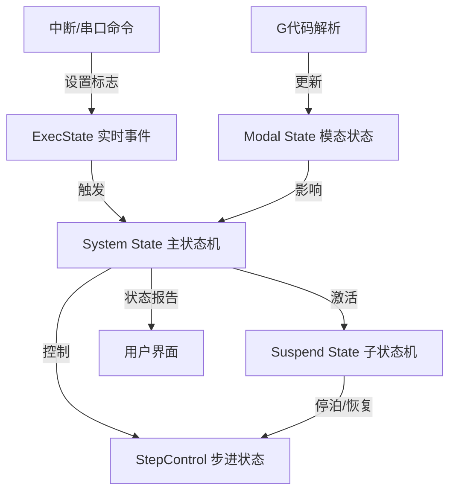
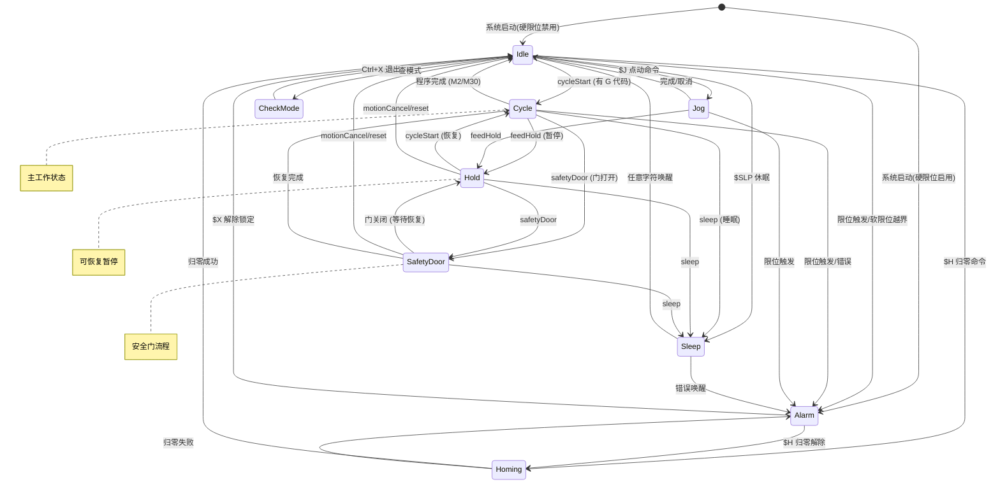
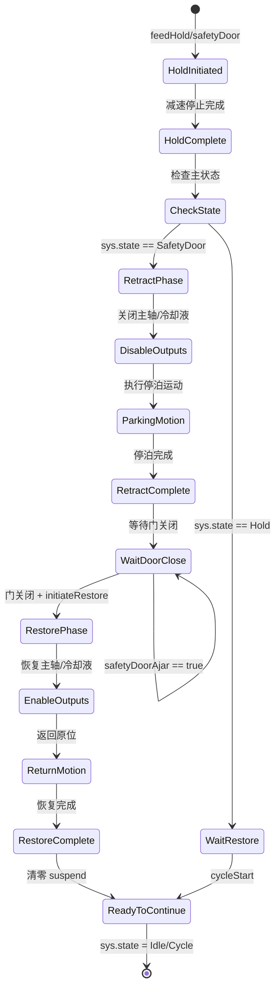

# Grbl_Esp32 状态机设计详解

> **核心主题**：多层状态机架构与事件驱动控制
>
> **适用场景**：实时控制系统、CNC控制器、工业自动化、复杂状态管理
>
> **最后更新**：2026-01-21

---

## 目录

- [第一部分：多层状态机概述](#第一部分多层状态机概述)
- [第二部分：系统状态机](#第二部分系统状态机system-state)
- [第三部分：暂停状态机](#第三部分暂停状态机suspend-state)
- [第四部分：事件驱动设计](#第四部分事件驱动设计)
- [第五部分：状态转换守卫机制](#第五部分状态转换守卫机制)
- [第六部分：实战应用指南](#第六部分实战应用指南)
- [第七部分：设计模式总结](#第七部分设计模式总结)

---

## 第一部分：多层状态机概述

### 1.1 什么是多层状态机设计

**多层状态机**（Multi-Layer State Machine）是一种将复杂系统的状态管理分解为多个协同工作的子状态机的设计模式。

#### 单层 vs 多层对比

```
单层状态机（简单LED控制）:
┌──────┐  开关  ┌──────┐
│ OFF  │<──────>│  ON  │
└──────┘        └──────┘

多层状态机（Grbl CNC控制）:
┌─────────────────────────────────────────────────────────┐
│ 主状态机 (System State)                                  │
│  Idle → Cycle → Hold → SafetyDoor                       │
│    ↓      ↓      ↓        ↓                             │
│    └──────┴──────┴────────┘                             │
│           ↓                                              │
│  子状态机 (Suspend State)                                │
│  holdComplete → retractComplete → restoreComplete       │
│                                                          │
│  步进状态 (StepControl)                                  │
│  executeHold, executeSysMotion, updateSpindleRpm       │
│                                                          │
│  实时事件 (ExecState)                                    │
│  reset, feedHold, cycleStart, safetyDoor               │
│                                                          │
│  模态状态 (Modal)                                        │
│  motion, units, distance, spindle, coolant             │
└─────────────────────────────────────────────────────────┘
```

### 1.2 为什么 Grbl 需要多层状态机

#### 问题场景

在 CNC 控制系统中，存在以下复杂需求：

1. **主控制流程**：空闲 → 运行 → 暂停 → 恢复（需要系统状态机）
2. **安全流程**：安全门打开 → 停泊 → 断电 → 等待 → 恢复（需要子状态机）
3. **实时响应**：紧急停止必须立即响应，优先级高于其他命令（需要事件驱动）
4. **模态保持**：G代码参数（单位、坐标系）在运动间保持（需要模态状态）

#### 单层状态机的困境

如果用单层状态机实现：

```cpp
// 状态爆炸问题
enum State {
    IDLE,
    CYCLE,
    HOLD,
    HOLD_COMPLETE,
    SAFETY_DOOR_OPENED,
    SAFETY_DOOR_RETRACTING,
    SAFETY_DOOR_RETRACTED,
    SAFETY_DOOR_RESTORING,
    SAFETY_DOOR_RESTORED,
    // ... 状态数量爆炸式增长
};
```

**问题**：
- 状态数量：`主状态 × 子状态 = 9 × 8 = 72 个状态`
- 转换复杂度：`O(n²)` 转换路径
- 可维护性：极低

#### 多层状态机的解决方案

```cpp
// 主状态（9 个）
enum class State {
    Idle, Alarm, CheckMode, Homing,
    Cycle, Hold, Jog, SafetyDoor, Sleep
};

// 子状态（8 个，仅在特定主状态下激活）
struct SuspendBits {
    uint8_t holdComplete : 1;
    uint8_t retractComplete : 1;
    uint8_t initiateRestore : 1;
    uint8_t restoreComplete : 1;
    // ...
};
```

**优势**：
- 状态数量：`9 + 8 = 17 个状态`（而非 72 个）
- 转换复杂度：`O(n)` 独立管理
- 可维护性：高（每层职责单一）

### 1.3 Grbl 的 5 个状态机

| 状态机 | 作用域 | 状态数 | 职责 | 文件位置 |
|--------|-------|--------|------|---------|
| **System State** | 全局 | 9 | 系统主控制流程 | System.h:29-39 |
| **Suspend State** | Hold/SafetyDoor | 8 | 暂停/恢复子流程 | System.h:49-63 |
| **StepControl** | Cycle/Homing | 4 | 步进执行控制 | System.h:41-47 |
| **ExecState** | 实时 | 8 | 实时事件标志 | Exec.h:10-19 |
| **Modal State** | G代码 | 13组 | G代码模态参数 | GCode.h:262-279 |

### 1.4 状态机协同工作原理



**工作流程**：

1. **事件输入**：用户按下暂停按钮 → 中断设置 `ExecState.bit.feedHold = true`
2. **主状态机响应**：`protocol_execute_realtime()` 检测到 feedHold → `State` 从 `Cycle` 转换到 `Hold`
3. **子状态机激活**：进入 `Hold` 状态后，`Suspend` 状态机开始多阶段暂停流程
4. **步进控制**：`StepControl.executeHold` 被设置，步进中断执行减速停止
5. **模态保持**：`Modal` 状态不变，恢复时继续使用原参数

---

## 第二部分：系统状态机（System State）

### 2.1 状态定义和设计意图

**文件路径**：[Grbl_Esp32/src/System.h:29-39](Grbl_Esp32/src/System.h#L29-L39)

```cpp
enum class State : uint8_t {
    Idle = 0,         // 空闲状态（必须为 0）
    Alarm,            // 报警状态，锁定所有 G 代码
    CheckMode,        // G 代码检查模式
    Homing,           // 归零中
    Cycle,            // 运动执行中
    Hold,             // 进给保持
    Jog,              // 点动模式
    SafetyDoor,       // 安全门打开
    Sleep,            // 睡眠状态
};
```

#### 状态设计意图

| 状态 | 设计意图 | 为什么需要 |
|------|---------|-----------|
| `Idle = 0` | 系统初始化后的默认状态 | C++ 全局变量默认初始化为 0，确保启动安全 |
| `Alarm` | 错误/不安全状态锁定 | 限位触发、归零失败时必须锁定，防止误操作 |
| `CheckMode` | G 代码语法检查 | 上传大文件前验证，避免运行时错误 |
| `Homing` | 建立坐标系原点 | 归零流程独占，拒绝其他命令，确保精度 |
| `Cycle` | 主工作状态 | G 代码执行、激光雕刻、铣削加工 |
| `Hold` | 可恢复的暂停 | 检查工件、调整参数，保持位置不丢失 |
| `Jog` | 手动控制 | 对刀、定位工件，与自动运动隔离 |
| `SafetyDoor` | 紧急安全干预 | 用户打开防护门，自动停车断电 |
| `Sleep` | 低功耗等待 | 长时间不操作，节能模式 |

### 2.2 状态转换规则

#### 2.2.1 合法转换矩阵

| 从\到 | Idle | Alarm | CheckMode | Homing | Cycle | Hold | Jog | SafetyDoor | Sleep |
|------|------|-------|-----------|--------|-------|------|-----|------------|-------|
| **Idle** | - | ✅ | ✅ | ✅ | ✅ | ❌ | ✅ | ❌ | ✅ |
| **Alarm** | ✅ | - | ❌ | ✅ | ❌ | ❌ | ❌ | ❌ | ❌ |
| **CheckMode** | ✅ | ❌ | - | ❌ | ❌ | ❌ | ❌ | ❌ | ❌ |
| **Homing** | ✅ | ✅ | ❌ | - | ❌ | ❌ | ❌ | ❌ | ❌ |
| **Cycle** | ✅ | ✅ | ❌ | ❌ | - | ✅ | ❌ | ✅ | ✅ |
| **Hold** | ✅ | ❌ | ❌ | ❌ | ✅ | - | ❌ | ✅ | ✅ |
| **Jog** | ✅ | ✅ | ❌ | ❌ | ❌ | ✅ | - | ✅ | ❌ |
| **SafetyDoor** | ✅ | ❌ | ❌ | ❌ | ✅ | ✅ | ❌ | - | ✅ |
| **Sleep** | ✅ | ✅ | ❌ | ❌ | ❌ | ❌ | ❌ | ❌ | - |

#### 2.2.2 状态转换图



### 2.3 状态转换守卫条件

#### 2.3.1 守卫的必要性

**问题场景**：如果没有守卫条件

```cpp
// 危险：无条件状态转换
if (rt_exec.bit.cycleStart) {
    sys.state = State::Cycle;  // 可能在 Alarm 状态下启动！
    st_wake_up();              // 步进电机在错误位置启动！
}
```

**后果**：
- 在 `Alarm` 状态下启动运动 → 可能撞限位开关
- 在 `Homing` 期间启动 → 坐标系未建立，位置错误
- 缓冲区为空时启动 → 步进电机空转

#### 2.3.2 多重守卫实现

**文件路径**：[Grbl_Esp32/src/Protocol.cpp:374-411](Grbl_Esp32/src/Protocol.cpp#L374-L411)

```cpp
if (rt_exec.bit.cycleStart) {
    // 守卫 1：检查是否有冲突的高优先级命令
    if (!(rt_exec.bit.feedHold || rt_exec.bit.motionCancel ||
          rt_exec.bit.safetyDoor)) {

        // 守卫 2：SafetyDoor 特殊恢复流程
        if (sys.state == State::SafetyDoor &&
            !(sys.suspend.bit.safetyDoorAjar)) {
            if (sys.suspend.bit.restoreComplete) {
                sys.state = State::Idle;
            } else if (sys.suspend.bit.retractComplete) {
                sys.suspend.bit.initiateRestore = true;
            }
        }

        // 守卫 3：只在特定状态下启动
        if (sys.state == State::Idle ||
            (sys.state == State::Hold && sys.suspend.bit.holdComplete)) {

            // 守卫 4：检查是否有运动数据
            if (plan_get_current_block() != NULL &&
                !sys.suspend.bit.motionCancel) {
                sys.suspend.value = 0;
                sys.state = State::Cycle;
                st_prep_buffer();
                st_wake_up();
            } else {
                // 无运动数据，保持 Idle
                sys.suspend.value = 0;
                sys.state = State::Idle;
            }
        }
    }
    sys_rt_exec_state.bit.cycleStart = false;  // 清除标志
}
```

**守卫层级**：

```
第 1 层：事件冲突检查
  ↓
第 2 层：特殊状态处理 (SafetyDoor)
  ↓
第 3 层：当前状态合法性检查
  ↓
第 4 层：数据有效性检查
  ↓
[安全转换] 或 [忽略命令]
```

#### 2.3.3 守卫代码模式

**模式 A：当前状态检查**

```cpp
if (rt_exec.bit.feedHold) {
    // 只在非特殊状态下响应
    if (!(sys.state == State::Alarm ||
          sys.state == State::CheckMode)) {
        sys.state = State::Hold;
    }
    sys_rt_exec_state.bit.feedHold = false;
}
```

**模式 B：状态白名单**

```cpp
if (rt_exec.bit.safetyDoor) {
    // 只在允许的状态下转换
    if (sys.state == State::Idle ||
        sys.state == State::Cycle ||
        sys.state == State::Hold) {
        sys.state = State::SafetyDoor;
    }
    // 其他状态忽略
}
```

**模式 C：嵌套守卫**

```cpp
if (rt_exec.bit.motionCancel) {
    if (sys.state == State::Cycle || sys.state == State::Hold) {
        if (!sys.suspend.bit.motionCancel) {  // 防止重复
            sys.suspend.bit.motionCancel = true;
            sys.step_control.endMotion = true;
        }
    }
}
```

### 2.4 优先级控制机制

#### 2.4.1 优先级层次

**文件路径**：[Grbl_Esp32/src/Protocol.cpp:251-411](Grbl_Esp32/src/Protocol.cpp#L251-L411)

```cpp
void protocol_exec_rt_system() {
    // 优先级 1：告警（最高）
    if (sys_rt_exec_alarm != ExecAlarm::None) {
        sys.state = State::Alarm;
        // 硬限位/软限位进入阻塞
        if (alarm == ExecAlarm::HardLimit ||
            alarm == ExecAlarm::SoftLimit) {
            do {
                // 只允许复位和状态报告
            } while (!sys_rt_exec_state.bit.reset);
        }
    }

    // 优先级 2：复位（第二高）
    if (rt_exec.bit.reset) {
        sys.abort = true;
        return;  // 立即退出，不处理其他命令
    }

    // 优先级 3：状态报告
    if (rt_exec.bit.statusReport) {
        report_realtime_status(CLIENT_ALL);
    }

    // 优先级 4：安全命令（feedHold, safetyDoor, motionCancel, sleep）
    if (rt_exec.bit.feedHold || rt_exec.bit.safetyDoor ||
        rt_exec.bit.motionCancel || rt_exec.bit.sleep) {
        // 处理暂停/安全门/取消/睡眠
    }

    // 优先级 5：循环启动（最低）
    if (rt_exec.bit.cycleStart) {
        // 只有在没有高优先级命令时才处理
    }
}
```

**优先级表**：

| 优先级 | 命令 | 行为 | 原因 |
|--------|------|------|------|
| 1 | `sys_rt_exec_alarm` | 进入 Alarm，可能阻塞 | 硬件安全，不可中断 |
| 2 | `reset` | 设置 abort，立即退出 | 紧急停止，最高响应 |
| 3 | `statusReport` | 发送状态报告 | 快速响应，无副作用 |
| 4 | `feedHold` | 暂停运动 | 安全命令，优于启动 |
| 4 | `safetyDoor` | 安全门处理 | 同 feedHold 级别 |
| 4 | `motionCancel` | 取消运动 | 同 feedHold 级别 |
| 4 | `sleep` | 进入睡眠 | 同 feedHold 级别 |
| 5 | `cycleStart` | 启动/恢复 | 最低优先级，需检查所有条件 |

#### 2.4.2 优先级冲突处理

**场景 1：启动与暂停同时触发**

```cpp
// 用户快速按下"启动"再按"暂停"
sys_rt_exec_state.bit.cycleStart = true;   // 设置启动
sys_rt_exec_state.bit.feedHold = true;     // 设置暂停

// 处理时：
if (rt_exec.bit.cycleStart) {
    // 检查是否有冲突命令
    if (!(rt_exec.bit.feedHold || ...)) {
        // feedHold 存在，跳过启动
    }
}
```

**结果**：暂停命令优先，启动被忽略。

**场景 2：安全门与复位同时触发**

```cpp
// 用户打开安全门同时按下复位
sys_rt_exec_state.bit.safetyDoor = true;
sys_rt_exec_state.bit.reset = true;

// 处理时：
if (rt_exec.bit.reset) {
    sys.abort = true;
    return;  // 立即退出，不处理 safetyDoor
}
```

**结果**：复位优先，安全门被忽略（因为系统已复位）。

### 2.5 状态转换的原子性保证

#### 2.5.1 问题场景

```cpp
// 非原子转换的问题
if (some_condition) {
    sys.state = State::Cycle;      // 步骤 1
    // 中断可能在这里插入，读取到不一致的状态
    sys.suspend.value = 0;          // 步骤 2
    st_wake_up();                   // 步骤 3
}
```

**问题**：
- 如果在步骤 1 和 2 之间发生中断
- 中断看到 `sys.state == Cycle` 但 `sys.suspend` 未清零
- 可能导致状态不一致

#### 2.5.2 解决方案：集中转换

```cpp
// 所有状态转换在一个函数中完成
if (sys.state == State::Idle) {
    if (plan_get_current_block()) {
        // 原子操作块
        sys.suspend.value = 0;           // 先准备
        sys.step_control = {};           // 清零控制
        sys.state = State::Cycle;        // 最后转换
        st_prep_buffer();
        st_wake_up();
    }
}
```

**保证**：
- ESP32 上 `sys.state`（单字节）的读写是原子的
- 在最后一刻修改 `sys.state`
- 其他变量先准备好

#### 2.5.3 事件处理的原子性

```cpp
void protocol_execute_realtime() {
    // 1. 原子复制所有标志位
    ExecState rt_exec;
    rt_exec.value = sys_rt_exec_state.value;  // 单字节读取，原子

    // 2. 使用本地副本处理
    if (rt_exec.bit.feedHold) {
        // 处理过程中，新的中断不会影响 rt_exec
        sys.state = State::Hold;

        // 3. 清除原始标志
        sys_rt_exec_state.bit.feedHold = false;
    }
}
```

**优势**：
- 处理过程中标志位快照不变
- 新触发的事件在下次循环处理
- 避免处理过程中的竞态条件

---

## 第三部分：暂停状态机（Suspend State）

### 3.1 暂停流程的多阶段设计

#### 3.1.1 为什么需要多阶段

**简单暂停 vs 安全门暂停对比**：

```
简单暂停（Hold）:
  Cycle → Hold (保持位置) → Cycle

安全门暂停（SafetyDoor）:
  Cycle
    → Hold (减速停止)
    → Retract (回退到安全位置)
    → Poweroff (断电、关闭主轴)
    → Wait (等待门关闭)
    → Restore (恢复主轴、回到原位)
    → Cycle (继续运动)
```

**设计意图**：
- **Hold**：用户临时检查，位置不变，快速恢复
- **SafetyDoor**：强制安全干预，必须回退避让，防止用户触碰运动部件

#### 3.1.2 Suspend 状态位定义

**文件路径**：[Grbl_Esp32/src/System.h:49-63](Grbl_Esp32/src/System.h#L49-L63)

```cpp
struct SuspendBits {
    uint8_t holdComplete : 1;       // 进给保持完成
    uint8_t restartRetract : 1;     // 重启收缩（门重新打开）
    uint8_t retractComplete : 1;    // 收缩到安全位置完成
    uint8_t initiateRestore : 1;    // 启动恢复程序
    uint8_t restoreComplete : 1;    // 恢复到原位完成
    uint8_t safetyDoorAjar : 1;     // 安全门打开标志
    uint8_t motionCancel : 1;       // 取消运动（探针/Jog）
    uint8_t jogCancel : 1;          // Jog 取消中
};

union Suspend {
    uint8_t     value;
    SuspendBits bit;
};
```

#### 3.1.3 安全门停泊流程

**文件路径**：[Grbl_Esp32/src/Protocol.cpp:531-752](Grbl_Esp32/src/Protocol.cpp#L531-L752)

```cpp
void protocol_exec_rt_suspend() {
    while (sys.suspend.value) {
        protocol_execute_realtime();  // 继续检查实时命令

        // 阶段 1：等待 Hold 完成
        if (sys.suspend.bit.holdComplete) {
            // 检查是否需要停泊（SafetyDoor）
            if (!sys.suspend.bit.retractComplete) {
                // 只在 SafetyDoor 状态下停泊
                if (sys.state == State::SafetyDoor) {
                    // 1. 禁用主轴和冷却液
                    spindle->stop();
                    coolant_stop();

                    // 2. 执行停泊运动（可选）
                    if (parking_enable->get()) {
                        // 回退到预定义的停泊位置
                        mc_parking_motion(parking_target);
                    }

                    sys.suspend.bit.retractComplete = true;
                }
            }
        }

        // 阶段 2：等待门关闭
        if (sys.suspend.bit.retractComplete) {
            if (!sys.suspend.bit.safetyDoorAjar) {
                // 门已关闭，可以恢复
                if (sys.suspend.bit.initiateRestore) {
                    // 阶段 3：恢复流程
                    if (!sys.suspend.bit.restoreComplete) {
                        // 1. 恢复主轴和冷却液
                        spindle->set_state(gc_state.modal.spindle,
                                          gc_state.spindle_speed);
                        coolant_set_state(gc_state.modal.coolant);

                        // 2. 返回原位
                        if (parking_enable->get()) {
                            mc_parking_motion(original_position);
                        }

                        sys.suspend.bit.restoreComplete = true;
                    }

                    // 阶段 4：准备继续
                    if (sys.suspend.bit.restoreComplete) {
                        sys.suspend.value = 0;
                        sys.state = State::Idle;
                        // 用户需要发送 cycleStart 继续
                    }
                }
            }
        }
    }
}
```

**流程图**：



### 3.2 嵌套状态管理

#### 3.2.1 主状态与子状态的关系

```
主状态（State）              子状态（Suspend）
┌────────────┐
│   Idle     │              (无子状态)
└────────────┘

┌────────────┐
│   Cycle    │              (无子状态)
└────────────┘

┌────────────┐              ┌──────────────────────┐
│   Hold     │─────────────>│ holdComplete = true  │
└────────────┘              │ (等待恢复)            │
                            └──────────────────────┘

┌────────────┐              ┌──────────────────────┐
│ SafetyDoor │─────────────>│ holdComplete         │
└────────────┘              │ retractComplete      │
                            │ initiateRestore      │
                            │ restoreComplete      │
                            │ safetyDoorAjar       │
                            └──────────────────────┘

┌────────────┐              ┌──────────────────────┐
│    Jog     │─────────────>│ jogCancel = true     │
└────────────┘              │ (取消点动)            │
                            └──────────────────────┘
```

**激活规则**：
- `Idle`, `Cycle`, `Alarm` → `Suspend.value = 0`（不使用子状态）
- `Hold` → 仅使用 `holdComplete`
- `SafetyDoor` → 使用所有停泊/恢复相关位
- `Jog` → 仅使用 `jogCancel`

#### 3.2.2 状态嵌套的优势

**优势 1：避免状态爆炸**

```cpp
// 如果不用嵌套，需要：
enum State {
    IDLE,
    CYCLE,
    HOLD,
    SAFETY_DOOR_HOLD_COMPLETE,
    SAFETY_DOOR_RETRACTING,
    SAFETY_DOOR_RETRACTED_WAIT_DOOR,
    SAFETY_DOOR_DOOR_CLOSED_WAIT_RESTORE,
    SAFETY_DOOR_RESTORING,
    SAFETY_DOOR_RESTORED,
    // ... 9 个基础状态 × N 个子阶段 = 状态爆炸
};

// 使用嵌套后：
State main_state = State::SafetyDoor;
Suspend sub_state = { .retractComplete = 1, .safetyDoorAjar = 0 };
```

**优势 2：状态逻辑分离**

```cpp
// 主状态：决定"做什么"
switch (sys.state) {
    case State::Hold:
        // 仅保持位置
        break;
    case State::SafetyDoor:
        // 执行完整停泊流程
        break;
}

// 子状态：决定"做到哪一步"
if (sys.suspend.bit.retractComplete && !sys.suspend.bit.restoreComplete) {
    // 已停泊，等待恢复
}
```

**优势 3：条件判断简化**

```cpp
// 检查是否可以恢复运动
bool can_resume() {
    if (sys.state == State::Hold) {
        return sys.suspend.bit.holdComplete;
    }
    if (sys.state == State::SafetyDoor) {
        return sys.suspend.bit.restoreComplete &&
               !sys.suspend.bit.safetyDoorAjar;
    }
    return false;
}
```

### 3.3 代码实现分析

#### 3.3.1 暂停初始化

**文件路径**：[Grbl_Esp32/src/Protocol.cpp:288-319](Grbl_Esp32/src/Protocol.cpp#L288-L319)

```cpp
if (rt_exec.bit.feedHold || rt_exec.bit.safetyDoor ||
    rt_exec.bit.motionCancel || rt_exec.bit.sleep) {

    if (!(sys.state == State::Alarm || sys.state == State::CheckMode)) {
        // 正在运动中，启动保持
        if (sys.state == State::Cycle || sys.state == State::Jog) {
            if (!(sys.suspend.bit.motionCancel || sys.suspend.bit.jogCancel)) {
                // 更新当前运动块参数
                st_update_plan_block_parameters();

                // 设置步进控制标志
                sys.step_control = {};
                sys.step_control.executeHold = true;

                // Jog 状态特殊处理
                if (sys.state == State::Jog && !rt_exec.bit.sleep) {
                    sys.suspend.bit.jogCancel = true;
                }
            }
        }

        // 已经空闲，直接标记完成
        if (sys.state == State::Idle) {
            sys.suspend.value = 0;
            sys.suspend.bit.holdComplete = true;
        }

        // 分别处理各种暂停类型
        if (rt_exec.bit.motionCancel) {
            sys.suspend.bit.motionCancel = true;
            sys_rt_exec_state.bit.motionCancel = false;
        }

        if (rt_exec.bit.feedHold) {
            sys.state = State::Hold;
            sys_rt_exec_state.bit.feedHold = false;
        }

        if (rt_exec.bit.safetyDoor) {
            sys.state = State::SafetyDoor;
            sys.suspend.bit.safetyDoorAjar = true;
            sys_rt_exec_state.bit.safetyDoor = false;
        }

        if (rt_exec.bit.sleep) {
            sys.state = State::Sleep;
            sys_rt_exec_state.bit.sleep = false;
        }
    }
}
```

#### 3.3.2 暂停完成检测

**文件路径**：[Grbl_Esp32/src/Protocol.cpp:419-434](Grbl_Esp32/src/Protocol.cpp#L419-L434)

```cpp
// 在主循环中调用，检测暂停是否完成
if ((sys.state == State::Hold || sys.state == State::SafetyDoor ||
     sys.state == State::Sleep) &&
    !(sys.soft_limit) && !(sys.suspend.bit.jogCancel)) {

    // 重新初始化规划器
    plan_cycle_reinitialize();

    // 如果步进控制标志仍然设置，标记完成
    if (sys.step_control.executeHold) {
        sys.suspend.bit.holdComplete = true;
    }

    // 清除步进控制标志
    sys.step_control.executeHold = false;
    sys.step_control.executeSysMotion = false;
}
```

**关键点**：
- `sys.step_control.executeHold` 由步进中断清除（减速完成后）
- 主循环检测到该标志被清除，设置 `suspend.bit.holdComplete`
- 这是步进中断和主循环的同步点

---

## 第四部分：事件驱动设计

### 4.1 事件源和状态机的连接

#### 4.1.1 事件驱动架构

```
┌─────────────────────────────────────────────────────────────┐
│                      事件驱动架构                            │
├─────────────────────────────────────────────────────────────┤
│                                                             │
│  事件源 (Producers)           事件缓冲          消费者       │
│  ┌──────────────┐           ┌─────────┐      ┌──────────┐  │
│  │ 中断         │─────────>│ ExecState│────>│ Protocol │  │
│  │ (限位/按钮)   │  设置标志  │ (8 bits) │ 轮询 │ Loop     │  │
│  └──────────────┘           └─────────┘      └──────────┘  │
│                                  ▲                 │        │
│  ┌──────────────┐                │                 │        │
│  │ 串口任务      │────────────────┘                 │        │
│  │ (实时命令)    │  设置标志                        │        │
│  └──────────────┘                                  │        │
│                                                     ▼        │
│  ┌──────────────┐                           ┌──────────┐    │
│  │ G代码解析器  │                           │ State    │    │
│  │ (M0/M1)      │                           │ Machine  │    │
│  └──────────────┘                           └──────────┘    │
│                                                             │
└─────────────────────────────────────────────────────────────┘
```

#### 4.1.2 完整的事件-状态路径

**路径 1：硬件中断 → 状态转换**

```cpp
// 步骤 1：限位开关触发（中断上下文）
void IRAM_ATTR isr_limit_switches() {
    if (limits_get_state()) {
        mc_reset();                                  // 设置复位
        sys_rt_exec_alarm = ExecAlarm::HardLimit;   // 设置告警
    }
}

// 步骤 2：mc_reset 设置标志位
void mc_reset() {
    if (!sys_rt_exec_state.bit.reset) {
        sys_rt_exec_state.bit.reset = true;  // 设置标志
        spindle->stop();
        coolant_stop();
    }
}

// 步骤 3：主循环检测标志（主程序上下文）
void protocol_main_loop() {
    for (;;) {
        protocol_execute_realtime();  // ← 检查标志位
    }
}

// 步骤 4：处理复位和告警
void protocol_exec_rt_system() {
    // 先处理告警
    if (sys_rt_exec_alarm == ExecAlarm::HardLimit) {
        sys.state = State::Alarm;  // 状态转换
        report_alarm_message(ExecAlarm::HardLimit);
    }

    // 再处理复位标志
    if (rt_exec.bit.reset) {
        sys.abort = true;
        return;
    }
}
```

**时序图**：

```
时间 →
ISR      │<──────────────────────>│
         │ 设置 reset=true        │
         │ 设置 alarm=HardLimit   │
         │ <1μs                   │
         ▼
主循环   │                        │<──────────────────────>│
         │ 继续其他任务           │ protocol_execute_     │
         │                        │   realtime() 检测到   │
         │                        │ → State = Alarm       │
         │                        │ → sys.abort = true    │
         │                        │ 约 1ms 延迟           │
         ▼                        ▼
```

**路径 2：串口命令 → 状态转换**

```cpp
// 步骤 1：串口任务接收实时命令
void clientCheckTask(void* pvParameters) {
    while (true) {
        uint8_t data;
        if (getClientChar(&data) != CLIENT_ALL) {
            if (is_realtime_command(data)) {
                execute_realtime_command(data);  // 立即处理
            }
        }
    }
}

// 步骤 2：设置标志位
void execute_realtime_command(Cmd command) {
    switch (command) {
        case Cmd::FeedHold:  // ! (0x21)
            sys_rt_exec_state.bit.feedHold = true;
            break;
        case Cmd::CycleStart:  // ~ (0x7E)
            sys_rt_exec_state.bit.cycleStart = true;
            break;
    }
}

// 步骤 3-4：同上
```

**路径 3：G代码解析器 → 状态转换**

```cpp
// M0/M1 程序暂停
case ProgramFlow::Paused:
    protocol_buffer_synchronize();  // 等待缓冲区清空
    if (sys.state != State::CheckMode) {
        sys_rt_exec_state.bit.feedHold = true;  // 设置标志
        protocol_execute_realtime();            // 立即处理
    }
    break;
```

### 4.2 事件优先级控制

#### 4.2.1 为什么需要优先级

**问题场景**：同时触发的事件

```cpp
// 场景：用户在安全门打开时按下复位按钮
// 中断 1：安全门传感器触发
sys_rt_exec_state.bit.safetyDoor = true;

// 中断 2：复位按钮按下（几乎同时）
sys_rt_exec_state.bit.reset = true;

// ExecState.value = 0b00110000 (safetyDoor=1, reset=1)
```

**如果没有优先级**：

```cpp
// 错误：按位处理顺序处理
if (rt_exec.bit.safetyDoor) {
    sys.state = State::SafetyDoor;
    // 开始复杂的停泊流程...
}

if (rt_exec.bit.reset) {
    sys.abort = true;  // 但停泊流程已经启动！
}
```

**后果**：
- 停泊流程启动但系统中止
- 状态不一致：`sys.state == SafetyDoor` 但 `sys.abort == true`
- 恢复后可能处于错误位置

#### 4.2.2 优先级实现

**文件路径**：[Grbl_Esp32/src/Protocol.cpp:276-411](Grbl_Esp32/src/Protocol.cpp#L276-L411)

```cpp
void protocol_exec_rt_system() {
    ExecState rt_exec;
    rt_exec.value = sys_rt_exec_state.value;

    // 优先级 1：复位（立即退出）
    if (rt_exec.bit.reset) {
        sys.abort = true;
        return;  // 不再处理其他事件
    }

    // 优先级 2：状态报告（快速响应，无副作用）
    if (rt_exec.bit.statusReport) {
        report_realtime_status(CLIENT_ALL);
        sys_rt_exec_state.bit.statusReport = false;
    }

    // 优先级 3：安全命令（同优先级，按代码顺序）
    if (rt_exec.bit.feedHold || rt_exec.bit.safetyDoor ||
        rt_exec.bit.motionCancel || rt_exec.bit.sleep) {
        // 处理暂停/安全门/取消/睡眠
        // 这些命令互不冲突，可以同时处理
    }

    // 优先级 4：循环启动（最低，需检查冲突）
    if (rt_exec.bit.cycleStart) {
        // 检查是否有高优先级命令
        if (!(rt_exec.bit.feedHold || rt_exec.bit.motionCancel ||
              rt_exec.bit.safetyDoor)) {
            // 安全启动
        }
        sys_rt_exec_state.bit.cycleStart = false;
    }
}
```

#### 4.2.3 优先级设计原则

| 原则 | 说明 | 示例 |
|------|------|------|
| **安全优先** | 停止类命令 > 启动类命令 | reset > cycleStart |
| **快速响应** | 无副作用命令优先处理 | statusReport 在前 |
| **不可中断** | 高优先级命令立即退出 | reset 后 return |
| **冲突检查** | 低优先级命令检查高优先级 | cycleStart 检查 feedHold |
| **同级并行** | 同优先级命令可同时处理 | feedHold 和 safetyDoor |

### 4.3 事件处理的防御机制

#### 4.3.1 本地复制避免竞态

**问题场景**：

```cpp
// 错误：直接使用 volatile 全局变量
void protocol_execute_realtime() {
    if (sys_rt_exec_state.bit.feedHold) {
        // 问题：中断可能在这里修改 sys_rt_exec_state
        delay_ms(10);  // 假设这里有耗时操作

        // 此时 sys_rt_exec_state.bit.reset 可能已被设置
        // 但我们仍然继续处理 feedHold
        sys.state = State::Hold;
    }
}
```

**正确方案**：

```cpp
void protocol_execute_realtime() {
    // 1. 原子复制到本地变量
    ExecState rt_exec;
    rt_exec.value = sys_rt_exec_state.value;

    // 2. 使用本地副本处理（不受中断影响）
    if (rt_exec.bit.feedHold) {
        // 即使中断修改了 sys_rt_exec_state
        // rt_exec 仍然是一致的快照
        sys.state = State::Hold;

        // 3. 清除原始标志
        sys_rt_exec_state.bit.feedHold = false;
    }
}
```

**汇编对比**（ESP32 Xtensa）：

```asm
; 直接使用 volatile（多次读取）
    l8ui  a2, [sys_rt_exec_state], 0    ; 读取 1
    bbci  a2, 3, skip                    ; 检查位 3 (feedHold)
    ; ... 耗时操作 ...
    l8ui  a2, [sys_rt_exec_state], 0    ; 读取 2（可能已改变）
    movi  a3, State_Hold
    s8i   a3, [sys_state], 0
skip:

; 使用本地副本（单次读取）
    l8ui  a2, [sys_rt_exec_state], 0    ; 读取 1（唯一）
    mov   a4, a2                         ; 保存到寄存器
    bbci  a4, 3, skip                    ; 检查位 3
    ; ... 耗时操作 ...
    movi  a3, State_Hold
    s8i   a3, [sys_state], 0
skip:
```

#### 4.3.2 状态检查防止非法转换

**检查类型 A：当前状态白名单**

```cpp
if (rt_exec.bit.cycleStart) {
    // 只在允许的状态下启动
    if (sys.state == State::Idle ||
        (sys.state == State::Hold && sys.suspend.bit.holdComplete)) {
        sys.state = State::Cycle;
        st_wake_up();
    }
    // Alarm, Homing 等状态忽略命令
    sys_rt_exec_state.bit.cycleStart = false;
}
```

**检查类型 B：子状态条件**

```cpp
if (rt_exec.bit.safetyDoor) {
    if (sys.state == State::Cycle || sys.state == State::Hold) {
        // 检查是否已经在处理安全门
        if (!sys.suspend.bit.safetyDoorAjar) {
            sys.state = State::SafetyDoor;
            sys.suspend.bit.safetyDoorAjar = true;
        }
    }
}
```

**检查类型 C：数据有效性**

```cpp
if (rt_exec.bit.cycleStart) {
    if (sys.state == State::Idle) {
        // 检查是否有运动数据
        if (plan_get_current_block() != NULL) {
            sys.state = State::Cycle;
        } else {
            // 无数据，保持 Idle
            log_warning("CycleStart ignored: no motion data");
        }
    }
}
```

#### 4.3.3 优先级排序保证安全

**排序策略**：

```cpp
void protocol_exec_rt_system() {
    ExecState rt_exec;
    rt_exec.value = sys_rt_exec_state.value;

    // 策略 1：早期退出（Early Exit）
    if (rt_exec.bit.reset) {
        sys.abort = true;
        return;  // 不处理后续任何命令
    }

    // 策略 2：冲突检查（Conflict Check）
    if (rt_exec.bit.cycleStart) {
        if (rt_exec.bit.feedHold || rt_exec.bit.safetyDoor) {
            // 冲突：不执行 cycleStart
            log_debug("CycleStart ignored: conflict with Hold/SafetyDoor");
        } else {
            // 安全：执行启动
        }
    }

    // 策略 3：原子清除（Atomic Clear）
    // 每个命令处理完立即清除，防止重复执行
    if (rt_exec.bit.feedHold) {
        sys.state = State::Hold;
        sys_rt_exec_state.bit.feedHold = false;  // 立即清除
    }
}
```

---

## 第五部分：状态转换守卫机制

### 5.1 多重守卫条件

#### 5.1.1 守卫的定义

**状态转换守卫**（State Transition Guard）是一组布尔条件，用于判断状态转换是否允许执行。

```cpp
// 守卫模式
if (event_triggered) {
    if (guard_condition_1 && guard_condition_2 && guard_condition_3) {
        // 执行状态转换
        sys.state = new_state;
    } else {
        // 拒绝转换，记录日志
        log_debug("Transition blocked by guard");
    }
    // 无论是否转换，都清除事件标志
    event_triggered = false;
}
```

#### 5.1.2 守卫条件分类

| 守卫类型 | 检查内容 | 示例 |
|---------|---------|------|
| **当前状态检查** | 源状态是否允许转换 | `sys.state == State::Idle` |
| **冲突事件检查** | 是否有更高优先级事件 | `!(rt_exec.bit.feedHold)` |
| **数据有效性检查** | 转换所需数据是否准备好 | `plan_get_current_block() != NULL` |
| **子状态条件** | 子状态是否允许转换 | `sys.suspend.bit.holdComplete` |
| **硬件状态检查** | 硬件是否就绪 | `!limits_get_state()` |
| **系统状态检查** | 系统错误标志 | `!sys.abort` |

#### 5.1.3 典型守卫实现

**案例 1：Cycle 启动的 4 层守卫**

**文件路径**：[Grbl_Esp32/src/Protocol.cpp:374-408](Grbl_Esp32/src/Protocol.cpp#L374-L408)

```cpp
if (rt_exec.bit.cycleStart) {
    // 守卫层 1：冲突事件检查
    if (!(rt_exec.bit.feedHold || rt_exec.bit.motionCancel ||
          rt_exec.bit.safetyDoor)) {

        // 守卫层 2：SafetyDoor 特殊流程
        if (sys.state == State::SafetyDoor) {
            if (!(sys.suspend.bit.safetyDoorAjar)) {
                if (sys.suspend.bit.restoreComplete) {
                    sys.state = State::Idle;  // 恢复完成
                } else if (sys.suspend.bit.retractComplete) {
                    sys.suspend.bit.initiateRestore = true;  // 启动恢复
                }
            }
            // 门仍打开，拒绝启动
        }

        // 守卫层 3：当前状态检查
        if (sys.state == State::Idle ||
            (sys.state == State::Hold && sys.suspend.bit.holdComplete)) {

            // 守卫层 4：数据有效性检查
            if (plan_get_current_block() != NULL &&
                !sys.suspend.bit.motionCancel) {
                // 所有守卫通过，执行转换
                sys.suspend.value = 0;
                sys.state = State::Cycle;
                st_prep_buffer();
                st_wake_up();
            } else {
                // 无运动数据，转到 Idle
                sys.suspend.value = 0;
                sys.state = State::Idle;
            }
        }
    }
    sys_rt_exec_state.bit.cycleStart = false;  // 清除标志
}
```

**守卫决策树**：

```
cycleStart 触发
  │
  ├─ 有冲突事件 (feedHold/safetyDoor) → 拒绝
  │
  ├─ SafetyDoor 状态
  │  ├─ 门仍打开 → 拒绝
  │  ├─ 恢复完成 → 转到 Idle
  │  └─ 收缩完成 → 启动恢复
  │
  ├─ Idle 或 (Hold + holdComplete)
  │  ├─ 有运动数据 → 转到 Cycle ✅
  │  └─ 无运动数据 → 转到 Idle
  │
  └─ 其他状态 (Alarm/Homing/Jog) → 拒绝
```

**案例 2：FeedHold 的 2 层守卫**

```cpp
if (rt_exec.bit.feedHold) {
    // 守卫层 1：当前状态检查（黑名单）
    if (!(sys.state == State::Alarm || sys.state == State::CheckMode)) {

        // 守卫层 2：特殊状态排除
        if (!(sys.state == State::SafetyDoor ||
              sys.state == State::Jog ||
              sys.state == State::Sleep)) {
            // 守卫通过，执行转换
            sys.state = State::Hold;
        }
    }
    sys_rt_exec_state.bit.feedHold = false;
}
```

### 5.2 守卫代码模式

#### 5.2.1 模式 A：早期退出（Early Return）

```cpp
void handle_cycle_start() {
    // 守卫 1：检查冲突
    if (rt_exec.bit.feedHold || rt_exec.bit.safetyDoor) {
        log_debug("CycleStart blocked: conflict");
        return;  // 早期退出
    }

    // 守卫 2：检查状态
    if (sys.state != State::Idle && sys.state != State::Hold) {
        log_debug("CycleStart blocked: invalid state");
        return;
    }

    // 守卫 3：检查数据
    if (!plan_get_current_block()) {
        log_debug("CycleStart blocked: no data");
        return;
    }

    // 所有守卫通过，执行转换
    sys.state = State::Cycle;
    st_wake_up();
}
```

**优势**：
- 代码结构清晰
- 避免深层嵌套
- 每个守卫独立，易于添加/删除

#### 5.2.2 模式 B：嵌套守卫（Nested Guard）

```cpp
void handle_cycle_start() {
    if (!rt_exec.bit.feedHold && !rt_exec.bit.safetyDoor) {  // 守卫 1
        if (sys.state == State::Idle || sys.state == State::Hold) {  // 守卫 2
            if (plan_get_current_block()) {  // 守卫 3
                // 执行转换
                sys.state = State::Cycle;
                st_wake_up();
            }
        }
    }
}
```

**优势**：
- 逻辑层次明确
- 符合条件的路径最短

**劣势**：
- 深层嵌套，可读性差
- 难以调试（不知道哪个守卫失败）

#### 5.2.3 模式 C：守卫函数（Guard Function）

```cpp
bool can_start_cycle() {
    // 守卫 1：无冲突
    if (rt_exec.bit.feedHold || rt_exec.bit.safetyDoor) {
        return false;
    }

    // 守卫 2：状态允许
    if (sys.state != State::Idle &&
        !(sys.state == State::Hold && sys.suspend.bit.holdComplete)) {
        return false;
    }

    // 守卫 3：有数据
    if (!plan_get_current_block()) {
        return false;
    }

    return true;
}

void handle_cycle_start() {
    if (can_start_cycle()) {
        sys.state = State::Cycle;
        st_wake_up();
    } else {
        log_debug("CycleStart blocked");
    }
}
```

**优势**：
- 守卫逻辑封装
- 可复用（多处检查是否可启动）
- 易于单元测试

### 5.3 防御性编程实践

#### 5.3.1 不信任输入

```cpp
// 原则：假设所有输入都可能是错误的

// ❌ 错误：直接使用外部输入
void set_state(State new_state) {
    sys.state = new_state;  // 没有验证！
}

// ✅ 正确：验证输入
void set_state(State new_state) {
    // 验证 1：合法的状态值
    if (new_state < State::Idle || new_state > State::Sleep) {
        log_error("Invalid state: %d", (int)new_state);
        return;
    }

    // 验证 2：转换是否合法
    if (!is_transition_allowed(sys.state, new_state)) {
        log_error("Illegal transition: %s -> %s",
                  state_name(sys.state), state_name(new_state));
        return;
    }

    // 验证通过，执行转换
    sys.state = new_state;
}
```

#### 5.3.2 状态一致性检查

```cpp
// 原则：定期检查状态一致性

void validate_state_consistency() {
    // 检查 1：主状态与子状态一致
    if (sys.state == State::Idle) {
        if (sys.suspend.value != 0) {
            log_error("Inconsistency: Idle but suspend!=0");
            sys.suspend.value = 0;  // 修复
        }
    }

    // 检查 2：主状态与步进状态一致
    if (sys.state != State::Cycle && sys.state != State::Homing) {
        if (sys.step_control.executeSysMotion) {
            log_error("Inconsistency: not in Cycle/Homing but executing motion");
            sys.step_control.executeSysMotion = false;  // 修复
        }
    }

    // 检查 3：Alarm 状态下主轴应关闭
    if (sys.state == State::Alarm) {
        if (spindle->get_state() != SpindleState::Disable) {
            log_error("Inconsistency: Alarm but spindle running");
            spindle->stop();  // 修复
        }
    }
}

// 在主循环中定期调用
void protocol_main_loop() {
    for (;;) {
        protocol_execute_realtime();

        #ifdef DEBUG
        validate_state_consistency();  // 调试模式下检查
        #endif
    }
}
```

#### 5.3.3 错误恢复机制

```cpp
// 原则：状态转换失败后，系统仍能安全运行

bool try_transition_to_cycle() {
    // 保存当前状态
    State old_state = sys.state;
    Suspend old_suspend = sys.suspend;

    // 尝试转换
    sys.state = State::Cycle;
    sys.suspend.value = 0;

    // 验证转换结果
    if (!st_wake_up()) {
        // 步进启动失败，恢复原状态
        log_error("Failed to wake up stepper, reverting state");
        sys.state = old_state;
        sys.suspend = old_suspend;

        // 进入安全状态
        sys_rt_exec_alarm = ExecAlarm::AbortCycle;
        return false;
    }

    return true;
}
```

---

## 第六部分：实战应用指南

### 6.1 在 Grbl 中使用状态机

#### 6.1.1 正确触发状态转换

**✅ 方式 1：通过实时标志位触发**

```cpp
// 场景：自定义按钮触发暂停
void custom_pause_button_isr() {
    sys_rt_exec_state.bit.feedHold = true;  // 设置标志位
    // 主循环会自动处理状态转换
}
```

**✅ 方式 2：通过命令字符串触发**

```cpp
// 场景：Web界面发送归零命令
void web_ui_home_button_click() {
    WebUI::inputBuffer.push("$H\r");  // 发送命令字符串
    // 命令解析器会处理
}
```

**✅ 方式 3：通过系统函数触发**

```cpp
// 场景：检测到错误，需要进入报警状态
void detect_error_condition() {
    sys_rt_exec_alarm = ExecAlarm::SoftLimit;  // 设置告警
    // 主循环会转换到 Alarm 状态
}
```

#### 6.1.2 常见错误模式

**❌ 错误 1：直接修改 sys.state**

```cpp
// 错误：绕过守卫和检查
void bad_pause() {
    sys.state = State::Hold;  // 直接修改

    // 问题：
    // 1. 没有设置 sys.step_control.executeHold
    // 2. 没有更新 sys.suspend
    // 3. 步进电机可能不会停止
    // 4. 状态报告可能不一致
}

// 正确：通过标志位
void good_pause() {
    sys_rt_exec_state.bit.feedHold = true;
    // 主循环会正确处理所有细节
}
```

**❌ 错误 2：在中断中执行复杂逻辑**

```cpp
// 错误：中断中直接处理状态转换
void IRAM_ATTR bad_button_isr() {
    if (sys.state == State::Cycle) {
        sys.state = State::Hold;  // 直接修改
        spindle->stop();          // 调用复杂函数
        Serial.println("Paused");  // 串口输出（非常慢！）
    }

    // 问题：
    // 1. 阻塞中断（可能 >10ms）
    // 2. 其他中断被延迟
    // 3. 看门狗可能复位系统
}

// 正确：仅设置标志位
void IRAM_ATTR good_button_isr() {
    sys_rt_exec_state.bit.feedHold = true;  // <1μs
    // 立即返回
}
```

**❌ 错误 3：忽略守卫条件**

```cpp
// 错误：无条件启动
void bad_start() {
    sys.state = State::Cycle;
    st_wake_up();

    // 问题：
    // 1. 可能在 Alarm 状态下启动
    // 2. 可能没有运动数据
    // 3. 可能与安全门冲突
}

// 正确：检查条件
void good_start() {
    if (sys.state == State::Idle ||
        (sys.state == State::Hold && sys.suspend.bit.holdComplete)) {
        if (plan_get_current_block()) {
            sys_rt_exec_state.bit.cycleStart = true;
        } else {
            log_info("No motion data, cannot start");
        }
    } else {
        log_warn("Cannot start from state: %s", state_name(sys.state));
    }
}
```

#### 6.1.3 最佳实践清单

**设置标志位**：
- ✅ 在中断中仅设置标志位，不执行逻辑
- ✅ 使用现有标志位，避免自定义全局变量
- ✅ 设置后快速返回（<1μs）
- ❌ 不要在设置标志后立即清除
- ❌ 不要在中断中调用非 IRAM 函数

**状态转换**：
- ✅ 通过标志位或系统函数触发
- ✅ 在主循环中统一处理
- ✅ 使用守卫条件验证合法性
- ❌ 不要直接修改 `sys.state`
- ❌ 不要跳过状态机检查

**错误处理**：
- ✅ 转换失败时记录日志
- ✅ 使用告警机制报告错误
- ✅ 提供状态一致性检查（调试模式）
- ❌ 不要忽略守卫失败
- ❌ 不要假设转换一定成功

### 6.2 实战案例分析

#### 6.2.1 案例 1：按钮控制的状态检查

**来源**：[doc/md/功能解析/State状态系统完全指南.md:610-636](doc/md/功能解析/State状态系统完全指南.md#L610-L636)

```cpp
void handle_user_button() {
    switch (sys.state) {
        case State::Idle:
            // 空闲时可以启动新任务
            start_new_job();
            break;

        case State::Cycle:
            // 运行时暂停
            sys_rt_exec_state.bit.feedHold = true;
            break;

        case State::Hold:
            // 暂停时恢复
            sys_rt_exec_state.bit.cycleStart = true;
            break;

        case State::Alarm:
            // 报警时尝试归零
            WebUI::inputBuffer.push("$H\r");
            break;

        default:
            LOG_WARN("Button pressed in unsupported state: %d", (int)sys.state);
            break;
    }
}
```

**设计模式分析**：

| 模式 | 说明 |
|------|------|
| **状态分发** | 使用 switch-case 根据状态执行不同操作 |
| **单一职责** | 每个 case 只负责一种状态的处理 |
| **扩展性** | 添加新状态只需添加新 case |
| **防御性** | default 分支捕获未处理状态 |

**优化建议**：

```cpp
// 优化：使用状态-动作映射表
struct StateAction {
    State state;
    void (*action)();
};

StateAction button_actions[] = {
    { State::Idle,  start_new_job },
    { State::Cycle, pause_job },
    { State::Hold,  resume_job },
    { State::Alarm, try_homing },
};

void handle_user_button() {
    for (int i = 0; i < sizeof(button_actions)/sizeof(StateAction); i++) {
        if (sys.state == button_actions[i].state) {
            button_actions[i].action();
            return;
        }
    }
    log_warn("Unsupported state: %d", (int)sys.state);
}
```

#### 6.2.2 案例 2：等待特定状态

**来源**：[doc/md/功能解析/State状态系统完全指南.md:640-651](doc/md/功能解析/State状态系统完全指南.md#L640-L651)

```cpp
bool wait_for_idle(uint32_t timeout_ms) {
    uint32_t start = millis();
    while (sys.state != State::Idle) {
        if (millis() - start > timeout_ms) {
            return false;  // 超时
        }
        vTaskDelay(pdMS_TO_TICKS(10));
    }
    return true;  // 成功
}
```

**设计模式分析**：

| 模式 | 说明 |
|------|------|
| **轮询等待** | 主动检查状态，适合任务上下文 |
| **超时机制** | 防止无限等待，提高鲁棒性 |
| **延迟释放** | vTaskDelay 释放 CPU，避免忙等 |

**替代方案：事件驱动**

```cpp
// 方案 A：使用 FreeRTOS 事件组
EventGroupHandle_t state_events;

#define EVENT_STATE_IDLE (1 << 0)

void notify_state_change() {
    if (sys.state == State::Idle) {
        xEventGroupSetBits(state_events, EVENT_STATE_IDLE);
    }
}

bool wait_for_idle(uint32_t timeout_ms) {
    if (sys.state == State::Idle) {
        return true;  // 已经是 Idle
    }

    // 阻塞等待事件
    EventBits_t bits = xEventGroupWaitBits(
        state_events,
        EVENT_STATE_IDLE,
        pdTRUE,  // 清除位
        pdFALSE,
        pdMS_TO_TICKS(timeout_ms)
    );

    return (bits & EVENT_STATE_IDLE) != 0;
}
```

**对比**：

| 方案 | 优势 | 劣势 | 适用场景 |
|------|------|------|---------|
| **轮询** | 简单、无需修改状态机 | CPU 占用稍高 | 短时等待 (<1s) |
| **事件驱动** | CPU 占用低、响应快 | 需要修改状态转换代码 | 长时等待 (>1s) |

#### 6.2.3 案例 3：状态转换监控和日志

**来源**：[doc/md/功能解析/State状态系统完全指南.md:654-679](doc/md/功能解析/State状态系统完全指南.md#L654-L679)

```cpp
State last_state = State::Idle;

void monitor_state_changes() {
    if (sys.state != last_state) {
        LOG_INFO("State changed: %s -> %s",
                 state_to_string(last_state),
                 state_to_string(sys.state));
        last_state = sys.state;
    }
}

const char* state_to_string(State state) {
    switch (state) {
        case State::Idle:       return "Idle";
        case State::Alarm:      return "Alarm";
        case State::CheckMode:  return "CheckMode";
        case State::Homing:     return "Homing";
        case State::Cycle:      return "Cycle";
        case State::Hold:       return "Hold";
        case State::Jog:        return "Jog";
        case State::SafetyDoor: return "SafetyDoor";
        case State::Sleep:      return "Sleep";
        default:                return "Unknown";
    }
}
```

**设计模式分析**：

| 模式 | 说明 |
|------|------|
| **观察者** | 监控状态变化，不影响状态机本身 |
| **日志记录** | 便于调试和故障排查 |
| **字符串转换** | 提高可读性 |

**扩展：状态转换统计**

```cpp
struct StateTransition {
    State from;
    State to;
    uint32_t count;
    uint32_t last_timestamp;
};

StateTransition transitions[81];  // 9x9 状态转换

void log_state_transition(State from, State to) {
    int index = (int)from * 9 + (int)to;
    transitions[index].count++;
    transitions[index].last_timestamp = millis();

    LOG_INFO("[%6lu] %s -> %s (count: %u)",
             millis(),
             state_to_string(from),
             state_to_string(to),
             transitions[index].count);
}

void print_transition_statistics() {
    LOG_INFO("=== State Transition Statistics ===");
    for (int i = 0; i < 81; i++) {
        if (transitions[i].count > 0) {
            State from = (State)(i / 9);
            State to = (State)(i % 9);
            LOG_INFO("%s -> %s: %u times",
                     state_to_string(from),
                     state_to_string(to),
                     transitions[i].count);
        }
    }
}
```

### 6.3 移植到其他项目

#### 6.3.1 状态机设计模板（100行）

```cpp
// ========== 状态机设计模板 ==========

// 1. 定义主状态枚举
enum class SystemState : uint8_t {
    Idle = 0,      // 必须为 0
    Running,
    Paused,
    Error,
};

// 2. 定义子状态（可选）
struct SubStateBits {
    uint8_t pauseComplete : 1;
    uint8_t resumeReady : 1;
    uint8_t errorHandling : 1;
    uint8_t reserved : 5;
};

union SubState {
    uint8_t      value;
    SubStateBits bit;
};

// 3. 定义实时事件标志
struct EventBits {
    uint8_t start : 1;
    uint8_t stop : 1;
    uint8_t pause : 1;
    uint8_t resume : 1;
    uint8_t reset : 1;
    uint8_t reserved : 3;
};

union Events {
    uint8_t   value;
    EventBits bit;
};

// 4. 全局变量
volatile SystemState g_state = SystemState::Idle;
volatile SubState    g_substate = { .value = 0 };
volatile Events      g_events = { .value = 0 };

// 5. 事件生产者（中断）
void IRAM_ATTR button_start_isr() {
    g_events.bit.start = true;  // 仅设置标志
}

void IRAM_ATTR button_pause_isr() {
    g_events.bit.pause = true;
}

// 6. 事件消费者（主循环）
void process_events() {
    // 原子复制
    Events events;
    events.value = g_events.value;

    if (events.value == 0) return;  // 快速退出

    // 优先级 1：复位
    if (events.bit.reset) {
        g_state = SystemState::Idle;
        g_substate.value = 0;
        g_events.bit.reset = false;
        return;
    }

    // 优先级 2：暂停
    if (events.bit.pause) {
        if (g_state == SystemState::Running) {
            g_state = SystemState::Paused;
            g_substate.bit.pauseComplete = true;
        }
        g_events.bit.pause = false;
    }

    // 优先级 3：启动/恢复
    if (events.bit.start || events.bit.resume) {
        if (g_state == SystemState::Idle ||
            (g_state == SystemState::Paused &&
             g_substate.bit.pauseComplete)) {
            g_state = SystemState::Running;
            g_substate.value = 0;
        }
        g_events.bit.start = false;
        g_events.bit.resume = false;
    }

    // 优先级 4：停止
    if (events.bit.stop) {
        if (g_state == SystemState::Running ||
            g_state == SystemState::Paused) {
            g_state = SystemState::Idle;
            g_substate.value = 0;
        }
        g_events.bit.stop = false;
    }
}

// 7. 主循环
void main_loop() {
    for (;;) {
        process_events();  // 处理事件

        // 根据状态执行任务
        switch (g_state) {
            case SystemState::Running:
                do_work();
                break;
            case SystemState::Paused:
                // 等待恢复
                break;
            case SystemState::Error:
                handle_error();
                break;
            default:
                // Idle
                break;
        }

        delay(10);  // 10ms 循环
    }
}
```

#### 6.3.2 简化版实现（单层状态机）

```cpp
// 适用于简单项目（如智能家居设备）

enum DeviceState {
    OFF,
    ON,
    STANDBY,
};

volatile DeviceState state = OFF;
volatile uint8_t events = 0;

#define EVENT_POWER   (1 << 0)
#define EVENT_STANDBY (1 << 1)

void power_button_isr() {
    events |= EVENT_POWER;
}

void process_events() {
    uint8_t evt = events;
    events = 0;  // 清零所有事件

    if (evt & EVENT_POWER) {
        if (state == OFF) {
            state = ON;
        } else {
            state = OFF;
        }
    }

    if (evt & EVENT_STANDBY) {
        if (state == ON) {
            state = STANDBY;
        }
    }
}
```

#### 6.3.3 扩展建议

**扩展 1：添加新状态**

```cpp
// 步骤 1：更新枚举
enum class SystemState : uint8_t {
    Idle = 0,
    Running,
    Paused,
    Error,
    Maintenance,  // 新状态
};

// 步骤 2：添加事件
struct EventBits {
    // ... 现有事件 ...
    uint8_t enterMaintenance : 1;  // 新事件
};

// 步骤 3：添加转换逻辑
if (events.bit.enterMaintenance) {
    if (g_state == SystemState::Idle || g_state == SystemState::Paused) {
        g_state = SystemState::Maintenance;
    }
    g_events.bit.enterMaintenance = false;
}

// 步骤 4：更新状态转换矩阵
// 文档中更新合法转换路径
```

**扩展 2：添加子状态**

```cpp
// 场景：Paused 状态需要多阶段恢复

struct SubStateBits {
    uint8_t pauseComplete : 1;
    uint8_t resumePhase1 : 1;   // 新增
    uint8_t resumePhase2 : 1;   // 新增
    uint8_t resumeReady : 1;
    // ...
};

// 恢复流程
if (g_state == SystemState::Paused && events.bit.resume) {
    if (g_substate.bit.pauseComplete) {
        // 阶段 1：准备硬件
        prepare_hardware();
        g_substate.bit.resumePhase1 = true;
    }
    if (g_substate.bit.resumePhase1) {
        // 阶段 2：预热
        preheat();
        g_substate.bit.resumePhase2 = true;
    }
    if (g_substate.bit.resumePhase2) {
        // 完成：恢复运行
        g_state = SystemState::Running;
        g_substate.value = 0;
    }
}
```

### 6.4 调试和监控

#### 6.4.1 状态转换日志实现

```cpp
#ifdef DEBUG

struct StateLog {
    State from;
    State to;
    uint32_t timestamp;
    const char* trigger;
};

#define STATE_LOG_SIZE 100
StateLog state_log[STATE_LOG_SIZE];
int log_index = 0;

void log_state_transition(State from, State to, const char* trigger) {
    state_log[log_index].from = from;
    state_log[log_index].to = to;
    state_log[log_index].timestamp = millis();
    state_log[log_index].trigger = trigger;

    log_index = (log_index + 1) % STATE_LOG_SIZE;

    Serial.printf("[%6lu] %s -> %s (%s)\n",
                  millis(),
                  state_to_string(from),
                  state_to_string(to),
                  trigger);
}

void print_state_history() {
    Serial.println("=== State History ===");
    for (int i = 0; i < STATE_LOG_SIZE; i++) {
        int idx = (log_index + i) % STATE_LOG_SIZE;
        if (state_log[idx].timestamp > 0) {
            Serial.printf("[%6lu] %s -> %s (%s)\n",
                          state_log[idx].timestamp,
                          state_to_string(state_log[idx].from),
                          state_to_string(state_log[idx].to),
                          state_log[idx].trigger);
        }
    }
}

#endif  // DEBUG
```

#### 6.4.2 状态机可视化

**工具 1：PlantUML 生成状态图**

```cpp
void generate_plantuml() {
    Serial.println("@startuml");
    Serial.println("[*] --> Idle");

    // 遍历状态转换统计
    for (int i = 0; i < 81; i++) {
        if (transitions[i].count > 0) {
            State from = (State)(i / 9);
            State to = (State)(i % 9);
            Serial.printf("%s --> %s : %u times\n",
                          state_to_string(from),
                          state_to_string(to),
                          transitions[i].count);
        }
    }

    Serial.println("@enduml");
}
```

**工具 2：Web 实时监控**

```cpp
// 通过 WebSocket 发送状态更新
void notify_state_change(State new_state) {
    String json = "{";
    json += "\"state\":\"" + String(state_to_string(new_state)) + "\",";
    json += "\"timestamp\":" + String(millis()) + ",";
    json += "\"suspend\":\"0x" + String(sys.suspend.value, HEX) + "\"";
    json += "}";

    webSocket.broadcastTXT(json);
}
```

#### 6.4.3 常见问题排查

**问题 1：状态转换不响应**

```cpp
// 排查清单
void diagnose_no_transition() {
    Serial.println("=== Diagnosis: No Transition ===");

    // 1. 检查事件标志
    Serial.printf("Events: 0x%02X\n", g_events.value);
    if (g_events.value == 0) {
        Serial.println("⚠️ No events pending");
    }

    // 2. 检查当前状态
    Serial.printf("Current state: %s\n", state_to_string(g_state));

    // 3. 检查子状态
    Serial.printf("Sub-state: 0x%02X\n", g_substate.value);

    // 4. 检查主循环是否运行
    static uint32_t last_check = 0;
    if (millis() - last_check > 5000) {
        Serial.println("⚠️ Main loop may be blocked!");
    }
    last_check = millis();
}
```

**问题 2：状态不一致**

```cpp
void check_state_consistency() {
    bool consistent = true;

    // 检查 1：Idle 时子状态应为 0
    if (g_state == SystemState::Idle && g_substate.value != 0) {
        Serial.println("❌ Inconsistent: Idle but substate != 0");
        consistent = false;
    }

    // 检查 2：运行时硬件应激活
    if (g_state == SystemState::Running && !is_hardware_active()) {
        Serial.println("❌ Inconsistent: Running but hardware inactive");
        consistent = false;
    }

    if (consistent) {
        Serial.println("✅ State consistent");
    }
}
```

---

## 第七部分：设计模式总结

### 7.1 状态机模式

#### 7.1.1 层次状态机（Hierarchical State Machine）

**定义**：将复杂状态机分解为多层嵌套的子状态机。

**Grbl 实现**：

```
SystemState (主状态)
  ├─ Idle
  ├─ Cycle
  ├─ Hold ──┐
  │         └─> SuspendState (子状态)
  │               ├─ holdComplete
  │               └─ ... (7 个子状态)
  └─ SafetyDoor ─┐
                 └─> SuspendState (共享子状态)
                       ├─ retractComplete
                       ├─ restoreComplete
                       └─ ...
```

**优势**：
- 状态数量：从 `O(n×m)` 降到 `O(n+m)`
- 复用子状态：Hold 和 SafetyDoor 共享 Suspend 逻辑
- 易于扩展：添加新主状态不影响子状态

**实现模式**：

```cpp
// 模式：状态嵌套
if (main_state == State::SafetyDoor) {
    // 主状态决定"使用哪个子状态机"
    if (sub_state.bit.retractComplete) {
        // 子状态决定"当前在哪个阶段"
        do_restore();
    }
}
```

#### 7.1.2 状态守卫模式（State Guard Pattern）

**定义**：在状态转换前检查多重条件，防止非法转换。

**Grbl 实现**：

```cpp
// 多层守卫
if (event_triggered) {
    // 守卫层 1：冲突检查
    if (!has_conflict()) {
        // 守卫层 2：状态检查
        if (is_valid_source_state()) {
            // 守卫层 3：数据检查
            if (has_required_data()) {
                // 执行转换
                do_transition();
            }
        }
    }
    clear_event();  // 无论是否转换，都清除事件
}
```

**优势**：
- 安全性：防止非法转换导致系统错误
- 可维护性：守卫逻辑集中，易于修改
- 可扩展性：添加新守卫不影响现有逻辑

**常见守卫类型**：

| 守卫类型 | 检查内容 | 失败处理 |
|---------|---------|---------|
| 前置守卫 | 当前状态是否允许 | 忽略事件 |
| 冲突守卫 | 是否有更高优先级事件 | 延迟处理 |
| 数据守卫 | 转换所需数据是否准备好 | 等待数据 |
| 硬件守卫 | 硬件是否就绪 | 报告错误 |

#### 7.1.3 事件驱动模式（Event-Driven Pattern）

**定义**：状态转换由异步事件触发，而非轮询检查。

**Grbl 实现**：

```
事件源               事件缓冲            事件处理
(异步)              (标志位)            (轮询)
┌─────────┐         ┌─────────┐        ┌─────────┐
│ 中断 ISR │────────>│ ExecState│───────>│Protocol │
│ 串口任务 │ 设置标志 │ (8 bits) │ 检查  │  Loop   │
└─────────┘         └─────────┘        └─────────┘
```

**混合模式**：
- 事件设置：异步（中断）
- 事件处理：同步（轮询）

**优势**：
- 实时性：中断快速返回（<1μs）
- 安全性：在主循环安全上下文处理
- 低延迟：轮询周期 <1ms

**对比其他模式**：

| 模式 | 延迟 | CPU 占用 | 复杂度 | 适用场景 |
|------|------|---------|--------|---------|
| **纯事件驱动** | <10μs | 极低 | 高 | 简单嵌入式 |
| **纯轮询** | 1-10ms | 高 | 低 | 非实时系统 |
| **混合模式**（Grbl） | <1ms | 中 | 中 | 实时控制 |

### 7.2 与其他模式的配合

#### 7.2.1 状态机 + 生产者-消费者

**结合方式**：
- 生产者：中断设置 `ExecState` 标志位
- 缓冲区：`ExecState` 联合体（1 字节）
- 消费者：状态机轮询并处理事件

**代码示例**：

```cpp
// 生产者（中断）
void IRAM_ATTR producer_isr() {
    g_event_buffer.bit.pause = true;  // 写入缓冲区
}

// 消费者（状态机）
void state_machine_loop() {
    Events events;
    events.value = g_event_buffer.value;  // 读取缓冲区

    if (events.bit.pause) {
        // 处理事件 → 状态转换
        g_state = State::Paused;
        g_event_buffer.bit.pause = false;
    }
}
```

**优势**：
- 解耦：生产者和消费者独立运行
- 非阻塞：生产者快速返回
- 线程安全：单字节读写原子性

#### 7.2.2 状态机 + 观察者

**结合方式**：
- 主题（Subject）：状态机（sys.state）
- 观察者（Observer）：状态报告、日志、UI 更新

**代码示例**：

```cpp
// 观察者接口
class StateObserver {
public:
    virtual void on_state_changed(State old_state, State new_state) = 0;
};

// 具体观察者：日志
class LogObserver : public StateObserver {
public:
    void on_state_changed(State old, State new) override {
        Serial.printf("State: %s -> %s\n",
                      state_name(old), state_name(new));
    }
};

// 具体观察者：状态报告
class ReportObserver : public StateObserver {
public:
    void on_state_changed(State old, State new) override {
        report_realtime_status(CLIENT_ALL);
    }
};

// 状态机通知观察者
std::vector<StateObserver*> observers;

void notify_state_change(State new_state) {
    for (auto observer : observers) {
        observer->on_state_changed(sys.state, new_state);
    }
    sys.state = new_state;
}
```

**Grbl 简化实现**：

```cpp
// 不使用类，直接回调
typedef void (*StateChangeCallback)(State old_state, State new_state);

StateChangeCallback callbacks[5];
int callback_count = 0;

void register_state_observer(StateChangeCallback cb) {
    if (callback_count < 5) {
        callbacks[callback_count++] = cb;
    }
}

void notify_state_change(State new_state) {
    for (int i = 0; i < callback_count; i++) {
        callbacks[i](sys.state, new_state);
    }
    sys.state = new_state;
}
```

#### 7.2.3 状态机 + 命令模式

**结合方式**：
- 命令（Command）：G 代码命令（G0, G1, M3 等）
- 接收者（Receiver）：状态机
- 调用者（Invoker）：G 代码解析器

**代码示例**：

```cpp
// 命令接口
class Command {
public:
    virtual bool can_execute(State state) = 0;  // 守卫
    virtual void execute() = 0;
};

// 具体命令：启动循环
class StartCycleCommand : public Command {
public:
    bool can_execute(State state) override {
        return state == State::Idle || state == State::Hold;
    }

    void execute() override {
        sys_rt_exec_state.bit.cycleStart = true;
    }
};

// 具体命令：归零
class HomingCommand : public Command {
public:
    bool can_execute(State state) override {
        return state == State::Idle || state == State::Alarm;
    }

    void execute() override {
        WebUI::inputBuffer.push("$H\r");
    }
};

// 调用者（G 代码解析器）
void execute_command(Command* cmd) {
    if (cmd->can_execute(sys.state)) {
        cmd->execute();
    } else {
        log_error("Command cannot execute in current state");
    }
}
```

### 7.3 可移植性原则

#### 7.3.1 状态定义与实现分离

**原则**：状态枚举独立于平台，转换逻辑可移植。

```cpp
// ========== 平台无关层 ==========
// state_machine.h

enum class State : uint8_t {
    Idle, Running, Paused, Error
};

// 转换规则（平台无关）
bool is_transition_valid(State from, State to);
void transition_to(State new_state);

// ========== 平台相关层 ==========
// platform_esp32.h

#define ATOMIC_READ(var) (var)
#define ATOMIC_WRITE(var, val) do { var = val; } while(0)
#define IRAM_ATTR __attribute__((section(".iram1")))

// platform_stm32.h
#define ATOMIC_READ(var) ({ \
    __disable_irq(); \
    auto val = var; \
    __enable_irq(); \
    val; \
})
#define ATOMIC_WRITE(var, val) do { \
    __disable_irq(); \
    var = val; \
    __enable_irq(); \
} while(0)
#define IRAM_ATTR

// ========== 状态机实现（使用宏适配）==========
void transition_to(State new_state) {
    State old = ATOMIC_READ(g_state);
    ATOMIC_WRITE(g_state, new_state);
    notify_observers(old, new_state);
}
```

#### 7.3.2 平台无关的状态转换逻辑

```cpp
// 状态转换表（可移植）
struct Transition {
    State from;
    State to;
    bool (*guard)();
};

bool guard_idle_to_running() {
    return has_work_to_do() && !is_hardware_error();
}

bool guard_running_to_paused() {
    return true;  // 总是允许
}

Transition transitions[] = {
    { State::Idle,    State::Running, guard_idle_to_running },
    { State::Running, State::Paused,  guard_running_to_paused },
    { State::Paused,  State::Running, guard_idle_to_running },
    { State::Running, State::Idle,    nullptr },  // 无守卫
};

bool try_transition(State to) {
    for (auto& t : transitions) {
        if (t.from == g_state && t.to == to) {
            if (t.guard == nullptr || t.guard()) {
                g_state = to;
                return true;
            }
            return false;  // 守卫失败
        }
    }
    return false;  // 非法转换
}
```

#### 7.3.3 平台相关的事件源适配

```cpp
// ========== 事件接口（平台无关）==========
void trigger_event(EventType event);

// ========== ESP32 实现 ==========
void IRAM_ATTR button_isr_esp32() {
    trigger_event(EventType::Pause);
}

void setup_events_esp32() {
    attachInterrupt(BUTTON_PIN, button_isr_esp32, FALLING);
}

// ========== STM32 实现 ==========
void button_isr_stm32() {
    trigger_event(EventType::Pause);
}

void HAL_GPIO_EXTI_Callback(uint16_t GPIO_Pin) {
    if (GPIO_Pin == BUTTON_PIN) {
        button_isr_stm32();
    }
}

void setup_events_stm32() {
    // HAL 配置中断
}

// ========== Arduino 实现 ==========
void button_isr_arduino() {
    trigger_event(EventType::Pause);
}

void setup_events_arduino() {
    attachInterrupt(digitalPinToInterrupt(BUTTON_PIN),
                    button_isr_arduino, FALLING);
}
```

---

## 附录

### A. 关键文件快速索引

| 文件 | 关键内容 | 行数范围 |
|------|---------|---------|
| System.h | State 枚举定义 | 29-39 |
| System.h | SuspendBits 结构体 | 49-63 |
| System.h | StepControl 结构体 | 41-47 |
| Protocol.cpp | protocol_exec_rt_system | 251-524 |
| Protocol.cpp | protocol_exec_rt_suspend | 531-752 |
| Protocol.cpp | cycleStart 守卫 | 374-411 |
| Exec.h | ExecStateBits 定义 | 10-19 |
| GCode.h | Modal 状态定义 | 262-279 |
| Limits.cpp | 归零流程 | 42-200 |
| Jog.cpp | 点动流程 | 28-55 |

### B. 状态转换速查表

| 事件 | 源状态 | 目标状态 | 守卫条件 |
|------|-------|---------|---------|
| cycleStart | Idle | Cycle | 有运动数据 |
| cycleStart | Hold | Cycle | holdComplete + 有数据 |
| feedHold | Cycle | Hold | 非 Alarm/CheckMode |
| safetyDoor | Cycle/Hold | SafetyDoor | 无 |
| reset | 任意 | Idle | 无（最高优先级）|
| sleep | Idle/Hold | Sleep | 无 |

### C. 调试命令参考

| 命令 | 功能 | 输出 |
|------|------|------|
| `?` | 查询状态 | `<Idle\|MPos:0,0,0\|FS:0,0>` |
| `$H` | 归零 | 触发 Homing 状态 |
| `$X` | 解除告警 | Alarm → Idle |
| `!` | 进给保持 | Cycle → Hold |
| `~` | 循环启动 | Hold/Idle → Cycle |
| Ctrl+X | 软复位 | 任意 → Idle |

### D. 参考资源

- **Grbl 官方文档**：https://github.com/gnea/grbl/wiki
- **Grbl_Esp32 仓库**：https://github.com/bdring/Grbl_Esp32
- **UML 状态机规范**：https://www.omg.org/spec/UML/
- **实时标志位系统设计详解**：[./实时标志位系统设计详解.md](./实时标志位系统设计详解.md)
- **State 状态系统完全指南**：[../功能解析/State状态系统完全指南.md](../功能解析/State状态系统完全指南.md)

---

**文档版本**：1.0
**最后更新**：2026-01-21
**作者**：基于 Grbl_Esp32 源码分析
**许可证**：与 Grbl_Esp32 相同（GPLv3）
